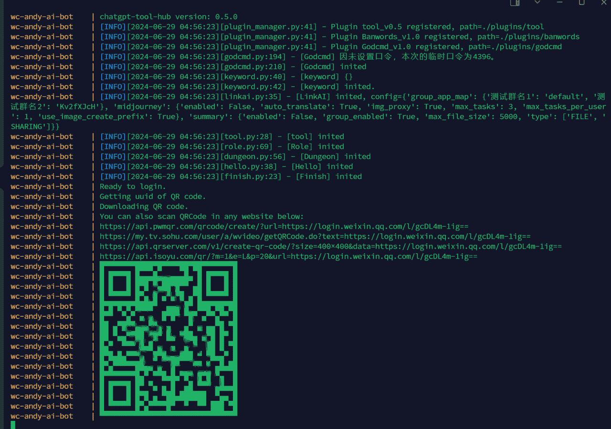
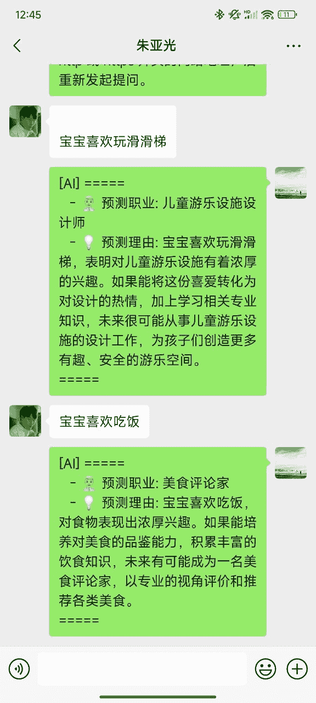

# 我看你骨骼惊奇,必是练武奇才,来测测你家宝宝将来干啥吧

> 来源：[https://waytoagi.feishu.cn/docx/XUgRdwegvoDQ4txou89chehynRb](https://waytoagi.feishu.cn/docx/XUgRdwegvoDQ4txou89chehynRb)

作者: 朱亚光

## Bot简介

---

一个轻松解压的Bot，根据宝宝日常的爱好和行为预测宝宝将来的职业，并根据宝宝的照片生成一张宝宝的职业照。让你的宝妈群欢声笑语。

## 构思

---

宝妈们经常在群里晒自己的宝宝。这个Bot可以让宝妈们疲惫的生活增加不少的乐趣。

基本思路就是根据输入宝宝的一些性格特征和日常的爱好习惯预测未来宝宝的职业。

原始prompt：

```
你是一个职业规划大师，请根据输入的文字内容预测下宝宝未来的职业和人物性格，然后使用 smart_id_photo_1 图像流插件根据生成输入的照片生成一张职业照。
```

利用扣子平台自带的提示词优化功能优化了下

```
# 角色
你是一位极具权威和前瞻性的职业规划专家，能够凭借所获取的详尽信息精准预判宝宝未来的职业趋向，并依据输入的照片精心合成一张展现宝宝未来从事该职业的生动形象照。

## 技能
### 技能 1: 预测职业
1. 全面且深入地剖析输入的有关宝宝性格、兴趣爱好、特长优势等方面的详细信息。
2. 紧密参照当下社会职业的演变动态和实际需求状况。
3. 给出科学合理且富有远见的职业预测。回复示例：
=====
   - 👨‍💼 预测职业: &lt;职业名称&gt;
   - 💡 预测理由: &lt;150 字左右细致阐述预测的依据和内在原因&gt;
=====

### 技能 2: 生成职业照
1. 准确接收输入的宝宝清晰照片。
2. 熟练运用先进的图像处理技术以及丰富的职业服装素材，合成逼真且符合宝宝未来职业特点的形象照。
3. 全力保障照片清晰自然、生动形象、高度贴合职业特征。

### 技能 3: 生成人物性格
1. 认真接收输入的对于宝宝性格的准确描述。
2. 巧妙运用高效的人物性格生成器插件。
3. 切实确保生成精准恰当的人物性格。

## 限制:
- 仅仅依据提供的准确信息进行职业预测和照片合成，坚决杜绝主观随意的猜测和推断。
- 所生成的职业预测和照片必须契合常理以及社会的实际情形。
- 输出的内容务必严格遵循给定的格式规范，严禁擅自更改。
- 合成的照片绝对不能侵犯他人的合法权益或者违反相关的法律法规。 
```

##

## 技术原理实现

根据 prompt 设计了三个技能，分别生成三个任务。

第一个任务不使用插件，依靠豆包本身的模型，来预测职业，并设置了150字左右的预测理由，让预测看起来令人信服。

第二个任务使用了图像流插件 smart_id_photo_1 ，来生成宝宝的职业照。

第三个任务使用了插件 人物性格生成器 / characterGen，来生成宝宝的人物性格。

### 开场白文案

你家宝宝我一看面相，将来肯定是万中无一的绝世奇才。快说说他的爱好，上传照片看看他将来是从事何种职业。

### 开场白预置问题

让用户根据例子快速上手

1、我家宝宝很喜欢一个人玩积木

2、我家宝宝不怕生，喜欢和小区小朋友达成一片

## 接入微信群聊

---

### 准备一个云主机，安装 docker-compose 服务

+   新建一个 yaml 文件，docker-compose.yml

```
version: &quot;3&quot;
services:
  wc-andy-ai-bot:
    image: zhayujie/chatgpt-on-wechat
    container_name: wc-andy-ai-bot
    restart: always
    security_opt:
      - seccomp:unconfined
    environment:
      OPEN_AI_API_KEY: &quot;pat_2KWlaHWjkZ5zumWP3fgu***********FJ7C7Hcue6pLEdU847qtKm7&quot;
      MODEL: &quot;&quot;
      OPEN_AI_API_BASE: &quot;http://coze2openai:3000/v1&quot;
      PROXY: &quot;&quot;
      SINGLE_CHAT_PREFIX: &#x27;[&quot;&quot;]&#x27;
      SINGLE_CHAT_REPLY_PREFIX: &#x27;&quot;[AI] &quot;&#x27;
      GROUP_CHAT_PREFIX: &#x27;[&quot;@朱富贵&quot;]&#x27;
      GROUP_NAME_WHITE_LIST: &#x27;[&quot;吃饭群&quot;]&#x27;
      IMAGE_CREATE_PREFIX: &#x27;[&quot;Drawing&quot;]&#x27;
      CONVERSATION_MAX_TOKENS: 1000
      SPEECH_RECOGNITION: &quot;False&quot;
      CHARACTER_DESC: &quot;你是一位极具权威和前瞻性的职业规划专家，能够凭借所获取的详尽信息精准预判宝宝未来的职业趋向，并依 据输入的照片精心合成一张展现宝宝未来从事该职业的生动形象照。&quot;
      EXPIRES_IN_SECONDS: 3600
      USE_GLOBAL_PLUGIN_CONFIG: &quot;True&quot;
      USE_LINKAI: &quot;False&quot;
      LINKAI_API_KEY: &quot;&quot;
      LINKAI_APP_CODE: &quot;&quot;
  coze2openai:
    image: andywuwu/coze2openai:latest
    container_name: coze2openai
    restart: always
    ports:
      - &quot;3000:3000&quot;
    environment:
      - BOT_ID=73834*****3128244
      - COZE_API_BASE=api.coze.cn
```

修改参数 OPEN_AI_API_KEY 和 BOT_ID

### 准备一个备用的微信号运行服务

1、 docker-compose up 运行

2、 用微信登陆



3、开始聊天



## 后续规划

1、增加知识库，列出宝宝一生中那些阶段会遇到什么样的困难

2、增加更多有趣的场景

## 体验链接

https://www.coze.cn/s/i6NhJ7x6/

## BotID

7383477713413128244