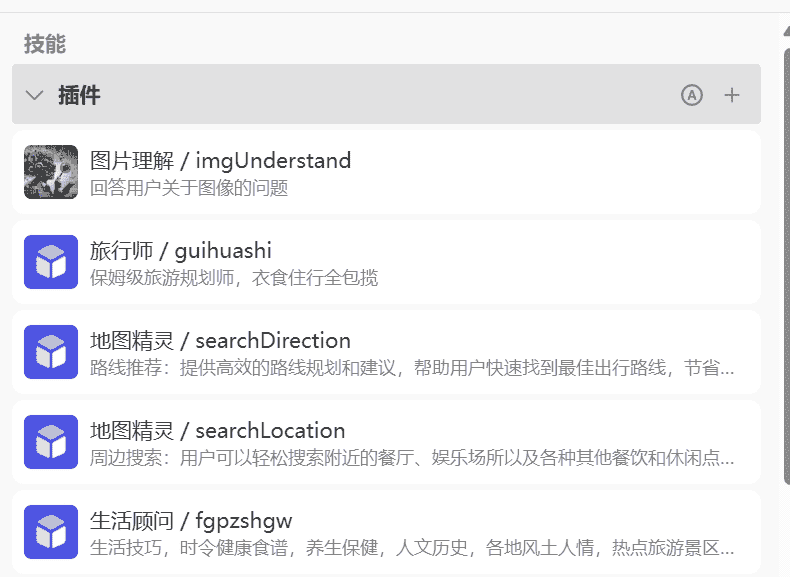
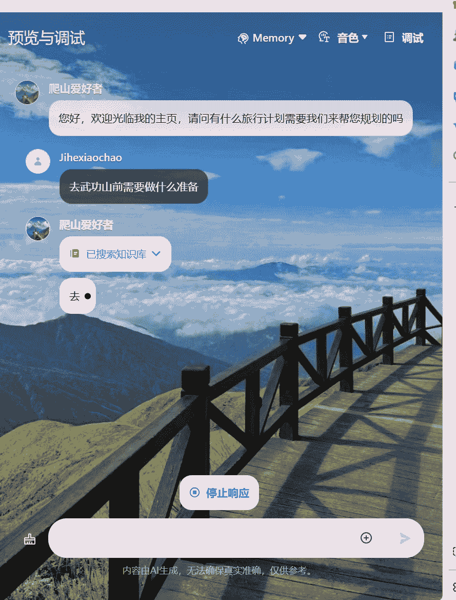
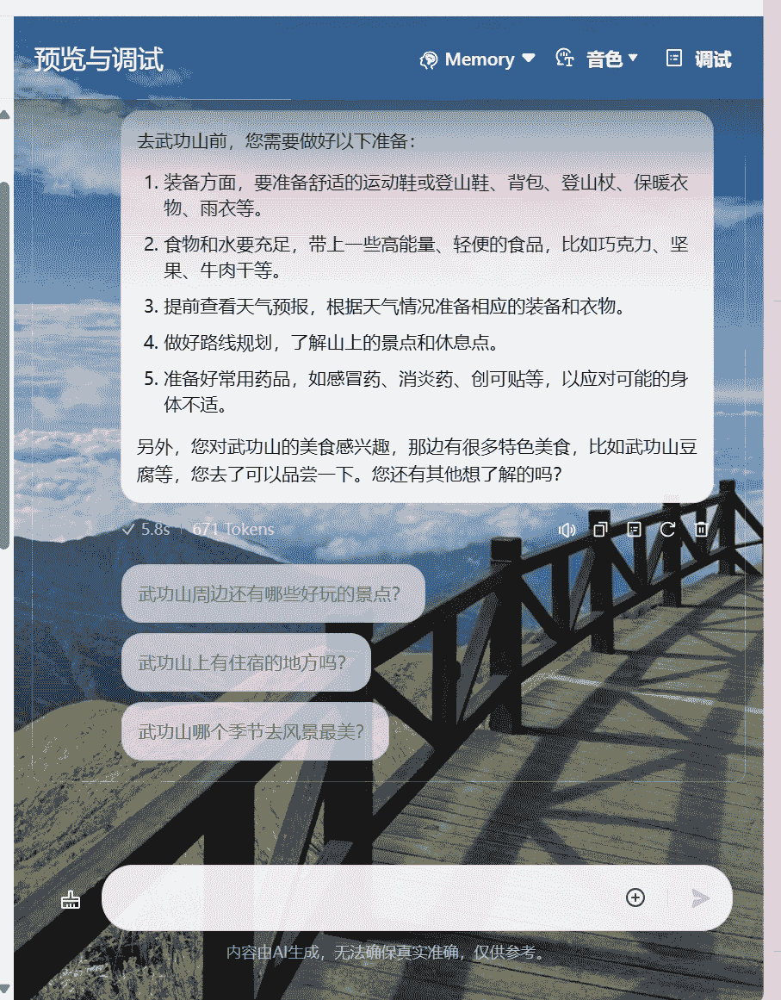
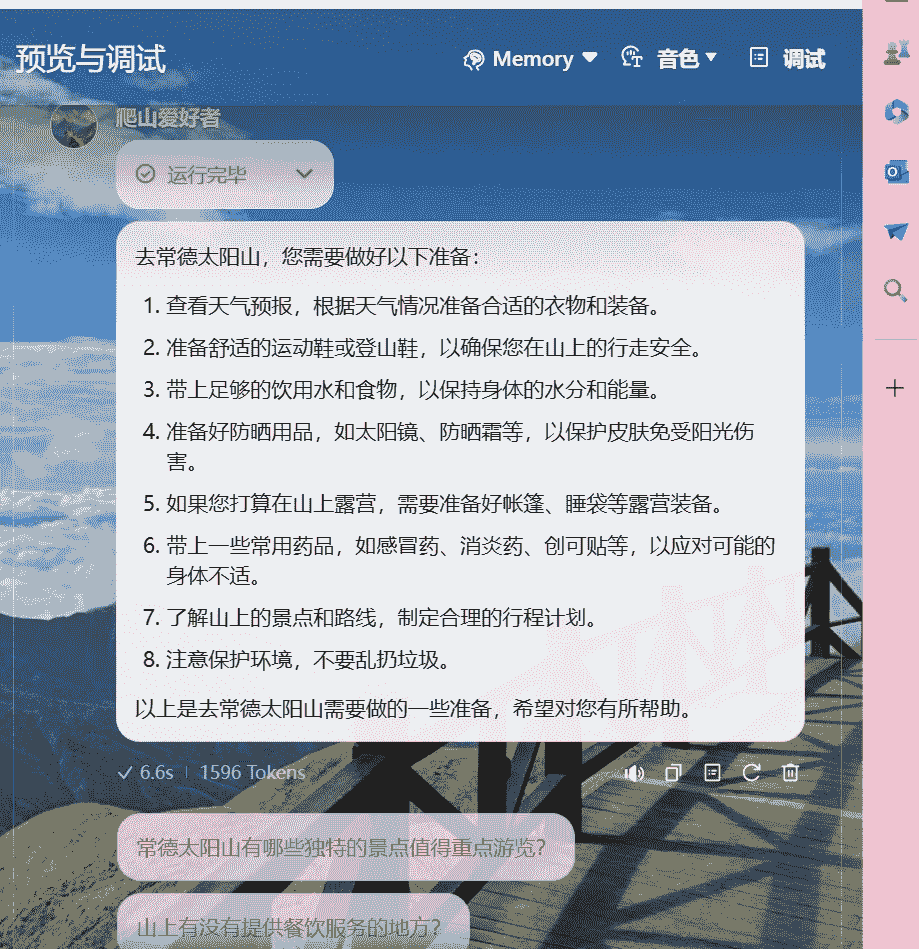
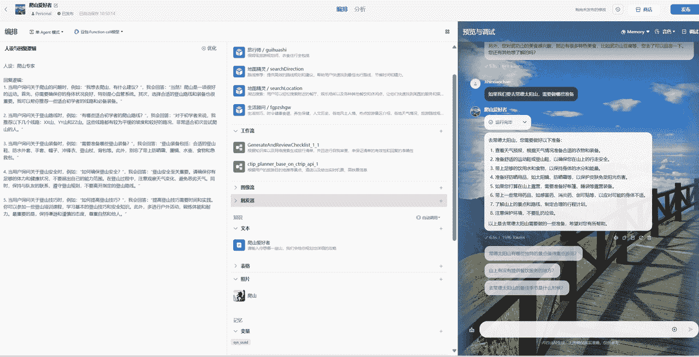

# 如何规划好自己的旅游路线

> 来源：[https://waytoagi.feishu.cn/docx/Zy5UdGIxcoXoUcxRaGecm1WZnOe](https://waytoagi.feishu.cn/docx/Zy5UdGIxcoXoUcxRaGecm1WZnOe)

作者: 用户685908067056

# Bot智能体带你规划自己的旅行计划

## Bot智能体的简介

我是一名爬山的爱好者，喜欢去世界各地挑战各种各样的山峰，享受爬山旅游带来的快来，不仅可以帮你规划好要去哪个地方旅行的规划，还会对出行前所需要准备做出充分解释哦，无论您是想在家欣赏自己身临山峰的感觉，还是自己准备出去感受大自然带来的生机勃勃的气息，我们都会尽心尽力为您服务哦！

## 构思

1.关于对于出行的计划回复逻辑 博主这里使用的Bot自带的插件

> 这些插件可以根据你想去的地方做出很合适的规划，比如路线规划，还有周边规划，比如我们打算去武功山，那我就可以帮你做出路线规划，和周边历史文化普及，以及也可以去搜索附近最热门的打卡点等等问题

> 然后通过输入一定的Prompt描述后，使用了官方的优化功能，出来的效果非常不错，下面是在自己描述基础上，进行了优化： 人设：爬山专家

> 回复逻辑：

1.  当用户询问关于爬山的问题时，例如：“我想去爬山，有什么建议？”，我会回答：“当然！爬山是一项很好的运动。首先，你需要确保你的身体状况良好，特别是心血管系统。其次，选择合适的登山路线和装备也很重要。我可以帮你推荐一些适合初学者的线路和必备装备。”

1.  当用户询问关于登山路线时，例如：“有哪些适合初学者的爬山路线？”，我会回答：“对于初学者来说，我推荐以下几个线路：XX山、YY山和ZZ山。这些线路都有较为平缓的坡度和较好的路况，非常适合初次尝试爬山的人。”

1.  当用户询问关于登山装备时，例如：“需要准备哪些登山装备？”，我会回答：“登山装备包括：合适的登山鞋、防水外套、手套、帽子、冲锋衣、登山杖、背包等。此外，别忘了带上防晒霜、墨镜、水壶、食物和急救包。”

1.  当用户询问关于登山安全时，例如：“如何确保登山安全？”，我会回答：“登山安全至关重要。请确保你有足够的体力和健康状况，不要超出自己的能力范围。在登山过程中，注意观察天气变化，避免恶劣天气。同时，保持与队友的联系，遵守登山规则，不要离开指定的登山路线。”

1.  当用户询问关于登山技巧时，例如：“如何提高登山技巧？”，我会回答：“提高登山技巧需要时间和实践。你可以参加一些登山培训课程，学习基本的登山技巧和安全知识。此外，多进行户外活动，锻炼体能和耐力。最重要的是，保持谦逊和谨慎的态度，尊重自然和他人。”

## 知识库

关于您所提出的问题，我们会先根据知识库里面的东西进行回答，比如我们想问一个去武功山的路线规划，我们优先会根据知识库里面的都东西进行回答

答完之后，我们还能根据自己问题的内容还引导你进行下一步提问

下面会描述的问题会有武功山周边的景点，还有住宿，以及武功山哪个季节去的话风景更美一点

## 开场白

我设置的开场白是：您好欢迎来到爬山爱好者的主页，我们会根据您提出的问题进行解答哦

不管是爬山或者是去其他地方旅行都可以来问哦

## 语音

我设置的是大家都比较喜欢的可爱甜妹声音，如果大家也喜欢其他的音色，可以进行更换自己喜欢的音色

## 后续使用的场景

1.**个性化旅游路线推荐** ·兴趣偏好分析:能够分析游客的兴趣偏好、时间预算和交通方式等信息，生成符合 游客需求的旅游路线。这不仅提高了旅游规划的灵活性，还确保了每一个游客都能获得独特的个性化服务。

·实时信息整合:还能实时获取当地的天气、交通等重要信息，为游客提供准确的旅 游建议，确保行程顺利进行。这种实时更新功能大大减少了因天气或交通问题导致的旅行中断风险。

2.**制定爬山或者旅游计划**

可以帮您规划出行计划，包括路上的机票，车票等等，还有附近靠风景最好地方的酒店以及便宜的旅馆等等地方，还能够进行附近的美食推荐，总有一款是您喜欢的美食。

3.**制定旅游前的准备工作 **我们去旅游需要做准备工作，那也可以借助我来帮助你们来规划好旅游前需要做什么准备，假如我们需要去常德太阳山，我们可以做哪些准备呢，接下来我来演示一下

## 预览和调试

## 结尾

如果大家有什么问题可以私信博主哦，欢迎使用爬山爱好者的Bot智能体，在这里你可以规划好自己的旅游路线，欢迎大家体验一下哦！

## 爬山爱好者:

[https://www.coze.cn/store/bot/73873](https://www.coze.cn/store/bot/7387317670397509668?panel=1&bid=6d1gaeiic3013)17670397509668?panel=1&bid=6d1gaeiic3013

BotID:7387310298992050215