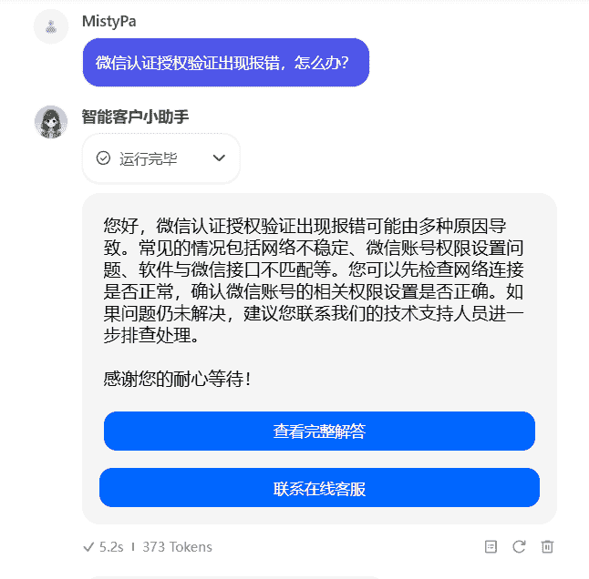
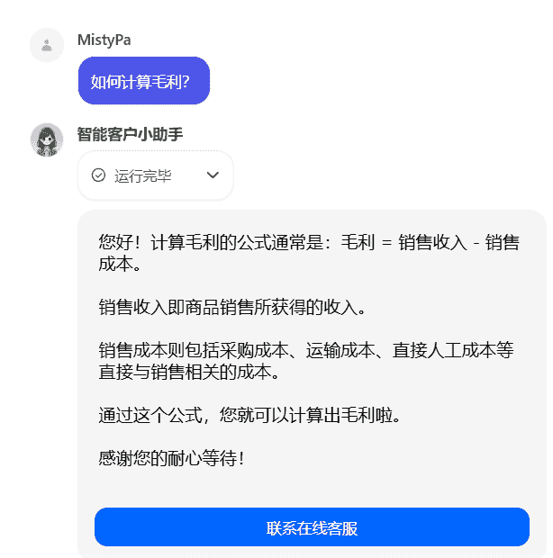
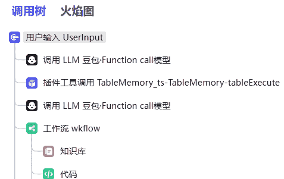
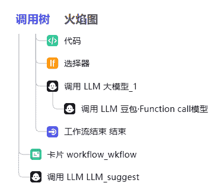

# 智能客服助手|基于扣子应用开发平台的解决方案

> 来源：[https://waytoagi.feishu.cn/docx/BKC4dzAoIoCw9HxpJlJcQZhknW0](https://waytoagi.feishu.cn/docx/BKC4dzAoIoCw9HxpJlJcQZhknW0)

用户: 用户6853839742902

### 一、背景

随着人工智能技术的飞速发展，智能客服系统逐渐成为企业提升服务质量和客户满意度的重要工具。本文想和大家分享的一款智能客服Bot，名字叫“智能客服助手”。接下来，我会从它的简介、构思、技术实现原理到未来的使用场景和商业化前景，带大家全面了解这个作品。

### 二、Bot简介

智能客服助手是一款旨在为用户提供高效、问题解答的智能客服系统。其主要功能是基于企业沉淀的私有知识库以及先进的大模型技术，为用户咨询的产品问题提供即时解答。同时，用户可以通过点击”查看详情”按钮获取问题详情，或点击“联系在线客服”按钮寻求人工帮助。这种双重保障机制既提高了问题解答的效率，又保证了用户体验的全面性。

匹配不上企业知识，不出现【查看完整解答】

### 三、搭建思路

智能客服助手的核心构思在于利用企业已有的知识积累，结合大模型的强大能力，为用户提供准确且简洁的答案。具体而言，通过创建一个企业私有知识库，收录企业过去的问答记录和资料，再利用大模型对用户咨询的问题进行处理，确保回答的准确性和一致性，还能在必要时提供原回答的完整版，以满足用户的深度需求。

这一思路的另一个关键点是对接人工客服。在智能助手无法解决用户问题时，用户可以快速转接到人工客服，确保问题的及时解决。这种人机结合的模式，有助于提升整体服务质量和客户满意度。

### 四、关键技术实现说明

智能客服助手的实现依赖于一套工作流，主要包括以下几个工作节点：

调用树图-1

调用树图-2

1.  知识库导入：首先，将企业已有的资料和历史问答记录导入私有知识库。这个知识库是智能助手提供高质量回答的基础。

1.  代码节点：在用户咨询问题时，首先判断该问题是否已被收录在企业资料中。如果问题在知识库中有记录，则直接调用相关答案。

1.  选择器节点：根据判断结果，确定工作流的走向。如果问题已被收录，则进入总结和提炼阶段；否则，基于互联网资料进行总结和提炼。

1.  大模型总结和提炼：利用大模型对知识库中的相关内容进行总结和提炼，确保回答的精简和准确。同时，如果没有相关记录，则利用互联网资料进行处理，提供最接近的答案。

1.  数据库节点：将每一次用户咨询和系统的回答存入数据库，形成新的知识积累，方便后续查看，为企业产品的不断优化提供数据支持。

1.  文本处理节点：使用特定的连接符将回答内容进行链接，保证回答的连贯性和完整性。

### 五、后续使用场景及商业化前景

1.  企业客服中心：智能客服助手可以广泛应用于各类企业客服中心，特别是那些需要处理大量客户咨询的行业，如电商、金融、通信等。通过利用大模型的强大自然语言处理能力，智能客服助手能够理解和处理更加复杂的问题，提高客服效率，减少人工成本。

1.  电商平台：在电商平台上，智能客服助手可以帮助用户快速了解产品信息、解决售前售后问题，提升客户满意度和购买转化率。大模型的持续学习能力能够根据用户行为和反馈，不断优化回答内容和方式，提供更加个性化和精准的服务。

1.  互联网服务公司：对于提供在线服务的公司，如软件开发、在线教育等，智能客服助手可以帮助用户解决常见问题，减轻人工客服的负担。利用大模型的文本生成和理解能力，智能客服助手可以生成详细的技术文档、故障排除指南等，大大提高客户服务的效率和质量。

1.  金融机构：在银行、保险等金融机构，智能客服助手可以帮助客户了解产品细节、处理常见问题，提高服务质量和客户体验。通过分析用户历史数据和咨询内容，智能客服助手还能预测用户需求，提供定制化的服务和产品推荐，提升客户体验。

### 六、BotID

BotID： 7385741163082645531