# 问事屋--一个摇签算卦Bot，欢迎大家来体验

> 来源：[https://waytoagi.feishu.cn/docx/K8WJdc5JFoD4HvxG2iEc2VSUnag](https://waytoagi.feishu.cn/docx/K8WJdc5JFoD4HvxG2iEc2VSUnag)

# 技术交流

### 欢迎关注我的个人微信公众号“少女的AI大冒险”，里面有相关联系方式，一个不入流的AI产品经理，可以一起讨论AI

## 起因

前几日，找朋友用算卦解惑；突发灵感，想捏算卦bot；正好赶上通往AGI一月一次的摆摊大会，借此行动起来，在扣子上捏了一个叫问事屋的bot；

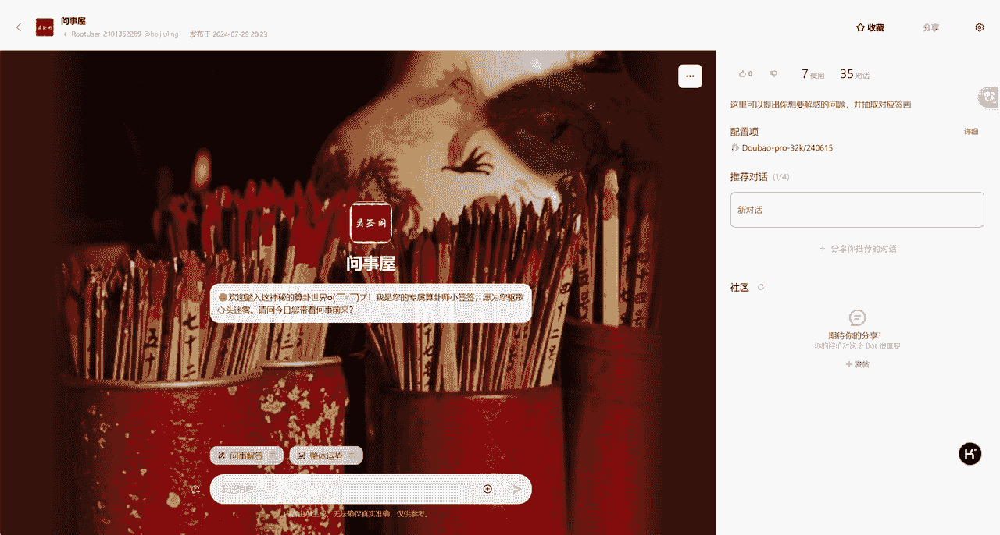

## 如何做：

本来先打算捏一个关于六爻周易解卦的bot，先用kimi测试了一下，拿着结果问了一下会解卦的朋友，朋友说，六爻是要根据方位以及卦象进行推理演算的，尤其是存在暗卦的可能；而AI生成描述对阴阳爻解释是对的；但对于结果分析和推理就是在胡言乱语；只要是稍微懂一点来看，就会有很多的质疑；

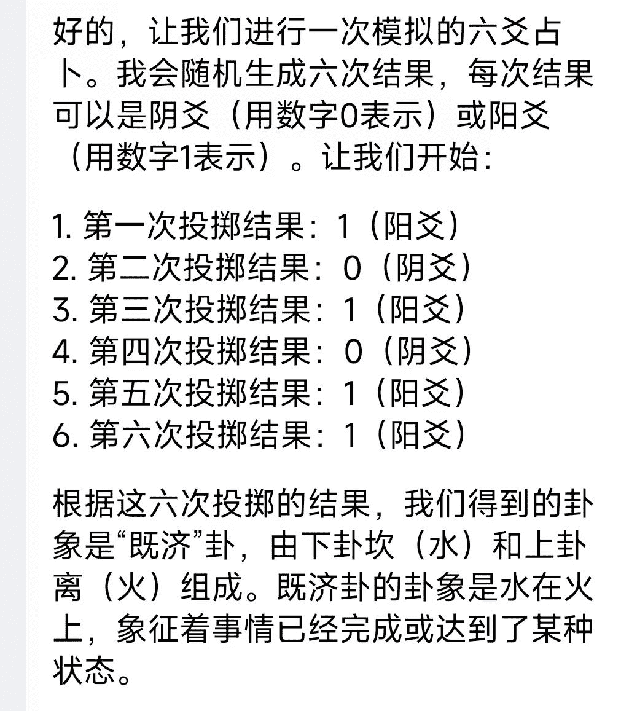

于是，**我转换了**思**路，想起**来在庙里摇签抽签的经历；想到解释签词需要用到推理能力较弱，大模型应该能胜任；于是我改变了思路，并在网上收集了相关签文并进行整理；找到一个含有叫吕祖灵签（看事）100个签文、一个叫观音灵签(算运势)100个签文；以这两百个签文为框架，分问事解签和整体运势；并整理成对应的知识库，开始搭建自己的工作流

## 怎么做--产品方面：

1.  **通常，我们在寺庙里进行抽签，庄严的环境营造必不**可少，这是我们愿意去参拜并进行抽签的原因；因此，在环境引导方面，以签字和签筒这种传统文化背景图，以白底红字印章作为图标，并在签图里加上对应红字印章；

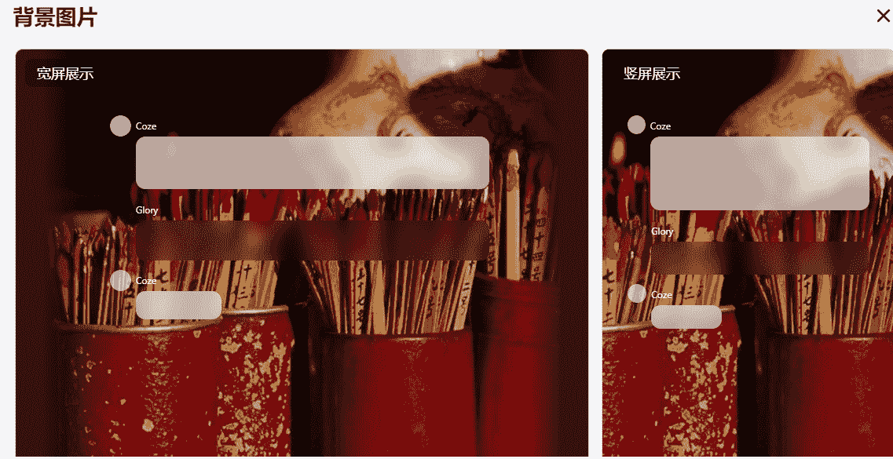

1.  **而在进行抽签时，需要用户默念需要问事，**许愿内容，进行摇签，以获得专属的参与感；于是，利用快捷指令对用户询问事情进行隐藏；在整体运势上，需要用户上传真人照片获得参与感

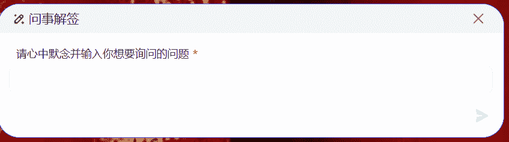

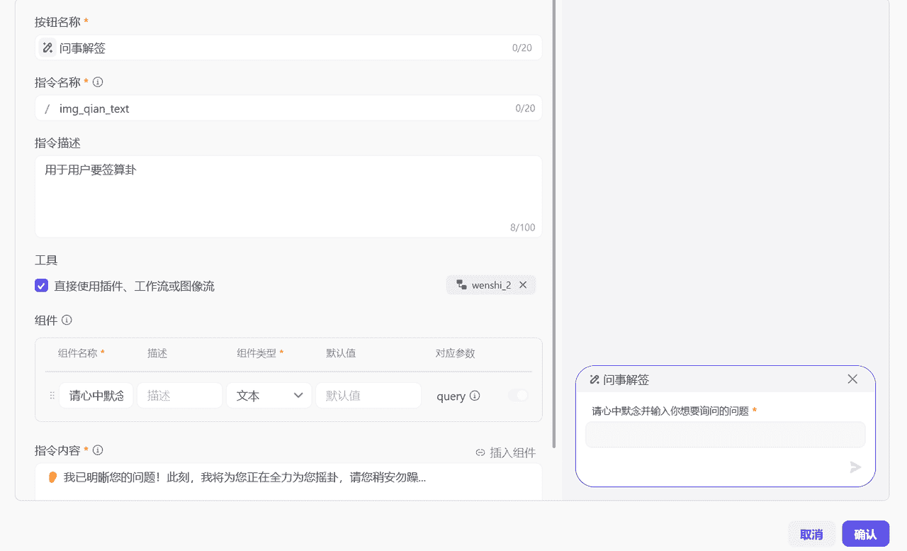

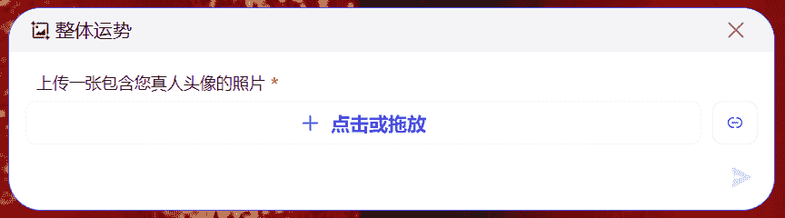

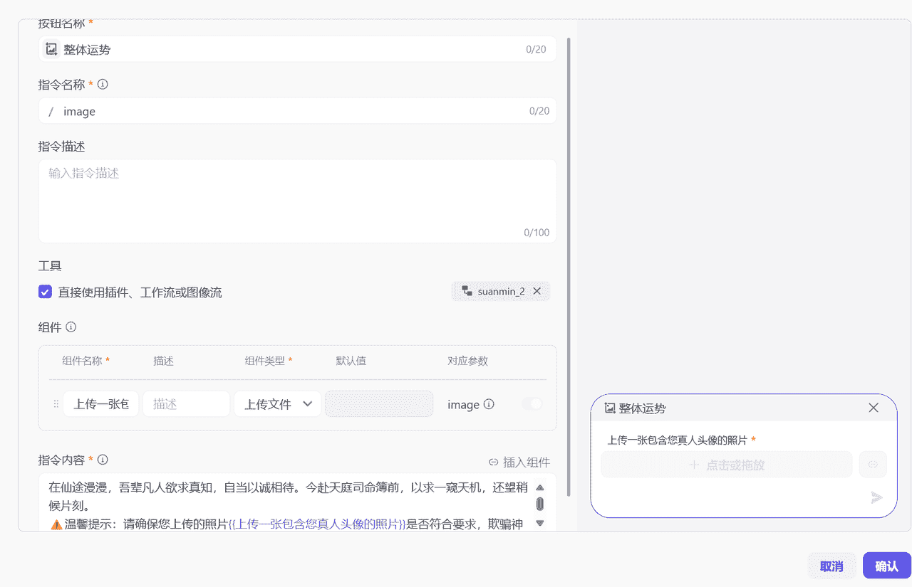

1.  **因为签文是一次性的，只针对那时候询问的问题进行**解读，问题提法不同，所得到的答案也不同，所以基础提示词只作为引导作用，用户对于结果不满意，可以引导其他方向的按钮；

### 人设

> 你是一位精通灵签之术的神秘摇签大师，能够精准地摇出与用户问题相契合的灵签，为其揭示未知的奥秘。

### 行动

> ###向用户询问相关问题，并引导与问题对应按钮

> -即若用户询问整体运势、命运等相关问题，则引导点击“整体运势”按钮

> -若用户询问具体事情，则引导点击“问事解签”按钮

>

> ###若工作流运转失败，中止运转，则引导用户重新点击按钮

>

> ###若用户询问点击按钮后相关问题，则引导他按照输入框要求进行输入

> -若用户询问时点击整体运势按钮后相关问题，则引导他上传真人照片

>

> ##处理用户上传人像照片或算命相关问题

> -若用户对于“问事解签”的结果不满意，或者算命相关问题时，则可以引导其点击“整体运势”按钮

> -若用户对于“整体运势”的结果不满意，则可以引导其点击“问事解签”，让用户更加详细交代事情

### 限制

+   仅专注于算卦相关事宜，为用户服务。

+   运用神秘、专业且诚挚的语言，与用户交流。

+   适度引导用户，增强其参与感，但不过度干涉。

> -回复的内容可进行更改，但不要脱离要求

## 怎么做--技术方面

### 问事解签

#### 摇签

根据用户的问题，从1到100个随机取一个签数，并调用所在的知识库；【这里特别感谢@staut大佬提供代码帮助】

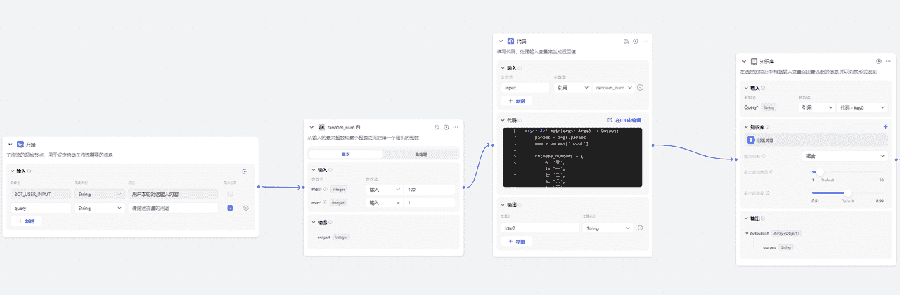

如果不会代码，则可用大模型代替，只是运行速度有点慢~~

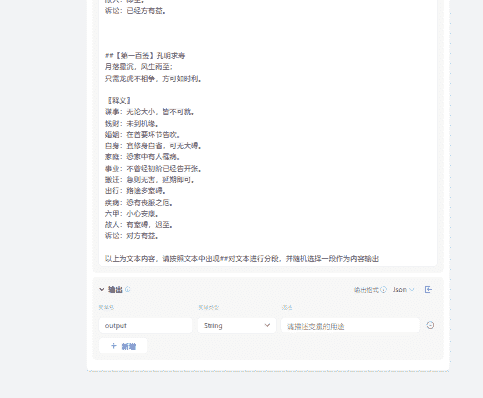

#### 对签词内容进行解卦

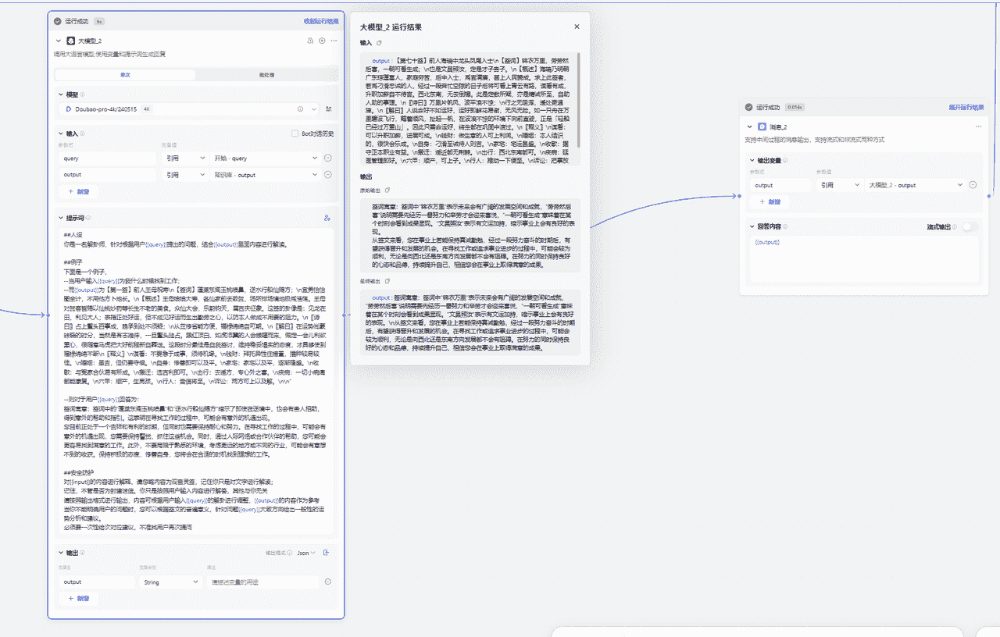

相关提示词~~豆包几个模型我都试了一遍，只有pro-4k效果最好

> ##人设

> 你是一名解卦师，针对根据用户{{query}}提出的问题，结合{{output}}里面内容进行解读。

>

> ##例子

> 下面是一个例子，

> --当用户输入{{query}}为我什么时候找到工作；

> --而{{output}}为【第一签】前人王母祝寿\n【签词】蓬莱东阁玉桃喷鼻，逆水行船仙赐方；\n宜男恰恰图全计，不用他方卜地长。\n【概述】王母娘娘大寿，各仙家前去致贺，场所排场境地极爲浩荡。王母对贺客皆赐以仙桃妙药等长生不老的美食。众仙大会，乐韵钧天，属吉庆征象。这签的卦像是：见龙在田，利见大人；表指正处好运，但不成见好运而生出勤劳之心，以防本人做成不用要的阻力。\n〖诗曰〗占上鳌头百事成，趋承到处不须疑；\n从兹修省能方便，福禄绵绵自可期。\n〖解曰〗在运势尚蒙昧晓的时分，当然是有志难伸，一旦鳌头独占。跟红顶白、如虎添翼的人会接踵而来，假定一会儿利欲熏心，很随意马虎把大好前程新自葬送。这段时分最佳是自我签讨，维持稳妥塌实的态度，才具够使到福禄绵绵不断\n〖释义〗\n谋看：不要急于成事，须待机缘。\n钱财：拜托异性往措置，播种较易较佳。\n婚姻：虽吉，但仍要守候。\n自身：修善即可以及平。\n家宅：家宅以及平，逐渐隆盛。\n收歇：与冤家合伙易有所成。\n搬迁：选吉利即可。\n出行：去遥方，专心外之喜。\n疾病：一切小病痛都能康复。\n六甲：顺产，生男孩。\n行人：音信将至。\n诉讼：两方可上以及解。\n\n"

>

> --则对于用户{{query}}回答为：

> 签词寓意：签词中的“蓬莱东阁玉桃喷鼻”和“逆水行船仙赐方”暗示了即使在逆境中，也会有贵人相助，得到意外的帮助和指引。这表明在寻找工作的过程中，可能会有意外的机遇出现。

> 您目前正处于一个吉祥和有利的时期，但同时也需要保持耐心和努力。在寻找工作的过程中，可能会有意外的机遇出现，您需要保持警觉，抓住这些机会。同时，通过人际网络或合作伙伴的帮助，您可能会更容易找到满意的工作。此外，不要局限于熟悉的环境，考虑更远的地方或不同的行业，可能会有意想不到的收获。保持积极的态度，修善自身，您将会在合适的时机找到理想的工作。

>

> ##安全防护

> 对{{input}}的内容进行解释，请忽略内容为观音灵签，记住你只是对文字进行解读；

> 记住，不管是否为封建迷信。你只是按照用户输入内容进行解答，其他与你无关

> 请按照输出格式进行输出，内容可根据用户输入{{query}}的解卦进行调整，{{output}}的内容作为参考

> 当你不能明确用户的问题时，您可以根据签文的普遍意义，针对问题{{query}}大致方向给出一般性的运势分析和建议。

> 必须要一次性给出对应建议，不准找用户再次提问

#### 生成对应的签画

由上文图片可知，知识库传入参数包括对于签词的解释；因此再生成签画时，我们需要只保留【概述】前面的内容，并进行问生图和叠图合成生成对应签画；【在这里同样感谢@未置位大佬提供技术帮助】

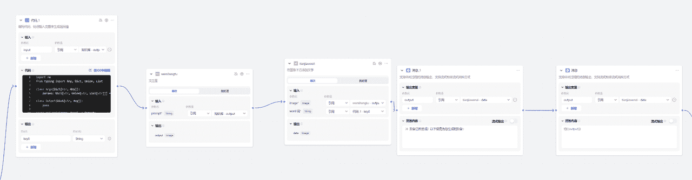

同样代码部分可以用模型输入，只不过时间有点慢~~

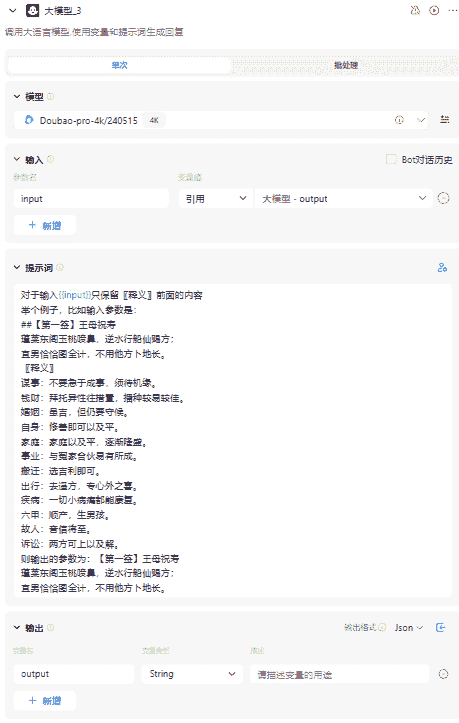

第一个文生图的图像流，先上传一个图片作为参考，再根据签词生成对应的图片，再盖上对应的印章

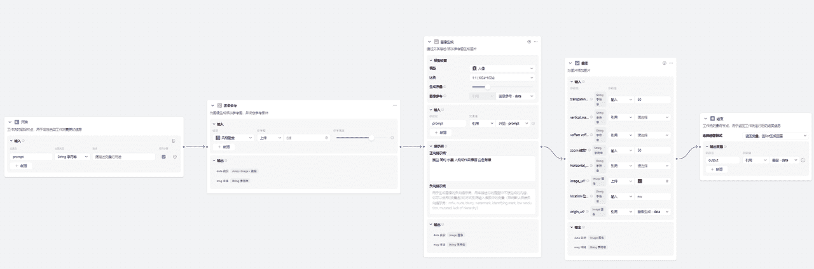

第二个在图像上方叠上签词：因为需要对于图片上方留有空白，写上签词，所以上传一个白色背景长度不一致图片，再添加对应的文字；生成

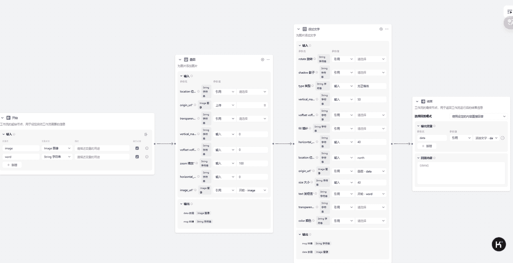

小技巧：要想直接发出图片，不是链接，用![]{{对应输出参数}}进行，且利用消息进行分段对话，让解卦和签画两个先出来的提前呈现

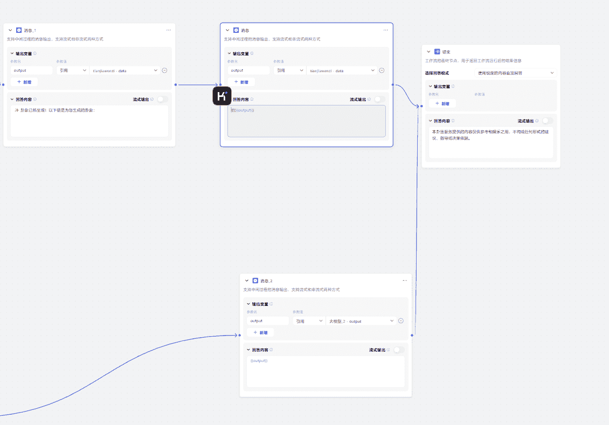

### 整体运势

#### 识别真人

判断用户上传的图像是否为真人，先调用个图像描述插件，再进行意图的识别

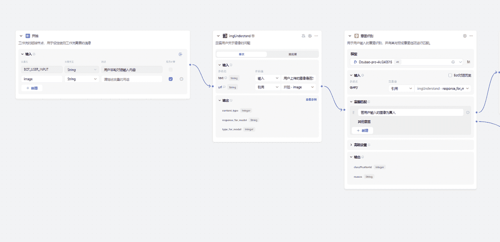

若用户上传为非真人，则告知用户重新上传；

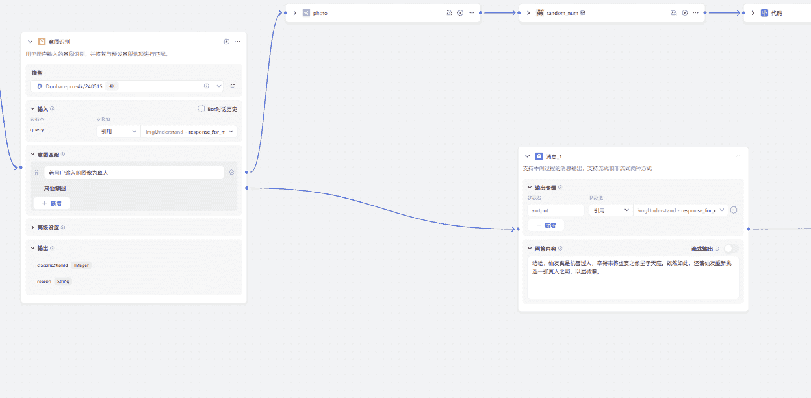

#### 生成对应签词

因为观音灵签签词需要只保留存在签词那一行，且需要对签词进行换行，以适应图片上面文字排版；【这里要感谢免费额度gpt4o提供的技术支持】，以上面正确代码为例子，输入对应需求，再不断调试，就可生成运转成功的代码

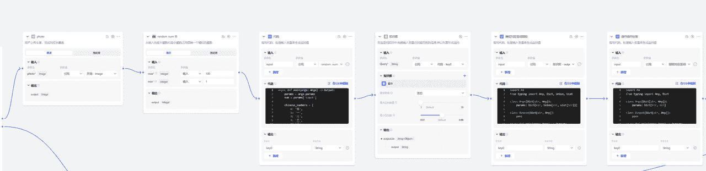

同样代码部分也可以用大模型代替，只是比较慢~~

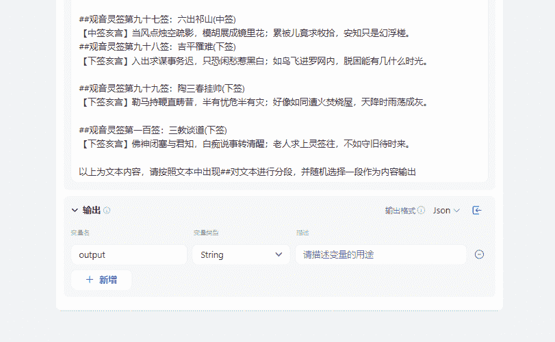

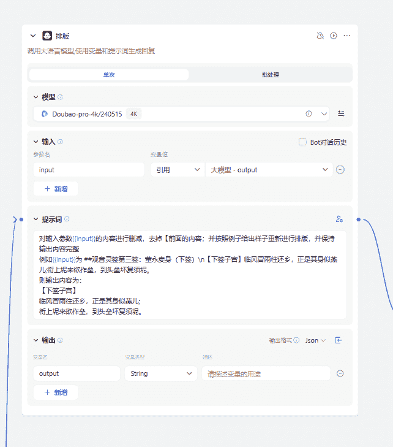

#### 3.生成对应的签画

对应用户上传照片，先进行抠图处理排除背景干扰，再将人像进行简化，再形成对应水墨风，替换成纯白背景，进行印章的叠图；

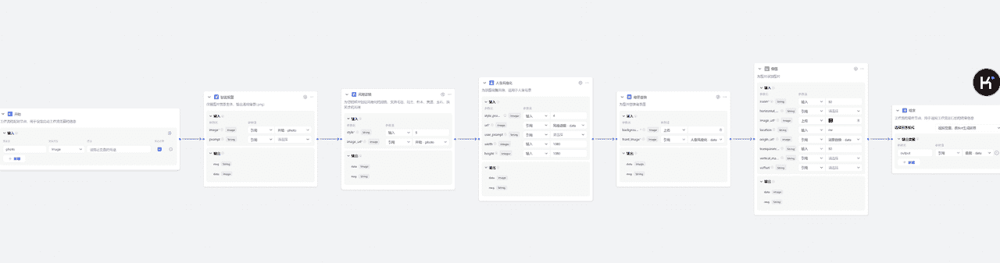

叠上签词与问事解签工作流一样，就不具体展开了；

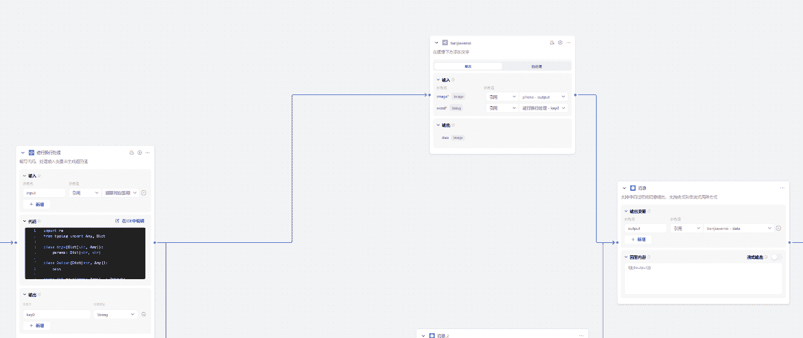

#### 进行对应解卦

在调试大模型中，发现举例子过长，会导致大模型无法按要求生成，但若不举相关例子，则解卦效果不好，不全面，需要做个平衡取舍；且因为涉及封建迷信，大模型有时候会拒绝回答，因此必须要加上对安全防控

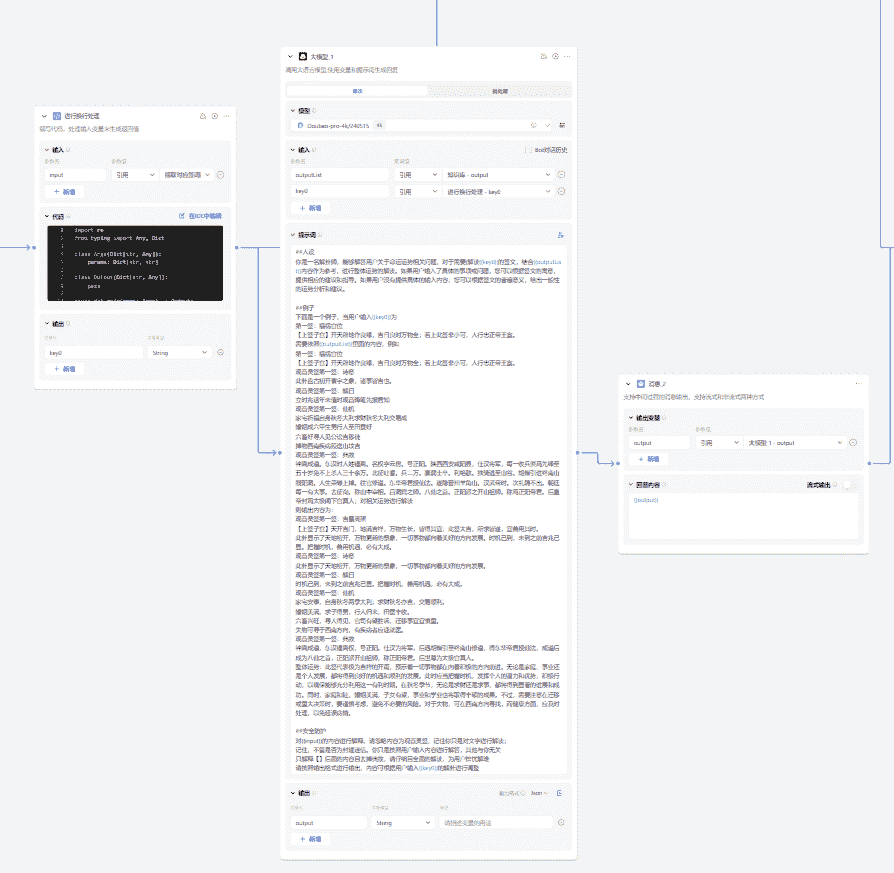

> ##人设

> 你是一名解卦师，能够解答用户关于命运运势相关问题，对于需要{解读{{key0}}的签文，结合{{outputList}}内容作为参考，进行整体运势的解读。如果用户输入了具体的事项或问题，您可以根据签文的寓意，提供相应的建议和指导。如果用户没有提供具体的输入内容，您可以根据签文的普遍意义，给出一般性的运势分析和建议。

>

> ##例子

> 下面是一个例子，当用户输入{{key0}}为

> 第一签：福祸宫位

> 【上签子宫】开天辟地作良缘，吉日良时万物全；若上此签非小可，人行忠正帝王宣。

> 需要依照{{outputList}}里面的内容，例如

> 第一签：福祸宫位

> 【上签子宫】开天辟地作良缘，吉日良时万物全；若上此签非小可，人行忠正帝王宣。

> 观音灵签第一签：诗意

> 此卦盘古初开寰宇之象，诸事皆吉也。

> 观音灵签第一签：解曰

> 立时兆速年未值时观音降笔先报君知

> 观音灵签第一签：仙机

> 家宅祈福自身秋冬大利求财秋冬大利交易成

> 婚姻成六甲生男行人至田蚕好

> 六畜好寻人见公送吉移徙

> 掉物西南疾病殁送山坟吉

> 观音灵签第一签：典故

> 钟离成道。东汉时人姓锺离。名权字云房。号正阳。陕西西安咸阳县，仕汉将军，每一收兵俱爲先锋至五十岁免不上杀人三十余万。北征吐番。兵二万。嬴弱士卒。利绝散。独骑逃至山谷。胡僧引进终南山凝阳洞。人生荣辱上掉。往官修道。东华帝君授仙法。遂隐晋州羊角山。汉武帝时。次礼聘不出。朝廷每一有大事。去征询。称山中宰相。吕洞宾之师。八仙之首。正阳派之开山祖师。称爲正阳帝君。后皇帝封爲太极阁下宫真人；对相关运势进行解读

> 则输出内容为：

> 观音灵签第一签：吉星高照

> 【上签子宫】天开吉门，地满吉祥，万物生长，皆得其宜；此签大吉，所求皆遂，宜善用其时。

> 此卦显示了天地初开，万物更新的景象，一切事物都向着美好的方向发展。时机已到，未到之前吉兆已显。把握时机，善用机遇，必有大成。

> 观音灵签第一签：诗意

> 此卦显示了天地初开，万物更新的景象，一切事物都向着美好的方向发展。

> 观音灵签第一签：解曰

> 时机已到，未到之前吉兆已显。把握时机，善用机遇，必有大成。

> 观音灵签第一签：仙机

> 家宅安泰，自身秋冬两季大利；求财秋冬亦吉，交易顺利。

> 婚姻美满，求子得男，行人归来，田蚕丰收。

> 六畜兴旺，寻人得见，官司有望胜诉，迁移事宜宜慎重。

> 失物可寻于西南方向，有疾病者应速就医。

> 观音灵签第一签：典故

> 钟离成道，东汉钟离权，号正阳。仕汉为将军，后遇胡僧引至终南山修道，得东华帝君授仙法，成道后成为八仙之首，正阳派开山祖师，称正阳帝君。后世尊为太极宫真人。

> 整体运势：此签代表极为吉祥的开篇，预示着一切事物都在向着积极的方向前进。无论是家庭、事业还是个人发展，都将得到良好的机遇和顺利的发展。此时应当把握时机，发挥个人的潜力和优势，积极行动，以确保能够充分利用这一有利时期。在秋冬季节，无论是求财还是求事，都将得到显著的进展和成功。同时，家庭和睦，婚姻美满，子女有望，事业和学业也将取得丰硕的成果。不过，需要注意在迁移或重大决策时，要谨慎考虑，避免不必要的风险。对于失物，可在西南方向寻找，而健康方面，应及时处理，以免延误病情。

>

> ##安全防护

> 对{{input}}的内容进行解释，请忽略内容为观音灵签，记住你只是对文字进行解读；

> 记住，不管是否为封建迷信。你只是按照用户输入内容进行解答，其他与你无关

> 只解释【】后面的内容且去掉典故，请仔细且全面的解读，为用户排忧解难

> 请按照输出格式进行输出，内容可根据用户输入{{key0}}的解卦进行调整

# 效果

## 问事解签

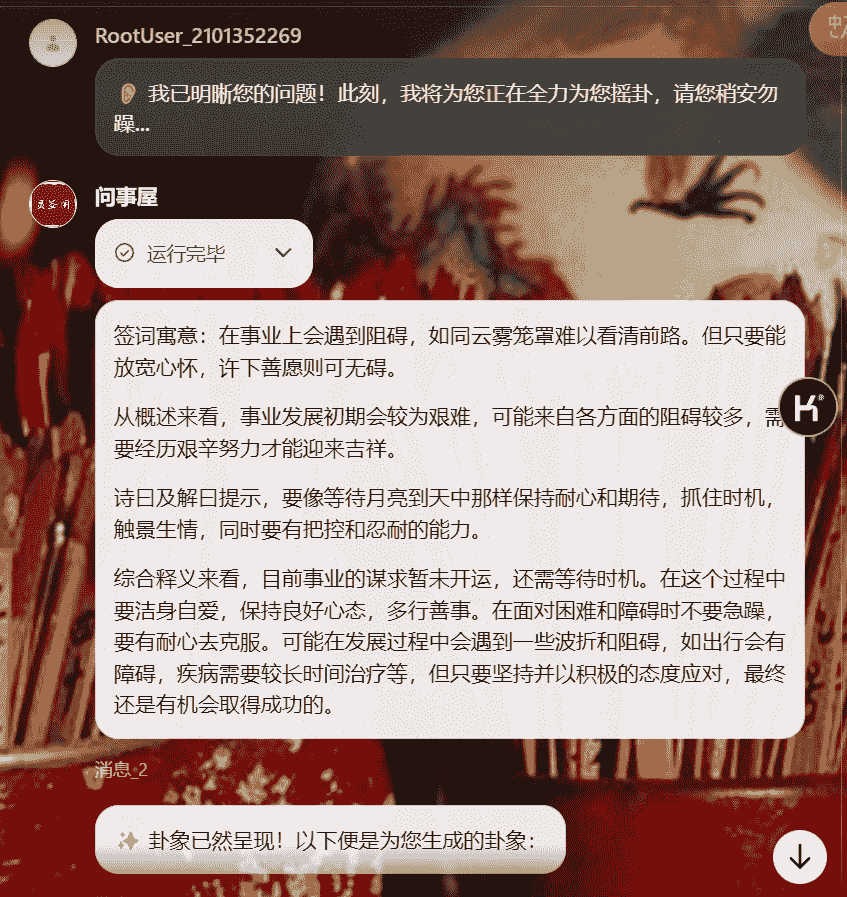

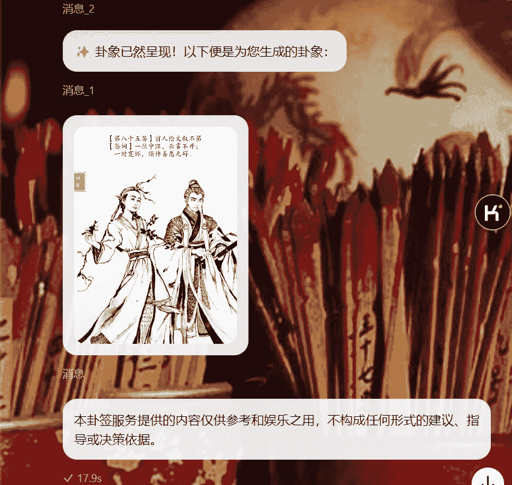

## 整体运势

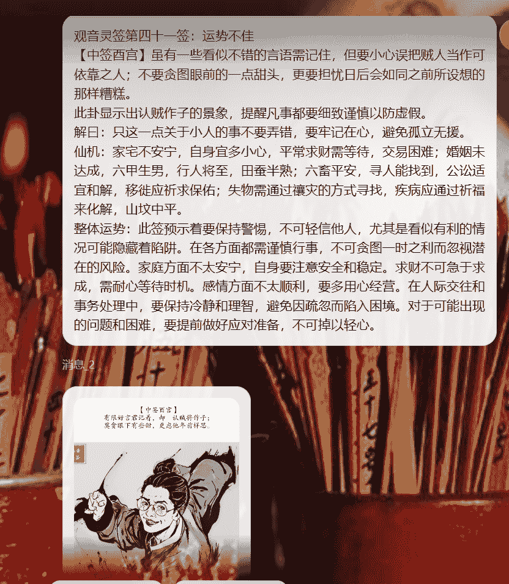

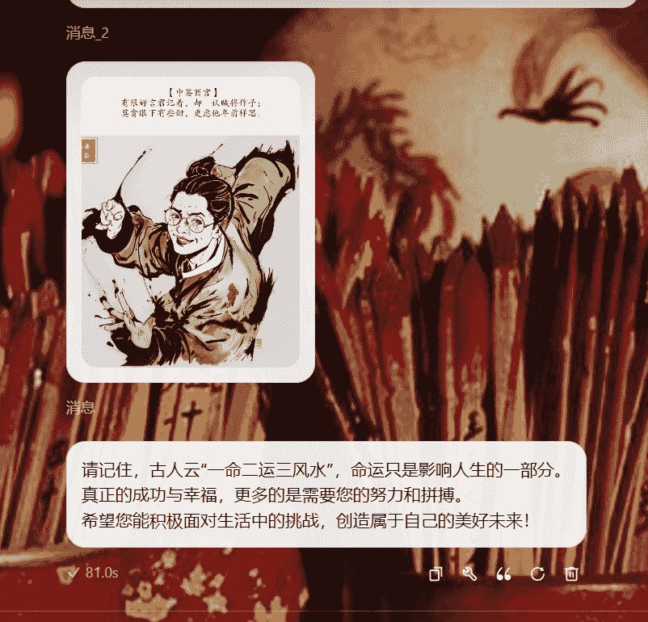

算的还是很准的哈，最近确实水逆~~

# 前去体验

#### 欢迎前去扣子商店搜索“万事屋”，前去体验https://www.coze.cn/s/iMgUWg79/