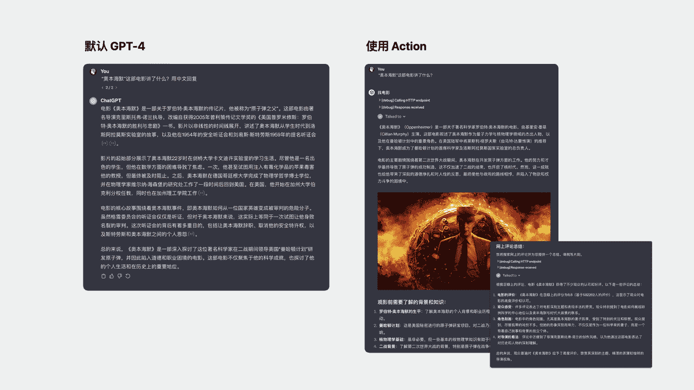
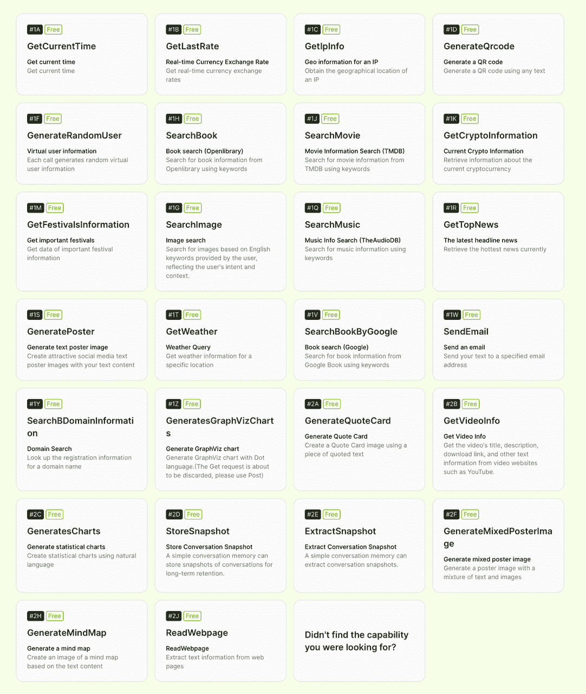
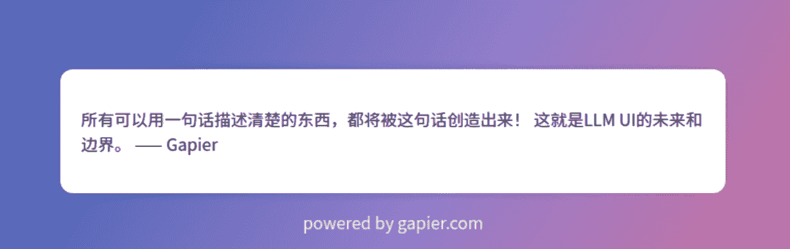
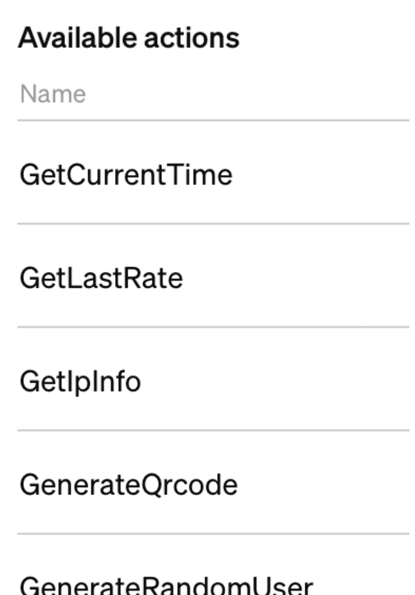
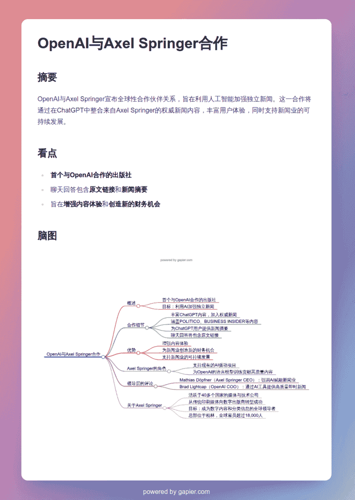

# 教程：自定义Action 的运用

> 来源：[https://waytoagi.feishu.cn/docx/ZCphd1u28ofaLHx9xQ2cebcKn0f](https://waytoagi.feishu.cn/docx/ZCphd1u28ofaLHx9xQ2cebcKn0f)

GPTs 已经上线两个多月了，在这期间里，数以万计的 GPTs 不断的涌现。

但无论是国内还是国外的开发者都存有同一共识：真正不同的 GPT 来自对 自定义Action 的运用。

单纯基于 GPT-4 构建的 GPTs 很容易同质化，而借助 Action 获取外部数据和信息的 GPTs 将可以发挥出更大的作用。

###

#### 跟着文章练习

[从基础到实践，学习使用 GPT 的 Action](https://s3zo40hh6a.feishu.cn/docx/HUcjdH5HXoPsvUxcqXXchkdenic?from=from_copylink)果你还不会使用 Action，你可以跟着这个文章进行练习：

1月5日的直播回放：LongTalk：聊聊 GPTs 动手实验室-飞书直播

#### 观看视频练习

观看下这个影片快速体验学习：

> 用gapier创作与众不同的GPTs应用

**如果你还没有**灵感，可以体验下这个 gapier 的官方引导 GPTs：https://chat.openai.com/g/g-WwGo4PIgk

####

#### 寻找更多 Action

你可以在🌈 通[**往AGI之路 **](https://waytoagi.feishu.cn/wiki/IawKwd3IgiHbezkB1KrcAFPRnbf?table=tblV9egSSGmG8BMy&view=vew5W4gOVJ)- 入**门：GPTs **- 进**阶：自定义 Action **找到更多

但是，去哪里可以找到适合刚入门的开发者来快速练习 Action 呢？

有一个产品可以做到：**gapier，**只需要1分钟配置，你就可以让你的 GPTs 支持调用几十种不同的 Action。

---

### 小知识探讨

杨轲Yangke:

> 小知识：使用Actions的时候，如何精准的让GPT知道你的意图？

> 最稳定是官方的测试工具里面的句式：Call the a.gapier.com APl with the GenerateMindMap operation

> 翻译过来就是： 调用 a.gapier.com APl 的 GenerateMindMap 操作，这样子能防止你导入了多个来源的 actions 的时候出现歧义，有可能导致出现随机执行的情况。

> 写操作流程的时候的标准句式是大致是：用xxx，干yyy，输出zzz

> 把GPT想象成一个陌生人，promtp应该能让这个陌生人一眼看懂。

杨轲Yangke:

刘宇龙 Rryu:

> 是的，如果只用了一个url，也可以直接用引号指定 operationId ，就是 Available actions 下面的部分

刘宇龙 Rryu:

> 使用 ‘GetCurrentTime’ 获取当前时间，它也能懂

杨轲Yangke:

> 是的，引用的action比较少的时候，其实也可以简化，但是一旦多了并且有时有近似功能时，容易出现偏差。

杨轲Yangke:

> action可以组合，还能生成这种

杨轲Yangke:

> GenerateMindMap 和 GenerateMixedPosterImage 的组合

> 如果和搜图action组合就是这样的

##### 作者：**GPTGeeker 刘宇龙**

GPTGeeker 是 OpenAI GPTs 精英开发者和 Geek 的社群，

我们致力于帮助 GPT 开发者 将心中的灵感和创意转化为能够迸发精彩能力的定制 GPTs

#### 杨轲Yangke：

gapier开发者

https://m.gapier.com/