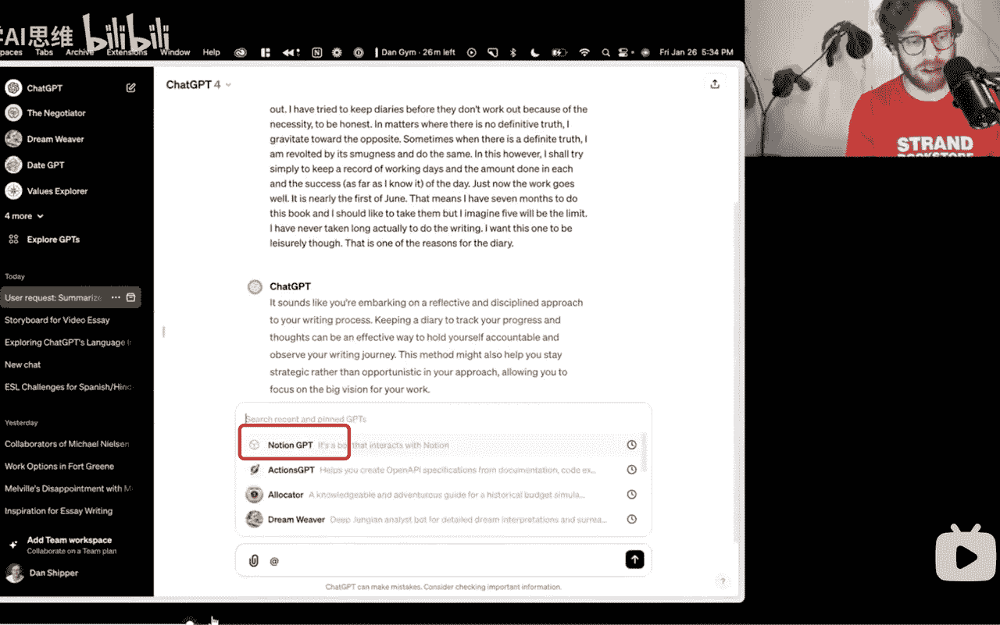

# 烧饼：在聊天过程中保存到@notion

> 来源：[https://waytoagi.feishu.cn/docx/BPWodu19bo004yxRbZqcF7SRnrh](https://waytoagi.feishu.cn/docx/BPWodu19bo004yxRbZqcF7SRnrh)

@我是个烧饼啊

做了一个基于 notion 的 to-do 助手 ：https://chat.openai.com/g/g-IhGsoyIkP-to-do-master。

欢迎大家体验

部署教程：https://github.com/Reborn14/To-Do-Master

可以的用法，看这个b站视频，这样可以各种调取之后做存档了

<https://player.bilibili.com/player.html?bvid=18U421Z7pd&buvid=YC4BD1CD531B1DE24BE79F1022B411E8311B&is_story_h5=false&mid=E93ZXvPaf6qpZfVvaoksIA%3D%3D&p=1&plat_id=116&share_from=ugc&share_medium=iphone&share_plat=ios&share_session_id=4209E0E4-51A5-4E5A-A318-6643E8DDC4D5&share_source=WEIXIN&share_tag=s_i&spmid=united.player-video-detail.0.0&timestamp=1706886516&unique_k=lZp5T4T&up_id=267440912>