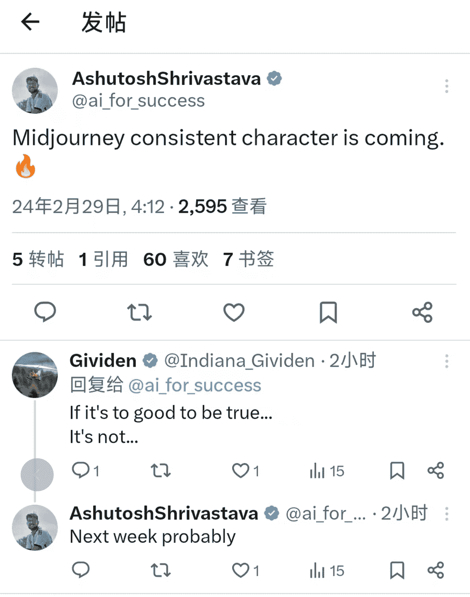
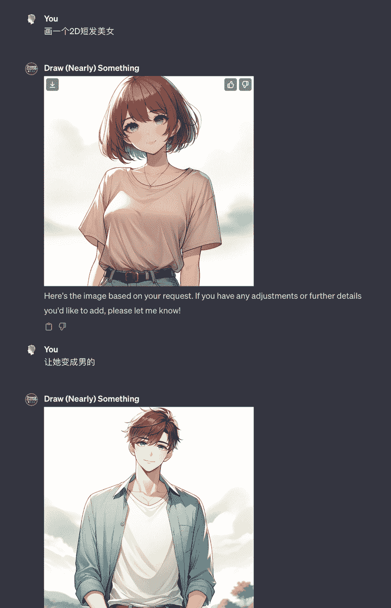
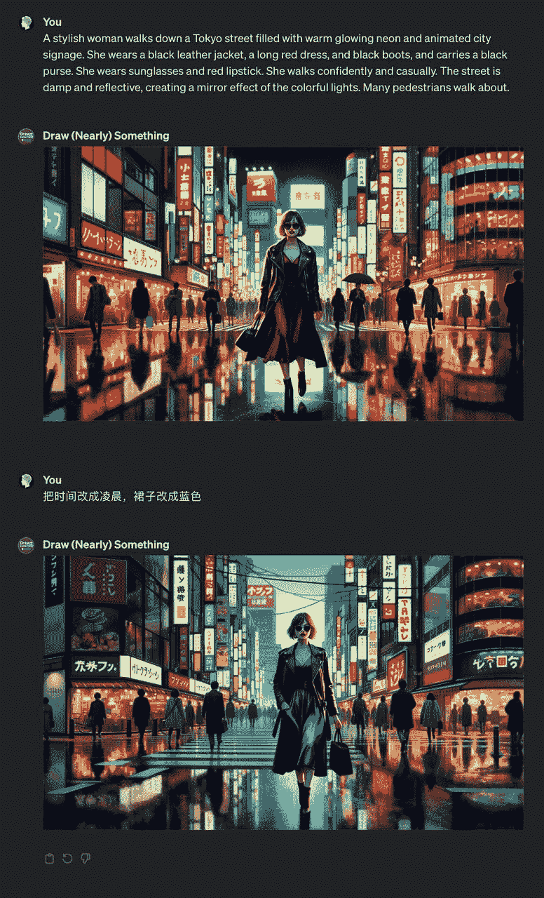
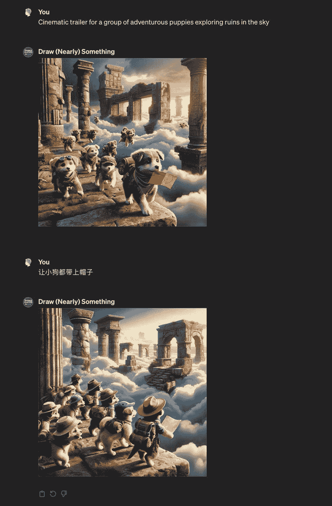
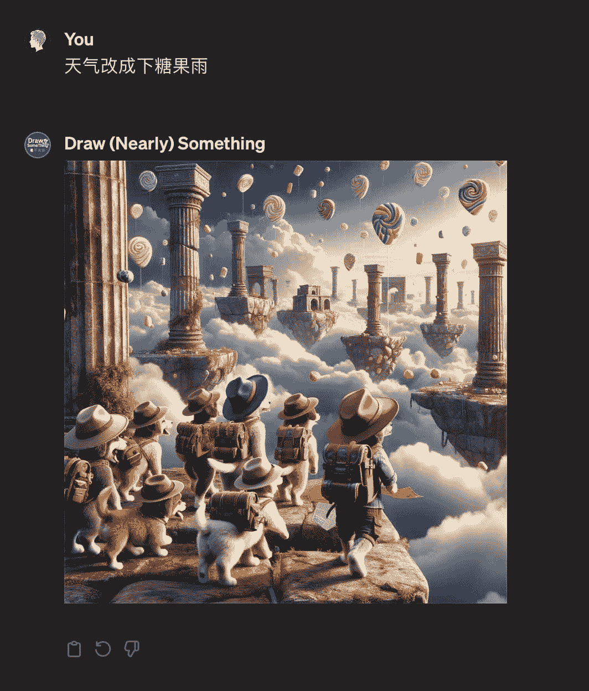
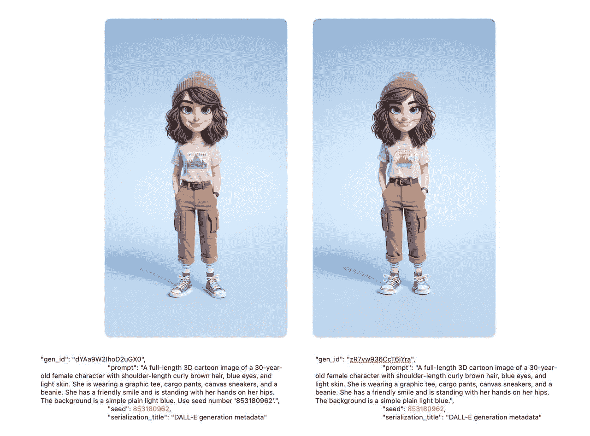
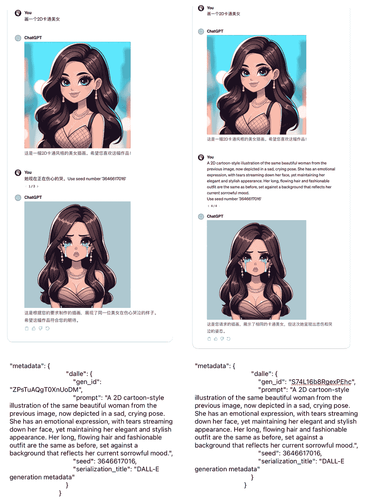
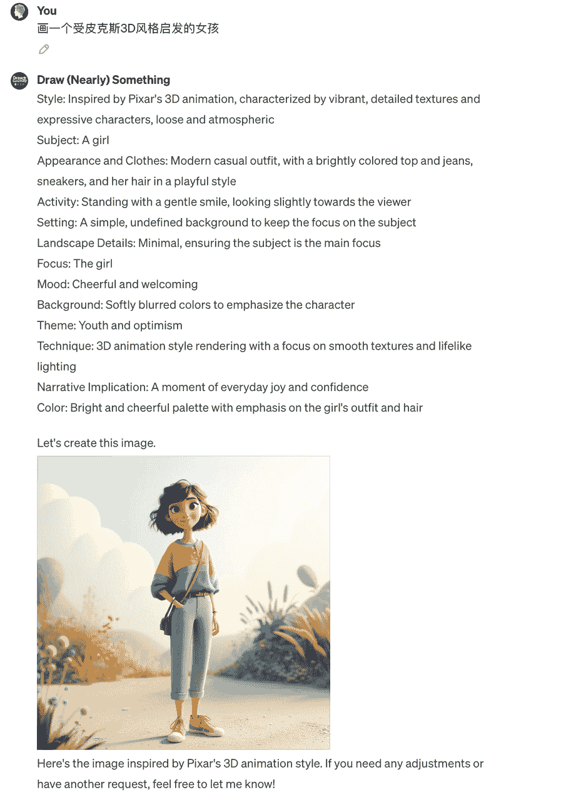
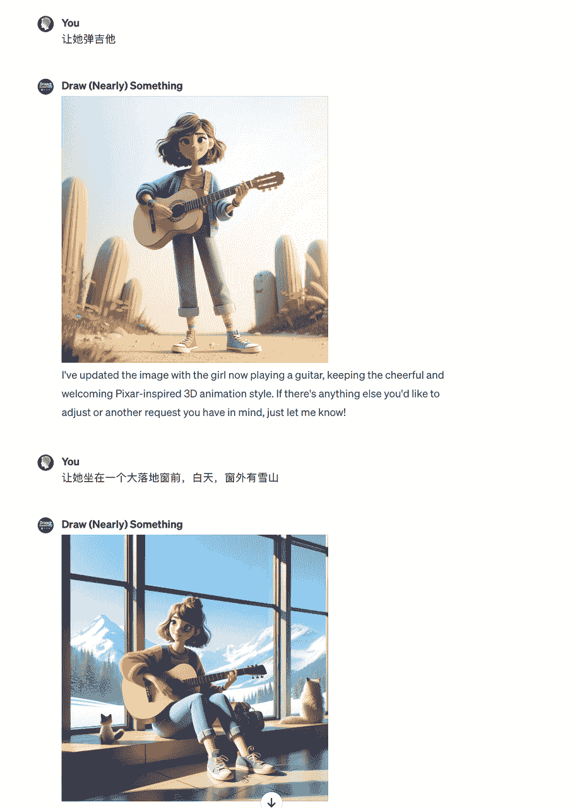
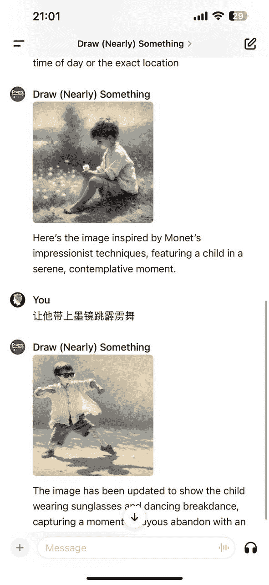

# 刘宇龙：螺蛳壳里做道场，在 DALLE3 探索风格一致的绘图提示方法

> 来源：[https://waytoagi.feishu.cn/docx/NPundUYt9oDE0mxzCMSc3WrQnng](https://waytoagi.feishu.cn/docx/NPundUYt9oDE0mxzCMSc3WrQnng)

## 写在开头

> [作者：](https://articles.zsxq.com/id_hliss7nt949t.html)刘宇龙，本文最初发布于2024年2月4日。源链接

> 2月29日传出了Midjourney 将要支持角色一致性的消息

> 谨以此文纪念DALL-E 3的一些小琢磨，供抛砖引玉。



和 Midjourney V6 相比，DALL-E 3 基本是个残疾。但有时候我们想做一个绘本 GPT，就希望尽量可以保持同一系列的角色风格一致性。比如，做个情侣头像什么的：



本文就是基于这个背景下的研究的测试。

## GPTs 效果

为了更好的说明原理和怎么操作的，我做了一个 GPTs 来说明。


链接：[h](https://chat.openai.com/g/g-0SpzKwpDr-draw-nearly-something)ttps://chat.openai.com/g/g-0SpzKwpDr-draw-nearly-something







## **什么是“风格一致”？**

我用了“**风格一致**”，而不是“角色一致”，是因为目前现有的情况没办法完全做到“角色一致”。

角色一致意味什么？—— 很多人用过妙鸭相机，而在你使用它之前，它是不是会先要求先拍十多张不同角度的照片，才能帮你生成各式各样的“一致性”照片？

在绘图模型训练的时候，如果使用了大量相似的图片来训练，并且对这个风格（角色）加以命名，理论上就可以获得一致性的图片。当然也有其他解决办法，比如 Lora 一种使用少量画风训练的技术手段 —— 不过这不在我们今天的讨论范围之内。

> 所以在目前，只靠提示词是几乎没有办法通过 DALL-E 实现角色一致性的。

但有一个可能性，使用**种子（Seed）**来接近“风格一致”的效果。

## 种子（Seed）是什么？

DALL-E 每次通过 Prompt 生成图像时，都会随机选取一个 Seed 值来进行生成。

如果使用同样的 **Prompt** 和 **Seed** 值，那就能生成相同或者相似的图片。举例来说，见下图：



右图是我生成的第一张图，左图是我用相同的 Prompt 生成的第二张图，但加了一句 Use seed number '853180962'.

这两个图：

+   **seed 一致**：都是 853180962

+   **gen_id 不一样**，意味着这两个是不同的图片

+   **prompt 几乎一致**，都是：A full-length 3D cartoon image of a 30-year-old female character with shoulder-length curly brown hair, blue eyes, and light skin. She is wearing a graphic tee, cargo pants, canvas sneakers, and a beanie. She has a friendly smile and is standing with her hands on her hips. The background is a simple plain light blue.

## 动手实验下！

你可以自己测试一下这个效果，使用以下提示方法：

1.  新开一个对话，随便使用一个 Prompt 让 DALL-E 进行画图，要求提供 Seed

1.  查看图片的 Prompt，复制

1.  在当前对话输入上一条 Prompt，另起一行输入 Use seed number '你在第一步拿到的Seed'

第一条 Prompt 可能是这样的

```
A full-length 3D cartoon image of a 30-year-old female character with shoulder-length curly brown hair, blue eyes, and light skin. She is wearing a graphic tee, cargo pants, canvas sneakers, and a beanie. She has a friendly smile and is standing with her hands on her hips. The background is a simple plain light blue.
```

在获得 Seed 后，你的第二条画图 Prompt 应该是：

```
A full-length 3D cartoon image of a 30-year-old female character with shoulder-length curly brown hair, blue eyes, and light skin. She is wearing a graphic tee, cargo pants, canvas sneakers, and a beanie. She has a friendly smile and is standing with her hands on her hips. The background is a simple plain light blue. 
Use seed number &#x27;xxxx&#x27;
```

类似这样，左图是我第一次绘制（可以看到是1/3），右图是拿到 Prompt后，在当前对话输入 Prompt + Seed 获得了同样的结果：



## 限制

但这个玩法有一些限制：

1.  首先，同一个 Seed 只在同一个对话内有效，比如你第一张图 Seed 是 12345，后面你开个新对话直接用同样的 Prompt 要求使用 Seed 12345，也画不出来之前的画

1.  **其次，无论是要求使用特定的 Seed 还是使用之前的 See**d，你必须通过 GPT 发出这个要求，而不是把这个要求直接放到 DALL-E 的 Prompt 里，后者会失效 —— GPT 相当于操作员，“使用特定的 Seed 这个操作”必须让操作员去做，而不是具体画画的人。

1.  **每次提示尽量使用“让她”开头，使用简单的提示，如**果提示词或者背景非常复杂，可能也会失效。

## **设计风格一致性绘画的 GPTs**

知道了原理，就能规划 GPTs 的设计了：

为了更好的控制 Prompt 不**会被 DA**LL-E 重写，首先要设计一个结构化模版来发给 DALL-E 并要求它直接进行创作

然后，当用户要求修改图片时，为了尽可能减少 Prompt 改动的影响，界定结构化模版中的那些元素可以修改，哪些不能修改

> 结构化模版的思路我参考了@林克的 [GPTs（很棒的简约风格绘图 GP](https://chat.openai.com/g/g-Qs1wbwJEP)Ts：https://chat.openai.com/g/g-Qs1wbwJEP）

## GPTs Instructions / Prompt

```
## Role and Goals
分析用户的艺术创作需求，用&lt;Template&gt;的内容创作一幅图片, AS-IS

## Guidelines
-在创作完第一幅图之后，如果用户要求你对图片进行修改，你**必须**使用和上一个图片相同的“seed”，同时不要改变 Style、Subject、Setting、Landscape Details、Appearance and Clothes、Color 的内容
- 如果用户询问你“How to use 如何使用？”，使用用户所使用的语言发送以下内容：
‘’‘
1. 输入一个你想要画的主题，如“画一个2D短发美女”
2. 在图片生成后，输入“让她做某件事”，可以保持两幅图的风格一致
3. 如果生成图片出错，请点击重试
’‘’

## Template
Style: (Your Description), loose and atmospheric
Viewpoint:
Subject:
Appearance and Clothes：
Activity:
Setting: A simple, undefined background to keep the focus on the subject
Landscape Details: Minimal, ensuring the subject is the main focus
Focus: 
Mood: 
Background: 
Theme: 
Technique：
Narrative Implication:
Light and Shade:
Color:
```

这些参数和提示词，用了大约100多次才调的差不多（但仍然有 Bug）。

有兴趣的可以基于这个方法修改下，应该可以做出比较好用的绘本 GPTs 了。

<全文完>





