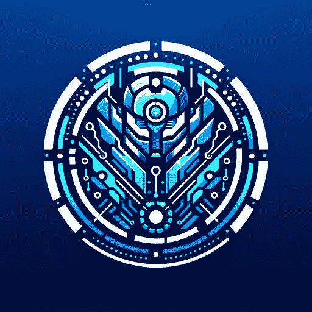
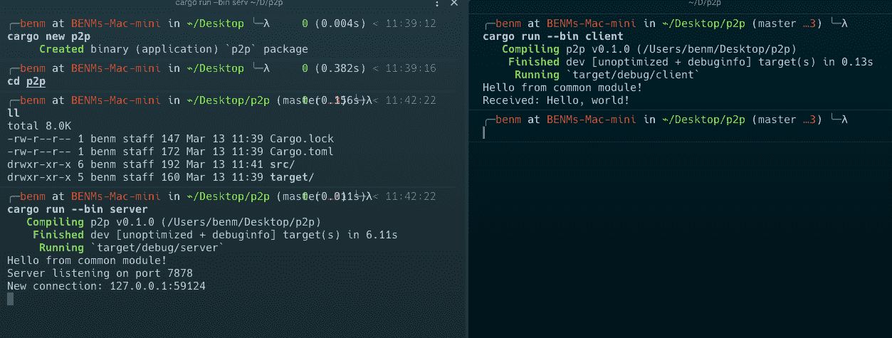
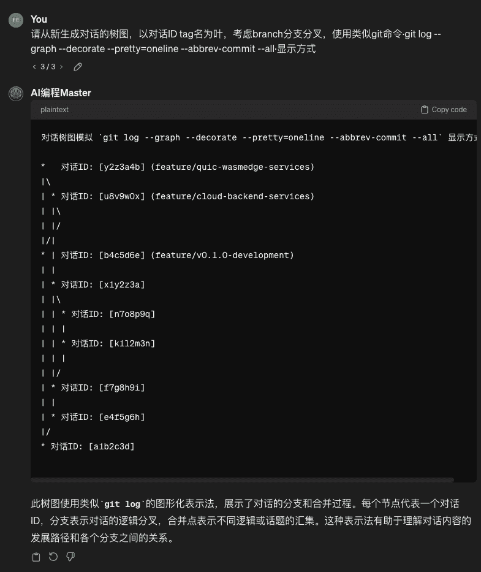

# 齐码蓝：你（或孩子）还需要学编程吗？AI编程Master GPTs

> 来源：[https://waytoagi.feishu.cn/docx/PxOmdmb7toSnCHxILzXcLicEnQh](https://waytoagi.feishu.cn/docx/PxOmdmb7toSnCHxILzXcLicEnQh)

# **“**** **造了个AI编程Master，让我思考我们还有必要学习编程语言吗？”

> 作者： ZimaBlueAI 齐码蓝

> 原文： https://mp.weixin.qq.com/s/VOL2BLjxPF9wy1Gna8DaoA

> **GPTs: **

> https://chat.openai.com/g/g-nZ7We96GP-aibian-cheng-master

> 这里有个好玩的地方是你可以让它根据不同的对话hash id，进行git命令式操作如：branch, tag, fork等。如：根据对话ID: [7b3a8b2f3b1ad9e67b8ef5a3bf28b1a2]创建一个branch: a，后面就像使用树式圣诞，你又可以回到对话ID: [7b3a8b2f3b1ad9e67b8ef5a3bf28b1a2]再创建别的分支，还可以打tag，甚至你可以让它类似git命令：“git log --graph --decorate --pretty=oneline --abbrev-commit --all” show 出对话的分支结构

用GPT4构建了个GPTs: AI编程Master（文末有链接），以下是对话测试：

---

> 你

> 我想用Rust开发一个程序

AI编程Master

对话ID: [8f52cce234e47a2db8cdef8ad89b0f1d]

你想用Rust开发一个程序，这是一个非常好的选择！Rust以其性能、安全性和并发处理能力而著名，非常适合需要高性能和安全性的系统级编程。为了更好地帮助你，我需要了解更多关于你想开发的程序的细节：

1.  你希望开发什么类型的程序？（例如，命令行工具、Web服务、嵌入式系统等）

1.  你是否已经有了一个具体的项目想法，还是需要建议来确定项目的方向？

1.  你在Rust编程方面的经验如何？你是初学者，还是已经有一些基础？

根据你提供的信息，我可以给出更具体的指导，例如项目初始化、环境配置、库的选择等。

---

> 你

> 我想写一个P2P传输的程序，会有Discovery Server和Relay Server，Discover Server是用于端到端的IP握手，Relay Server是为了提供传输cache和分块传输管道，考虑数据分布式的完整CAP问题，端到端会用一个跟文件系统优化相关的大小，将各文件分块并记录其hash值用于判断数据传输完整性；Discovery Server和Relay Server可以支持多点分布式去中心化，实现P2P传输，传输信道同时考虑TCP、UDP、QUIC、Socket和RPC传输，数据的读写考虑实用DMA或RDMA技术；


AI编程Master

对话ID: [cfd7f546e8ecae3b5f8b2d2c83f8a9a3]

你计划开发的P2P传输程序设计思路十分先进，充分考虑了现代网络传输中的多项关键技术和挑战，包括分布式系统设计、数据完整性校验、去中心化架构以及高效的数据传输技术。下面是针对你的项目设计的一些建议和思路：

### 项目初始化与配置

#### Rust环境配置

首先，确保你的开发环境已经安装了Rust。你可以通过官网https://www.rust-lang.org/获取安装指南。使用rustup工具来管理Rust版本是个不错的选择，它可以帮助你安装Rust编译器和Cargo包管理器。

#### 项目结构

使用cargo new <project_name>创建新的Rust项目，这将会为你的项目生成一个基本的文件结构和Cargo.toml文件，后者用于管理项目依赖。

### 需求分析

#### Discovery Server和Relay Server设计

+   Discovery Server: 需要设计一套高效的协议来处理P2P网络中的节点发现和IP握手过程。可以考虑使用现有的协议如Kademlia来加速节点之间的发现过程。

+   Relay Server: 设计时需要考虑到传输的稳定性和速度，以及如何高效地处理数据的分块和缓存。考虑实现一个高效的分块传输和重组机制，确保数据的完整性和一致性。

#### 数据传输和网络协议

+   支持多种传输协议：实现对TCP、UDP、QUIC、Socket和RPC的支持，可以考虑使用第三方库或Rust生态内的现有解决方案来简化实现。

+   高效数据读写：考虑DMA或RDMA技术优化数据传输路径，减少CPU负担，提升数据传输效率。对于Rust来说，可以查找支持这些技术的库或绑定。

### 架构设计与模块化

+   模块化设计：将Discovery Server和Relay Server作为独立模块开发，之间通过明确定义的接口通信。

+   去中心化和分布式：为了实现高度的去中心化和分布式，需要在设计上考虑到容错性、一致性和分区容忍性（CAP定理）。可以考虑使用Raft或Paxos等分布式一致性协议。

### 数据完整性和安全性

+   数据完整性校验：对于文件的每个分块，计算并记录其哈希值，以在数据传输后验证完整性。可以使用Rust的加密哈希库（如sha2）来实现。

+   安全性：考虑使用TLS/SSL来保护节点之间的通信，防止中间人攻击等安全威胁。

### 性能考量

+   并发和异步处理：利用Rust的async/await语法和tokio等异步运行时来处理并发，尤其是在数据传输和节点发现时。

+   内存和CPU优化：分析和优化关键路径的内存使用和CPU消耗，考虑利用Rust的零成本抽象来实现性能优化。

这个项目非常有挑战性，需要深入了解网络编程、分布式系统设计和Rust编程。我推荐从一个较小的原型开始，逐步迭代增加功能。如果你在项目开发中遇到具体的技术难题，可以随时向我寻求帮助。

---

> 你

> 非常好，我们考虑先建立个branch:  p2p，实现一个最简单的端到端的传输，不考虑安全和discovery server,  relay server因素。


AI编程Master

对话ID: [b7f5c9e8e2b0a4f2b9b6e8d72dfee345]

基于你提供的信息，我们将创建一个名为 p2p 的分支，用于实现一个最简单的端到端传输。这个初级版本将不涉及安全性、发现服务器（Discovery Server）和中继服务器（Relay Server）的因素，使我们能够专注于基础的P2P传输逻辑。下面是一个逐步的指南，帮助你开始这个项目：

### 步骤1: 环境准备

确保你的开发环境已经安装了Rust。如果尚未安装，可以访问 Rust官方网站 获取安装指南。

### 步骤2: 创建项目

在终端中执行以下命令来创建一个新的Rust项目：

```
cargo new p2p --bin
cd p2p
```

这将创建一个名为 p2p 的新项目，并生成基本的项目结构。

### 步骤3: 编写端到端传输逻辑

首先，我们需要定义基本的数据传输逻辑。你可以考虑使用 std::net 模块中的TCP或UDP进行通信。这里我们使用TCP作为示例。

在 src/main.rs 中，我们将创建一个简单的TCP服务器和客户端。

#### TCP服务器（监听端）

```
use std::net::{TcpListener, TcpStream};
use std::thread;
use std::io::prelude::*;

fn handle_client(mut stream: TcpStream) {let mut buffer = [0; 1024];
while match stream.read(&amp;mut buffer) {Ok(size) =&gt; {// echo everything we receive
            stream.write(&amp;buffer[0..size]).unwrap();true
        },Err(_) =&gt; {println!(&quot;An error occurred, terminating connection with {}&quot;, stream.peer_addr().unwrap());
            stream.shutdown(std::net::Shutdown::Both).unwrap();false
        }
    } {}
}

fn main() {let listener = TcpListener::bind(&quot;0.0.0.0:7878&quot;).unwrap();println!(&quot;Server listening on port 7878&quot;);
for stream in listener.incoming() {match stream {Ok(stream) =&gt; {println!(&quot;New connection: {}&quot;, stream.peer_addr().unwrap());
                thread::spawn(|| {handle_client(stream)
                });
            }Err(e) =&gt; {println!(&quot;Error: {}&quot;, e);
            }
        }
    }
}
```

#### TCP客户端（发送端）

你可以在同一项目中创建客户端逻辑，或为了测试方便，另外创建一个项目。这里简单描述客户端逻辑：

```
use std::net::TcpStream;
use std::io::prelude::*;

fn main() {let mut stream = TcpStream::connect(&quot;127.0.0.1:7878&quot;).unwrap();
    stream.write(b&quot;Hello, world!&quot;).unwrap();let mut buffer = [0; 1024];
    stream.read(&amp;mut buffer).unwrap();println!(&quot;Received: {}&quot;, String::from_utf8_lossy(&amp;buffer[..]));
}
```

### 步骤4: 运行和测试

先启动服务器，再运行客户端，观察是否能够成功进行数据传输。

### 接下来的步骤

一旦基本的传输逻辑稳定后，你可以开始考虑如何引入更复杂的功能，比如使用发现服务器进行节点发现，利用中继服务器处理NAT穿越问题等。

请随时提供反馈或进一步的需求，我们可以根据这些信息继续扩展和完善你的P2P传输程序。

---

> 你

> 请根据“对话ID: [b7f5c9e8e2b0a4f2b9b6e8d72dfee345]”的思路，将代码的文件结构列出



AI编程Master

对话ID: [49e007abeef0a9da6e0a8e8c3a6e50df]

基于之前讨论的P2P传输项目思路，我们可以按照如下的文件结构来组织你的Rust项目。这个结构将帮助我们将服务端和客户端代码分开，便于管理和扩展。

```
vbnetCopy code
p2p/
├── Cargo.toml
└── src/
    ├── bin/
    │   ├── client.rs
    │   └── server.rs
    ├── lib.rs
    └── common/
        └── mod.rs
```

### 文件结构解释：

+   Cargo.toml: 这是Rust项目的配置文件，包含了项目的依赖信息和一些元数据。

+   src/: 存放源代码的目录。

+   bin/: 存放可执行文件的源代码。在这个目录下，我们将分别为客户端和服务端创建独立的文件：

+   client.rs: 客户端代码，负责发起连接和发送数据。

+   server.rs: 服务端代码，监听客户端的连接请求并处理数据。

+   lib.rs: 如果你的项目中有共享的逻辑或者你想构建一个库供其他项目使用，可以在这个文件中定义。

+   common/mod.rs: 存放两端共享的代码，例如一些工具函数或者数据结构定义。使用模块的方式可以更好地组织代码，便于管理。

### 如何运行：

+   运行服务端：在项目根目录下，使用 cargo run --bin server 命令启动服务端。

+   运行客户端：同样在项目根目录下，使用 cargo run --bin client 命令启动客户端。

通过这种结构，你可以清晰地区分不同组件的职责，同时也为未来的项目扩展留出空间，比如增加新的功能模块或者进一步细分现有模块。如果你需要更多关于如何实现特定功能的细节，请随时提问。

你

very good, 请将“对话ID: [49e007abeef0a9da6e0a8e8c3a6e50df]”中文结构的每一个文件的内容/代码都输出

AI编程Master

对话ID: [1e9643bf5fe76e1d7d4f2483aaf7b3b3]

根据“对话ID: [49e007abeef0a9da6e0a8e8c3a6e50df]”中的文件结构，我将为每个文件提供基本的内容或代码框架。这将帮助你开始构建P2P传输项目。

1.  Cargo.toml

这是项目的配置文件，定义了项目的依赖和一些其他配置。

```
#Cargo.toml
[package]
name = &quot;p2p&quot;
version = &quot;0.1.0&quot;
edition = &quot;2021&quot;
#Dependencies can be added here
[dependencies]
```

1.  src/lib.rs

这个文件通常包含库的主要代码，但对于我们的项目，它可能仅用于共享代码或模块。

```
// lib.rs
pub mod common;
```

1.  src/common/mod.rs

这里定义了客户端和服务端共享的功能或数据结构。

```
// src/**common/mod.**rs
// 定义一些客户端和服务端共用的结构或者工具函数
pub fn print_hello() {
    println!(&quot;Hello from common module!&quot;);
}

```

1.  src/bin/server.rs

这是服务端的实现代码。

```
// **src/bin/serve**r.rs
use std::net::{TcpListener, TcpStream};
use std::thread;
use std::io::prelude::*;
use p2p:**:commo**n; // 引用公共模块**

fn han**dle_clie**nt(mut st**rea**m: Tcp**Stream) {
    let m**ut buffe****r = [0**; 1**024]**;

    while** match stre****am.r****ead(&amp;m**ut b**uffer) {****
       **** Ok(size****) =&gt; {
  **   **      **** // e****cho everythin****g we rec**eive
            stream.write(&amp;buffer[0..size]).unwrap();
            true
        },
        Err(_) =&gt; {
            println!(&quot;An error occurred, terminating connection with {}&quot;, stream.peer_addr().unwrap());
            stream.shutdown(std::net::Shutdown::Both).unwrap();
            false
        }
    } {}
}

fn main() {
    common::print_hello(); // 使用公共模块的函数
    let listener = TcpListener::bind(&quot;0.0.0.0:7878&quot;).unwrap();
    println!(&quot;Server listening on port 7878&quot;);

    for stream in listener.incoming() {
        match stream {
            Ok(stream) =&gt; {
                println!(&quot;New connection: {}&quot;, stream.peer_addr().unwrap());
                thread::spawn(|| {
                    handle_client(stream)
                });
            }
            Err(e) =&gt; {
                println!(&quot;Error: {}&quot;, e);
            }
        }
    }
}

```

1.  src/bin/client.rs

这是客户端的实现代码。

```
// **src/**bin/client.r**s
use std::**net::TcpStream;
use std::io::pre**lude::*****;
use **p2p::common; // **引用公共模块**

fn main() {
    common::print_hello(); // 使用公**共模块的函数**
   ** let mut**** stream = TcpSt**ream::connect(&quot;127.0.0.1:7878&quot;).unwrap();

    stream.write(b&quot;Hello, world!&quot;).unwrap();
    let mut buffer = [0; 1024];
    stream.read(&amp;mut buffer).unwrap();
    println!(&quot;Received: {}&quot;, String::from_utf8_lossy(&amp;buffer[..]));
}

```

以上代码为你的P2P传输项目提供了一个基础的起点。请注意，根据项目的发展和需求，你可能需要添加额外的依赖和模块。同时，确保在实际应用中添加错误处理和日志记录以提高程序的健壮性和可维护性。如果你需要进一步的帮助或有其他问题，请随时告诉我。

测试



---

---

## AJ 的测试：

> AJ 的测试🔗 原文链接： h[ttps://chat.openai](https://chat.openai.com/g/g-nZ7We96GP-aibian-cheng-master/c/0c474b56-c153-490f-a3e1-e03355d68519).com/g/g-nZ7We96...

> 要开发一个网页，一个页面可以承载离谱生物档案的网站，每个页面都是一个离谱生物的介绍，图片，头像，文字介绍，可以跟他打字和语音对话。以及展示跟他相关的离谱事件

对话ID: [29cf545e41e028fd6498139670e7426c]

这个项目听起来既有趣又具有挑战性。为了更好地帮助你，我将分步骤来指导这个项目的开发。首先，让我们从项目的初始化与配置开始。

### 1. **项目初始化与配置**

#### 选择编程语言和技术栈

考虑到你的项目需要网页开发、后端逻辑处理，以及可能的语音对话功能，我推荐使用以下技术栈：

+   **前端**：React.js 或 Vue.js，因为这两个框架都非常适合构建动态的用户界面，并且有丰富的组件库支持多媒体内容的展示。

+   **后端**：Node.js 加上 Express.js，这样可以让你使用JavaScript同时开发前端和后端，简化开发过程。Node.js的非阻塞IO特性也非常适合处理实时通讯的需求。

+   **数据库**：MongoDB，因为你可能需要存储的数据（离谱生物档案和相关事件）是文档形式的，MongoDB作为一个NoSQL数据库，在存储此类灵活数据方面表现良好。

+   **语音处理**：可以考虑使用Google Cloud Speech-to-Text和Text-to-Speech API来实现语音与文本的相互转换，以支持与离谱生物的语音对话。

#### 开发环境配置

+   **IDE**：Visual Studio Code，它免费、开源，支持大量的插件，适用于前端和Node.js开发。

+   **Node.js和NPM**：安装Node.js时，会一并安装npm（node package manager），用于管理项目中的依赖。

#### 项目结构模板

你的项目目录可能如下所示：

```
your_project_name/
│
├── client/ # 前端项目目录
│   ├── public/
│   ├── src/
│   │   ├── components/
│   │   ├── App.js
│   │   └── index.js
│   └── package.json
│
├── server/ # 后端项目目录
│   ├── api/
│   ├── db/
│   ├── node_modules/
│   ├── server.js
│   └── package.json
│
└── README.md
```

### 2. **需求分析与项目规划**

+   **功能需求**：每个离谱生物的页面需要展示图片、头像、文字介绍，并支持文字和语音对话。此外，还需要展示相关的离谱事件。

+   **非功能需求**：页面加载速度要快，用户界面友好，支持响应式设计，以适应不同设备的屏幕。

+   **用户故事**：作为一个访客，我希望浏览不同的离谱生物档案，了解它们的背景故事和相关事件，还希望能够和它们进行文字或语音交流。

### 3. **架构设计与模块化**

#### 架构设计

+   **前后端分离**：采用前后端分离的架构，前端负责展示界面和用户交互，后端负责处理业务逻辑和数据存取。

+   **REST API**：后端提供RESTful API，供前端调用，获取生物档案数据和处理语音转换等功能。

#### 模块化

+   **前端模块**：

+   生物档案组件：展示离谱生物的图片、头像和文字介绍。

+   事件展示组件：展示与离谱生物相关的事件。

+   对话组件：实现用户与离谱生物之间的文字和语音交流功能。

+   **后端模块**：

+   生物档案API：处理生物档案数据的增删查改。

+   事件API：处理事件数据的增删查改。

+   语音处理API：调用外部语音处理服务，实现语音和文字的相互转换。

接下来，根据你的需要，我们可以深入讨论开发的具体细节，比如如何设计数据库模型、如何实现前后端的具体功能等。你希望从哪个部分开始讨论呢？

> 我是小白，请直接给我指导如何继续搭建完整的网站

对话ID: [7b3a8b2f3b1ad9e67b8ef5a3bf28b1a2]

既然你是初学者，那么我们将采取一步步的方法，首先设置你的开发环境，然后逐步开发前端和后端，最后部署你的网站。我们将从最基础的部分开始。

### 步骤1：设置开发环境

#### 安装Node.js和NPM

1.  **访问 **[**Node.js官网 **](https://nodejs.org/)**下载 **适用于你操作系统的Node.js安装包，并安装它。安装Node.js的同时会安装NPM，它是Node.js的包管理器，用于安装第三方库和工具。

1.  **验证安装 **：打开命令行工具（Windows上是命令提示符或PowerShell，macOS或Linux上是终端），输入以下命令，检查Node.js和NPM是否正确安装。

```
bash
node --version
npm --version
```

1.  如果这些命令返回了版本号，说明安装成功。

#### 安装Visual Studio Code

1.  **下载安装 **：访问 Visual Studio Code官网 ，下载并安装适合你操作系统的版本。

1.  **探索VS Code **：VS Code有很多有用的功能和扩展，比如自动代码完成、git集成、代码高亮和调试支持。你可以通过阅读官方文档或观看入门视频来熟悉它。

### 步骤2：创建你的项目

1.  **创建一个新的目录 **作为你的项目文件夹，并在VS Code中打开这个目录。

1.  **在项目根目录下打开终端 **，创建两个子目录： client 用于存放前端代码， server 用于存放后端代码。可以使用以下命令：

1.  **初始化前端项目 **：进入 client 目录，使用Create React App来初始化前端项目。Create React App是一个官方支持的CLI工具，用于创建React应用程序。运行：

```
bash
npx create-react-app .
```

1.  这将在 client 目录下创建一个新的React应用。

1.  **初始化后端项目 **：进入 server 目录，初始化一个Node.js项目：

```
bash
cd ../server
npm init -y
```

1.  这会创建一个 package.json 文件，它包含了项目的配置信息。

1.  **安装Express **：在 server 目录下，安装Express.js，它是一个简单而灵活的Node.js web应用框架，用于构建API。

现在，你的基本开发环境和项目结构已经设置完毕。下一步，我们将开始开发前端和后端。

### 步骤3：开发前端

1.  **编辑React组件 **：在 client/src 目录下，你会找到一个名为 App.js 的文件，这是你的React应用的主组件。你可以开始通过修改 App.js 来构建你的界面。

1.  **运行前端开发服务器 **：在 client 目录下运行以下命令，启动开发服务器：

1.  这将自动在浏览器中打开一个新标签，显示你的应用。

### 步骤4：开发后端

1.  创建一个简单的Express服务器 ：在 server 目录下，创建一个名为 server.js 的文件，并写入以下代码来启动一个基本的Express服务器：

```
javascript
const express = require(&#x27;express&#x27;);
const app = express();
const port = 3001;

app.get(&#x27;/&#x27;, (req, res) =&gt; {
  res.send(&#x27;Hello World!&#x27;);
});

app.listen(port, () =&gt; {
  console.log(`Server listening at http://localhost:${port}`);
});
```

1.  **运行后端服务器 **：在 server 目录下运行以下命令来启动你的后端服务器：

1.  你现在应该能通过访问 http://localhost:3001 在浏览器中看到 Hello World! 。

接下来，你可以根据之前的计划和需求，继续开发前端的用户界面和后端的API。如何处理用户与生物之间的对话、如何存储生物和事件的信息，都是你接下来需要考虑的问题。如果你遇到任何具体问题，随时可以问我！

> 好的 请直接给我最终代码

对话ID: [a6c4a8f66e9ef76e5a4e99a9ef15a5bf]

理解您想直接看到最终的代码，但是编写一个完整的网站项目的代码远超出单个回答所能包含的范围。不过，我可以提供一个简化的示例，帮助你开始构建这个项目。这个示例将包括一个前端页面，用于展示一个“离谱生物”的信息，以及一个简单的后端服务器，用于提供这些信息。

### 简化的前端React代码

我们将创建一个简单的React组件，用于展示生物的名称、图片和描述。

在你的 client/src 目录中，找到 App.js 文件，然后替换其内容如下：

```
jsx
import React, { useEffect, useState } from &#x27;react&#x27;;
import &#x27;./App.css&#x27;;

function App() {
  const [creature, setCreature] = useState(null);

  useEffect(() =&gt; {
    fetch(&#x27;http://localhost:3001/creature&#x27;)
      .then(response =&gt; response.json())
      .then(data =&gt; setCreature(data));
  }, []);

  return (
    &lt;div className=&quot;App&quot;&gt;
      &lt;header className=&quot;App-header&quot;&gt;
        {creature ? (
          &lt;div&gt;
            &lt;h1&gt;{creature.name}&lt;/h1&gt;
            &lt;img src={creature.image} alt={creature.name} /&gt;
            &lt;p&gt;{creature.description}&lt;/p&gt;
          &lt;/div&gt;
        ) : (
          &lt;p&gt;Loading creature...&lt;/p&gt;
        )}
      &lt;/header&gt;
    &lt;/div&gt;
  );
}

export default App;
```

### 简化的后端Express代码

接下来，让我们创建一个后端Express服务器，它将提供一个离谱生物的数据。

在你的 server 目录中，创建或更新 server.js 文件，然后替换其内容如下：

```
javascript
const express = require(&#x27;express&#x27;);
const cors = require(&#x27;cors&#x27;);
const app = express();
const port = 3001;

app.use(cors()); // 允许跨域请求

const creature = {
  name: &quot;离谱生物1号&quot;,
  image: &quot;https://via.placeholder.com/150&quot;, // 这里应该替换为实际图片URL
  description: &quot;这是一个非常离谱的生物，拥有不可思议的能力。&quot;
};

app.get(&#x27;/creature&#x27;, (req, res) =&gt; {
  res.json(creature);
});

app.listen(port, () =&gt; {
  console.log(`Server listening at http://localhost:${port}`);
});
```

### 运行项目

1.  **启动后端服务器 **：在 server 目录中，运行 node server.js 启动后端服务。

1.  **启动前端应用 **：在 client 目录中，运行 npm start 启动React应用。

打开浏览器访问 http://localhost:3000 ，你将看到一个简单的页面，展示了从后端服务器获取的“离谱生物”的信息。

这只是一个起点。实际的项目开发会涉及到更多的功能和细节，包括但不限于数据库操作、用户交互、状态管理、样式美化等。在你探索和开发过程中，遇到任何问题，都可以来询问我！

---

Tips

这里有个好玩的地方是你可以让它根据不同的对话hash id，进行git命令式操作如：branch, tag, fork等。如：根据对话ID: [7b3a8b2f3b1ad9e67b8ef5a3bf28b1a2]创建一个branch: a，后面就像使用树式圣诞，你又可以回到对话ID: [7b3a8b2f3b1ad9e67b8ef5a3bf28b1a2]再创建别的分支，还可以打tag，甚至你可以让它类似git命令：“git log --graph --decorate --pretty=oneline --abbrev-commit --all” show 出对话的分支结构

