# 大雨：如何让GPTs调用我们自己的服务

> 来源：[https://waytoagi.feishu.cn/docx/GqbIdhmQpoZBA5x0i36cjY66n2e](https://waytoagi.feishu.cn/docx/GqbIdhmQpoZBA5x0i36cjY66n2e)

> 链接: https://www.iaiuse.com/posts/1959af2e.html

> 来源: AIMeticulously

# 写在前面

+   我自己有一个服务，如何让GPTs调用它呢

+   我想用外部的服务，但是担心它哪天不通了，想通过我自己的服务应该如何做呢

+   我想看看如何让GPTs调用外部的服务，它大概是什么样的呢？

+   GPTs是个语言模型，它能使用定义严格的函数吗？比如字符串和整型？

+   如何在Prompt中声明要调用哪个接口呢？

# 1、深入浅出：HTTP服务的演变

## 1.1、 网络服务演化史：从孤岛到互联

随着互联网的日益发展，信息孤岛建立，打破，又建立，合久必分，分久必合不断循环，推动了大量能力和服务的积累。为有效利用这些资源，社会逐渐向开放组织和标准的建立迈进，验证了开源和开放策略在商业上的价值。在企业信息化和互联网的进程中，HTTP 成为了展示能力的主要形式。为了加强不同系统间的交流，历经多次尝试，数据交互格式从 XML 演变为 JSON，交互规范也从笨重的 Web Service 转向灵活的 Restful 方案，标志着互联网服务的一大进步。

在当今的数字时代，HTTP服务已成为互联网上不可或缺的基石之一。它允许不同的应用和服务通过一个简单、标准化的方式进行数据交换和通信。这种通用性不仅让HTTP服务在传统的网站和服务器通信中扮演着中心角色，也使其能够广泛应用于各种现代数字解决方案中。

> 现如今不太会有人从 0 到 1 构建一个应用，AI 的出现更是如此，极大减低了门槛，这背后依托强大的历史沉淀。这种跨平台的兼容性使得开发者能够创建一次，然后在多个环境中部署和使用，极大地提升了开发效率和用户体验。

从一个更广泛的视角来看，HTTP服务如同现代数字世界中的“万能胶”，将不同的信息源和服务紧密地粘合在一起。无论是在提供天气更新的移动应用、实时交通信息的地图服务，还是在线购物平台，HTTP服务都扮演着至关重要的角色。通过这种方式，它不仅促进了信息的快速流通，也使得复杂的服务集成变得可能，进一步推动了数字经济的发展。

有了这些能力，可以用在 app 上，用在微信小程序，用在网页上，用在各种地方，就像是打车软件依赖地图的能力。下面我们从一个非常小的案例开始。

## 1.2、调用外部服务

现在我们创建一个 Http 服务，它的能力很简单，每次产生一个随机数。体验地址如下：

https://gptaction.iaiuse.com/api/random

结果很简单，每次请求返回一个随机数。

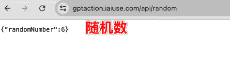

### 开始创建 GPTs

东西比较简单，直接在 Instructions 里面写，让它去调用接口

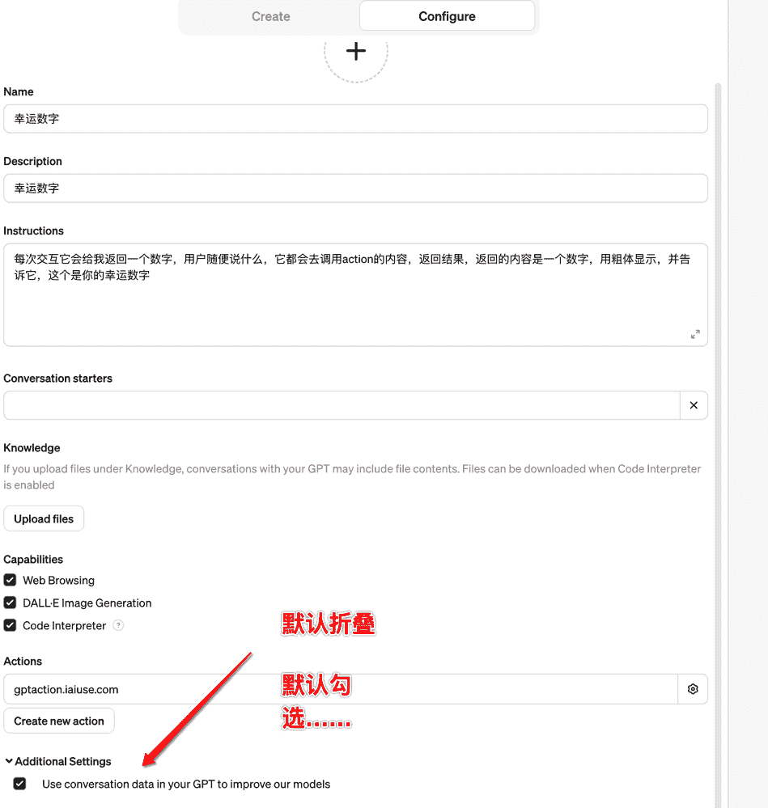

窗口最下面有个 Actions，这里就可以设置它和外部系统的接口了。

### 设置Action

打孔 Add actions 界面，录入下面的这段代码在 Schema 里面


这个就是关于前面那个 http api 的描述

```
openapi: 3.0.0
info:
  title: Random Number API
  description: API for fetching a random number.
  version: 1.0.0
servers:
  - url: https://gptaction.iaiuse.com/api
    description: Main API server for random number generation
paths:
  /random:
    get:
      operationId: getRandomNumber
      summary: Fetches a random number
      responses:
        &#x27;200&#x27;:
          description: Successfully retrieved a random number
          content:
            application/json:
              schema:
                type: object
                properties:
                  random:
                    type: integer
                    description: A random number
```

简单解读一下，上面这段内容分了几个部分：

+   info：基本信息，就是给人类看的

+   servers：表示服务在哪里，url 后面那个 api 不加的话，可以放在后面的 paths 里面

+   paths：

* 表示 api 的具体位置

* get 表示请求方法，还有 post，put，delete 等等

* operationId： 这个名字就是告诉 gpts 的的

其他内容我们就不细究了。通过它的测试按钮，我们能更清楚了解它们的对应关系。

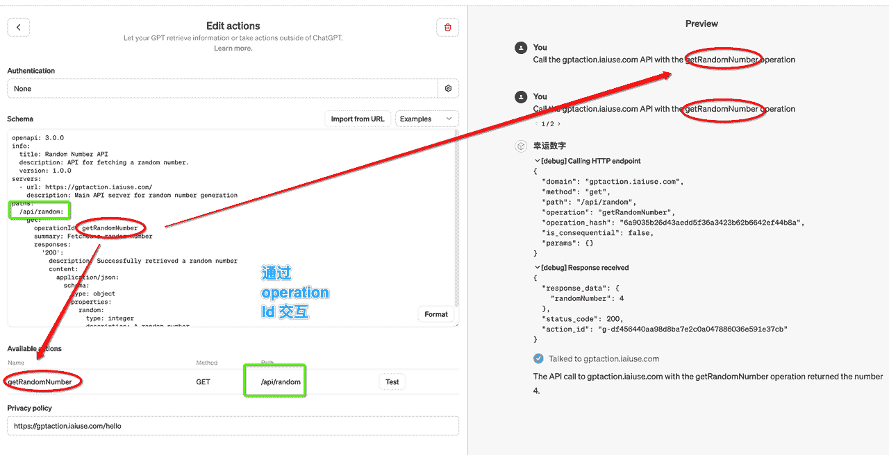

我们点击下面的 Test 按钮，就能看到 ChatGPT 如何和我们的服务进行交互。

### 实测效果

第一次允许它会提示我们是否允许外部服务

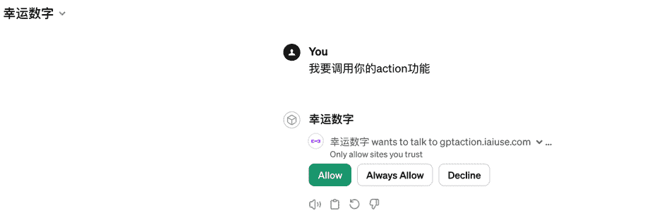

点击右边的小三角可以看到这样的对话框，最右边那个隐私政策就是前面设置的。针对每个 action 都可以设置独立的隐私政策

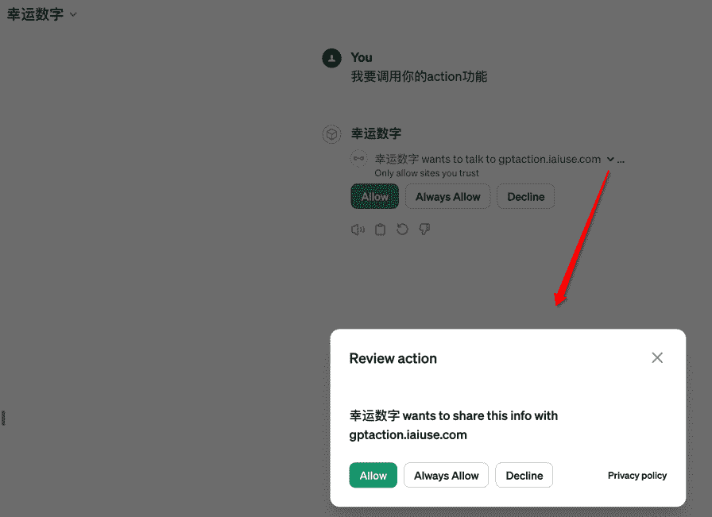

结果如下

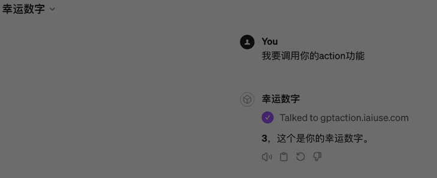

通过上面这样一个简单的示例，我们了解了 GPTs 如何和外部的服务进行交互，扩展它的能力。

下面我们开始抽丝剥茧，看下背后的故事

# 2、GPTs Action 为什么会知道 API 干啥的

## 2.1、OpenAPI 规范（不是 OpenAI，一字之差，天差地别）

前面我们提到了，通过 Schema，ChatGPT 就懂这个 API，这并不是 OpenAI 独创的，而是发展了很多年的一个规范， https://spec.openapis.org/oas/v3.1.0

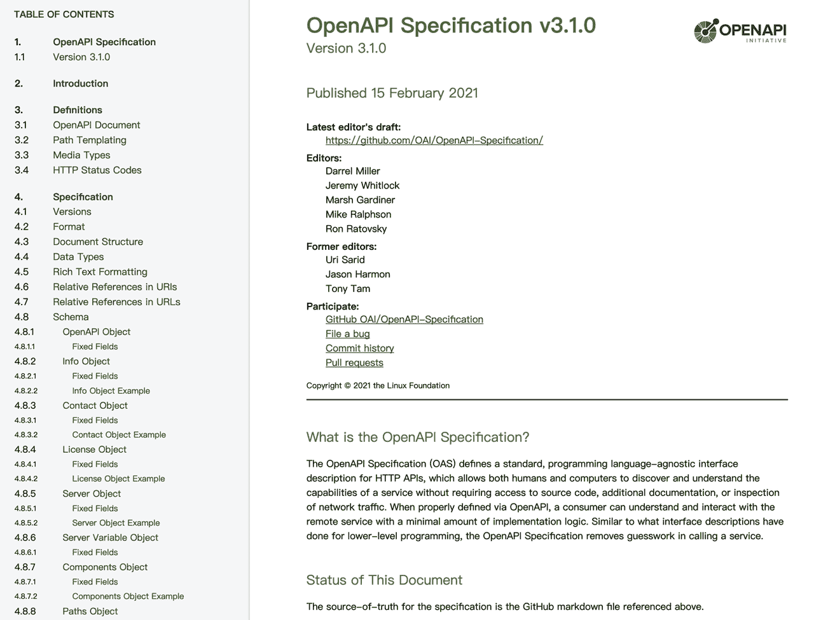

为了让这些能力公开出去，形成了这样的规范，首先是让使用的人看明白，其次才是计算机能懂。我现在系统做好了，如何去生成这样一[份文件给 ChatG](https://chat.openai.com/g/g-TYEliDU6A-actionsgpt)PT 呢，对照这个规范去写，显然是非常不"AI"的做法。ChatGPT 为此提供了一个 GPTs— ActionsGPT。

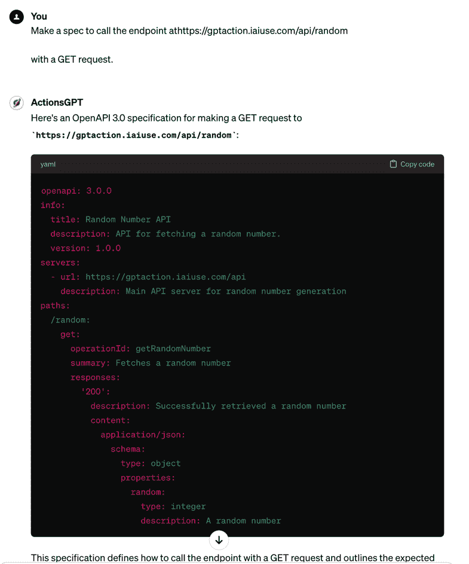

这里用的是 GET 请求，如果是 Post 它也有个示例，如下

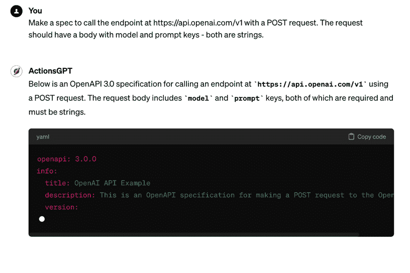

这个文件我们用工具自动生成，放在服务器上，提供接口给 GPTs 去引用，也就是创建 GPTs 的时候可以 Import URL。

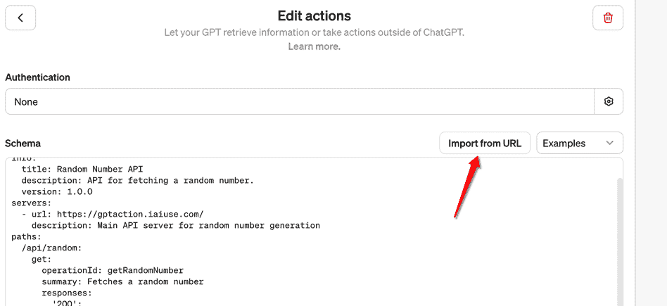

前面的示例中，只展示一个请求，而且是 Get 请求，那如何用 Post 请求呢，传入 2 个参数，数据类型还不一样，要如何做呢。

## 2.2、一个带参数的 Post 请求

### 创建规范文件

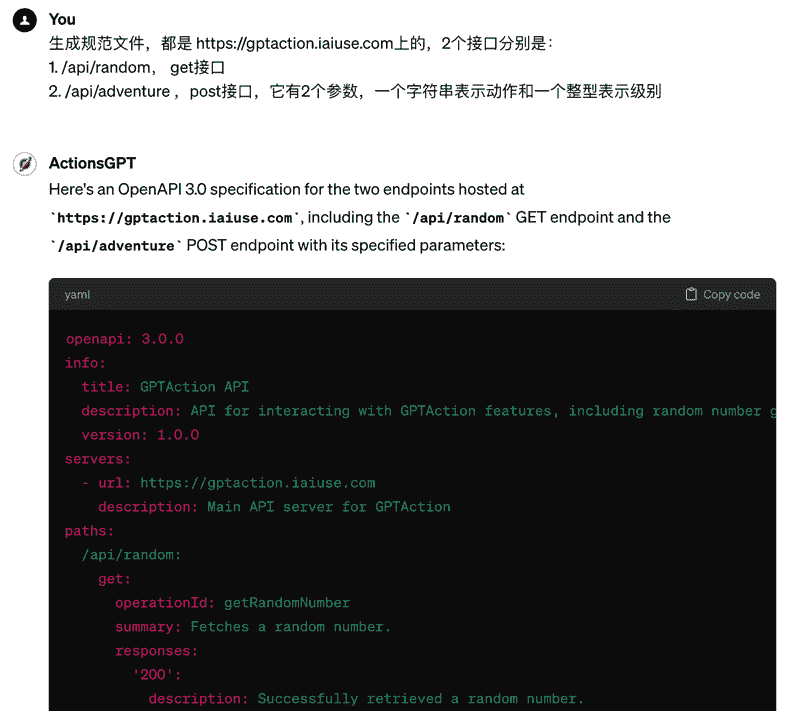

```
openapi: 3.0.0
info:
  title: GPTAction API
  description: API for interacting with GPTAction features, including random number generation and adventure actions.
  version: 1.0.0
servers:
  - url: https://gptaction.iaiuse.com
    description: Main API server for GPTAction
paths:
  /api/random:
    get:
      operationId: getRandomNumber
      summary: Fetches a random number.
      responses:
        &#x27;200&#x27;:
          description: Successfully retrieved a random number.
          content:
            application/json:
              schema:
                type: object
                properties:
                  random:
                    type: integer
                    description: A random number generated by the server.
  /api/adventure:
    post:
      operationId: postAdventureAction
      summary: Submits an action and level for an adventure.
      requestBody:
        required: true
        content:
          application/json:
            schema:
              type: object
              properties:
                action:
                  type: string
                  description: The action to be performed.
                level:
                  type: integer
                  description: The level of the action.
      responses:
        &#x27;200&#x27;:
          description: Successfully processed the adventure action.
          content:
            application/json:
              schema:
                type: object
                properties:
                  result:
                    type: string
                    description: The result of the adventure action.
```

### 修改 GPTs 的 Action

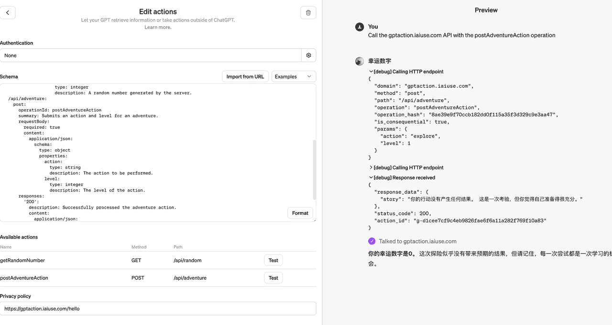

修改好了回到 GPTs 配置界面修改Instructions

### 调整 Prompt

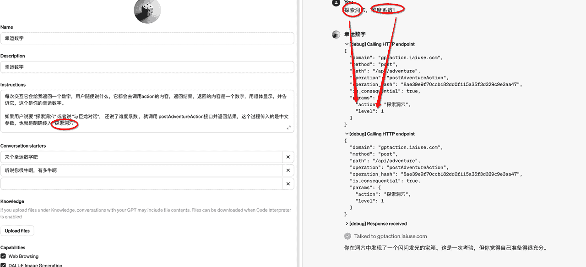

从这里我们可以看出来，它会调用 API，传入合适的参数。

> 这里要注意的是，如果不和说传入中文，它会给我们翻译了再传。如图

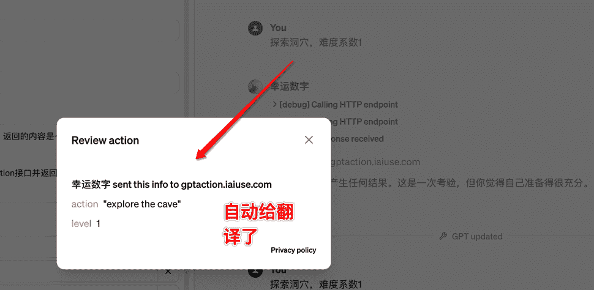

>

### 看看 API 代码逻辑是啥样的

```
function generateStoryPart(action, level) {
    // 根据动作指令和角色等级来生成故事
    const outcomes = {
        &quot;探索洞穴&quot;: [
            &quot;你在洞穴中发现了一个闪闪发光的宝箱。&quot;,
            &quot;一只洞穴巨蛛突然出现，阻挡了你的去路。&quot;
        ],
        &quot;与巨龙对话&quot;: [
            &quot;巨龙对你的勇气表示赞赏，并赠予你一块龙鳞。&quot;,
            &quot;巨龙不耐烦地摆动尾巴，你感觉这次谈话可能不会有好结果。&quot;
        ]
    };

    const levels = [
        &quot;这件事对你来说简直易如反掌。&quot;,
        &quot;这是一次考验，但你觉得自己准备得很充分。&quot;,
        &quot;这可能超出了你的能力范围，要小心行事。&quot;
    ];

    const actionOutcome = outcomes[action] || [&quot;你的行动没有产生任何结果。&quot;];
    const levelComment = levels[Math.min(level, levels.length - 1)];

    // 随机选择一个动作结果
    const randomOutcome = actionOutcome[Math.floor(Math.random() * actionOutcome.length)];

    // 组合故事的各个部分
    return `${randomOutcome} ${levelComment}`;
}
```

通过这样 2 个代码，我们就可以开始构建自己的服务提供给 GPTs，让它实实在在给我们的工作提效了。

## 2.3、如果要多个服务咋办

目前看起来，虽然在 json 格式中，servers 是一个数组，但是还没了解到如何整合，实际上一个 GPTs 中可以包含多个 Action，每个 Action 都可以对应一个 server，也就是说，有 2 个外部服务，分别画猫和画狗，都可以集成在一个 GPTs 中。

## 2.4、演示 API 代码

https://github.com/iaiuse/gptaction/tree/main

这个代码主要是为了演示如何和 GPTs 交互用，结构很简单

+   App. Js

- 主程序，路由用

+   package. Json

- 用到几个包

App. Js

```
const express = require(&#x27;express&#x27;);
const cors = require(&#x27;cors&#x27;);
const fs = require(&#x27;fs&#x27;);
const path = require(&#x27;path&#x27;);

// 导入 query 处理函数
const handleQuery = require(&#x27;./api/query&#x27;);

const app = express();
app.use(express.json());

app.use(cors({
  origin: &quot;*&quot;, // 在生产环境中，您应该限制具体的来源，而不是使用 &quot;*&quot;
  methods: &#x27;*&#x27;,
  allowedHeaders: &#x27;*&#x27;,
  credentials: true,
}));

// 示例路由
app.get(&#x27;/hello&#x27;, (req, res) =&gt; {
  res.json({ message: &#x27;Hello, World!&#x27; });
});

app.post(&#x27;/api/adventure&#x27;, (req, res) =&gt; {
    const { action, level } = req.body;

    // 确保收到的参数有效
    if (typeof action !== &#x27;string&#x27; || typeof level !== &#x27;number&#x27;) {
        return res.status(400).send(&#x27;Invalid input&#x27;);
    }

    // 根据接收的参数生成故事的下一部分
    const story = generateStoryPart(action, level);

    // 发送生成的故事段落作为响应
    res.json({ story });
});

function generateStoryPart(action, level) {
    // 根据动作指令和角色等级来生成故事
    const outcomes = {
        &quot;探索洞穴&quot;: [
            &quot;你在洞穴中发现了一个闪闪发光的宝箱。&quot;,
            &quot;一只洞穴巨蛛突然出现，阻挡了你的去路。&quot;
        ],
        &quot;与巨龙对话&quot;: [
            &quot;巨龙对你的勇气表示赞赏，并赠予你一块龙鳞。&quot;,
            &quot;巨龙不耐烦地摆动尾巴，你感觉这次谈话可能不会有好结果。&quot;
        ]
    };

    const levels = [
        &quot;这件事对你来说简直易如反掌。&quot;,
        &quot;这是一次考验，但你觉得自己准备得很充分。&quot;,
        &quot;这可能超出了你的能力范围，要小心行事。&quot;
    ];

    const actionOutcome = outcomes[action] || [&quot;你的行动没有产生任何结果。&quot;];
    const levelComment = levels[Math.min(level, levels.length - 1)];

    // 随机选择一个动作结果
    const randomOutcome = actionOutcome[Math.floor(Math.random() * actionOutcome.length)];

    // 组合故事的各个部分
    return `${randomOutcome} ${levelComment}`;
}

// 添加的 /api/random 路由
app.get(&#x27;/api/random&#x27;, (req, res) =&gt; {
  const randomNumber = getRandomNumber();
  res.json({ randomNumber });
});

function getRandomNumber() {
  return Math.floor(Math.random() * 6) + 1;
}

// 启动服务
const port = process.env.PORT || 3000; // Vercel 会自动为您的应用分配一个 PORT 环境变量
app.listen(port, () =&gt; {
  console.log(`Server running on http://localhost:${port}`);
});
```

其他没有特别要说明的，唯一一个考虑是关于请求来源地址的。https://chat.openai.com

好了，通过这个一个简单的案例，我们大概知道如何在 GPTs 中使用我们系统的能力，应该如何做了。但是如果需要使用其他的能力呢？就是通过我们自己的系统中转。

> 计算机的问题解决，通常是通过多增加 "一层"来实现

## 2.4、几个开放的 API 能力

### https://github.com/public-apis/public-apis?tab=readme-ov-file

搜索引擎里面搜" free api"、"免费 api"，能找出很多来，推荐日期是最近一年内的，后面会介绍到一个针对 GPTs 而生的 API 服务。它聚合了很多免费的 API 服务，可以玩好一阵子了。比如

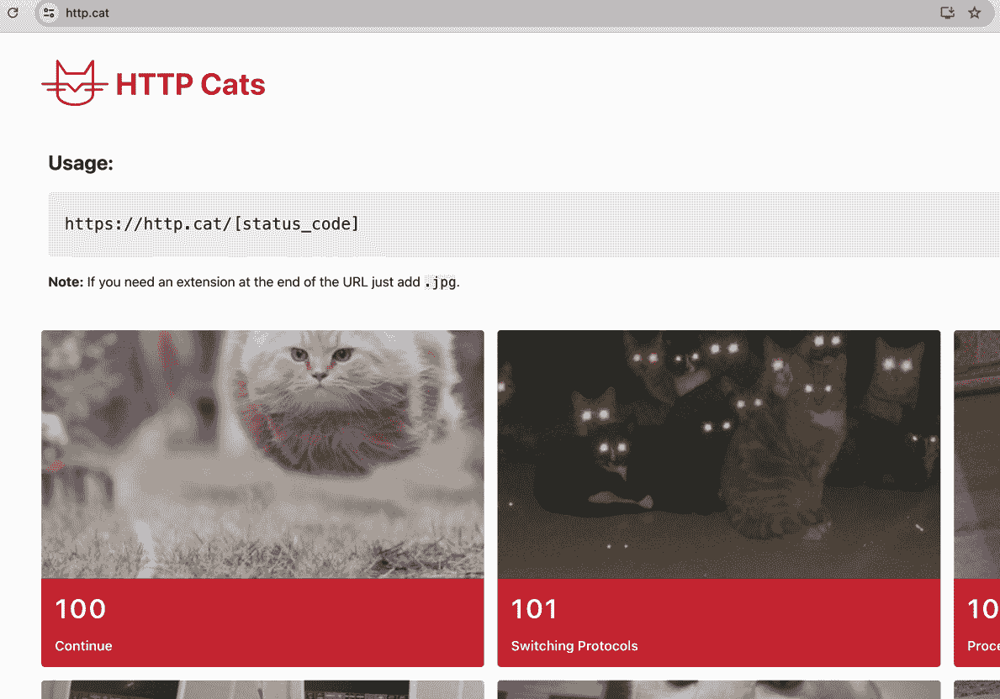

### https://rapidapi.com/collection/list-of-free-apis

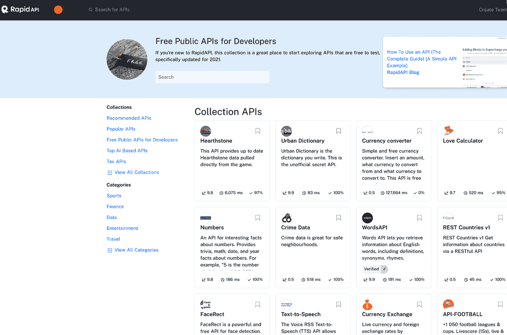

### https://free-apis.github.io/#/browse

从图标能看出来，是否需要另外的 key 啥的

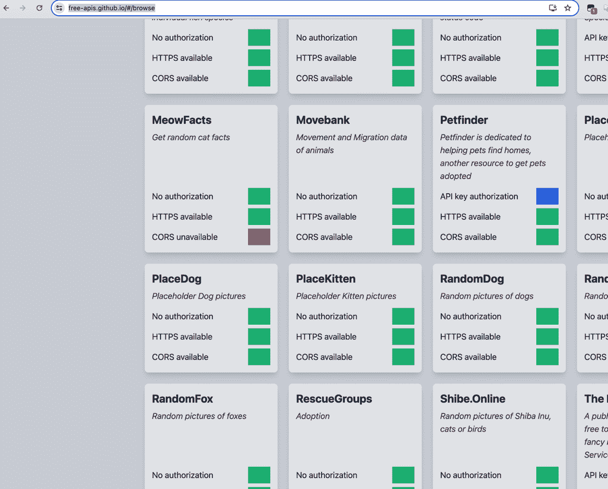

### https://apilist.fun/collection/free-apis

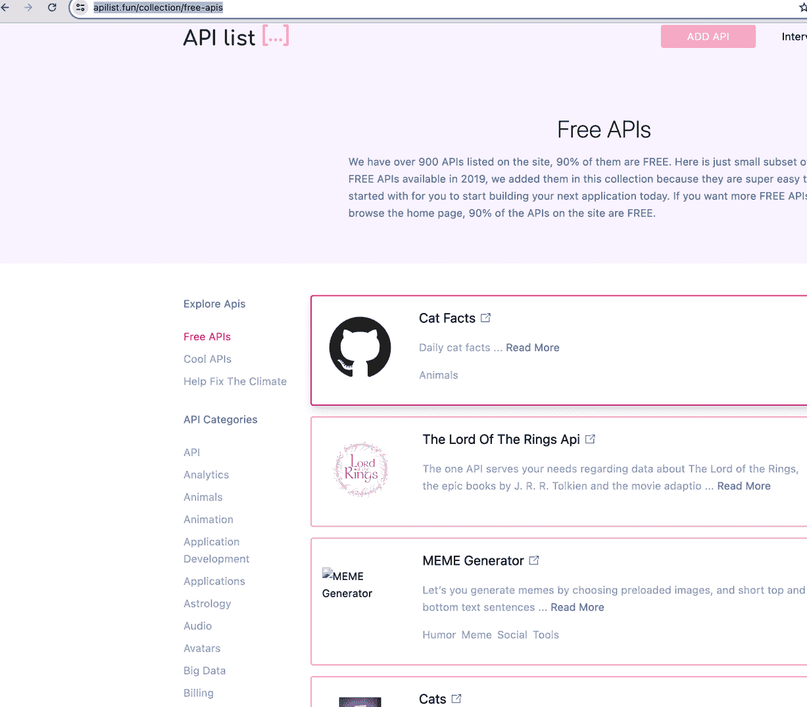

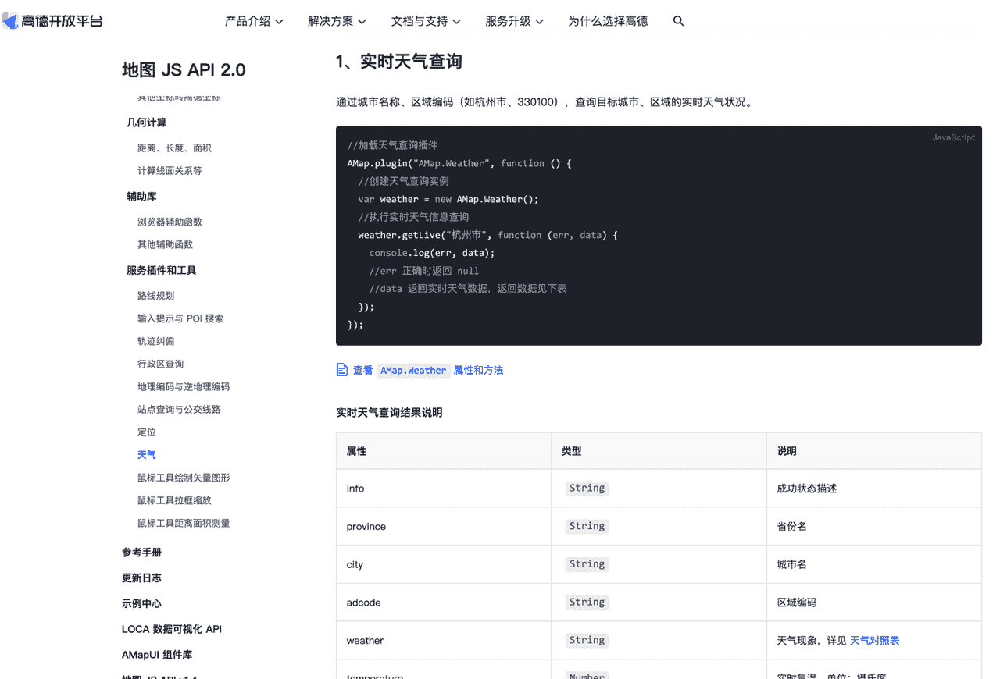

通过聚合各种服务，让我们整体的工作流更加顺畅

前面的案例为了方便，部署在一个云服务器上，其实本地也可以部署。

# 3. 扩展阅读

## 3.1、本地搭建一个简单的 GPTs Action 应用

本文旨在介绍 GPTs Action 规范，所以代码不用复杂，本地简单几个文件就可以了。

```
const express = require(&#x27;express&#x27;);
const cors = require(&#x27;cors&#x27;);
const fs = require(&#x27;fs&#x27;);
const path = require(&#x27;path&#x27;);

const app = express();
app.use(express.json());
app.use(cors({
  origin: &quot;*&quot;,
  methods: &#x27;*&#x27;,
  allowedHeaders: &#x27;*&#x27;,
  credentials: true,
}));


app.post(&#x27;/api/adventure&#x27;, (req, res) =&gt; {
    const { action, level } = req.body;

    // 确保收到的参数有效
    if (typeof action !== &#x27;string&#x27; || typeof level !== &#x27;number&#x27;) {
        return res.status(400).send(&#x27;Invalid input&#x27;);
    }

    // 根据接收的参数生成故事的下一部分
    const story = generateStoryPart(action, level);

    // 发送生成的故事段落作为响应
    res.json({ story });
});

function generateStoryPart(action, level) {
    // 根据动作指令和角色等级来生成故事
    const outcomes = {
        &quot;探索洞穴&quot;: [
            &quot;你在洞穴中发现了一个闪闪发光的宝箱。&quot;,
            &quot;一只洞穴巨蛛突然出现，阻挡了你的去路。&quot;
        ],
        &quot;与巨龙对话&quot;: [
            &quot;巨龙对你的勇气表示赞赏，并赠予你一块龙鳞。&quot;,
            &quot;巨龙不耐烦地摆动尾巴，你感觉这次谈话可能不会有好结果。&quot;
        ]
    };

    const levels = [
        &quot;这件事对你来说简直易如反掌。&quot;,
        &quot;这是一次考验，但你觉得自己准备得很充分。&quot;,
        &quot;这可能超出了你的能力范围，要小心行事。&quot;
    ];

    const actionOutcome = outcomes[action] || [&quot;你的行动没有产生任何结果。&quot;];
    const levelComment = levels[Math.min(level, levels.length - 1)];

    // 随机选择一个动作结果
    const randomOutcome = actionOutcome[Math.floor(Math.random() * actionOutcome.length)];

    // 组合故事的各个部分
    return `${randomOutcome} ${levelComment}`;
}

// 添加的 /api/random 路由
app.get(&#x27;/api/random&#x27;, (req, res) =&gt; {
  const randomNumber = getRandomNumber();
  res.json({ randomNumber });
});

function getRandomNumber() {
  return Math.floor(Math.random() * 6) + 1;
}

// 启动服务
const port = 4000;
app.listen(port, &#x27;0.0.0.0&#x27;, () =&gt; {
  console.log(`Server running on http://0.0.0.0:${port}`);
});
```

启动

```
node server.js
```

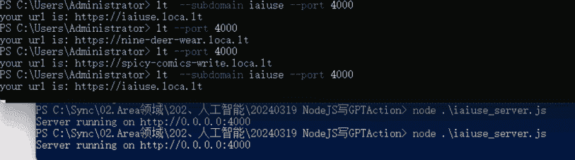

本地部署，要让 openai 能访问，方法有很多，frps，花生壳，ngrok 等等都可以，这里选择的是 localtunnel，一个 nodes 的包。安装很简单

```
npm install localtunnel
```

安装成功就会出来一个 lt 命令，通过这个命令来扩展，启动的时候，如果不带参数，会随机分配一个域名，也可以我们自己指定参数。

```
lt --subdomain iaiuse --port 4000
```

这样的话 chatgpt 就能访问了。不过 localtunnel 因为安全性的考虑，需要加一些特殊的请求头。

为什么在本地部署一方面是测试方便，另外也想试试让它控制家里的智能家居。

## 3.2. GPTs 有版本管理功能了

GPTs Action 给 GPT 插上了翅膀，也开启了潘多拉磨合。拭目以待吧。看样子 GPTs 的商业化进程加快了。作为商业化的重要里程碑，总算有了版本功能。不过复制不知道意义是什么。

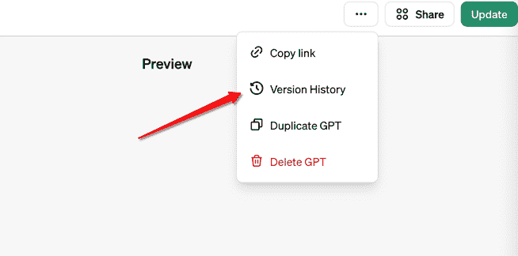

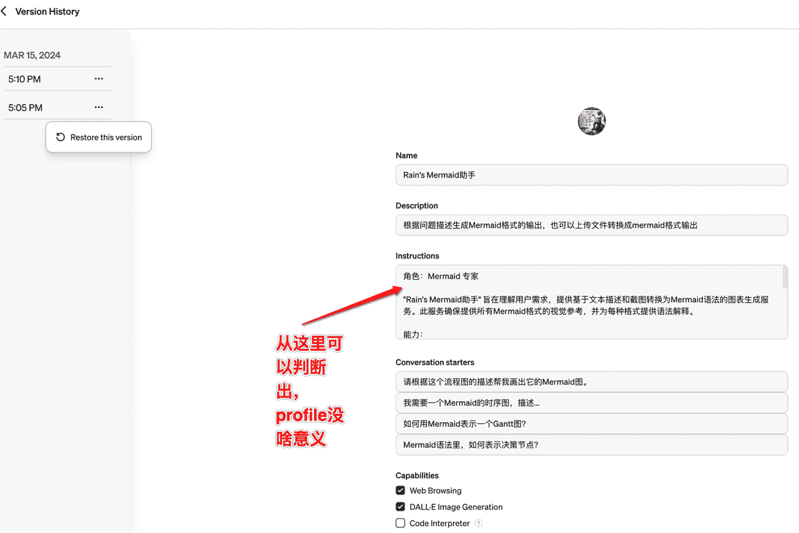

从这个历史版本可以看出来，真正起作用的是 Instructions，创建这个 GPTs 的时候是通过会话做的，但是最终它呈现的就是它呈现的。

安全性问题后续再探讨

链接: https://www.iaiuse.com/posts/1959af2e.html

来源: AIMeticulously