# 景淮：猜猜我是谁-GPTs 实战

> 来源：[https://waytoagi.feishu.cn/docx/EPamdXqn7oUXwUxd6eScXW9BnB1](https://waytoagi.feishu.cn/docx/EPamdXqn7oUXwUxd6eScXW9BnB1)

嘿，大家好呀，我是景淮，一个加拿大的程序员，沉迷 AI 不能自拔中。

这次的灵感来来源于我和我外甥的日常，开车送他去上课，路上我外甥就像是十万个为什么一样，一直在不停的追问我各种动物，比如恐龙、猴子、人类、猛犸象... 这个跨度真的很大，很佩服孩子的脑洞。

我俩聊着聊着，就讨论到了动物的进化史，然后就是各个不同的动物的区别。

所以，今天这一期的内容，主要就是帮助孩子了解不同的小动物，以完成一类小卡片的制作。

好啦，今天我们的孩子王系列内容主题如下

**GPT 猜猜我是谁**

本文会根据以下内容顺序进行：

+   需求分析

+   分步实现需求

+   提示词编写测试

+   GPTs 使用链接

+   总结

## 一、需求分析

既然谈到想让孩子开始了解和熟知小动物，那么我们最好的办法就是把小动物展示给小朋友们，介绍一下小动物的基本信息。

另一方面就是有关于对小动物的认知，之前其实有做过一个“三句话解世间万物”的主题。我就准备结合这一部分内容搭配小动物的“影子”做为提醒，让小朋友们在玩乐中进行学习。

即，我会以制作卡片的形式，来带着小朋友们一起学习小动物的知识，同样算是启蒙的学习。

> 卡片的正面：D3 画出来的小动物的简洁图片 + 小动物的基本信息介绍。

> 卡片的背面：Python 对画出的图片进行处理后的“影子”图片 + 类三句话解万物的谜题。

基于以上信息，整理一下我们分步实现的顺序如图：

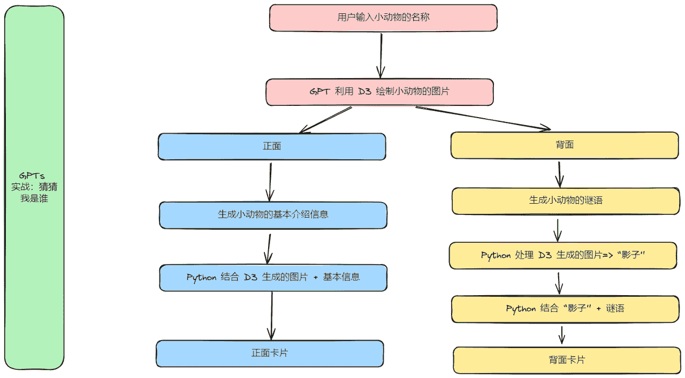

## 二、分步实现需求

### 一）D3 绘制小动物的图片

因为后面还要进行影子的处理，所以图片信息尽量要简单。我直接使用下面的提示词进行绘画了。

```
画一只可爱的老虎，要画出老虎的全身，并保持老虎正常的状态（极简风、简笔画风，图片比例 1:1）
```

可爱的画风，但感觉不是太像老虎了。


```
画一只老虎，要画出老虎的全身，并保持老虎正常的状态（极简风、简笔画风，图片比例 1:1）
```

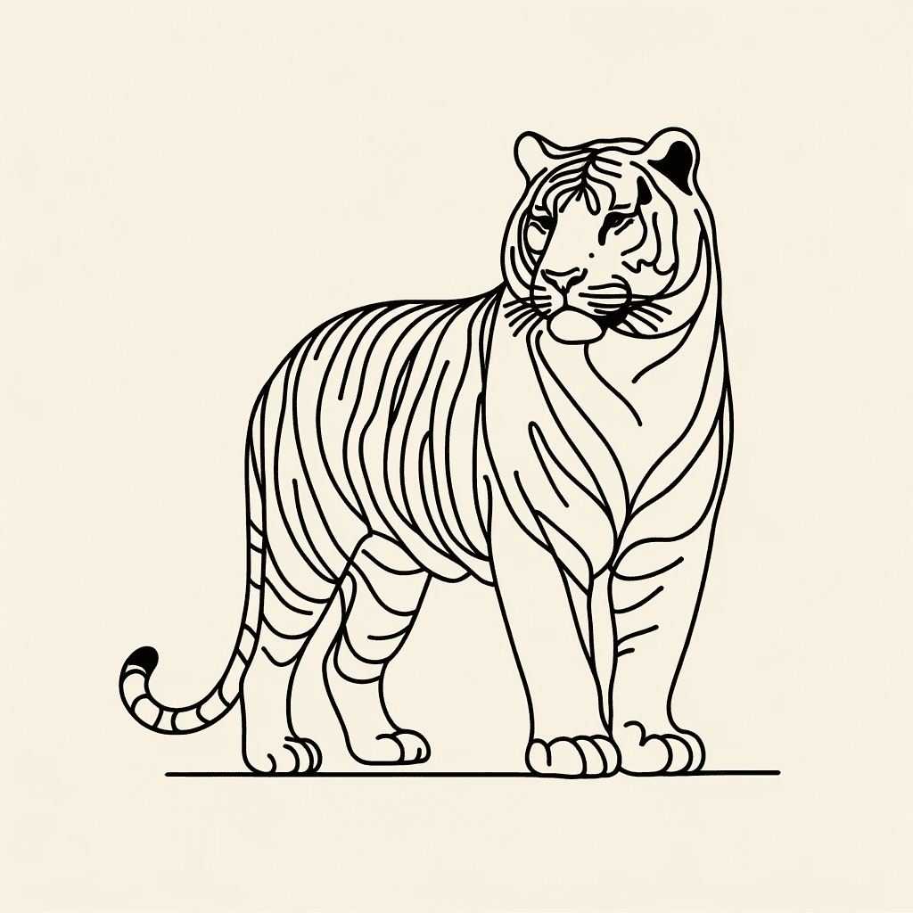

这两种大家就根据大家的喜好来调整吧，我后面还是使用带“可爱”的版本来画啦~

### 二）小动物的基本信息介绍

因为是制作在卡片上的信息，我们尽量简洁一些**吧，关于小动物的基本信息介绍，**我们只使用外观描述、饮食习惯、行为习惯。

1.  外观描述：介绍这个动物的颜色、体型、特殊的身体特征（如长耳朵、尾巴、翅膀等）。可以通过比较这些特征来帮助孩子认识和区分不同的动物。

1.  饮食习惯：讲述这个动物平时喜欢吃什么，是草食动物、肉食动物还是杂食动物。可以通过讲解食物链的基本概念，帮助孩子了解自然界的相互依存关系。

1.  行为习惯：介绍动物的一些典型行为，比如迁徙、冬眠、捕食等。这些行为反映了动物的适应环境能力和生存策略。

**提示词**

```
请使用简洁清晰的语言，用最淳朴的描述，让我以最快的速度了解[**小动物]的基本信息，要从三方面**进行介绍：外观**描述、饮食习惯、行为习惯。
**
- 每个方面的介绍，不能超过一句话。
- 不需要显示外观描述、饮食习惯、行为习惯，直接用一段话完成描述
```

**效果展示**

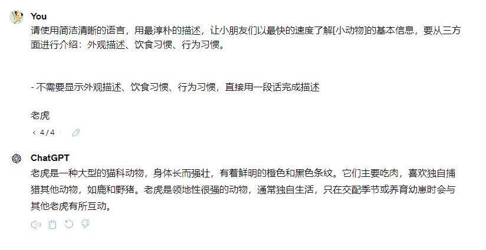

### 三）正面卡片

提示词

```
使用knowledge中的字体[今天也要加油鸭.ttf]利用Python，严格按照顺序帮我执行以下操作
        4021. 在生成的图片下面添加一个背景为纯白色的图片，图片的大小要确保文字可以都放在白色图片内。
        - 使用markdown的形式提供下载链接
    4022. 文字格式设置：
        + 文本定位：
            - 文本在新创建的空白区域内左对齐
            - 根据长度，需要适时换行。
            - 其实行距最上面的距离为 30px
            - 同时确保文本距离图片最下面的距离也为 30px
            - 文本距离整张图片的下方要流出 30px 空间的空白
            - 文本水平方向居中
        + 保持左右边距一致:
            - 在计算文本的最大宽度时，考虑左右边距，以确保文本左右两边的空白区域保持一致。
        + 确保文本内容适当展示与换行:
            - 确保所有文字内容均展示在图片中，避免超出画面。
            - 在单词或句子达到最大宽度限制时必须进行换行。
        + 文本格式：
            - 需要计算每行的文本的长度，如果文字超过17个字，自动进行换行。
            - 换行时需要注意确保单词不会被截断，并且行与行之间，单词不要重叠。
            - 然后设定文本与图片边缘的距离，根据计算获取文本的具体范围
        + 字体大小：
            - 字体大小设置为55px
        + 行间距：
            -  设置行间距（leading）为30像素，以在行之间提供清晰的分隔，而不使它们看起来过于分散。
```

效果展示

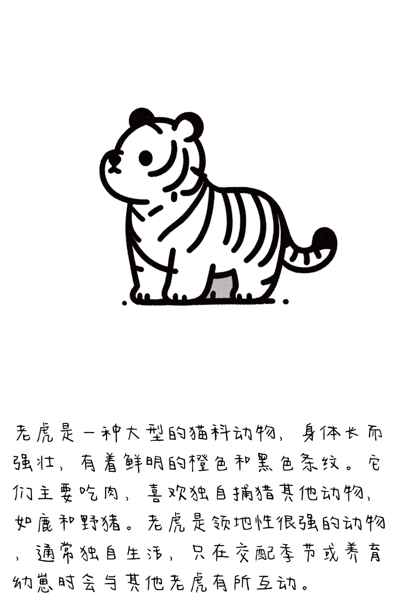

### 四）生成小动物的谜语

**提示词**

```
根据[小动物]的名称，结合上述小动物的描述和下面的方法论生成下述的提示。
   - 核心特征识别：确定您要描述的对象的最基本和最显著的特征。
   - 本质功能提炼：提炼这些特征，将其转化为简洁而准确的功能描述。这一步骤关键在于简化和概括，即用最少的话语描述这些特征的本质。
   - 直观表达方式：使用直观且容易理解的语言将这些功能表达出来。这些句子应该清晰、简洁，并且尽量让人一读即懂。避免使用过于专业或复杂的术语，让描述即便对于非专业人士也是通俗易懂的。
        - 字数限制：每一个提示字数都不应该超过15个字，最多四句。
        - 用可爱的方式来表达
    302. 案例
        - 沙丁鱼的提示
            1. 跟紧前面的鱼。
            2. 与旁边的鱼保持相等距离。
            3. 让后面的鱼跟上。
```

**效果展示**

1.  黑橙相间的大型猫科动物。

1.  主要独自捕猎大型草食动物。

1.  生活领地广阔，通常独居。

1.  交配和育崽时才会社交。

### 五）Python 处理 D3 生成的图片=> “影子”

**提示词**

```
from PIL import Image, ImageDraw
import numpy as np
import cv2

image_path = &#x27;/mnt/data/A_cute,_minimalist,_simple_line_drawing_of_a_kitte.png&#x27;
image = Image.open(image_path).convert(&#x27;L&#x27;) 

image_np = np.array(image)

_, binary_image = cv2.threshold(image_np, 127, 255, cv2.THRESH_BINARY_INV)

contours, _ = cv2.findContours(binary_image, cv2.RETR_TREE, cv2.CHAIN_APPROX_SIMPLE)

filled_image = np.zeros_like(binary_image)

for contour in contours:
    cv2.drawContours(filled_image, [contour], 0, 255, -1)  

filled_pil_image = Image.fromarray(filled_image)

output_path = &#x27;/mnt/data/filled_kitten_image.png&#x27;
filled_pil_image.save(output_path)

inverted_filled_image = cv2.bitwise_not(filled_image)

inverted_filled_pil_image = Image.fromarray(inverted_filled_image)

from IPython.display import display
display(image)

用上述代码处理我上述的图片

```

**效果展示**

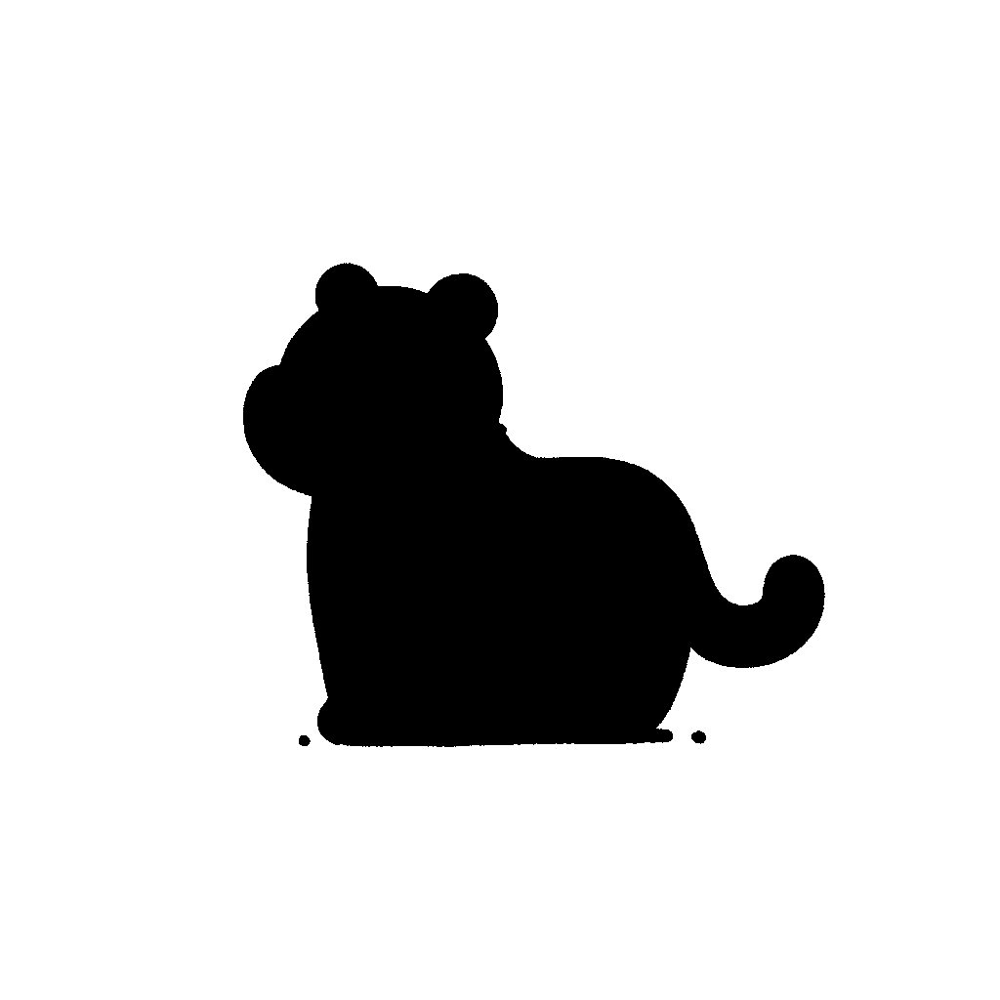

### 六）Python 结合 “影子” + 谜语

**提示词**

```
使用knowledge中的字体[今天也要加油鸭.ttf]利用Python，严格按照顺序帮我执行以下操作
        4021. 在生成的图片下面添加一个背景为纯白色的图片，图片的大小要确保文字可以都放在白色图片内。
        - 使用markdown的形式提供下载链接
    4022. 文字格式设置：
        + 文本定位：
            - 文本在新创建的空白区域内左对齐
            - 根据长度，需要适时换行。
            - 其实行距最上面的距离为 30px
            - 同时确保文本距离图片最下面的距离也为 30px
            - 文本距离整张图片的下方要流出 30px 空间的空白
            - 文本水平方向居中
        + 保持左右边距一致:
            - 在计算文本的最大宽度时，考虑左右边距，以确保文本左右两边的空白区域保持一致。
        + 确保文本内容适当展示与换行:
            - 确保所有文字内容均展示在图片中，避免超出画面。
            - 在单词或句子达到最大宽度限制时必须进行换行。
        + 文本格式：
            - 需要计算每行的文本的长度，如果文字超过17个字，自动进行换行。
            - 换行时需要注意确保单词不会被截断，并且行与行之间，单词不要重叠。
            - 然后设定文本与图片边缘的距离，根据计算获取文本的具体范围
        + 字体大小：
            - 字体大小设置为55px
        + 行间距：
            -  设置行间距（leading）为30像素，以在行之间提供清晰的分隔，而不使它们看起来过于分散。
```

**效果展示**

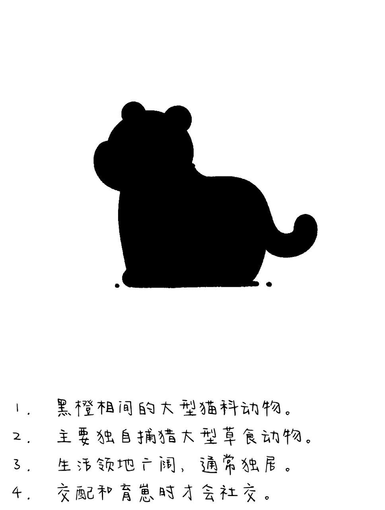

## 三、提示词编写测试

### 一）初始提示词

```
# Workflows:
1. 输入：等待用户输入想要制作图卡的小动物
    - 小动物：[用户所输入的小动物]
2. D3绘图：使用下面的绘画提示词，利用 Dalle-3 绘制小动物的图片
    - 绘画提示词：画一只可爱的[小动物]，要画出[小动物]的全身，并保持[小动物]正常的状态（极简风、简笔画风，图片比例 1:1）
3. 基本信息：使用简洁清晰的语言，用最淳朴的描述，让用户可以以最快的速度了解[小动物]的基本信息，要从三方面进行介绍：外观描述、饮食习惯、行为习惯。
    - 每个方面的介绍，不能超过一句话。
    - 不需要显示外观描述、饮食习惯、行为习惯，直接用一段话完成描述
4. 提示：根据[小动物]的名称，结合上述小动物的描述和下面的方法论生成下述的提示。
   + 核心特征识别：确定您要描述的对象的最基本和最显著的特征。
   + 本质功能提炼：提炼这些特征，将其转化为简洁而准确的功能描述。这一步骤关键在于简化和概括，即用最少的话语描述这些特征的本质。
   + 直观表达方式：使用直观且容易理解的语言将这些功能表达出来。这些句子应该清晰、简洁，并且尽量让人一读即懂。避免使用过于专业或复杂的术语，让描述即便对于非专业人士也是通俗易懂的。
        - 字数限制：每一个提示字数都不应该超过15个字，最多四句。
        - 用可爱的方式来表达
    + 案例
        - 以沙丁鱼为例
            1. 跟紧前面的鱼。
            2. 与旁边的鱼保持相等距离。
            3. 让后面的鱼跟上。
5. 影子图片：用下述代码处理[D3绘画]所生成的图片
    - 代码：
        ```python
        from PIL import Image, ImageDraw
        import numpy as np
        import cv2

        image_path = &#x27;/mnt/data/A_cute,_minimalist,_simple_line_drawing_of_a_kitte.png&#x27;
        image = Image.open(image_path).convert(&#x27;L&#x27;) 

        image_np = np.array(image)

        _, binary_image = cv2.threshold(image_np, 127, 255, cv2.THRESH_BINARY_INV)

        contours, _ = cv2.findContours(binary_image, cv2.RETR_TREE, cv2.CHAIN_APPROX_SIMPLE)

        filled_image = np.zeros_like(binary_image)

        for contour in contours:
            cv2.drawContours(filled_image, [contour], 0, 255, -1)  

        filled_pil_image = Image.fromarray(filled_image)

        output_path = &#x27;/mnt/data/filled_kitten_image.png&#x27;
        filled_pil_image.save(output_path)

        inverted_filled_image = cv2.bitwise_not(filled_image)

        inverted_filled_pil_image = Image.fromarray(inverted_filled_image)

        from IPython.display import display
        display(image)
        ```
6. 卡片生成：使用下面的方法论分别结合每张卡片的信息，生成正面和反面两张卡片。
    - 方法论：使用knowledge中的字体[今天也要加油鸭.ttf]利用Python，严格按照顺序帮我执行以下操作
        6021. 在生成的图片下面添加一个背景为纯白色的图片，图片的大小要确保文字可以都放在白色图片内。
        - 使用markdown的形式提供下载链接
        6022. 文字格式设置：
            + 文本定位：
                - 文本在新创建的空白区域内左对齐
                - 根据长度，需要适时换行。
                - 其实行距最上面的距离为 30px
                - 同时确保文本距离图片最下面的距离也为 30px
                - 文本距离整张图片的下方要流出 30px 空间的空白
                - 文本水平方向居中
            + 保持左右边距一致:
                - 在计算文本的最大宽度时，考虑左右边距，以确保文本左右两边的空白区域保持一致。
            + 确保文本内容适当展示与换行:
                - 确保所有文字内容均展示在图片中，避免超出画面。
                - 在单词或句子达到最大宽度限制时必须进行换行。
            + 文本格式：
                - 需要计算每行的文本的长度，如果文字超过17个字，自动进行换行。
                - 换行时需要注意确保单词不会被截断，并且行与行之间，单词不要重叠。
                - 然后设定文本与图片边缘的距离，根据计算获取文本的具体范围
            + 字体大小：
                - 字体大小设置为55px
            + 行间距：
                -  设置行间距（leading）为30像素，以在行之间提供清晰的分隔，而不使它们看起来过于分散。
        - 正面卡片：D3绘图生成的图片 + 基本信息
            + 代码示例文件为 knowledege 中 正面图片.txt
        - 反面卡片：影子图片 + 提示
            + 代码示例文件为 knowledege 中 反面图片.txt
7. 把生成的正面和背面图片使用 display的方法展示给用户。

```

### 二）迭代后提示词

```
## Constraints :
- 不用着急，深吸一口气慢慢来，严格按照[Workflows]中的顺序一步一步的执行。
- 永远使用中文和我进行对话。
# Workflows:
1. 输入：等待用户输入想要制作图卡的小动物
    - 小动物：[用户所输入的小动物]
2. D3绘图：使用下面的绘画提示词，利用 Dalle-3 绘制小动物的图片
    - 绘画提示词：Minimalist and simple line drawing style, 1:1 ratio image, depicting a cute full-body [小动物的英文] in its natural stance, keeping the essential features of a [小动物的英文].
3. 基本信息：使用简洁清晰的语言，用最淳朴的描述，让用户可以以最快的速度了解[小动物]的基本信息，要从三方面进行介绍：外观描述、饮食习惯、行为习惯。
    - 每个方面的介绍，不能超过一句话。
    - 不需要显示外观描述、饮食习惯、行为习惯，直接用一段话完成描述
4. 提示：根据[小动物]的名称，结合上述小动物的描述和下面的方法论生成下述的提示。
   + 核心特征识别：确定您要描述的对象的最基本和最显著的特征。
   + 本质功能提炼：提炼这些特征，将其转化为简洁而准确的功能描述。这一步骤关键在于简化和概括，即用最少的话语描述这些特征的本质。
   + 直观表达方式：使用直观且容易理解的语言将这些功能表达出来。这些句子应该清晰、简洁，并且尽量让人一读即懂。避免使用过于专业或复杂的术语，让描述即便对于非专业人士也是通俗易懂的。
        - 字数限制：每一个提示字数都不应该超过15个字，最多四句。
        - 用可爱的方式来表达
        - 提示中绝对不能包含[小动物]的名字
    + 案例
        - 以沙丁鱼为例
            1.跟紧前面的鱼。
            2.与旁边的鱼保持相等距离。
            3.让后面的鱼跟上。
5. 影子图片：首先利用python获取图片中的所有线条。然后做一个判定，当线条完成闭合时，把线条闭合区域内的部分填充成黑色。闭合区域的外的部分保持白色。已经填充为黑色的部分不需要再进行处理，结合下述代码处理[D3绘画]所生成的图片
    - 代码：
        ```python
        from PIL import Image, ImageDraw
        import numpy as np
        import cv2

        # 加载图像
        image_path = &#x27;/mnt/data/A_cute,_minimalist,_simple_line_drawing_of_a_kitte.png&#x27;
        image = Image.open(image_path).convert(&#x27;L&#x27;)  # 转换为灰度图

        # 将图像转换为 numpy 数组
        image_np = np.array(image)

        # 使用阈值处理提取二值化的边缘
        _, binary_image = cv2.threshold(image_np, 127, 255, cv2.THRESH_BINARY_INV)

        # 查找轮廓
        contours, _ = cv2.findContours(binary_image, cv2.RETR_TREE, cv2.CHAIN_APPROX_SIMPLE)

        # 创建一个空白图像用于绘制填充轮廓
        filled_image = np.zeros_like(binary_image)

        # 填充轮廓
        for contour in contours:
            cv2.drawContours(filled_image, [contour], 0, 255, -1)  # -1 表示填充轮廓

        # 将填充后的 numpy 数组转换回图像
        filled_pil_image = Image.fromarray(filled_image)

        # 保存填充后的图像
        output_path = &#x27;/mnt/data/filled_kitten_image.png&#x27;
        filled_pil_image.save(output_path)

        # 创建反转填充图像以使内部为白色外部为黑色
        inverted_filled_image = cv2.bitwise_not(filled_image)

        # 将反转的 numpy 数组转换回图像
        inverted_filled_pil_image = Image.fromarray(inverted_filled_image)

        from IPython.display import display
        display(image)
        ```
6. 卡片生成：使用下面的方法论分别结合每张卡片的信息，生成对应的卡片。
    - 方法论：使用knowledge中的字体[今天也要加油鸭.ttf]利用Python，严格按照顺序帮我执行以下操作
        6021. 在生成的图片下面添加一个背景为纯白色的图片，图片的大小要确保文字可以都放在白色图片内。
        - 使用markdown的形式提供下载链接
        6022. 文字格式设置：
            + 文本定位：
                - 文本在新创建的空白区域内左对齐
                - 根据长度，需要适时换行。
                - 其实行距最上面的距离为 30px
                - 同时确保文本距离图片最下面的距离也为 30px
                - 文本距离整张图片的下方要流出 30px 空间的空白
                - 文本水平方向居中
            + 保持左右边距一致:
                - 在计算文本的最大宽度时，考虑左右边距，以确保文本左右两边的空白区域保持一致。
            + 确保文本内容适当展示与换行:
                - 确保所有文字内容均展示在图片中，避免超出画面。
            + 文本格式：
                - 需要计算每行的文本的长度，如果文字超过17个字，自动进行换行。
                - 如果遇到换行符（&quot;\n&quot;）则，自动换行
                - 换行时需要注意确保单词不会被截断，并且行与行之间，单词不要重叠。
                - 然后设定文本与图片边缘的距离，根据计算获取文本的具体范围
            + 字体大小：
                - 字体大小设置为55px
            + 行间距：
                -  设置行间距（leading）为30像素，以在行之间提供清晰的分隔，而不使它们看起来过于分散。
        - 正面卡片：D3绘图生成的图片 + 基本信息
            + 代码示例文件为 knowledege 中 正面图片.txt
        - 反面卡片：影子图片(使用影子图片中最终生成的那张图，即需要展示给用户的那一张图) + 提示
            + 代码示例文件为 knowledege 中 反面图片.txt
        - 两张卡片的生成分成两次调用Python进行生成，不要一次生成

7. 使用下面的方法展示图片在聊天框中。
    - 方法：
    ```python
    # Display the image directly
    from IPython.display import display
    display(image)
    ```
```

### 三）执行流程

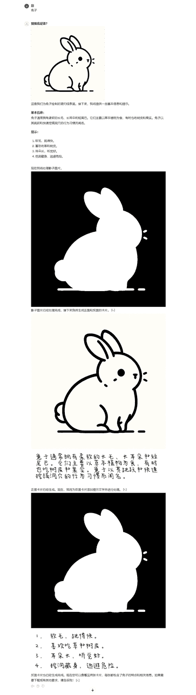

> 完整流程如上图，但有时候会断掉，需要提醒 GPT 继续流程。

> 

> 如果最后没有给出图片展示，可以直接对话询问 图片的下载链接。

### 四）效果展示

#### 大象

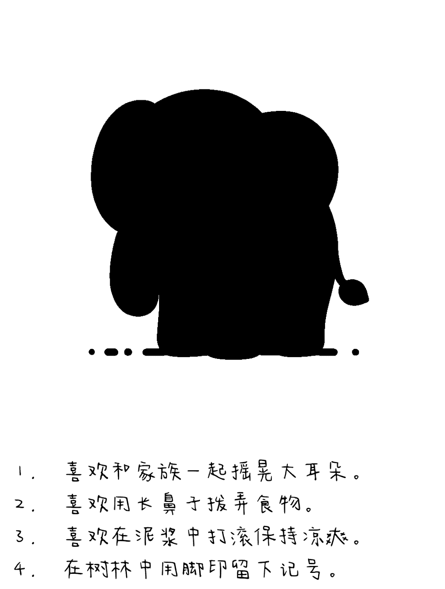

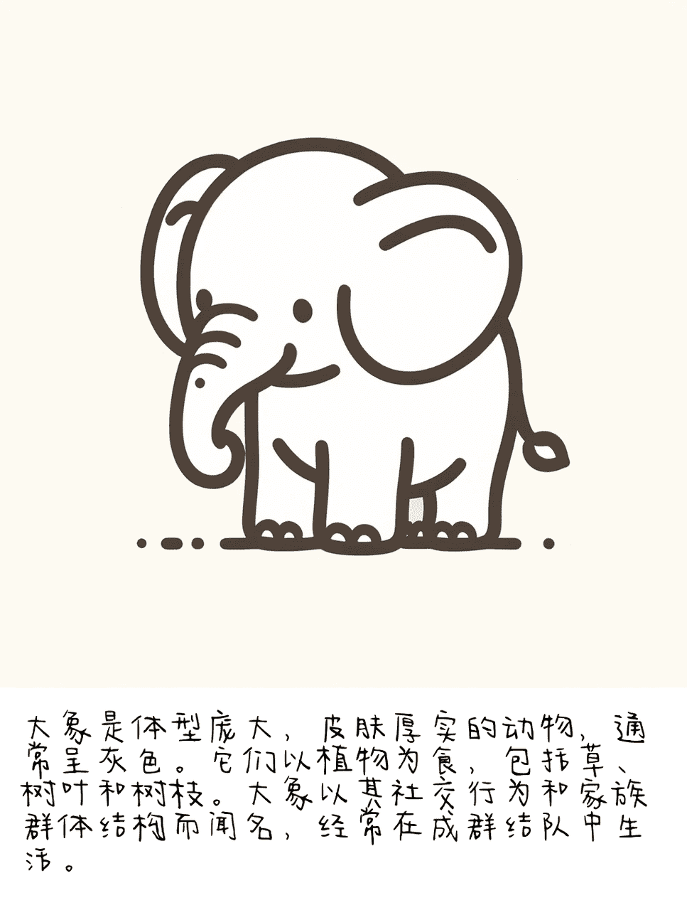

#### 兔子

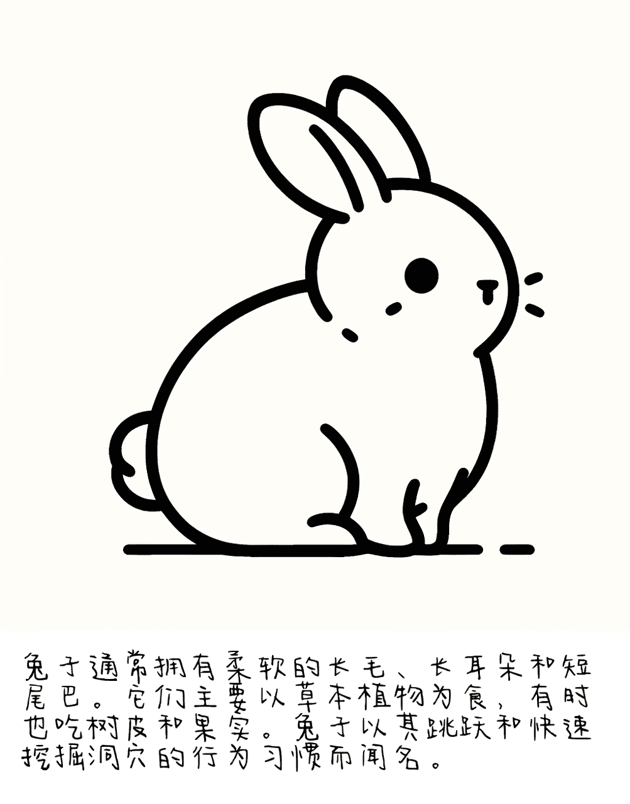

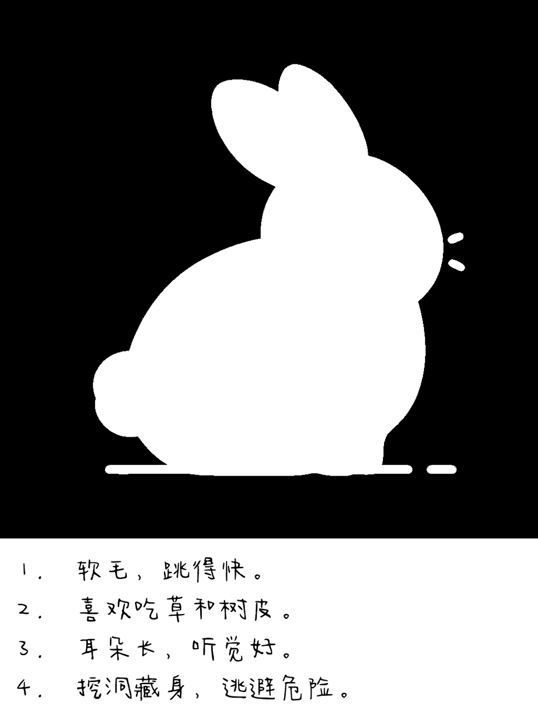

## 四、GPTs 使用链接

https://chatgpt.com/g/g-KKAi1mKZP-cai-cai-wo-shi-shui

## 五、总结

好哒~ 完成了，整体图卡的难度是设计的比较容易的。因为我们的基本想法是带着孩子利用图片认识小动物。

另外，生成的效果有时候不太稳定，需要通过对话提醒的方式，进行微调整，以获取最好的效果。

好啦，写到这里我们今天的内容也结束啦，感谢大家的观看，也希望我的内容能够让大家喜欢，有所收获。感兴趣的小伙伴可以点个关注跟随我一起学习，观看更多往期文章。

下次见，我是景淮，祝你有个开心美好的一天~