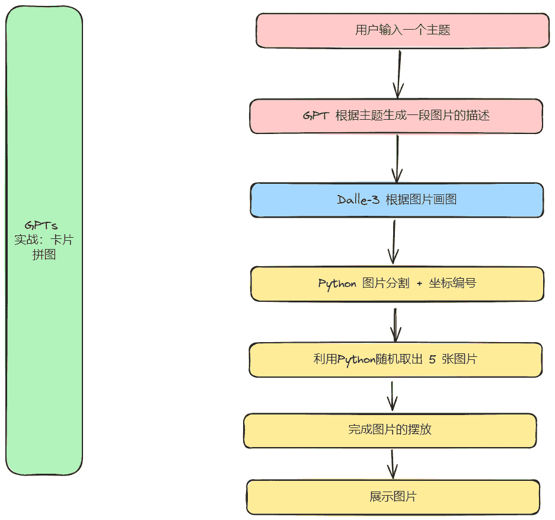
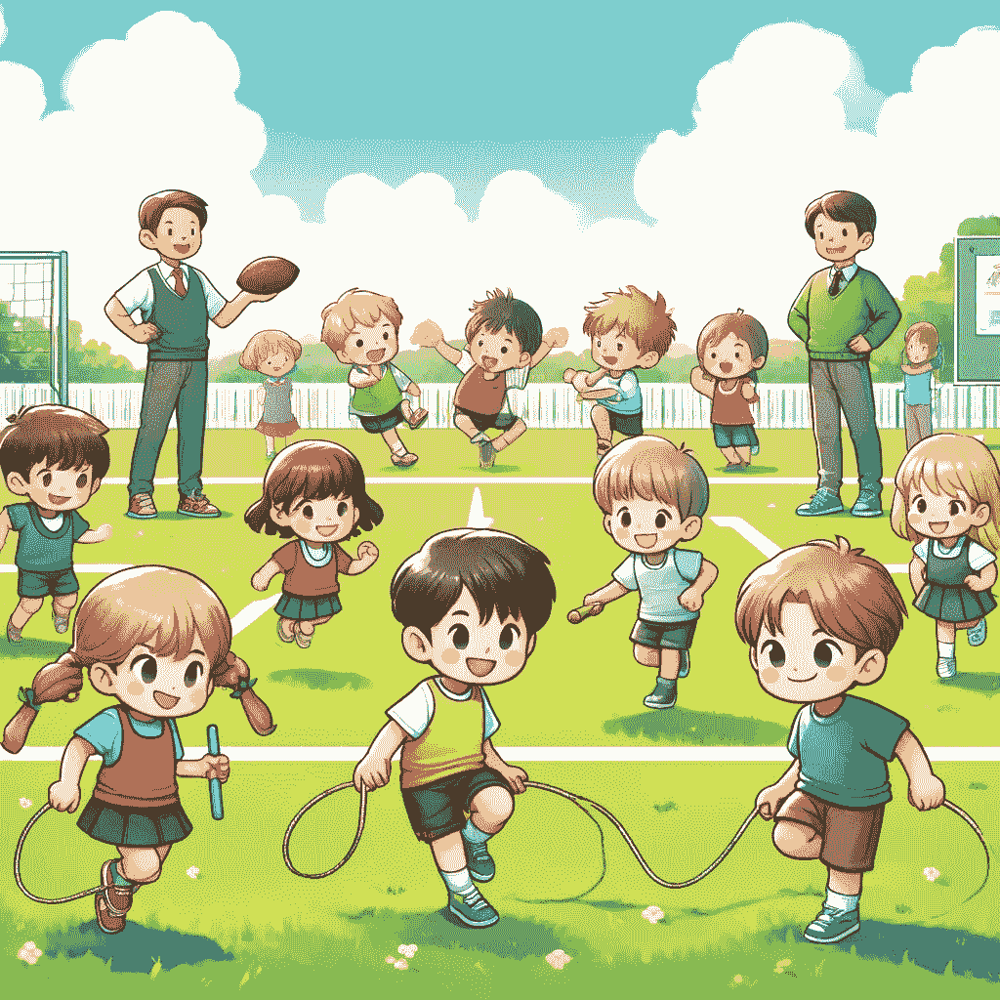
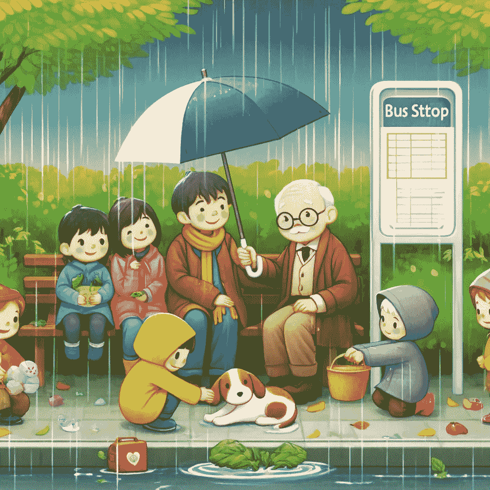
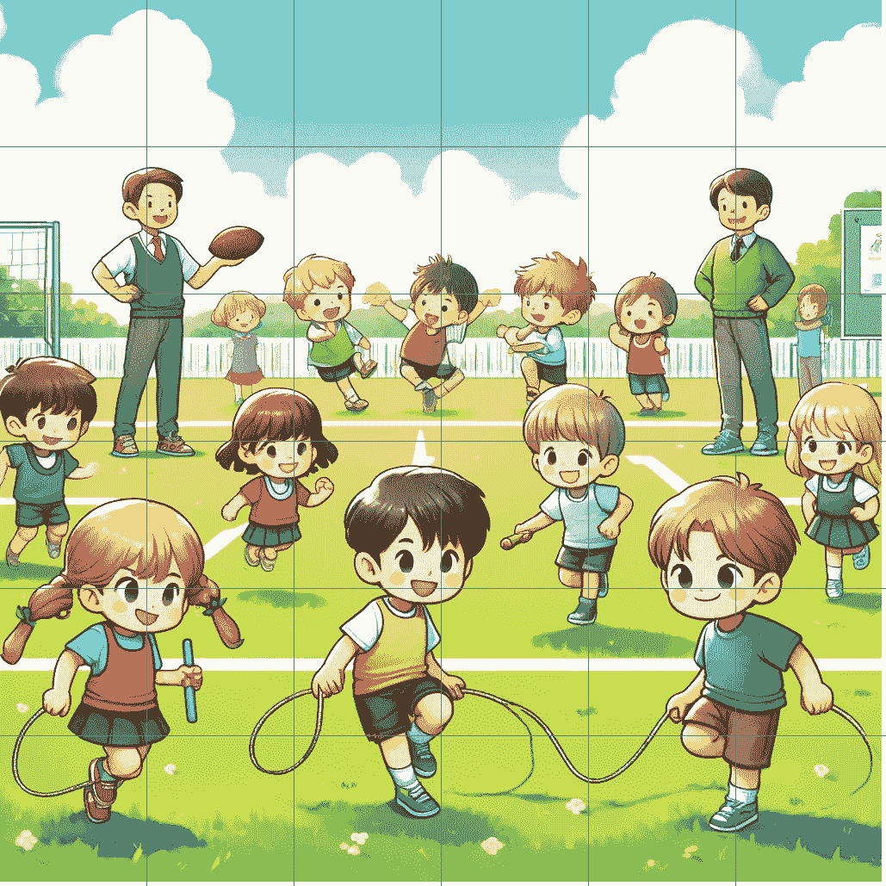
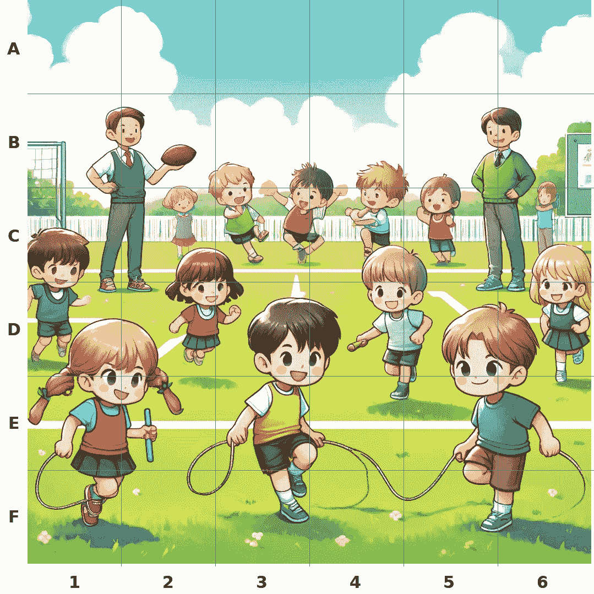
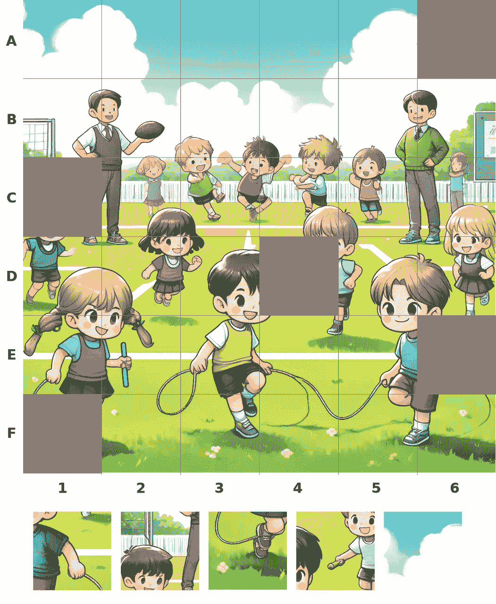
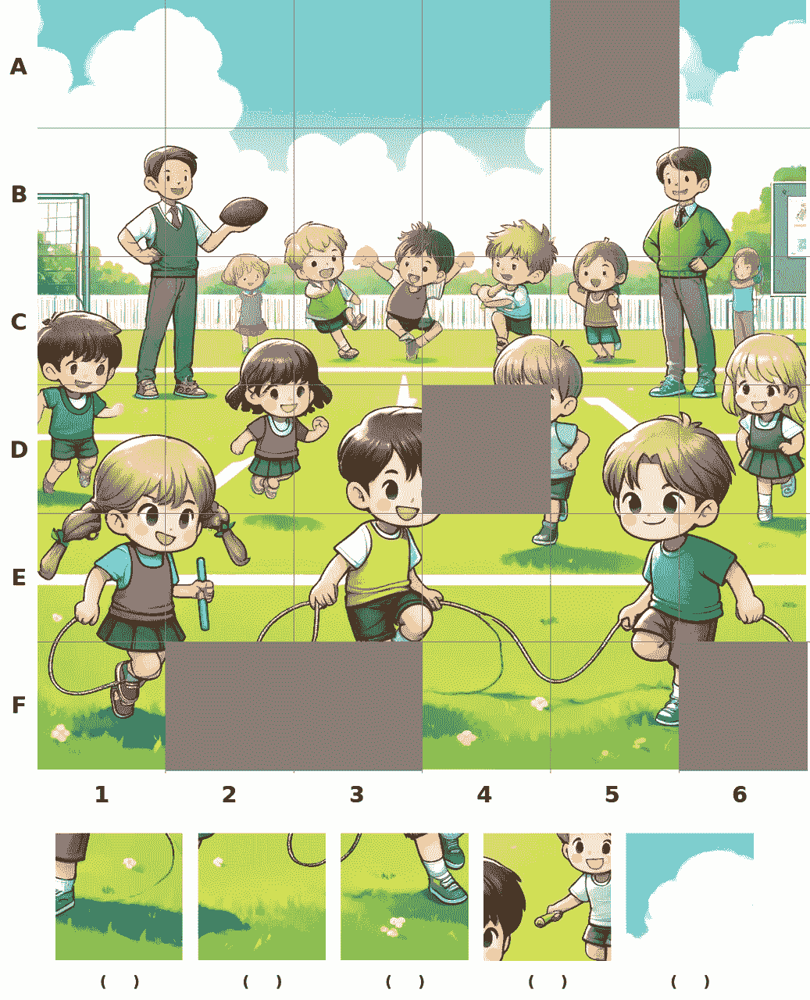
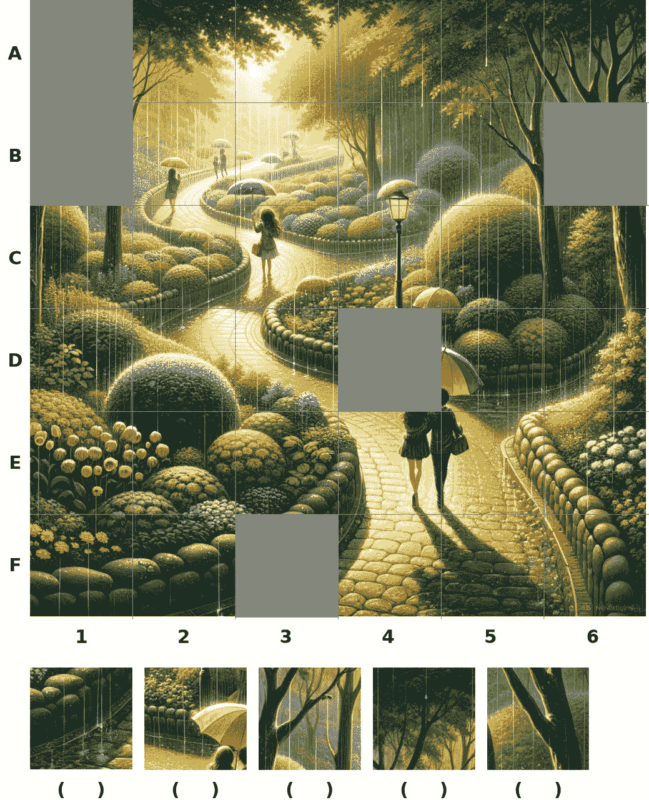
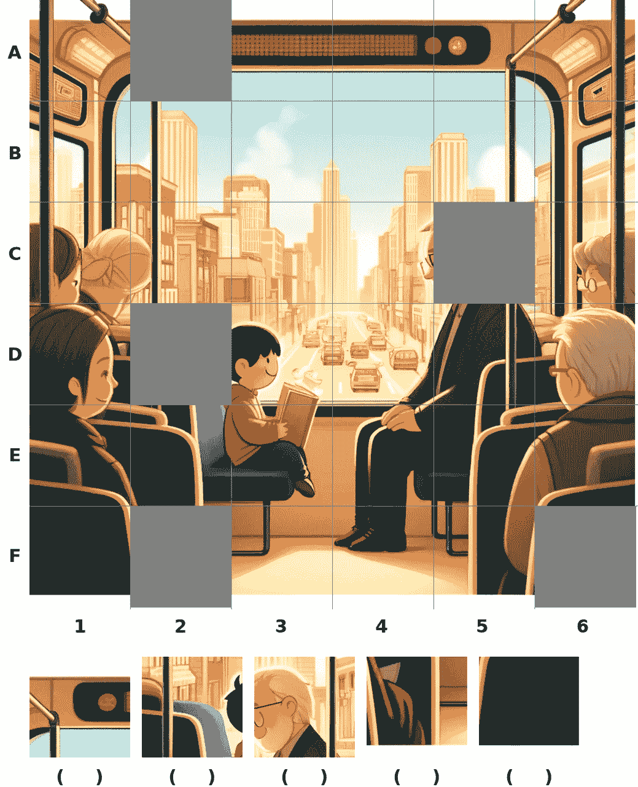
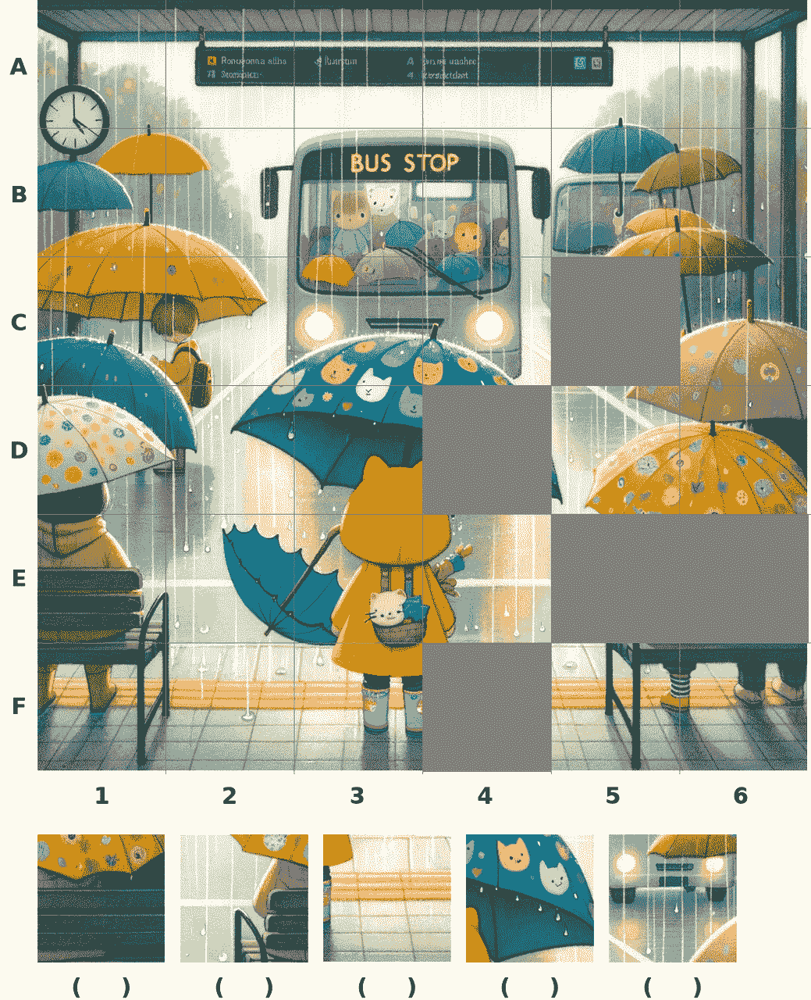

# 景淮：卡片拼图-GPTs 实战

> 来源：[https://waytoagi.feishu.cn/docx/AnN0d16b4ohqtsxZBUtcx3cznDf](https://waytoagi.feishu.cn/docx/AnN0d16b4ohqtsxZBUtcx3cznDf)

嘿，大家好呀，我是景淮，一个加拿大的程序员，沉迷 AI 不能自拔中。

最近总是很奇怪，就觉得自己没什么效率和目标。思前想后，可能还是现在写文章的同时，缺少了最开始那种感觉。

很多东西都玩了很多遍，所以好像缺少了些挑战。没有挑战也就反而没有了动力和激情。

思考ing，可能最近会多更新一下，找找节奏和感觉。

感觉自己很奇怪，很多时候要不是有事情解决不了，一般不会查查查，但是要是很长时间没有 Read in 又会陷入压抑的情绪中。

Emmmm 感觉自己还是多更新吧。

好啦，今天我们的孩子王系列内容主题如下

**GPT 猜猜我是谁**

本文会根据以下内容顺序进行：

+   需求分析

+   分步实现需求

+   提示词编写测试

+   GPTs 使用链接

+   总结

## 一、需求分析

在小时候，我们都玩过拼图游戏，那么拼图游戏对孩子到底有什么用呢？只是单纯的游戏吗？

当然不止是游戏，或者说，任何游戏只要有了正确的引导，任何游戏都可以是对孩子有益的。

拿拼图游戏举例来说，首先拼图游戏有益于反战孩子的认知和情感相关的技能。

1.  认知发展：拼图能帮助孩子识别不同的颜色、形状和图案，通过这个过程，他们学习如何识别和组织视觉信息。此外，解决拼图时需要记忆哪些部分可以拼在一起，这有助于提高记忆力。

1.  问题解决能力：拼图是一种很好的问题解决训练。孩子们需要思考如何才能使不同的拼图块拼在一起，这训练了他们的逻辑思维和策略规划能力。

1.  手眼协调：拼图游戏中，孩子们需要观察，挑选合适的拼图块，并将它们放在正确的位置，这个过程可以锻炼手眼协调能力。

1.  耐心和毅力：拼图需要时间和耐心，尤其是那些较为复杂的拼图。孩子在拼图过程中学会了坚持和耐心，这对培养良好的学习态度和应对生活挑战非常重要。

1.  社交技能：当拼图作为一种群体活动时，孩子们会学习如何与其他人合作，分享拼图块，交流想法，从而提高他们的社交技能。

1.  自我满足感和成就感：完成拼图后，孩子们会感受到成就感和自我满足，这有助于增强他们的自信心。

聊过拼图游戏的作用，然后我们就来一起设计游戏吧~

### 一）拼图制作

关于拼图的制作，其实是很简单的一部分，我们只需要用户先给出一个拼图的主题。

我们根据主题生成一段拼图的描述。然后利用 Dalle-3 把对应的图画出来。

然后我们可以利用 Python 按照规定的规则对图片进行切割，如 4 * 4 ， 5 *5 等

### 二）游戏设计

对于游戏的设计，抛开传统的拼图内容，我们把拼图弄的稍微简单一些，增加一些小的设计，比如增加类似坐标的原理。

分割图片后，随机抽出一些图片块，展示在图片下方，并标号。同时把原图抽出图片块的位置换成白色或灰色。

在原图上，按照分割的结果，对图片添加坐标编号。

最后，可以让孩子通过在下面的抽出图片的位置写上对应坐标的方式，复原图片。

### 三）工作流



## 二、分步实现需求

### 一）根据主题生成描述

**提示词**

```
根据用户输入的[主题]，来扩写，通过文字描述的方式，描述对应[主题]场景温馨美好，能够让人感觉到快乐和人性的善良的一面。描述的重点要放在构图上，要描述画面中尽可能多的元素。但字数不应多于100字。
```

**效果展示**

> 在阳光明媚的一天，一群小学生在操场上开心地参加体育课。孩子们身穿五彩缤纷的运动服，有的在跳绳，有的在踢足球，还有的在玩接力棒。在他们的周围，绿色的草地和远处的蓝天白云形成了美丽的背景。教练和几位老师站在一旁，微笑着观看，偶尔给予指导和鼓励。这幅画面展现了孩子们的活力、合作与快乐，以及他们在游戏中展现出的纯真与友谊。

> 在雨天的公交站，一片温馨的场景展开。穿着彩色雨衣的孩子们欢快地跳着水坑，而几位老人和年轻人共用一把大伞，围坐在一起，相互分享笑容和故事。雨滴从伞尖滴落，与周围绿树的叶子轻轻碰撞，营造出一种宁静而美好的氛围。公交站牌下，一只流浪狗蜷缩在一角，一位善良的少女正蹲下来，轻轻地喂它吃食。

### 二）Dalle-3 绘画

**提示词**

```
根据上面的描述
1. 在描述的前面固定加上“儿童插画画风，从整体的方式进行构图”，
2. 把整体的文字翻译成英文
3. 根据翻译后的内容当做 Dalle-3 绘画的提示词进行绘画。
```

**效果展示**





### 三）Python 处理图片

#### 1、图片分割

**提示词**

```
请帮我利用Python对上述图片按照下面的顺序进行处理。
1. 图片分割：利用 Python 把上面的图片进行等分，分割成 6 * 6 （总共36个）的小正方形。要保证每个边都被等分成 6 份。分割线为 1 px 的灰色实线
```

**效果展示**



代码

```
from PIL import Image, ImageDraw

# Load the image
image_path = &#x27;/mnt/data/Children\&#x27;s_illustration_style,_composed_overall:_O.png&#x27;
original_image = Image.open(image_path)

# Constants for the grid
num_splits = 6
line_width = 1
line_color = (128, 128, 128)  # Gray color

# Dimensions of the image
width, height = original_image.size

# Size of each cell (without considering line width initially)
cell_width = width // num_splits
cell_height = height // num_splits

# Create a new image to accommodate the lines
new_width = width + (num_splits - 1) * line_width
new_height = height + (num_splits - 1) * line_width
grid_image = Image.new(&#x27;RGB&#x27;, (new_width, new_height), (255, 255, 255))
grid_image.paste(original_image, (0, 0))

# Draw the grid lines
draw = ImageDraw.Draw(grid_image)

# Vertical lines
for i in range(1, num_splits):
    x = i * cell_width + (i - 1) * line_width
    draw.line([(x, 0), (x, new_height)], fill=line_color, width=line_width)

# Horizontal lines
for i in range(1, num_splits):
    y = i * cell_height + (i - 1) * line_width
    draw.line([(0, y), (new_width, y)], fill=line_color, width=line_width)

# Save the result
output_path = &#x27;/mnt/data/6x6_grid_illustration.png&#x27;
grid_image.save(output_path)
output_path

```

#### 2、坐标轴标注

**提示词**

```
2. 对上述图片标注坐标轴，分别在图片的左边和图片的下面增加一块空白区域，以标注坐标。
x轴部分用数字标注（1-6）y轴部分用（A,B,C,D,E,F）字体大小为 30px
```

**效果展示**



**代码**

```
# Load the grid image
grid_image = Image.open(&#x27;/mnt/data/6x6_grid_illustration.png&#x27;)

# Constants for the axis label area
x_axis_height = 50  # extra height for x-axis labels
y_axis_width = 50   # extra width for y-axis labels
font_size = 30

# Load a font (using a default PIL font)
from PIL import ImageFont
font = ImageFont.truetype(&quot;/usr/share/fonts/truetype/dejavu/DejaVuSans-Bold.ttf&quot;, font_size)

# Create new image with extra space for labels
labelled_image = Image.new(&#x27;RGB&#x27;, (grid_image.width + y_axis_width, grid_image.height + x_axis_height), (255, 255, 255))
labelled_image.paste(grid_image, (y_axis_width, 0))

# Draw object to add text labels
draw = ImageDraw.Draw(labelled_image)

# Adding x-axis labels (1-6)
for i in range(1, 7):
    text = str(i)
    # Calculate text position (centered on each cell)
    text_x = y_axis_width + (i - 1) * cell_width + cell_width // 2 - font.getsize(text)[0] // 2
    text_y = grid_image.height + (x_axis_height // 2) - (font.getsize(text)[1] // 2)
    draw.text((text_x, text_y), text, fill=(0, 0, 0), font=font)

# Adding y-axis labels (A-F)
for i, letter in enumerate(&quot;ABCDEF&quot;):
    text = letter
    # Calculate text position (centered on each cell)
    text_x = y_axis_width // 2 - font.getsize(text)[0] // 2
    text_y = (i * cell_height + cell_height // 2) - (font.getsize(text)[1] // 2)
    draw.text((text_x, text_y), text, fill=(0, 0, 0), font=font)

# Save the result
output_path_with_axes = &#x27;/mnt/data/6x6_grid_illustration_with_axes.png&#x27;
labelled_image.save(output_path_with_axes)
output_path_with_axes

```

#### 3、抽图

**提示词**

```
3. 随机从图片的坐标轴中，随机出5个图片的坐标。
沿着分割线，把图片从大图中取出（抽出来的图片，需要整齐的（水平）摆放在原始图片的下方，距离图片 30px的位置。同时确保图片之间有20px的间隙。保持原有的图片大小。）取出的部分用灰色进行填充。
```

**效果展示**



**代码**

```
import random
from PIL import Image, ImageDraw

# Generate 5 unique random coordinates from the grid
coordinates = [(x, y) for x in range(1, 7) for y in range(1, 7)]
random_coords = random.sample(coordinates, 5)

# Load the image with axes (to maintain the same dimensions)
image_with_axes = Image.open(&#x27;/mnt/data/6x6_grid_illustration_with_axes.png&#x27;)

# Parameters for cropping and drawing
cell_width = cell_height = 100  # Example values, please adjust to your actual grid cell size
line_width = y_axis_width = 10  # Example values for the width of grid lines and y-axis width

# Extract the individual images based on random coordinates and fill the original parts with gray
extracted_images = []
draw = ImageDraw.Draw(image_with_axes)
for x, y in random_coords:
    left = y_axis_width + (x - 1) * (cell_width + line_width)
    top = (y - 1) * (cell_height + line_width)
    right = left + cell_width
    bottom = top + cell_height
    
    # Crop the image
    cropped_image = image_with_axes.crop((left, top, right, bottom))
    extracted_images.append(cropped_image)

    # Fill the extracted part with gray in the main image
    draw.rectangle([left, top, right, bottom], fill=(128, 128, 128))

# Create a new image to accommodate the extracted images below the main image
start_x = y_axis_width
start_y = image_with_axes.height + 30  # 30px below the main image
total_width = y_axis_width + 6 * cell_width + 5 * line_width  # original total width
space_between_images = 20
total_extracted_width = 5 * cell_width + 4 * space_between_images
offset_x = (total_width - total_extracted_width) // 2  # Center the row of extracted images
final_image = Image.new(&#x27;RGB&#x27;, (total_width, start_y + cell_height + 30), (255, 255, 255))
final_image.paste(image_with_axes, (0, 0))

# Paste the extracted images onto the final image
current_x = offset_x
for img in extracted_images:
    final_image.paste(img, (current_x, start_y))
    current_x += cell_width + space_between_images

# Save the final result with corrections
final_output_path_corrected = &#x27;/mnt/data/final_image_with_extracted_and_filled.png&#x27;
final_image.save(final_output_path_corrected)
final_output_path_corrected

```

#### 4、添加括号

**提示词**

```
4. 在最下面5个抽出图片正下方中间的位置，添加“（   ）”，确保留出足够多的空间，以填写坐标，同时在括号下方再添加30px高度的空白区。- 注意括号中间要留出5个空格的空间
```

**效果展示**



代码

```
# Load the latest modified image
final_image = Image.open(&#x27;/mnt/data/final_image_with_extracted_and_filled.png&#x27;)

# Parameters for the extra labels and spacing
bracket_width = font.getsize(&quot;(     )&quot;)[0]
bracket_height = font.getsize(&quot;(     )&quot;)[1]
extra_space_below_bracket = 30

# Create a new image with additional space for brackets and extra space
new_image_height = final_image.height + bracket_height + extra_space_below_bracket
new_final_image = Image.new(&#x27;RGB&#x27;, (final_image.width, new_image_height), (255, 255, 255))
new_final_image.paste(final_image, (0, 0))

# Draw brackets and add space
draw = ImageDraw.Draw(new_final_image)
start_y = final_image.height + extra_space_below_bracket // 2  # Starting Y for brackets
bracket_text = &quot;(     )&quot;

# Calculate positions for the brackets centered below each image
current_x = (total_width - total_extracted_width) // 2
for _ in range(5):
    bracket_x = current_x + (cell_width // 2) - (bracket_width // 2)
    draw.text((bracket_x, start_y), bracket_text, fill=(0, 0, 0), font=font)
    current_x += cell_width + space_between_images

# Save the updated image
final_bracketed_path = &#x27;/mnt/data/final_image_with_brackets.png&#x27;
new_final_image.save(final_bracketed_path)
final_bracketed_path

```

#### 5、融合代码

```
from PIL import Image, ImageDraw, ImageFont
import random

# Load the original image
image_path = &#x27;/path/to/your/image.png&#x27;
original_image = Image.open(image_path)

# Constants for the grid and label setup
num_splits = 6
line_width = 1
line_color = (128, 128, 128)  # Gray color
x_axis_height = 50
y_axis_width = 50
font_size = 30

# Calculate new dimensions
width, height = original_image.size
cell_width = width // num_splits
cell_height = height // num_splits
new_width = width + (num_splits - 1) * line_width
new_height = height + (num_splits - 1) * line_width
extra_space_below_bracket = 30

# Create grid image
grid_image = Image.new(&#x27;RGB&#x27;, (new_width, new_height), (255, 255, 255))
grid_image.paste(original_image, (0, 0))
draw = ImageDraw.Draw(grid_image)

# Draw the grid lines
for i in range(1, num_splits):
    x = i * cell_width + (i - 1) * line_width
    draw.line([(x, 0), (x, new_height)], fill=line_color, width=line_width)
for i in range(1, num_splits):
    y = i * cell_height + (i - 1) * line_width
    draw.line([(0, y), (new_width, y)], fill=line_color, width=line_width)

# Label the grid
font = ImageFont.truetype(&quot;/usr/share/fonts/truetype/dejavu/DejaVuSans-Bold.ttf&quot;, font_size)
labelled_image = Image.new(&#x27;RGB&#x27;, (grid_image.width + y_axis_width, grid_image.height + x_axis_height), (255, 255, 255))
labelled_image.paste(grid_image, (y_axis_width, 0))
draw = ImageDraw.Draw(labelled_image)

# X-axis and Y-axis labels
for i in range(1, 7):
    text_x = y_axis_width + (i - 1) * cell_width + cell_width // 2 - font.getsize(str(i))[0] // 2
    text_y = grid_image.height + (x_axis_height // 2) - (font.getsize(str(i))[1] // 2)
    draw.text((text_x, text_y), str(i), fill=(0, 0, 0), font=font)
for i, letter in enumerate(&quot;ABCDEF&quot;):
    text_x = y_axis_width // 2 - font.getsize(letter)[0] // 2
    text_y = (i * cell_height + cell_height // 2) - (font.getsize(letter)[1] // 2)
    draw.text((text_x, text_y), letter, fill=(0, 0, 0), font=font)

# Randomly select 5 cells and extract images
coordinates = [(x, y) for x in range(1, 7) for y in range(1, 7)]
random_coords = random.sample(coordinates, 5)
extracted_images = []
for x, y in random_coords:
    left = y_axis_width + (x - 1) * (cell_width + line_width)
    top = (y - 1) * (cell_height + line_width)
    right = left + cell_width
    bottom = top + cell_height
    cropped_image = labelled_image.crop((left, top, right, bottom))
    extracted_images.append(cropped_image)
    draw.rectangle([left, top, right, bottom], fill=(128, 128, 128))

# Place extracted images below the main image
final_image = Image.new(&#x27;RGB&#x27;, (labelled_image.width, labelled_image.height + cell_height + x_axis_height + extra_space_below_bracket), (255, 255, 255))
final_image.paste(labelled_image, (0, 0))
current_x = y_axis_width
start_y = labelled_image.height + 30
space_between_images = 20
for img in extracted_images:
    final_image.paste(img, (current_x, start_y))
    current_x += cell_width + space_between_images

# Draw brackets and additional space for each extracted image
draw = ImageDraw.Draw(final_image)
start_y += cell_height + 15  # Adjust as needed
bracket_text = &quot;(     )&quot;
for i in range(5):
    bracket_x = y_axis_width + i * (cell_width + space_between_images) + cell_width // 2 - font.getsize(bracket_text)[0] // 2
    draw.text((bracket_x, start_y), bracket_text, fill=(0, 0, 0), font=font)

# Save the final image
final_image_path = &#x27;/path/to/save/final_image.png&#x27;
final_image.save(final_image_path)
final_image_path
```

效果展示（到次数了，重新画了一张）



## 三、提示词编写测试

### 一）初版提示词

```
# Workflows：
1. 输入：等待用户输入想要制作卡片拼图的主题
2. 描述：根据用户输入的[主题]，来扩写，通过文字描述的方式，描述对应[主题]场景温馨美好，能够让人感觉到快乐和人性的善良的一面。描述的重点要放在构图上，要描述画面中尽可能多的元素。但字数不应多于100字。
3. 绘图：根据上面的描述，按照下面的顺序执行。
    301. 在描述的前面固定加上“儿童插画画风，从整体的方式进行构图”，
    302. 把整体的文字翻译成英文
    303. 根据翻译后的内容当做 Dalle-3 绘画的提示词进行绘画。
4. 调用 Knowledge 中的 代码.py 文件来处理[绘画]生成的图片
5. 使用下面的方法展示图片在聊天框中。
    - 方法：
    ```python
    # Display the image directly
    from IPython.display import display
    display(image)
    ```
```

### 二）迭代后提示词

```
## Constraints :
- 不用着急，深吸一口气慢慢来，严格按照[Workflows]中的顺序一步一步的执行。
- 永远使用中文和我进行对话。
- 儿童插画画风只是一种画风，并不是给孩子用的
# Workflows：
1. 输入：等待用户输入想要制作卡片拼图的主题
2. 描述：根据用户输入的[主题]，来扩写，通过文字描述的方式，描述对应[主题]场景温馨美好，能够让人感觉到快乐和人性的善良的一面。描述的重点要放在构图上，要描述画面中尽可能多的元素。但字数不应多于100字。
3. 绘图：根据上面的描述，按照下面的顺序执行。
    301. 在描述的前面固定加上“儿童插画画风，从整体的方式进行构图”。
    302. 把整体的文字翻译成英文
    303. 根据翻译后的内容当做 Dalle-3 绘画的提示词进行绘画。
4. 调用 Knowledge 中的 代码.txt 文件中的代码来处理[绘画]生成的图片
5. 使用下面的方法展示图片在聊天框中。
    - 方法：
    ```python
    # Display the image directly
    from IPython.display import display
    display(image)
    ```
```

### 三）效果展示





## 四、GPTs 使用链接

https://chatgpt.com/g/g-kQYWBxTxO-qia-pian-pin-tu

## 五、总结

今天尝试着把Python处理图片的流程也拆的更细致了。然后把每段代码又合并成了一段代码。

因为这次的内容中，每次生成的图片大小基本相同，所以我们就不需要再增加过多的信息描述，直接要求使用合成的那一段代码即可。

好啦，写到这里我们今天的内容也结束啦，感谢大家的观看，也希望我的内容能够让大家喜欢，有所收获。感兴趣的小伙伴可以点个关注跟随我一起学习，观看更多往期文章。

下次见，我是景淮，祝你有个开心美好的一天~