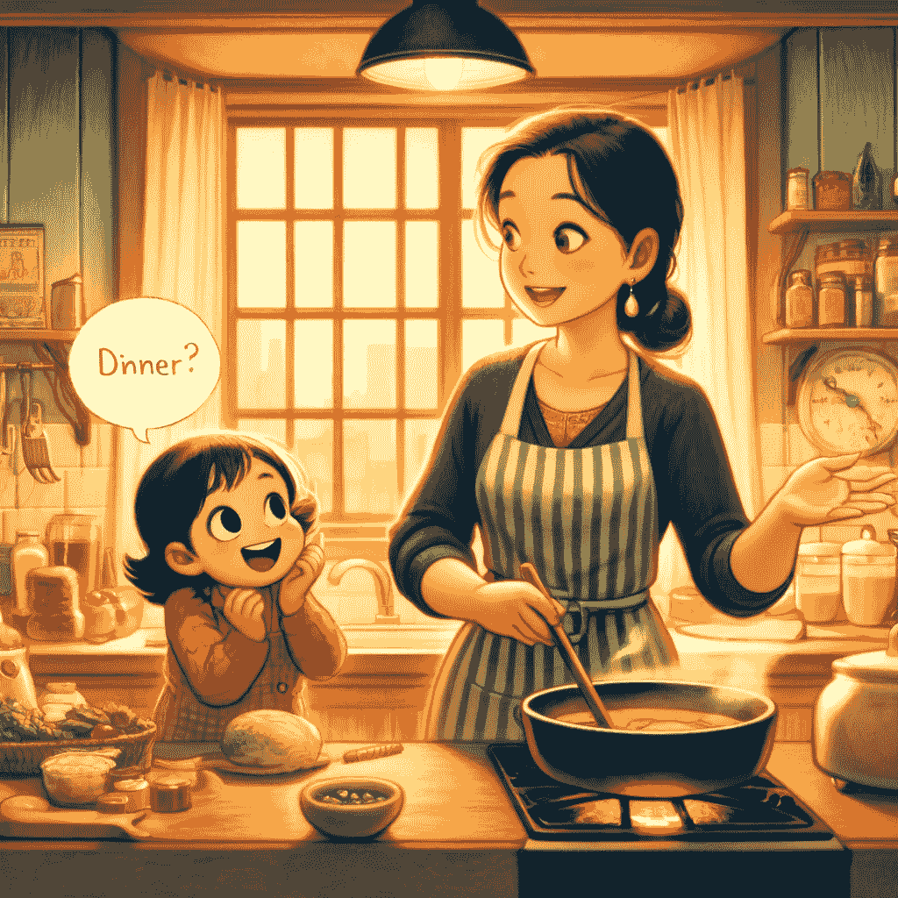
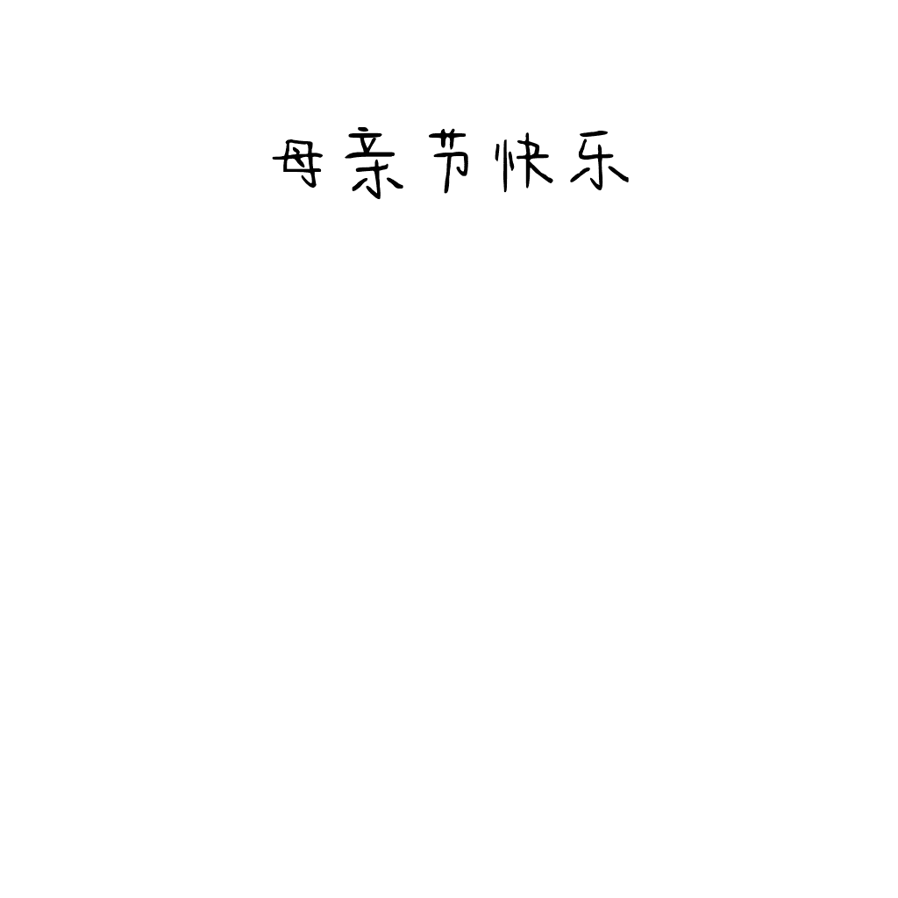
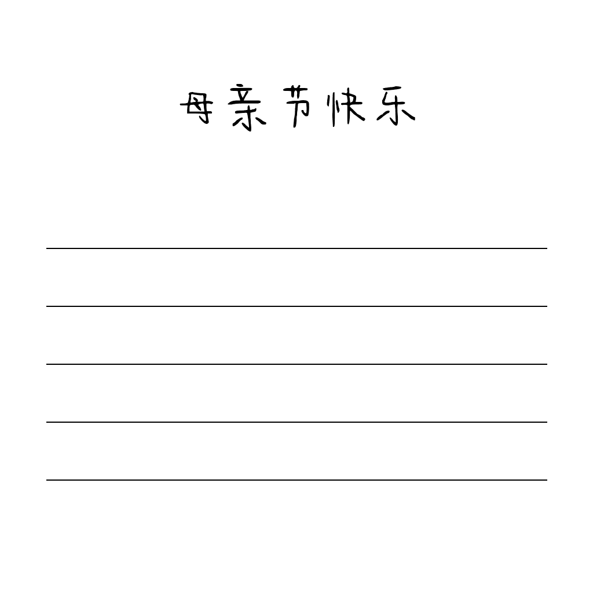
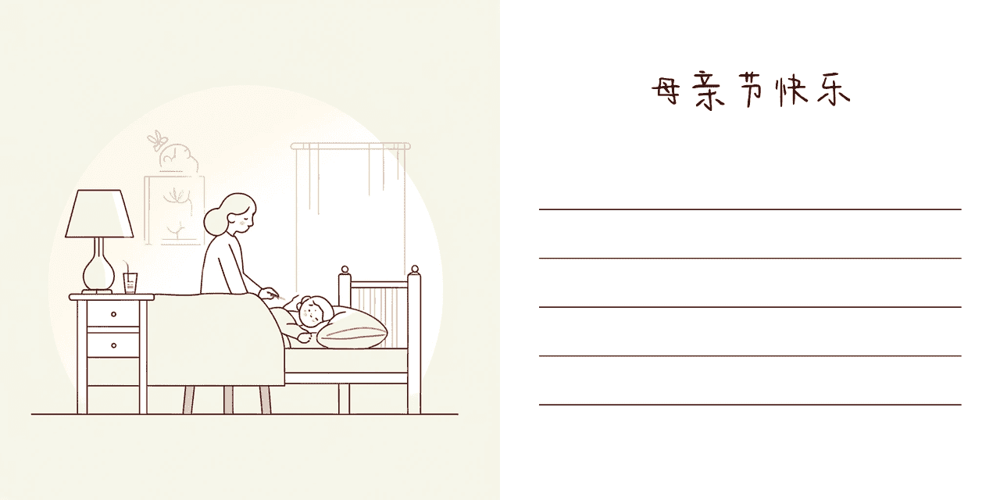
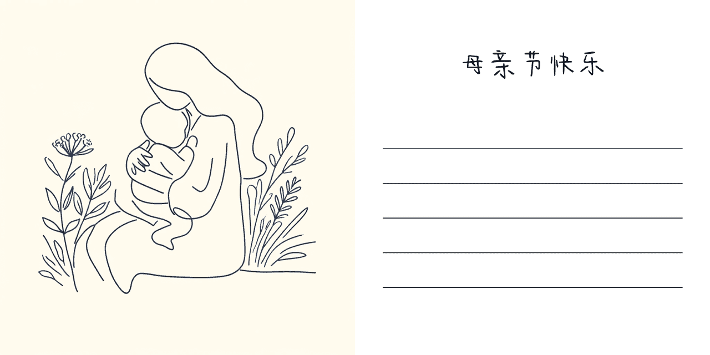
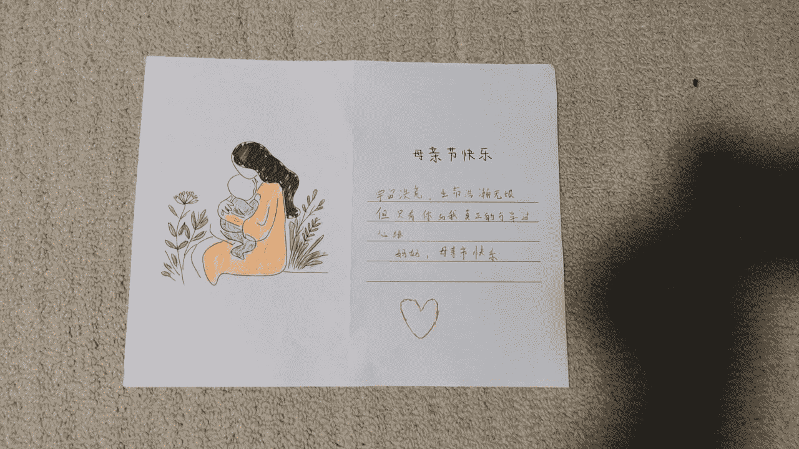
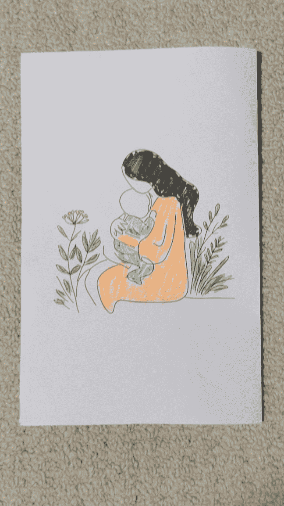
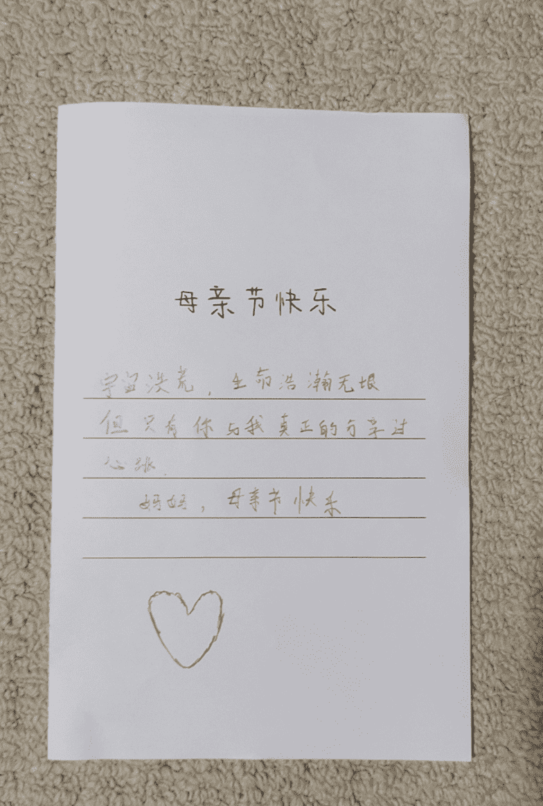

# 景淮： 母亲节贺卡 GPTs 实战

> 来源：[https://waytoagi.feishu.cn/docx/BhzidmqfcoZecAxTuLGcwuFzn9c](https://waytoagi.feishu.cn/docx/BhzidmqfcoZecAxTuLGcwuFzn9c)

嘿，大家好呀，我是景淮，一个加拿大的程序员，沉迷 AI 不能自拔中。

今天是 2024 年 5 月 12 日，是一个重要的日子，也是一个苦难的日子。

首先还是得祝福天下所有的母亲，母亲节快乐~

首先,祝福天下所有的母亲,母亲节快乐!这是一个值得庆祝的节日,向所有辛勤付出的母亲致敬。

不过,在欢庆的同时,我们也应当怀着虔诚的心意,默哀一下那些在汶川大地震中遇难的无辜生命。时光飞逝,转眼间已经16年过去了,如果有来生,那现在也都16岁啦。

大自然的威力是可怕的,但面对生死存亡,母亲们展现了人性中最纯美、最伟大的一面。她们是延续生命的摇篮,是温暖人心的太阳,用怀抱和身体为孩子遮风挡雨、护佑生命。

大地的撼动不足以撼动母亲对子女的深深眷恋。在那些被震垮的房屋下,在那些被掩埋的废墟里,母亲们用自己的肉身护住了娇嫩的生命。

人们总说，父爱如山，母爱如海。二者源远流长,相辅相成,缔造了人间最美好的 “家”。

今天是母亲节，所以就着重从母亲的角度聊聊吧~ 父爱等下个月~

说到妈妈呢，就想起那总是忙忙碌碌的身影，从记事起，妈妈好像总是很忙。



放学的时候她忙着在厨房做饭，准备晚餐。那时候最喜欢问的一句就是“妈，晚上吃啥”。

我妈会“恶狠狠”的回我一句，“做啥吃啥，总问啥啊” ，而我每天挨骂，但每天都乐此不疲的一遍遍的问。

虽然妈妈嘴上说“做啥吃啥”，可是啊，慢慢的发现妈妈开始尝试着做我喜欢吃的菜。饭桌上，符合我口味的菜越来越多。可我那时候不懂到底什么是母爱，总觉得妈妈做饭给我吃就是天经地义的呀。

小时候学游泳，可能游泳馆水质有问题，我眼镜又没戴好。得了“红眼病”，最后发烧发到 40 多度。人要是发烧烧到这个程度啊，就已经是很严重了。跟昏迷区别也不大了。

到了现在，我只记得，我躺在沙发上，在那边呻吟，我妈一遍又一遍的用她温热的手掌摸摸我的额头，一遍又一遍的体温计测量我的体温。然后，帮我擦身子，换放在头上的毛巾。哼着小曲，让我能够入睡。


我也记得，在我病好之后，妈妈去找游泳馆吵架，举报她们水质不好等等。细节已经记不清了，但那时候，可我那时候不懂到底什么是母爱，只觉得妈妈是想让他们对我的生病负责。

那时候只觉得妈妈好烦，很啰嗦，会抓我去学这学那。会天天说我，穿衣、吃饭、洗漱、睡觉... 每天都有说不完的唠叨。

可当我有一天上了大学，我才发现。陌生的环境会让我彷徨，没有人帮我把衣服洗好放进柜子，没有人帮我准备我爱吃的一日三餐，没有人在我生病的时候悉心照顾。

原来，离开了妈妈，我啥也不会，再简单的洗衣做饭都变得那么陌生和苦难。更没有妈妈的及时叮嘱，让我常常错过吃饭的时间，晚上也会经常熬夜，甚至昼夜颠倒，把作息全然弄乱。

突然，想起周董的那首歌“听妈妈的话”，小时只觉得旋律好听，当听懂的时候，才发现那些时间早已远去。

> 小朋友你是否有很多问号

> 为什么 别人在那看漫画 我却在学画画 对着钢琴说话

> 别人在玩游戏 我却靠在墙壁背我的ABC

> 

> 我说我要一台大大的飞机 但却得到一台旧旧录音机

> 为什么要听妈妈的话 长大后你就会开始懂了这段话

> 

> 长大后我开始明白

> 为什么我跑得比别人快 飞得比别人高

> 将来大家看的都是我画的漫画 大家唱的都是我写的歌

> 妈妈的辛苦不让你看见 温暖的食谱在她心里面

> 有空就多多握握她的手 把手牵着一起梦游

> 听妈妈的话 别让她受伤 想快快长大 才能保护她

> 美丽的白发 幸福中发芽 天使的魔法 温暖中慈祥

> 

> 在你的未来 音乐是你的王牌 拿王牌谈个恋爱

> 唉!我不想把你教坏 还是听妈妈的话吧 晚点再恋爱吧

> 我知道你未来的路 但妈比我更清楚

> 

> 你会开始学其他同学在书包写东写西

> 但我建议最好写妈妈我会用功读书

> 用功读书 怎么会从我嘴巴说出

> 不想你输 所以要叫你用功读书

> 妈妈织给你的毛衣 你要好好的收著

> 因为母亲节到时 我要告诉她我还留着

> 对了 我会遇到周润发

> 所以你可以跟同学炫耀赌神未来是你爸爸

> 

> 我找不到童年写的情书 你写完不要送人

> 因为过两天你会在操场上捡到

> 你会开始喜欢上流行歌 因为张学友开始准备唱吻别

> 

> 听妈妈的话 别让她受伤 想快快长大 才能保护她

> 美丽的白发 幸福中发芽 天使的魔法 温暖中慈祥

> 

> 听妈妈的话 别让她受伤 想快快长大 才能保护她

> 

> 长大后我开始明白

> 为什么我跑得比别人快 飞得比别人高

> 将来大家看的都是我画的漫画 大家唱的都是我写的歌

> 妈妈的辛苦不让你看见 温暖的食谱在她心里面

> 有空就多多握握她的手 把手牵着一起梦游

> 

> 听妈妈的话 别让她受伤 想快快长大 才能保护她

> 美丽的白发 幸福中发芽 天使的魔法 温暖中慈祥

哎，再听歌已经属于，看着歌词都会流泪的年纪。才知道有些时光一去终将不复。

其实我妈妈在我文章中出现过挺多次的。但基本写的都是我童年中，我觉得受伤的一面，但我也不止一次说过，我能有现在的思考，现在的状态，一定是因为妈妈，一定是因为爱。很庆幸，回过头来，我能感受到我是被爱包围着长大的孩子。

所以，“别让她受伤，快快长大，才能保护她”。

如果，有小朋友跟我一样，在那个叛逆的年纪，读不懂爱，甚至觉得烦躁，我是真的能理解的。因为很矛盾的就是，孩子在那个年纪，是很难读懂爱的。

但当有一天，他逐渐长大，过去的事情终究会成为他最美好的回忆，陪伴他继续远航，直到永远永远。

所以，教育的根本，从来不是你要执拗的教会孩子数学、语文、英语、体育、美术。

教育的根本说白了就是爱与陪伴。爱是生命中最美好、最纯真的一部分。用正确的方式去陪伴孩子，去爱孩子。不管他之后做着什么样的工作，过着什么样的生活。但他一定是幸福、快乐的。这就足够了。

最后，爱你老妈，明天见。

好啦，今天我们更新一篇跟母亲节相关的一期。

**GPT 母亲节贺卡**

本文会根据以下内容顺序进行：

+   需求分析

+   分步实现需求

+   提示词编写测试

+   GPTs 使用链接

+   总结

## 一、需求分析

其实之前做过中文的新年贺卡和英文的圣诞节贺卡，很多内容都是相关的。这次就当是整理，再做一张母亲节贺卡吧~

但是这次的内容，不止是单纯的贺卡，我更希望孩子可以用自己的方式把图片中的内容画出来，或者上色其他的方式来手工制作这张贺卡。（爸爸们，是你们帮忙动手的时候了！）

### 一）D3 绘制主题图片

当用户输入一个场景，或者一段印象中最深刻的时刻时，需要绘制出对应的图片。

### 二）文案创作

根据用户输入的内容，创作文案。

### 三）Python 制作贺卡

结合上述的生成的图片和文案，拼接成新的母亲节贺卡。

### 四) 手工制作贺卡

孩子们，爸爸们，是时候上手制作母亲节的贺卡了！

## 二、分步实现需求

### 一）D3 绘制主题图片

**提示词**

```
用极简画风、简笔画、儿童插画画风，画一个母亲抱着自己的孩子，其他的场景由你来创作。
```

**效果展示**


### 二）文案创作

其实写到这，突然不想创作文案了，把抒情的空间留给孩子不是更好吗？

那我就用留白的方式把空间留给孩子吧。让孩子们给妈妈们送上最真挚的祝福。

> 搜集文案

1.  世界上有一部永远都写不完的书，那便是母亲。

1.  宇宙洪荒，生命浩瀚无垠，但只有母亲和孩子真正分享过心跳。

1.  岁月不是偷走妈妈青春的小偷，我才是。

1.  神摧毁通天塔，只留下一个密码，名字叫做“妈妈”。

1.  听说神不能无处不在，所以创造了妈妈到了妈妈的年龄，妈妈依然是妈妈的守护神妈妈这个词，只是叫么叫，也触人心弦。

1.  妈妈永远是内心最柔软的地方。

1.  母亲卑微如青苔，庄严如晨曦柔如江南的水声，坚如千年的寒玉。举目时，她是皓皓明月:垂首时，她是莽莽大地。

1.  我不要沙滩小岛马车和城堡我不要人山人海热情的尖叫，我不要五光于色，灿烂辉煌的灯光在闪耀我只想有一天你能为我骄傲。

1.  她也是一个希望被爱，会害怕黑暗:遇到困难也会伤心难过会哭的女孩子可是罗月叫她伟大。

1.  即使活到七八十岁有母亲在，多少还可以有点孩子气。

1.  人这一生的浪漫和宠溺，记得分给母亲一份。

1.  妈妈们都有个通病，只要你说了哪样菜好吃，她就频繁地煮那道菜直到你决烦地埋怨了为止。其实她这辈子，就是在拼命把你觉得好的给你，都给你，爱得不知所措了而已

### 三）Python 制作贺卡

既然之前的想法已经确定了，那这次主要就是要在 D3 生成的图片右边生成一个标注有 母亲节快乐 的可书写卡片。

```
使用用户上传的字体包，按照以下要求，一步一步的使用 Python 执行。

1. 帮我生成一块与Dalle-3 绘制的图片相同大小，颜色为白色的图片（同样的高度和宽度）
2. 在创作的图片中间偏上的位置，用 85px 的字体，使用上传的字体包，写上“母亲节快乐”。
    - 字要水平居中
```

**效果图**



**提示词**

```
在文字下面 200px 左右的位置，开始添加横线（用来让用户在上面写字）。连续添加横线，直到距离整个图片底部 160px 的位置，不再添加横线。
    - 要求横线距离图片两边的距离为 80px，同时横线为黑色的实线 2px。
    - 每条横线之间的间距为 100px
```

**效果展示**



> 这边就不添加代码了，直接把生成的图片放入 knowledge 中就好了

## 三、提示词编写测试

### 一）初版提示词

```
## Constraints :
- 不用着急，深吸一口气慢慢来，严格按照[Workflows]中的顺序一步一步的执行。
- 永远使用中文和我进行对话。

## Workflows:
1. 输入：等待用户输入一个跟母亲相关的场景或者主题
    - 可以是场景的描述或者主题，如果内容不全则由你发挥想象力进行补全。
    - 一定要与母爱、母亲相关。
2. D3绘图：根据上述用户输入的内容和你补全的内容，把内容填充在下面的绘画提示词中，然后根据绘画提示词使用Dalle-3 来生成图片。
    - 绘画提示词：A minimalist, simple line drawing in a children&#x27;s illustration style，[描述]
3. 图片生成：使用Python把knowledge中名字为“mother.png”的图片根据 [D3绘图]绘制出图片的高度和宽度，对“mother.png”图片进行缩放，使其可以完美的拼接在生成的图片右侧。对两张图片进行拼接 D3 图片在左，Knowledge中的图片在右。
4. 使用下面的方法展示图片在聊天框中。
    - 方法：
    ```python
    # Display the image directly
    from IPython.display import display
    display(image)
    ```
```

### 二）迭代后提示词

```
## Constraints :
- 不用着急，深吸一口气慢慢来，严格按照[Workflows]中的顺序一步一步的执行。
- 永远使用中文和我进行对话。

## Workflows:
1. 输入：等待用户输入一个跟母亲相关的场景或者主题
    - 可以是场景的描述或者主题，如果内容不全则由你发挥想象力进行补全。
    - 一定要与母爱、母亲相关。
2. D3绘图：根据上述用户输入的内容和你补全的内容，把内容填充在下面的绘画提示词中，然后根据绘画提示词使用Dalle-3 来生成图片。
    - 绘画提示词：A minimalist, simple line drawing in a children&#x27;s illustration style，[描述]
3. 图片生成：使用Python把knowledge中名字为“mother.png”的图片根据 [D3绘图]绘制出图片的高度和宽度，对“mother.png”图片进行缩放，使其可以完美的拼接在生成的图片右侧。对两张图片进行拼接 D3 图片在左，Knowledge中的图片在右。
4. 使用下面的方法展示图片在聊天框中。
    - 方法：
    ```python
    # Display the image directly
    from IPython.display import display
    display(image)
    ```
 5. 给出图片的下载链接
```

### 三）效果展示





### 四）手工制作贺卡

首先我们用打印机，把图片打印出来。







（我外甥睡了= = 只能我来代工了！禁止批评字写的难看！不然都拉黑！统统拉黑！）

## 四、GPTs 链接

https://chatgpt.com/g/g-JX0nRhKOr-mu-qin-jie-he-qia

## 五、总结

内容其实很简单，重点是给孩子一个创作的机会，用自己的方式来表达爱。

好啦，不过多耽误大家时间了。最后，祝天下所有的母亲，母亲节快乐~

好啦，写到这里我们今天的内容也结束啦，感谢大家的观看，也希望我的内容能够让大家喜欢，有所收获。感兴趣的小伙伴可以点个关注跟随我一起学习，观看更多往期文章。

下次见，我是景淮，祝你有个开心美好的一天~