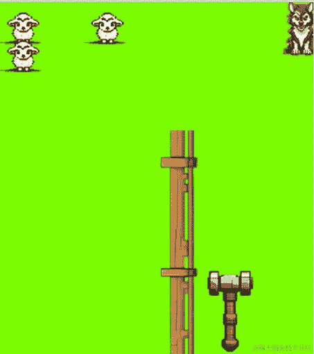
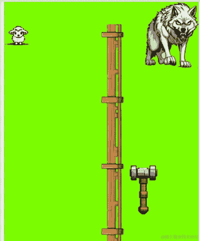
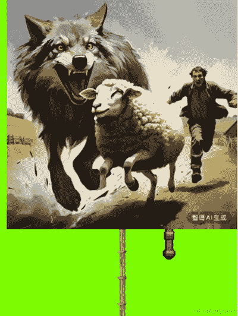
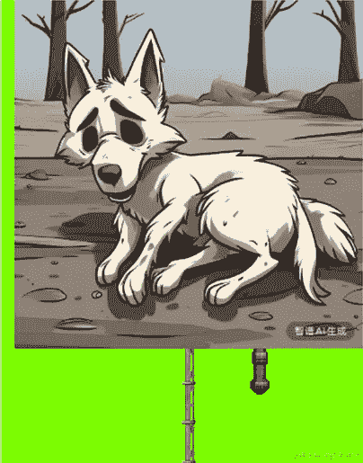

# 案例教程：记一次用国产AI开发游戏给孩子玩

> 来源：[https://waytoagi.feishu.cn/docx/T0QhduUyPo0IVwxCIb8cayS1nDe](https://waytoagi.feishu.cn/docx/T0QhduUyPo0IVwxCIb8cayS1nDe)

> 🔗 原文链接： h[ttps://juejin.cn/p](https://juejin.cn/post/7367753873891901459)ost/736775387389...

> 作者：涵

# 一、项目介绍和背景

> 2024年5月10日发现孩子 ，中午到家，说作业复杂（其实就是3位数竖式计算题，但是不知道为什么他觉得难，昨晚做了20题左右3位数测试结果她正确率100%应该还行），作业都不做，老是想去玩。

> 也许有可能是，休息后时间概念没有，导致休息时间太久了？还需要摸索处理。

> 为了让他有个概念，知道时间一直都在流失。

> 所以决定做个游戏，让他知道时间流逝。时间不因为作业难，停下不做，而变慢。

> 因为我本身不会做游戏，但是会HTML+CSS+JS，为了快速出货。

> 直接用我熟悉的HTML+css+js快速做。顺带测试一下用AI做一个完整的小项目效果如何。

> 本次代码大部分用AI，图片也用AI。

> 为了方便测试，全部采用智普AI。

> 计划给定时间，今天下午完成，晚上马上给孩子玩。毕竟时间不多，手头还要做其他事情呢！

# 二、游戏思路

故事背景:

亡羊补牢的故事。

游戏目的:

狼代表有点难度的作业。

羊代表时间。

角色:

老狼🐺1 普通，形象猥琐，小羊🐏一分钟出来一只。

老狼🐺2，暴躁强壮。大只一些。一直在向羊圈前进。

小羊🐏一分钟出来2只，

羊圈:初始里头50只羊。

每分钟都在减少。

有个破洞。

破洞修好后羊的数量快速上升到100只。

胜利画面，画一只饿死的狼。

羊圈没有羊了，画一只撑死的狼。

点击屏幕，锤子动，表示在做栅栏。

点击20下，完成栅栏。

关卡:

第一关，普通狼。

第二关，凶猛狼。

# 三、成品效果

# ****

第一只狼

第二只狼

失败效果

成功效果

# 四、 **开发过程**

2024年5月11日14:14:28 开始

+   直接智普，叫它生成羊，狼，锤子，栅栏，胜利图片，失败图片

其中：

+   羊，狼，锤子，栅栏 叫它生成没有背景的。然后用PS做成透明PNG。因为东西相对简单，所以都是一次过。

+   栅栏生成了比较多次，因为我自己也想像不出来要啥样的比较好，只能生成多个看效果。

+   胜利图片，失败图片，也生成了多次，因为AI无法理解我要的东西，我需要狼，人，羊都在一个画面。目前生成的也不是很理想。

+   直接智普，图片先不放进去。叫它生成HTML的大框架，验证是否能够生成我期望的各个元素的摆放位置。

+   生成HTML代码比较简洁，符合期待。

+   多生成了js现在没啥用，因为JS是属于后期的事情，需求还没给，所以现在不管。到时候写业务逻辑了重新单独写。

+   生成的CSS结构不错，但是position的定位模式不对，导致羊和狼的位置错误。为了快速完成，我直接修改position: fixed;修复该BUG。

（个人感觉：AI生成的东西还是不能完全信任，可能有90%能用，但是剩下的10%还是需要有经验的人，或者说是专家进行人工调整。这个让我对于AI生成的其他东西也不敢完全信任。自己学习还是有必要的AI就是个辅助，不知道的东西，有条件的话，问专家应该还是很好的解决方案。）

2024年5月11日15:52:52 UI和HTML完成，开始制作JS效果

+   设计思路

+   羊：在左边，向栅栏缺口移动，之后向狼移动。碰到狼，消失。然后下一只。

+   狼：不用动，没啥动作

+   栅栏：上面一个，下面一个。中间的缺口当做洞，给羊过，羊碰到栅栏无法前进。

+   槌子：点一下转动，代表在修栅栏，然后栅栏变长，堵住洞口。

+   思路优化：

上面那个思路，后来一想，不对，太麻烦了。做起来代码太多了，影响进度。砍功能，压缩范围。

+   狼：不用动，没啥动作

+   栅栏：从上到下完整的一条杆子，做个洞的DIV。

+   洞：和栅栏一样宽度，和背景草坪一个颜色，高度变0的时候就是修好了。放在顶部，这样羊的动作简化很多，只要向右移动就好了

+   槌子：点一下转动，代表在修栅栏，然后洞变短。

+   羊：在左边，向右移动。不管狼了，反正看起来就是没掉了，直接超出屏幕就消失。然后下一只。

+   开发过程：

+   狼：不用动，就是图片放进去，调整一下大小，完成了。

+   栅栏：从上到下图片放进去，调整一下大小，完成了。

+   洞：调整背景颜色，叫AI给一个，然后背景颜色也这时候改进去。

+   槌子：点一下转动几度，结果AI给的代码发现没有实现动的动画，那我直接简化？事实证明确实还行。改成这样了：

+   点一下，马上旋转90度，不要动画效果了。放开的时候恢复。

+   然后点击的时候洞的高度变短，代表在修复洞口。

+   羊：这个部分最费时了。

+   生成20只羊，实现后发现羊都重叠在一起了，看不出来，然后叫AI每只羊间隔10PX，还行。

+   找到第一只，向右移动，结果AI给的代码，所有的羊都在动。重写了好几轮。

+   后来写出了第一只羊可以动了，叫它写到屏幕右边的时候删除这只羊。

+   然后要动下一只羊，又没思路了。还是叫AI写。把前面的羊的代码给AI，说我要动完第一次羊，删除这个羊，然后下一只羊继续跑出来。

这个又是改了几轮，然后才行。（感觉AI要出现人工需要的东西，可能需要多轮干预才行。比我期望的差一些些。）

+   失败判断：失败其实这个是放在羊的跑的动作里头实现的，就是羊跑光了，显示失败图像。

+   胜利判断：放在槌子事件里头判断。洞全部修好，就胜利。

+   第二关：胜利的时候多一个步奏跳转到第二页，第二页完全复制刚刚的代码，改改用，就是加一只长相凶狠点的狼，还是AI作图。其他没有了。

2024年5月11日17:34:04 完成所有内容，并上传到服务器，测试了几下。

时间到了，要回去给孩子用了。先这样凑合用吧，还是有一点点小BUG的。

# 五、 **总结**

##

## AI开发优点：

之前没有做过游戏，第一次做。作图这块确实省事很多。理论上，我如果想做一个游戏的个人开发者，也是可以的了。

开发省了很多事情。

## AI开发缺点：

由于本项目我没有强调架构，复用性，可维护性。所以很多细节排除了。整个代码写得有点不规范，后期维护升级啥的其实不方便。如果是非IT人事很难兼顾到这点。

比如失败和胜利的判断：应该将失败和胜利的判断逻辑从羊的移动逻辑中分离出来，单独作为一个判断条件。这样可以让游戏的结束条件更加清晰，也更容易进行测试和维护。

不过对于这个项目，我本身的定位就是一次性的游戏，没打算升级了，孩子只要能够记住，不要被困难吓倒，退缩就可以。

# 六、 **代码**

麻烦传，暂时先不弄了。

# 七、 **项目使用效果**

当天晚上我到家，孩子还是在等我回来才做作业，反正就是各种理由没有做。

孩子玩了1分钟。（辛苦3小时，只为一分钟，心里有点不是滋味，也在想，这个投入和收益是否匹配呢？）

然后我给孩子讲解，困难的题目就是第二只凶狠的狼，你看到它，难道就停止修围栏了？你还不是快快的点下去。

好像是听懂了。

然后就去上培训班了。

培训班回来后，好积极啊！自己说要把作业做掉。做到10点半，还没做完，太迟了，我催他明天继续做，才去睡觉。

当天晚上我开心了好久，觉得这3小时值得了！！

但是第二天，好像又恢复了。做作业拖拖拉拉，10多题的计算题。硬生生给我拖了2个小时，又被我骂了。

哎，真的不知道到底孩子理解了没？还是他理解了，但是执行不了？

我这个做游戏讲道理的方式，到底有没有用？哎，继续观察吧。