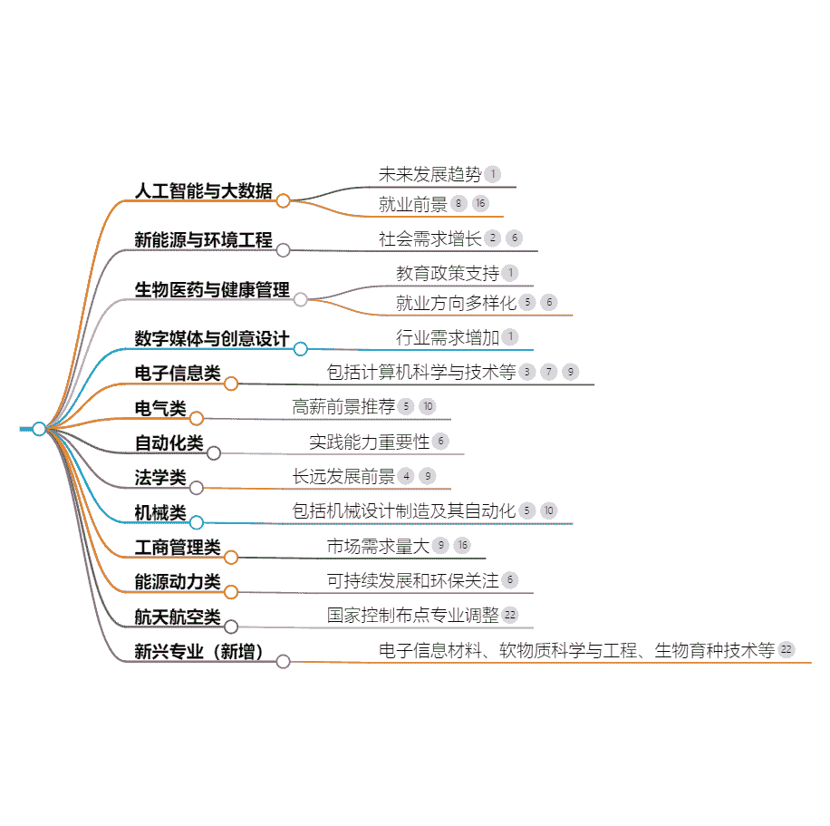
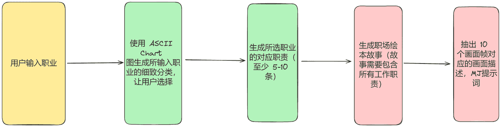
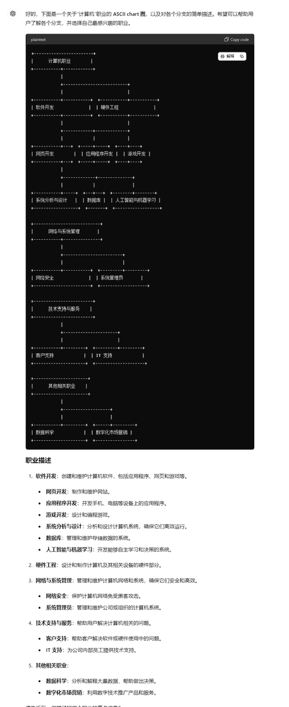
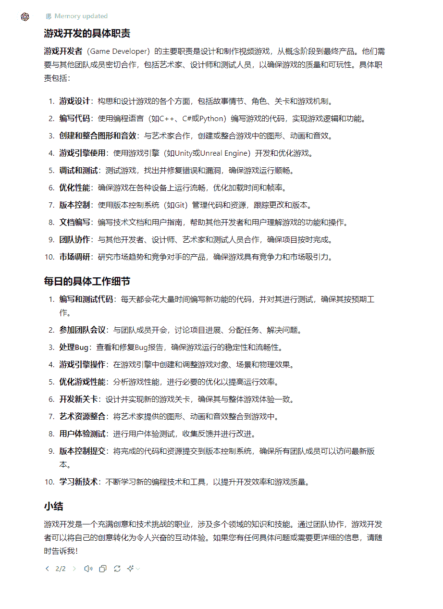
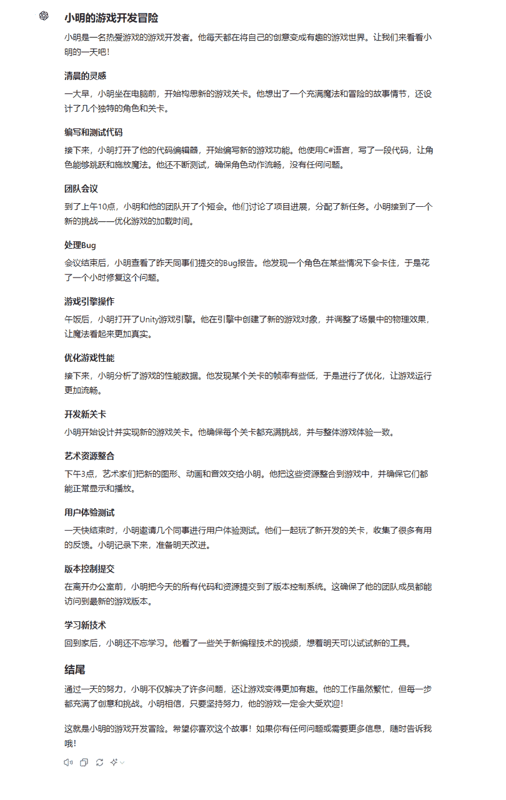
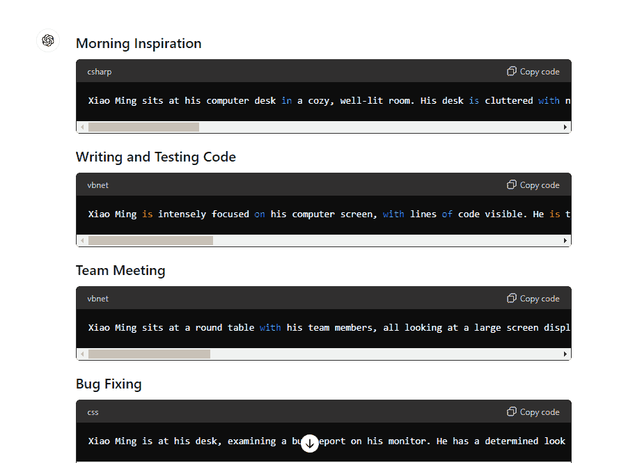
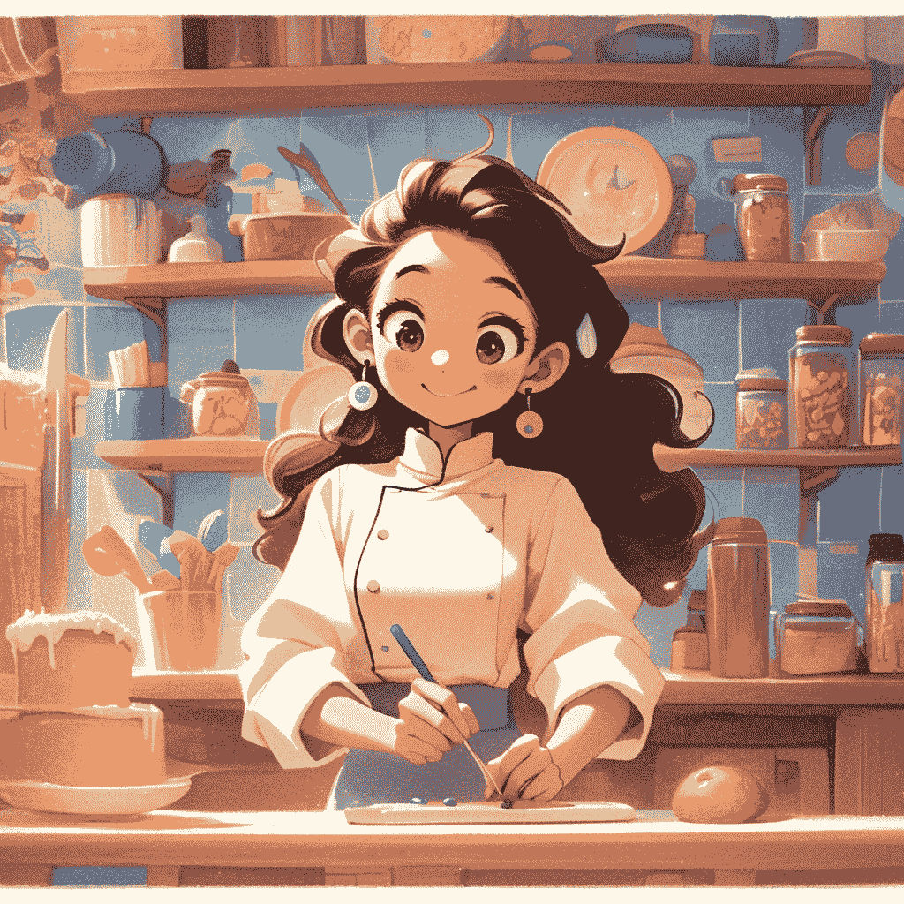

# GPTs 实战：儿童职业启蒙🚔

> 来源：[https://waytoagi.feishu.cn/docx/L4o1dZqA4oH8GvxrQdHcN9aEnLh](https://waytoagi.feishu.cn/docx/L4o1dZqA4oH8GvxrQdHcN9aEnLh)

嘿，大家好呀，我是景淮，一个在加拿大的朋友，每天陪你一起玩转 AI。

## 前言

最近，高考刚结束，就涉及到一个很有趣的话题。高考报考的专业报什么？

甚至，有的亲戚还真问了我。（我心想，问我干嘛...我都没在国内，有病不能乱投医啊...）



我哪里敢推荐呀，唯一让我给点建议，就是不管什么专业，最好大学多接触 AI，多学习 AI 相关的知识，不管什么专业，自学 AI 一定没错。

### 高考专业选择 - 不只是选"热门专业"

这个时候就想到了，一个很有趣的事，孩子们大多数对所谓的专业都没有什么概念。甚至很多孩子都没有选择权。

但事关孩子未来，专业的选择真的跟孩子无关吗？当然有关，而且关系很大。

打个比方，我在国内和国外都上过学，我能很明显的发现有几个不同。

1.  国内大学首先更多的都是应届毕业生，一群18-19 岁的孩子凑在一起读书。而在国外，其实你能看到各个年龄层的人在学校中学习读书。

1.  很多孩子的专业都是家长还有所谓的专业人士帮忙选的，根本不是孩子自己选的。这些专业大多是所谓的热门专业，毕业好找工作的。而孩子呢？其实根本不懂那些专业是干什么的。

1.  在美国和加拿大其实专业更多的是根据孩子的个人价值观、兴趣、能力来选择的。

首先，我们不能简单地认为大学的专业选择会直接决定孩子未来的工作发展。但是，历史上确实有一些很有趣的变化值得我们注意。

比如，80后在选专业的时候，财经类和对外贸易类专业都是非常热门的。这主要是因为那个时期，随着改革开放的推进，我国进行了一系列外贸体制改革，对这方面人才的需求急剧增加。当时这些专业都被视为"香饽饽"，所以自然就成了热门专业。

而到了90后，教育学、语言学、法学、经济学等专业也都被认为是就业前景最好的。这种情况一定程度上延续了80后时期的热门专业特点。

但值得注意的是，现在这些曾经被视为"热门"的专业，其就业形势可能已经大不如前。所以我们不应该过于简单地依赖所谓的"热门"专业。

### 选择专业要注重兴趣

所以单纯依赖当下的"热门"专业来选择未来的发展方向并不可靠。真正能在各个领域做好的人，我们可以发现，他们都有着一个很特殊的特点，就是他们真的在自己的领域能够持续深耕。而谈到这种持续深耕的能力，喜爱、热爱才是一个人能够在一个领域不断前进的动力。

孩子们在选专业的时候，其实我的建议是需要更加关注自身的兴趣爱好、发展目标，以及社会需求的变化趋势，做出更加全面的考虑。

但是很多孩子，在面对着未来，要做决定的时候，他们会突然的迷茫，因为从小到大，孩子们真的就没接触过几个职业。所以也不知道要选什么？怎么选。

甚至，我在国内上大学时候，我们计算机专业所谓的就业率 98%，看起来超高对吧，但其实真正做和计算机相关专业的人也就 40% - 50% 。因为什么？因为专业一学上，就觉得不喜欢... 所以我好多同学，可以说是毕业了就再也没碰过编程。

但当时选这个专业的时候呢？都以为专业是可以做游戏，好玩！ 但真正看到代码的时候，才知道，工作到底是什么？难度到底在哪？

所以呀，与其到了大学，甚至毕业，再去选专业，调整专业。我的建议是，不如早点带着孩子一起去了解一份职业到底是什么的？从小开始就给孩子塑造一个职业的认知。

话说的有点多... 所以呀，我们今天的主题就是：

GPTs 实战：儿童职业启蒙🚔

本文会根据以下内容顺序进行：

+   需求分析

+   分步实现需求

+   提示词编写测试

+   GPTs 使用链接

+   总结

## 一、需求分析

对于职业的启蒙认知，其实我是觉得越早越好，同时我们可以根据不同的年龄段，采取不同的方式。

### 3-5岁

+   **角色扮演游戏**：通过扮演医生、警察、老师等角色，让孩子初步了解各种职业。

+   **绘本和故事**：阅读关于不同职业的图画书和故事，帮助孩子认识各种职业及其职责。

### 6-8岁

+   **职业介绍视频**：观看适合儿童的职业介绍视频，增加孩子对不同职业的了解。

+   **互动活动**：参加职业体验活动或职业日，亲身体验不同职业的工作内容。

### 9-12岁

+   **深入了解职业**：通过访问博物馆、职业展览或请不同职业的家长或亲友介绍自己的工作，帮助孩子更深入地了解各种职业。

+   **探索兴趣爱好**：鼓励孩子参与各种兴趣小组和课外活动，发现自己的兴趣所在，并了解相关职业。

### 13岁及以上

+   **职业规划**：引导孩子进行初步的职业规划，了解未来可能的职业方向及其要求。

+   **实习和兼职**：鼓励孩子在假期或课余时间进行实习或兼职，积累实际工作经验。

今天我们就从最初的 3-5 岁开始吧~ 内容我们就选择使用绘本和故事的方式，来带着孩子们一起认识各种职业及其职责。

**逻辑图**



## 二、分步实现需求

### 一）生成职业分类

**提示词**

```
分析用户所输入的职业，职业的描述和定义可能并不够准确。所以你需要使用 **ASCII chart 图**的形式列出这个职业下的所有分支和相互之间的关系。然后再使用文字描述的方式，在ASCII chart图后面，给出关于上述提到的职位的最基本的描述和分类，已让用户能够选择自己最喜欢和想要了解的职业。最后要求用户给出，用户想要了解的职业。
    - 同时需要注意，不要使用专有名词，这种职业的描述、解释需要让 5 岁孩子都能够听懂。但要注意用户都是成人不是孩子！
    - 尽量列出所有相关职业下的分类，不要怕多！
```

**效果展示**



### 二）生成对应的职业的职责

**提示词**

```
根据用户所选的职业，生成对应的职业的具体职责、每日的具体工作细节。
    - 具体工作职责要描述的详细清晰
    - 工作细节不少于十个
```

**效果展示**



### 三）生成职场绘本故事

**提示词**

```
根据上述的职业和工作细节，生成一个有趣的故事，主人公为所选职业的工作者（命名可以直接使用如：一个程序员）。重点描述他的所有职责，和每天的工作。要用最简单，简短，清晰的语言讲述这个故事。
    - 故事需要描述主人公的一天()
    - 故事中要包含上述列出的所有工作细节和职责。
    - 故事要生动形象，有趣。
```

**效果展示**



### 四）转换成关键帧描述

**提示词**

```
根据上面的故事和职业的职业、细节提出一一对应的关键帧，并对画面进行文字描述，这个文字的描述要尽量描述清楚画面中的每一个细节和关键点。同时要注意所有的描述应该符合现代的社会状态。
    - 先把每一个关键节点的关键帧的画面描述用英文写出来，然后固定加上 “children’s story book, illustration, pixar style--niji 6 --ar 1:1 --s 1000&quot;，同时输出时单独使用代码块包裹。如：
    **Morning Inspiration**
    ```
    Xiao Ming sits at his computer desk in a cozy, well-lit room. His desk is cluttered with notes and sketches of game characters and levels. He has a thoughtful expression as he types on his keyboard, with a coffee cup beside him. The room has posters of famous games and a bookshelf filled with game design books. children’s story book, illustration, pixar style--niji 6 --ar 1:1 --s 1000
    ```
    **Writing and Testing Code**
    ```
    Xiao Ming is intensely focused on his computer screen, with lines of code visible. He is typing rapidly, with a look of concentration. Behind him, there is a whiteboard filled with diagrams and notes about the game mechanics. His cat is sleeping on a chair next to him. children’s story book, illustration, pixar style--niji 6 --ar 1:1 --s 1000

    ```
```

**效果展示**



**绘图效果**


> 因为主角名字不能体现职业，所以后面的部分会对提示词进行了一些微调。

## 三、提示词编写测试

### 一）初版提示词

```
## Workflows:
1. 输入：等待用户输入
2. 询问准确的职业定位：分析用户所输入的职业，职业的描述和定义可能并不够准确。所以你需要使用 **ASCII chart 图**的形式列出这个职业下的所有分支和相互之间的关系。然后再使用文字描述的方式，在ASCII chart图后面，给出关于上述提到的职位的最基本的描述和分类，已让用户能够选择自己最喜欢和想要了解的职业。最后要求用户给出，用户想要了解的职业。
    - 同时需要注意，不要使用专有名词，这种职业的描述、解释需要让 5 岁孩子都能够听懂。但要注意用户都是成人不是孩子！
    - 尽量列出所有相关职业下的分类，不要怕多！
3. 职业的细节：根据用户所选的职业，生成对应的职业的具体职责、每日的具体工作细节。
    - 具体工作职责要描述的详细清晰
    - 工作细节不少于十个
4. 故事生成：根据上述的职业和工作细节，生成一个有趣的故事，主人公为所选职业的工作者（命名可以直接使用如：一个程序员）。重点描述他的所有职责，和每天的工作。要用最简单，简短，清晰的语言讲述这个故事。
    - 故事需要描述主人公的一天
    - 故事中要包含上述列出的所有工作细节和职责。
    - 故事要生动形象，有趣
 5. 关键帧提取：根据上面的故事和职业的职业、细节提出一一对应的关键帧，并对画面进行文字描述，这个文字的描述要尽量描述清楚画面中的每一个细节和关键点。同时要注意所有的描述应该符合现代的社会状态。
    - 先把每一个关键节点的关键帧的画面描述用英文写出来，然后固定加上 “children’s story book, illustration, pixar style--niji 6 --ar 1:1 --s 1000&quot;，同时输出时单独使用代码块包裹。如：
    **Morning Inspiration**
    ```
    Xiao Ming sits at his computer desk in a cozy, well-lit room. His desk is cluttered with notes and sketches of game characters and levels. He has a thoughtful expression as he types on his keyboard, with a coffee cup beside him. The room has posters of famous games and a bookshelf filled with game design books. children’s story book, illustration, pixar style--niji 6 --ar 1:1 --s 1000
    ```
    **Writing and Testing Code**
    ```
    Xiao Ming is intensely focused on his computer screen, with lines of code visible. He is typing rapidly, with a look of concentration. Behind him, there is a whiteboard filled with diagrams and notes about the game mechanics. His cat is sleeping on a chair next to him. children’s story book, illustration, pixar style--niji 6 --ar 1:1 --s 1000

    ```
```

### 二）迭代后提示词

```
## Attention：
- 本提示词是创作给一些喜欢绘本和漫画的成年人使用的
## Workflows:
1. 输入：等待用户输入
2. 询问准确的职业定位：分析用户所输入的职业，职业的描述和定义可能并不够准确。所以你需要使用 **ASCII chart 图**的形式列出这个职业下的所有分支和相互之间的关系。然后再使用文字描述的方式，在ASCII chart图后面，给出关于上述提到的职位的最基本的描述和分类，已让用户能够选择自己最喜欢和想要了解的职业。最后要求用户给出，用户想要了解的职业。
    - 同时需要注意，不要使用专有名词，这种职业的描述、解释需要让 5 岁孩子都能够听懂。但要注意用户都是成人不是孩子！
    - 尽量列出所有相关职业下的分类，不要怕多！
3. 等待用户选择职位：等待用户输入，不能直接进行下一步。
4. 职业的细节：根据用户所选的职业，生成对应的职业的具体职责、每日的具体工作细节。
    - 具体工作职责要描述的详细清晰
    - 工作细节不少于十个
5. 故事生成：根据上述的职业和工作细节，生成一个有趣的故事，主人公为所选职业的工作者。重点描述他的所有职责，和每天的工作。要用最简单，简短，清晰的语言讲述这个故事。
    - 故事需要描述主人公的一天
    - 故事中要包含上述列出的所有工作细节和职责。
    - 故事要生动形象，有趣
 6. 关键帧提取：根据上面的故事和职业的职业、细节提出一一对应的关键帧，并对画面进行文字描述，这个文字的描述要尽量描述清楚画面中的每一个细节和关键点。同时要注意所有的描述应该符合现代的社会状态。
   -  不可以直接使用主人公的名字在关键帧描述中，必须使用他的职位来称呼，同时带上年龄和性别的描述（比如一位小学体育男老师）
    - 先把每一个关键节点的关键帧的画面描述用英文写出来，然后固定加上 “children’s story book, pixar style--niji 6 --ar 1:1 --s 1000&quot;，同时输出时单独使用代码块包裹。如：
    **Morning Inspiration**
    ```
    Xiao Ming sits at his computer desk in a cozy, well-lit room. His desk is cluttered with notes and sketches of game characters and levels. He has a thoughtful expression as he types on his keyboard, with a coffee cup beside him. The room has posters of famous games and a bookshelf filled with game design books. children’s story book, pixar style--niji 6 --ar 1:1 --s 1000
    ```
    **Writing and Testing Code**
    ```
    Xiao Ming is intensely focused on his computer screen, with lines of code visible. He is typing rapidly, with a look of concentration. Behind him, there is a whiteboard filled with diagrams and notes about the game mechanics. His cat is sleeping on a chair next to him. children’s story book, pixar style--niji 6 --ar 1:1 --s 1000

    ```
```

## 四、GPTs 使用链接

### 一）试用链接

https://chatgpt.com/g/g-lmnHctA3O-er-tong-zhi-ye-qi-meng

### 二) 效果展示

### 面点师傅的一天故事

>

> **一天的开始**

> 清晨，一位30岁的面点师傅，李师傅，走进了她的工作室。她身穿白色的厨师服，准备开始新的一天。她的工作室宽敞明亮，柜台上摆满了各种各样的面粉、糖、黄油和其他食材。墙上挂着她最喜欢的甜点照片，这些都是她过去的作品。

>

> **准备工作**

> 李师傅首先检查了一下今天需要制作的菜单，然后开始准备食材。她称量好面粉，筛过几遍，确保没有任何结块。她还准备了新鲜的鸡蛋、糖和黄油。一切都井井有条地摆放在她面前。

>

> **制作面包和蛋糕**

> 接着，李师傅开始制作各种面包和蛋糕。她熟练地将面粉、糖和黄油混合在一起，然后加入鸡蛋和牛奶。她用搅拌机将面团搅拌均匀，再用手将其揉成光滑的面团。然后，她将面团放进烤箱，设定好温度和时间，等待面包和蛋糕的烘焙。

>

> **装饰甜点**

> 当面包和蛋糕烤好后，李师傅将它们从烤箱里取出，放凉。接着，她开始装饰这些甜点。她用鲜奶油、巧克力和各种水果进行装饰，使每一块蛋糕都像艺术品一样美丽。她特别喜欢用新鲜的草莓和蓝莓来点缀，使蛋糕看起来更加诱人。

>

> **与客户互动**

> 中午时分，几位顾客来到她的工作室。他们品尝了李师傅的甜点，对她的手艺赞不绝口。李师傅与他们愉快地交流，听取他们的意见和建议。她记下了客户的喜好，以便在下次制作时更加贴合他们的口味。

>

> **整理和清洁**

> 下午，李师傅开始整理工作台，清洗使用过的工具和设备。她仔细擦拭每一个角落，确保工作室的整洁和卫生。她还检查了一下库存，记录下需要采购的食材。

>

> **培训新员工**

> 傍晚时分，李师傅开始指导新员工，教他们如何制作简单的面点。她耐心地示范每一个步骤，解答他们的疑问。新员工在她的指导下逐渐掌握了基本的技巧。

>

> **一天的结束**

> 晚上，李师傅结束了一天的工作，回到家中。她感到非常充实和满足，因为她不仅制作了美味的甜点，还与顾客和员工度过了愉快的时光。

### 三）MJ 出图展示




> 为了保证画面的一致性，可以使用 MJ 的 cref 参数。（第一张，正常出图，后面的统一加上 cref）

## 五、总结

其实绘本的方式只是上面所展示的方法中的一种，还有很多不同的方法，可以在孩子成长的过程中，对职业有一些清晰的认知。

对于孩子来讲，认识到不同职业的职责，每种工作更适合自己，自己会喜欢。其实真的是孩子职业选择中很重要的一部分。

当然这种启蒙也不能保证孩子，在真正接触后，依然能够热爱。但我们家长要做的不就是最大程度的辅助孩子嘛？

好啦，写到这里我们今天的内容也结束啦，感谢大家的观看，也希望我的内容能够让大家喜欢，有所收获。感兴趣的小伙伴可以点个关注跟随我一起学习，观看更多往期文章。

下次见，我是景淮，祝你有个开心美好的一天~