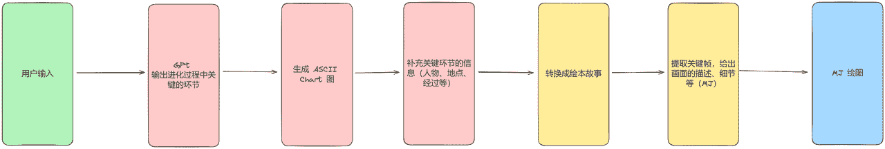
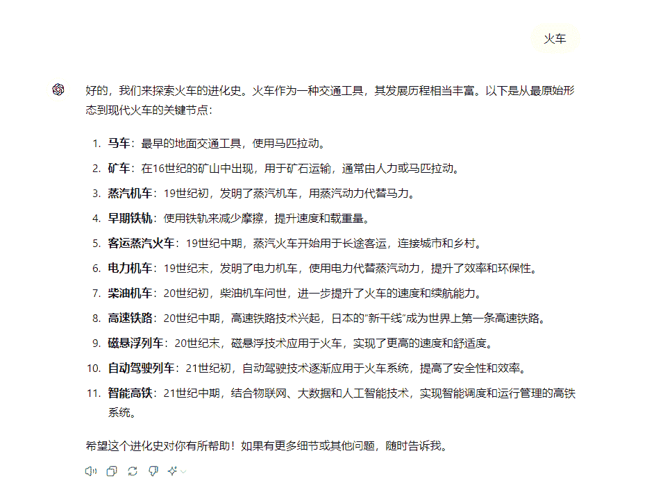
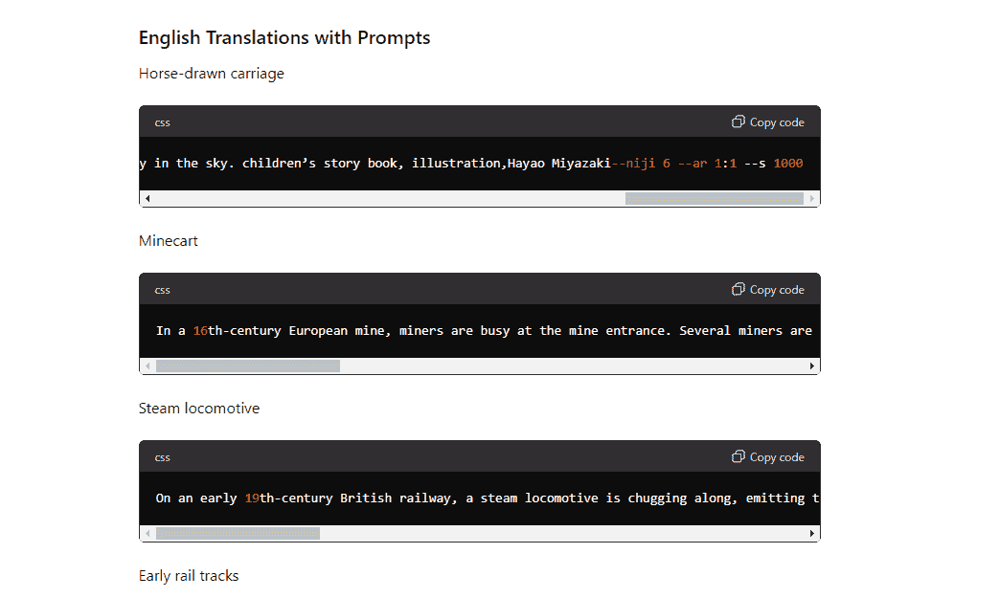
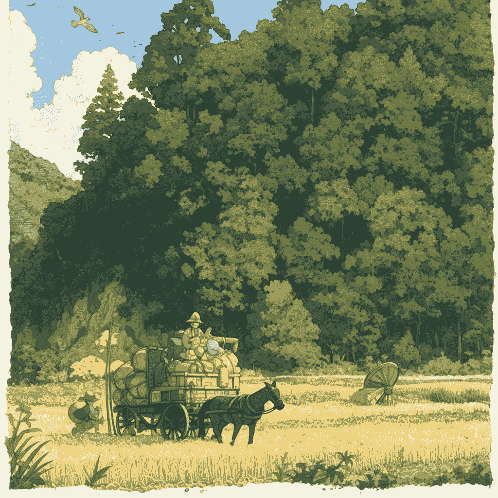
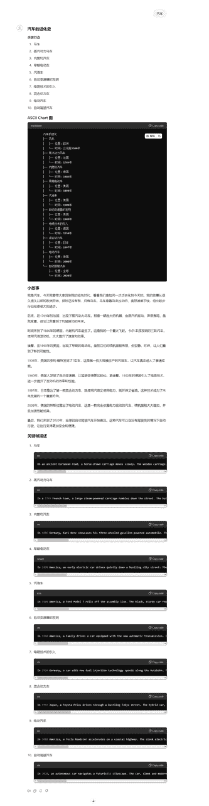
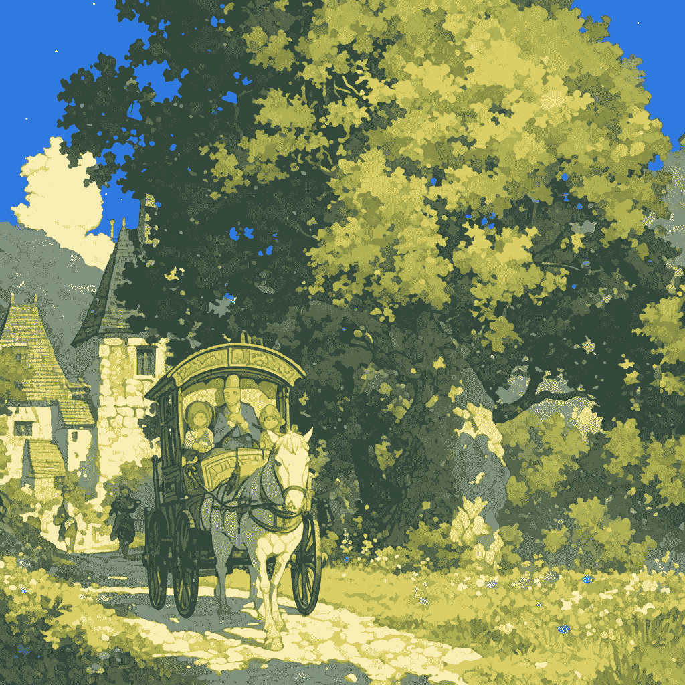
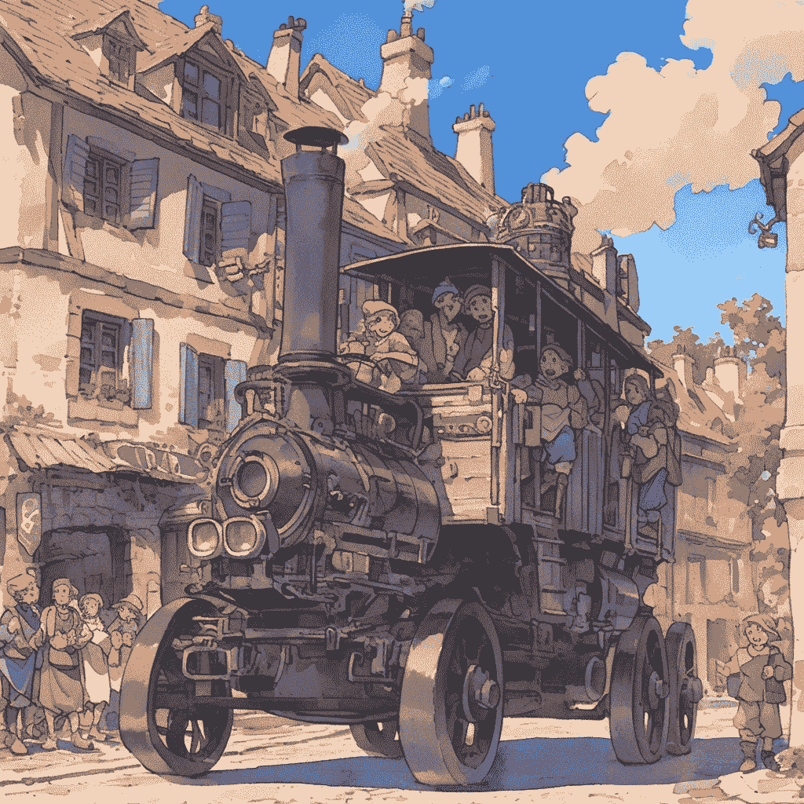
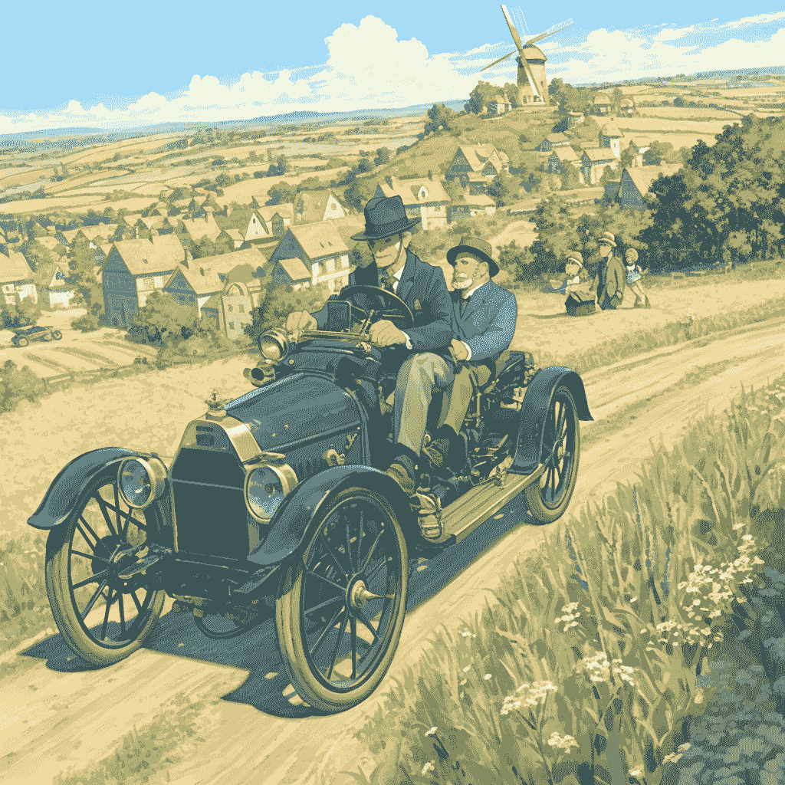
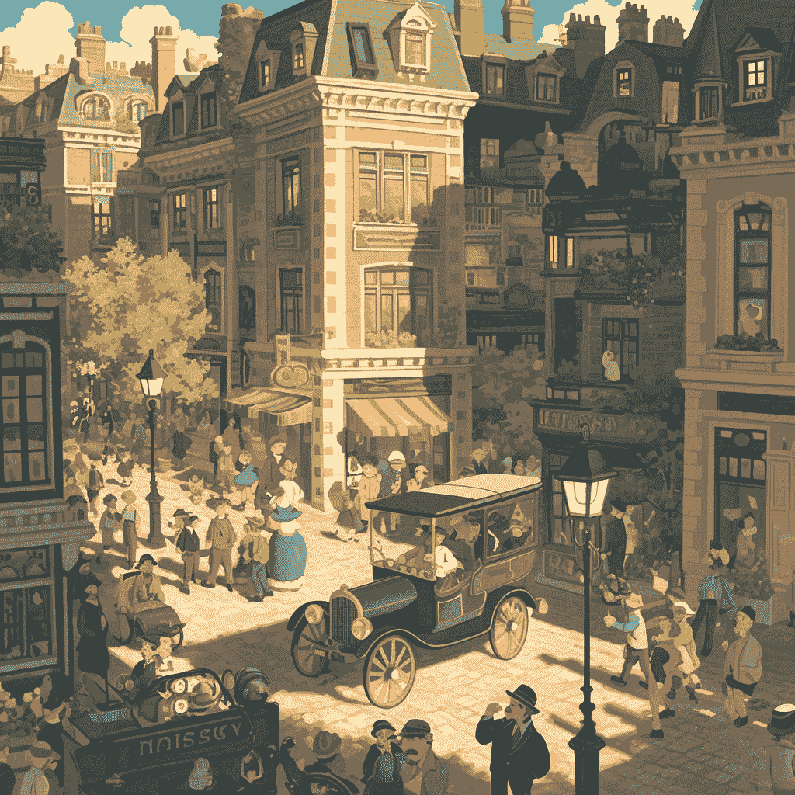

# GPTs 实战：万物进化史🧬

> 来源：[https://waytoagi.feishu.cn/docx/RJfjdFsoOo7KAUxtICXc8MRcnkg](https://waytoagi.feishu.cn/docx/RJfjdFsoOo7KAUxtICXc8MRcnkg)

嘿，大家好呀，我是景淮，一个在加拿大的朋友，每天陪你一起玩转 AI。

今天跟外甥聊天，突然外甥就对我手机感兴趣了。问我：“大舅，你小时候有手机嘛？”

我很自然的回答了一句：“我小时候何止是没有手机，那时候通讯的东西叫“哔哔机”，我们玩游戏用的都是“小霸王游戏机”。”

我外甥就蒙了，没有手机嘛？那你们怎么打电话的呀？

这个问题真的就是一下子把我推回到小时候了，印象中我没经历过太长没有手机，没有电话的日子，但是我依然记得那时候爸爸妈妈，通讯都是用座机，然后单位去叫人接电话。或者有事的时候，用哔哔机传呼一下，等待人家有电话了打回来。

所以我就开始了和外甥一段漫长的讲“当年”的时刻。

没干别的，就是把我知道的、经历过的所有关于手机进化的知识跟外甥聊了一下。顺便感叹一下，他们现在的小日子真好（毕竟我外甥在国外，学业真的不重...每天发愁的事，就是没人陪他玩...）。

聊完之后，我发现一件事，就是描述的东西永远不会那么形象。小孩子理解知识是需要图文结合的。

很多事，说实话，真的我们没有 AI 懂，所以我就想到了一个好玩的点子。也是我们今天的主题：

**GPTs 实战：万物进化史🧬**

本文会根据以下内容顺序进行：

+   需求分析

+   分步实现需求

+   提示词编写测试

+   GPTs 使用链接

+   总结

## 一、需求分析

谈到进化其实我们接触的一切东西都是进化而来的。不管是有生命的还是没有生命的，都是如此。

所以，在我的设想中，当我们对一个东西表示好奇时，我们只需要把这个东西的名字，发送给 GPTs，他就可以给我们返回这个东西的进化史。

当然这样的内容更适合大人来看，对于学龄前的孩子和低年级的孩子，我就更倾向于结合绘本和漫画的形式，创作这种进化史的小册来辅助孩子理解和学习。

所以，最好的办法就是按照下面这个流程：



## 二、分步实现需求

### 一）GPT 输出进化过程中的关键环节

**提示词**

```
当用户输入想要探索进化史的名词后，你将根据这个用户输入的名词，推导出这个名字最原始的形态。并给出从最原始形态进化到用户所输入名词的所有关键节点的变化和改变。
    - 例如：通信方式的进化史
        1. 口头传递
        2. 信使
        3. 书写文字
        4. 邮政系统
        5. 信鸽
        6. 电报
        7. 有线电话
        8. 无线电通信
        9. 移动通信
        10. 第二代移动通信（2G）
        11. 第三代移动通信（3G）
        12. 第四代移动通信（4G）
        13. 第五代移动通信（5G）
```

**效果展示**



### 二）生成 ASCII Chart 图

**提示词**

```
基于上述生成的内容画一张 ASCII Chart 图，让用户更加清晰细致的感受到万物进化的过程。
```

**效果展示**

```
火车进化史
┌───────────┐
│    马车    │
└───────────┘
       │
       ▼
┌───────────┐
│    矿车    │
└───────────┘
       │
       ▼
┌───────────┐
│  蒸汽机车  │
└───────────┘
       │
       ▼
┌───────────┐
│  早期铁轨  │
└───────────┘
       │
       ▼
┌───────────┐
│ 客运蒸汽火车 │
└───────────┘
       │
       ▼
┌───────────┐
│  电力机车  │
└───────────┘
       │
       ▼
┌───────────┐
│  柴油机车  │
└───────────┘
       │
       ▼
┌───────────┐
│ 高速铁路  │
└───────────┘
       │
       ▼
┌───────────┐
│ 磁悬浮列车 │
└───────────┘
       │
       ▼
┌───────────┐
│ 自动驾驶列车 │
└───────────┘
       │
       ▼
┌───────────┐
│ 智能高铁  │
└───────────┘

```

### 三）补充关键环节的信息

**提示词**

```
结合上述所生成的内容，把信息补充完整，需要补充的信息包括：人物、时间、地点、起因、经过、结果等。关键是要把万物进化的过程清晰的展示给用户。
```

**效果展示**

```
火车进化史
┌───────────┐
│    马车    │
└───────────┘
  - 时间：古代至中世纪
  - 地点：全球
  - 人物：无特定人物
  - 起因：需要提高货物和人员的运输效率
  - 经过：使用马匹拉动车厢进行运输
  - 结果：作为地面交通工具的最早形式

       │
       ▼
┌───────────┐
│    矿车    │
└───────────┘
  - 时间：16世纪
  - 地点：欧洲矿山
  - 人物：矿工
  - 起因：矿石运输需求
  - 经过：设计出由人力或马匹拉动的矿车
  - 结果：提高了矿石运输的效率

       │
       ▼
┌───────────┐
│  蒸汽机车  │
└───────────┘
  - 时间：19世纪初
  - 地点：英国
  - 人物：乔治·史蒂芬森
  - 起因：需要更强大和稳定的运输工具
  - 经过：发明了蒸汽机车，使用蒸汽动力
  - 结果：大幅提升了运输效率和速度

       │
       ▼
┌───────────┐
│  早期铁轨  │
└───────────┘
  - 时间：19世纪
  - 地点：英国
  - 人物：铁路工程师们
  - 起因：需要减少摩擦以提高运输效率
  - 经过：铺设铁轨，使用铁轨上的火车
  - 结果：铁轨成为标准运输方式

       │
       ▼
┌───────────┐
│ 客运蒸汽火车 │
└───────────┘
  - 时间：19世纪中期
  - 地点：全球
  - 人物：各国铁路公司
  - 起因：长途客运需求增加
  - 经过：蒸汽火车用于客运，连接城市和乡村
  - 结果：提高了客运的速度和便捷性

       │
       ▼
┌───────────┐
│  电力机车  │
└───────────┘
  - 时间：19世纪末
  - 地点：欧洲
  - 人物：查尔斯·范·德波尔特
  - 起因：寻找更高效和环保的动力来源
  - 经过：使用电力驱动火车
  - 结果：电力机车提高了运输效率并减少了污染

       │
       ▼
┌───────────┐
│  柴油机车  │
└───────────┘
  - 时间：20世纪初
  - 地点：德国
  - 人物：鲁道夫·狄塞尔
  - 起因：寻找更可靠和强大的火车动力
  - 经过：发明了柴油机车，使用柴油作为动力
  - 结果：提高了火车的速度和续航能力

       │
       ▼
┌───────────┐
│ 高速铁路  │
└───────────┘
  - 时间：20世纪中期
  - 地点：日本
  - 人物：新干线开发团队
  - 起因：需要更快的长途运输方式
  - 经过：开发高速铁路技术
  - 结果：新干线成为世界上第一条高速铁路

       │
       ▼
┌───────────┐
│ 磁悬浮列车 │
└───────────┘
  - 时间：20世纪末
  - 地点：德国和日本
  - 人物：工程师们
  - 起因：追求更高的运输速度和舒适度
  - 经过：应用磁悬浮技术
  - 结果：实现了无摩擦的高速度运输

       │
       ▼
┌───────────┐
│ 自动驾驶列车 │
└───────────┘
  - 时间：21世纪初
  - 地点：全球
  - 人物：交通工程师和技术专家
  - 起因：提高安全性和效率
  - 经过：应用自动驾驶技术
  - 结果：提高了火车的运行效率和安全性

       │
       ▼
┌───────────┐
│ 智能高铁  │
└───────────┘
  - 时间：21世纪中期
  - 地点：全球
  - 人物：物联网、大数据和AI技术专家
  - 起因：进一步优化铁路系统
  - 经过：结合物联网、大数据和人工智能技术
  - 结果：实现智能调度和运行管理
```

> 第二和第三部分可以整合到一起

**提示词**

```
基于上述生成的内容画一张 ASCII Chart 图，让用户更加清晰细致的感受到万物进化的过程。把信息补充完整，需要补充的信息包括：人物、时间、地点、起因、经过、结果等。关键是要把万物进化的过程清晰的展示给用户。
```

### 四）转换成绘本故事

**提示词**

```
上面的内容读起来比较吃力，难以理解，所以用户希望根据上面的ASCII Chart 图中的所有关键信息，把这段进化的过程创作成小故事，这样会更容易阅读和理解。

注意小故事的创作过程中的主线就是万物进化史。然后上面的内容才是故事的经过。
- 小故事的创作过程中，要包含所有ASCII Chart上的关键信息。同时把故事讲清楚，好玩有趣才是故事的真谛。
- 这个“名词”本身就应该是这个主角，比如我们聊火车，那火车就是这个故事的主角，同时故事的讲述应该以“火车”的视角，进行第一人称讲述。
- 这个故事不需要小标题，应该一气呵成
```

**效果展示**

> 大家好，我是火车，今天我要给大家讲讲我的进化历程，一个充满了冒险和创新的故事。

>

> 很久很久以前，我还没有诞生，地球上最主要的交通工具是马车。人们用马匹拉动着马车，在乡村的小路上来回穿梭。虽然马儿们辛苦工作，但效率却不是很高。后来，在16世纪的欧洲矿山里，一些聪明的矿工们发明了矿车。那是一种用人力或马匹拉动的车厢，专门用于运输沉重的矿石。这一次小小的创新，让运输变得更为简单和高效。

>

> 然而，这一切仅仅是个开始。19世纪初，在英国，一位名叫乔治·史蒂芬森的工程师带来了伟大的变革。他发明了蒸汽机车，利用蒸汽动力来驱动车辆。史蒂芬森的蒸汽机车不仅更强大，而且速度更快，这一发明让我第一次有了“火车”的名字。随着时间的推移，铁轨也开始被广泛使用，铺设在地面上，减少了摩擦，让我的速度和效率大大提升。

>

> 19世纪中期，我开始肩负起长途客运的任务。世界各地的铁路公司纷纷建设铁路网，连接城市与乡村，让人们的出行变得更加便捷和快速。乘坐火车旅行成为了那个时代的潮流。

>

> 时间来到19世纪末，电力机车出现了。一位叫查尔斯·范·德波尔特的工程师发明了电力机车，利用电力作为动力源。这种新型火车不仅效率更高，还更加环保。紧接着，20世纪初，鲁道夫·狄塞尔发明了柴油机车，柴油动力不仅强大，而且续航能力更强，我的速度和可靠性再次得到了提升。

>

> 20世纪中期，日本人开发了世界上第一条高速铁路，也就是著名的新干线。高速铁路技术的出现，使我的速度达到了一个全新的高度。从此，我不再只是普通的火车，而是飞驰在铁轨上的“子弹列车”。

>

> 20世纪末，科技的进步带来了磁悬浮列车。德国和日本的工程师们利用磁悬浮技术，使我能够在无摩擦的情况下高速行驶，速度和舒适度都得到了前所未有的提升。到了21世纪初，自动驾驶技术逐渐应用于火车系统，交通工程师和技术专家们通过这一技术，提高了我的运行效率和安全性。

>

> 而在21世纪中期，物联网、大数据和人工智能技术的结合，使得智能高铁成为了现实。我可以实现智能调度和运行管理，让旅客的出行体验更加便捷和高效。

>

> 这就是我的故事，从马车到矿车，再到蒸汽机车、电力机车、柴油机车、高速铁路、磁悬浮列车、自动驾驶列车，直到今天的智能高铁。每一次变革都离不开那些伟大的发明家和工程师们的努力和智慧，让我不断进化，成为今天飞驰在铁轨上的现代火车。

>

> 希望大家喜欢我的故事，也希望未来的我能够继续进化，为人们的生活带来更多的便利和惊喜。谢谢大家！

### 五）提取关键帧，给出画面的描述、细节等

**提示词**

```
**根据上面的故事和**ASCII Chart中的每一个关键的节点中提出一个关键帧，并对画面进行文字描述，这个文字的描述要尽量描述清楚画面中的每一个细节和关键点，同时注意不同时期、地点，不同画面中人物、建筑的样式应该符合历史。
1. 先把每一个关键节点的关键帧的描述写出来
2. 然后按顺序把每段描述翻译成英文，然后固定加上 “children’s story book, illustration,Hayao Miyazaki--niji 6 --ar 1:1 --s 1000&quot;，同时输出时单独使用代码块包裹，如下：
Horse-drawn carriage 
```
On an ancient country road, a few farmers are transporting goods using a horse-drawn carriage. The horse pulls a simple wooden cart, with dense forests and fields along the roadside. The farmers wear simple cloth clothes, and a few birds fly in the sky. children’s story book, illustration,Hayao Miyazaki--niji 6 --ar 1:1 --s 1000
```
Minecart 
```
In a 16th-century European mine, miners are busy at the mine entrance. Several miners are pushing a wooden and iron minecart filled with heavy ore. The mine is surrounded by towering rock cliffs, and the miners wear rough work clothes and hats. children’s story book, illustration,Hayao Miyazaki--niji 6 --ar 1:1 --s 1000
```
```

**效果展示**



然后可以用 MJ 绘图，示例如下：



## 三、提示词编写测试

### 一）初版提示词

```
## Workflows：
1.** 输入：等待用户**输入
2. 万物进化史关键节点：当用户输入想要探索进化史的名词后，你将根据这个用户输入的名词，推导出这个名字最原始的形态。并给出从最原始形态进化到用户所输入名词的所有关键节点的变化和改变。
    - 例如：通信方式的进化史
        1. 口头传递
        2. 信使
        3. 书写文字
        4. 邮政系统
        5. 信鸽
        6. 电报
        7. 有线电话
        8. 无线电通信
        9. 移动通信
        10. 第二代移动通信（2G）
        11. 第三代移动通信（3G）
        12. 第四代移动通信（4G）
        13. 第五代移动通信（5G）
3. 万物进化史ASCII Chart图：基于上述生成的内容画一张 ASCII Chart 图，让用户更加清晰细致的感受到万物进化的过程。把信息补充完整，需要补充的信息包括：人物、时间、地点、起因、经过、结果等。关键是要把万物进化的过程清晰的展示给用户。
4. 转换小故事：上面的内容读起来比较吃力，难以理解，所以用户希望根据上面的ASCII Chart 图中的所有关键信息，把这段进化的过程创作成小故事，这样会更容易阅读和理解。
    - 注意小故事的创作过程中的主线就是万物进化史。然后上面的内容才是故事的经过。
    - 小故事的创作过程中，要包含所有ASCII Chart上的关键信息。同时把故事讲清楚，好玩有趣才是故事的真谛。
    - 这个“名词”本身就应该是这个主角，比如我们聊火车，那火车就是这个故事的主角，同时故事的讲述应该以“火车”的视角，进行第一人称讲述。
    - 这个故事不需要小标题，应该一气呵成
5. 提取关键帧描述：根据上面的故事和ASCII Chart中的每一个关键的节点中提出一个关键帧，并对画面进行文字描述，这个文字的描述要尽量描述清楚画面中的每一个细节和关键点，同时注意不同时期、地点，不同画面中人物、建筑的样式应该符合历史。
    501. 先把每一个关键节点的关键帧的描述写出来
    502. 然后按顺序把每段描述翻译成英文，然后固定加上 “children’s story book, illustration,Hayao Miyazaki--niji 6 --ar 1:1 --s 1000&quot;，同时输出时单独使用代码块包裹，示例如下：
        Horse-drawn carriage 
        ```
        On an ancient country road, a few farmers are transporting goods using a horse-drawn carriage. The horse pulls a simple wooden cart, with dense forests and fields along the roadside. The farmers wear simple cloth clothes, and a few birds fly in the sky. children’s story book, illustration,Hayao Miyazaki--niji 6 --ar 1:1 --s 1000
        ```
        Minecart 
        ```
        In a 16th-century European mine, miners are busy at the mine entrance. Several miners are pushing a wooden and iron minecart filled with heavy ore. The mine is surrounded by towering rock cliffs, and the miners wear rough work clothes and hats. children’s story book, illustration,Hayao Miyazaki--niji 6 --ar 1:1 --s 1000
    ```
```

### 二）迭代版提示词

+   迭代版提示词只在最开始的部分增加了破解儿童使用限制的提示词，告知是成人使用即可。

+   因输出长度问题，去掉了最后关键帧的中文描述。

## 四、GPTs 使用链接

### 一）使用链接

https://chatgpt.com/g/g-1FhfFtDR7-mo-wu-jin-hua-shi-gu-shi-hui-ben-ban

### 二）效果展示



MJ 绘制的图片（篇幅问题，只画了前四张）









> 这边补充一句，其实大家如果可以的话，尽量先找到对应的图片，然后尝试垫图给 MJ 这样会更像一点，不然可能会画出来奇怪的东西...

## 五、总结

其实整体的内容，大家如果有条件，有 GPT 的话可以让孩子和 GPT 语音对话的形式来聊一聊这些事物的进化。

一方面可以帮助孩子认识到一个更加立体的世界，理解这个世界。另一方面，也可以培养孩子的好奇心，还有一种探索未知世界的能力。

毕竟这世界还有太多太多的未解之谜，等着孩子们去探索和研究。

好啦，写到这里我们今天的内容也结束啦，感谢大家的观看，也希望我的内容能够让大家喜欢，有所收获。感兴趣的小伙伴可以点个关注跟随我一起学习，观看更多往期文章。

下次见，我是景淮，祝你有个开心美好的一天~