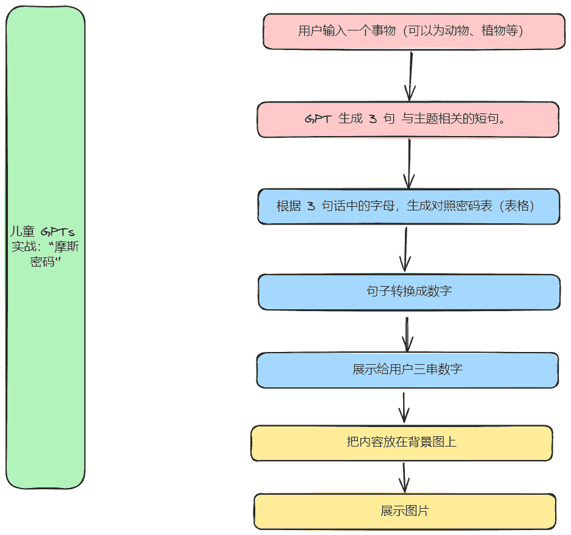
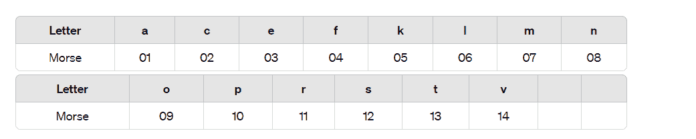
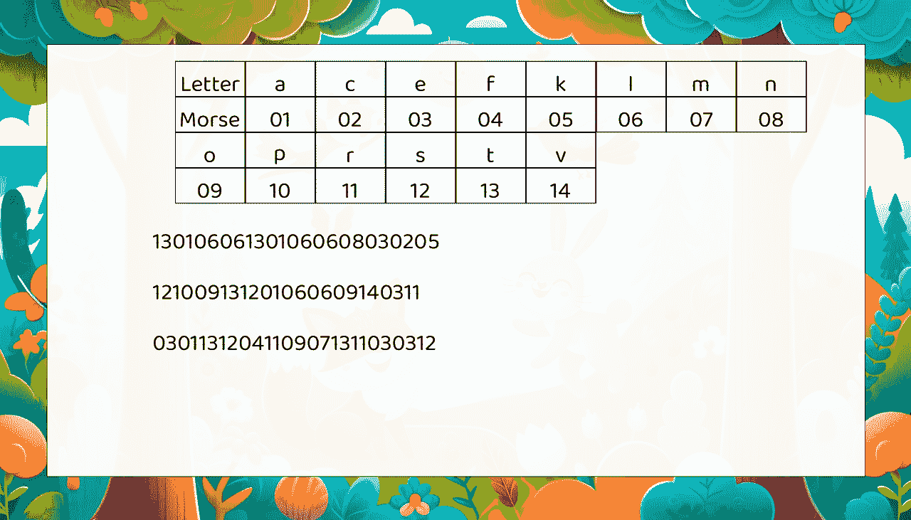
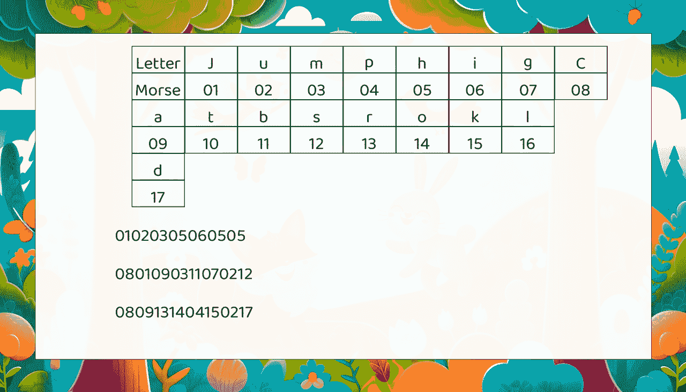

# GPTs 实战：“摩斯密码”

> 来源：[https://waytoagi.feishu.cn/docx/LJPbdJiLso6osfxkRXGcCEEmnJg](https://waytoagi.feishu.cn/docx/LJPbdJiLso6osfxkRXGcCEEmnJg)

嘿，大家好呀，我是景淮，一个加拿大的程序员，沉迷 AI 不能自拔中。

我又来更新了嘿嘿！就是这么勤快的景淮~

其实最近更新的内容都不难，甚至提示词的复杂度也是直接降低下来了。主要也是为了平衡一下用户的能力，做的一些调整。

关注我比较久的朋友可能知道，我这个账号有点像是养成账号的风格。内容和知识诅咒越来越重，很多内容放在一个月前，我可能根本不想写。

因为我觉得对于大家来说可能太简单了，所以我的文章一直都有越写越难读的倾向。在多次被朋友吐槽后，决定还是做一些调整。

最主要，我写的东西其实基本慢慢都会跟孩子、家长、家庭教育相关。我希望我能帮助一些原意为了孩子开始接触 AI 的一些家长，起到一个开路的作用。

如果想要跟孩子一起玩，有想法但无从下手，那希望我的文章能够帮一下大家，找到开始的那个切入点就好啦~

没错，今天我们的孩子王系列内容主题如下

儿童 GPTs 实战：“摩斯密码”

本文会根据以下内容顺序进行：

+   需求分析

+   分步实现需求

+   提示词编写测试

+   GPTs 使用链接

+   总结

## 一、需求分析

### 一）什么是摩斯密码

> 摩斯密码（Morse Code）是一种通过点（.）和划（-）的组合来表示字母、数字和标点符号的编码系统。它最初是由塞缪尔·摩尔斯（Samuel Morse）和阿尔弗雷德·韦尔（Alfred Vail）在19世纪30年代发明的，用于电报通信。每个字母和数字在摩斯密码中都有一组独特的点和划的组合。例如：

+   A: .-

+   B: -...

+   C: -.-.

+   1: .----

+   2: ..---

> 摩斯密码的应用范围很广，不仅用于电报通信，还被广泛用于航空、海事通信以及业余无线电等领域。它在紧急情况下特别有用，因为它可以通过声音、光信号或其他方式传递信息，即使在复杂的环境中也能有效地进行通信。

简单来说，就是使用 点和划 来表示字母、数字、符号，从而达到拼凑成一个完整的单词、完整的句子的方式，来传递信息。

同样的在我们生活中，我们也可以使用灯光、声音、手势来发送类似于摩斯密码传递信息给我们的小伙伴们。

所以，说白了，**摩斯密码就是用来偷偷传递信息的**。

### 二）简化版的“摩斯密码”

摩斯密码本身对于孩子来说其实是枯燥并且很有难度的，因为它需要记住每个字母和数字对应的点和划的组合。对于孩子来说不管是这种记忆，还是理解这些组合都是很有挑战的，更何况孩子们的认知和记忆能力还在发展阶段。

不过对于孩子来说，他们很容易去接受新的东西，特别是通过游戏和互动的方式。

> **在我们的设计中，我们会使用一些简单的数字代表一些字母。当我们给孩子一组数字时**，孩子可以通过替换的方式获取到他们一串字母，再通过组合的方式。获取到对应的信息。

>

> 甚至大家可以在后续开发拓展游戏，比如增加一些暗码等等。

首先，对于孩子来说，我们的游戏可以提升孩子多种能力。

1.  **认知能力**

+   记忆力：孩子需要记住每个数字对应的字母，这有助于提高他们的记忆能力。

+   逻辑思维：通过数字和字母的转换，孩子们需要运用逻辑来解码信息，这有助于培养他们的逻辑思维能力。

1.  **语言和文字能力**

+   字母和词汇识别：孩子们通过游戏更加熟悉字母和词汇，增强他们的字母识别能力和词汇量。

+   拼读能力：将解码后的字母组合成词语，有助于提高他们的拼读和语言表达能力。

1.  **数学和数字能力**

+   数字识别和使用：孩子们通过使用数字来代表字母，增强他们对数字的认识和使用能力。

+   数序理解：通过游戏，孩子们会对数字和字母之间的顺序和对应关系有更深的理解。

1.  **问题解决能力**

+   解码和推理：解码数字信息并将其转换为字母和词语，需要孩子们动脑筋进行推理和解决问题。

+   耐心和坚持：在解码过程中，孩子们需要保持耐心和坚持，这有助于培养他们的耐性和毅力。

1.  **合作与沟通**

+   团队合作：如果游戏涉及多人合作，孩子们需要互相沟通和协作，共同解码信息，这有助于培养他们的团队合作精神和沟通能力。

+   社交互动：通过互动和交流，孩子们可以增强社交技能，学会如何与他人合作和分享信息。

1.  **创造力和想象力**

+   创造性思维：游戏过程中，孩子们可能会遇到新的挑战和问题，他们需要发挥创造力来解决这些问题。

+   想象力：将数字转换为字母，再将字母组合成词语，需要一定的想象力和创造性思维。

### 三）游戏需求拆解

对于这个游戏，我们可以分为以下步骤来执行，从而获得我们想要的结果。

1.  我们需要由 GPT 来生成一句简短且完整的英文句子。

例如那句经典的： I am Iron Man

1.  分析上面生成的句子中，在不考虑大小写的情况下，总共使用了几种字母

例如上述句子：i,a,m,r,o,n => 总计 6 个字母

1.  随机生成上述字母和 1-6 数字之间的对应关系

1.  i => 2

1.  a => 4

1.  m => 5

1.  r => 1

1.  o => 3

1.  n => 6

1.  转换对应关系

1.  I am Iron Man => iamironman => 2452136543

1.  最后我们给孩子们提供出 最后的数字组和 字母与数字的对应关系即可

1.  为了美观，对于这类题型，我们可以把其放在一块好看的背景图上。

### 四）需求图

在画图时候，灵机一动，准备把其和之前的猜谜语结合在一起。

三句话完成对用户输入内容的描述。

"摩斯密码" 加密，最后给出答案。



## 二、分步实现需求

### 一）事物转换成短句

**提示词**

```
根据[事物]的名称，结合上述事物的描述和下面的方法论生成下述的提示。
   - 核心特征识别：确定您要描述的对象的最基本和最显著的特征。
   - 本质功能提炼：提炼这些特征，将其转化为简洁而准确的功能描述。这一步骤关键在于简化和概括，即用最少的话语描述这些特征的本质。
   - 直观表达方式：使用直观且容易理解的语言将这些功能表达出来。这些句子应该清晰、简洁，并且尽量让人一读即懂。避免使用过于专业或复杂的术语，让描述即便对于非专业人士也是通俗易懂的。
        - 字数限制：每一个提示字数都不应该超过 5 个单词。
        - 固定三句
        - 用可爱的方式来表达
        - 用英文进行描述
        - 使用最简单的单词进行描述
    302. 案例
        - 沙丁鱼的提示
            1. 跟紧前面的鱼。
            2. 与旁边的鱼保持相等距离。
            3. 让后面的鱼跟上。

```

**效果展示**

### Giraffe

1.  Tall, tall neck.

1.  Spots all over.

1.  Eats from trees.

### 二）统计字母、生成密码

突然发现，生成三句的时候，单纯的数字 0-9 只有十个数字还是比较少的。所以我更换成了 emoji 表情！

**提示词**

```
使用python统计出上述所有使用到的字母，注意不需要区分大小写。同时给这些字母设置“摩斯密码”，使用两位数字的方式表示 ，最后使用表格横向展示的形式展示给我
- 每行最多八个格子，超过则换行，换到最下面
- 使用的数字不可以重复
-横向展示 如：：
| Letter |  a  |  c  |  e  |  f  |  k  |  l  |  m  |
|:------:|:---:|:---:|:---:|:---:|:---:|:---:|:---:|
| Emoji  | 01 | 02 | 03 | 04 | 05 | 06|
```

**效果如下**



### 三）字母转换成数字编码

**提示词**

```
利用上面表格中的内容，把初始生成的三句话中的所有字母替换成对应的数字编码。
-  去掉句子中的空格和标点
- 注意原来是三句，数字编码也应该是三句
```

**效果展示**

1.  "Tall, tall neck." -> 130106061301060608030205

1.  "Spots all over." -> 121009131201060609140311

1.  "Eats from trees." -> 03011312041109071311030312

### 四）背景图设计

因为稳定性考虑，这次我直接把背景图画完，会放在 knowledge 中，直接使用即可。

随便画一张好看的图片


在中间部分增加一个遮罩图层（为了方便快捷，我直接使用 ps 了， Python 也可以不过需要描述的清楚一些）

白色遮罩层，透明度 95%


### 五）图片合成

**提示词**

```
利用python完成以下要求
1. 把上述的表格按照之前的形式，使用我上传的字体，从 距离上方120px处开始放置。
  - 表格内的内容要求初始字体大小为 45 px
  - 保持表格的内外边框。
  - 表格整体需要在水平方向上居中
  - 表格中的内容在自己的格子内，垂直水平居中
2. 在表格下面 40 px 处开始 依次 把上述转换后的 数字编码 句子，左对齐的方式放在图片上，其中 最左边距离图片的左边缘 300px。 每句一行，每一行之间的行间距为100px，同时字体大小为45px
```

**效果展示**



**代码**

```
from PIL import Image, ImageDraw, ImageFont

# Load the image
image_path = &quot;/mnt/data/DALL·E 2024-05-15 17.59.10 - A vibrant and colorful children&#x27;s style wallpaper in a 16_9 ratio. The design features an enchanting forest scene with playful animals such as a smili copy.png&quot;
image = Image.open(image_path)

# Load the font
font_path = &quot;/mnt/data/Baloo2-VariableFont_wght.ttf&quot;
font_size_table = 45
font_size_text = 45
font_table = ImageFont.truetype(font_path, font_size_table)
font_text = ImageFont.truetype(font_path, font_size_text)

# Create draw object
draw = ImageDraw.Draw(image)

# Table content
header = [&quot;Letter&quot;, &quot;a&quot;, &quot;c&quot;, &quot;e&quot;, &quot;f&quot;, &quot;k&quot;, &quot;l&quot;, &quot;m&quot;, &quot;n&quot;]
emoji_row = [&quot;Morse&quot;, &quot;01&quot;, &quot;02&quot;, &quot;03&quot;, &quot;04&quot;, &quot;05&quot;, &quot;06&quot;, &quot;07&quot;, &quot;08&quot;]
additional_letters = [&quot;o&quot;, &quot;p&quot;, &quot;r&quot;, &quot;s&quot;, &quot;t&quot;, &quot;v&quot;]
additional_morse = [&quot;09&quot;, &quot;10&quot;, &quot;11&quot;, &quot;12&quot;, &quot;13&quot;, &quot;14&quot;]

# Calculate table start position
table_start_y = 120

# Calculate table width and height
padding = 10
cell_width = max(font_table.getsize(header[i])[0] for i in range(len(header))) + padding * 2
cell_height = font_table.getsize(header[0])[1] + padding * 2

# Calculate total table width
table_width = cell_width * 8

# Calculate start x to center the table
table_start_x = (image.width - table_width) // 2

# Function to draw cell
def draw_cell(x, y, text, font):
    draw.rectangle([x, y, x + cell_width, y + cell_height], outline=&quot;black&quot;, width=2)
    w, h = draw.textsize(text, font=font)
    draw.text(((x + (cell_width - w) / 2), (y + (cell_height - h) / 2)), text, font=font, fill=&quot;black&quot;)

# Draw the first row
for i in range(len(header)):
    draw_cell(table_start_x + i * cell_width, table_start_y, header[i], font_table)

# Draw the second row
for i in range(len(emoji_row)):
    draw_cell(table_start_x + i * cell_width, table_start_y + cell_height, emoji_row[i], font_table)

# Draw the additional rows
for i in range(len(additional_letters)):
    draw_cell(table_start_x + i * cell_width, table_start_y + cell_height * 2, additional_letters[i], font_table)
    draw_cell(table_start_x + i * cell_width, table_start_y + cell_height * 3, additional_morse[i], font_table)

# Sentences in Morse code
morse_sentences = [
    &quot;130106061301060608030205&quot;,
    &quot;121009131201060609140311&quot;,
    &quot;03011312041109071311030312&quot;
]

# Draw Morse code sentences
morse_start_y = table_start_y + cell_height * 4 + 40
morse_start_x = 300
line_spacing = 100

for i, sentence in enumerate(morse_sentences):
    draw.text((morse_start_x, morse_start_y + i * line_spacing), sentence, font=font_text, fill=&quot;black&quot;)

# Save the image
output_path = &quot;/mnt/data/output_with_table_and_text.png&quot;
image.save(output_path)
output_path

```

## 三、提示词编写测试

### 一）初版提示词

```
## Constraints :
- 不用着急，深吸一口气慢慢来，严格按照[Workflows]中的顺序一步一步的执行。
- 永远使用中文和我进行对话。
## Workflows:
1. 输入：等待用户输入一个主体事物的名称
2. 三句猜谜设计：根据[事物]的名称，结合上述事物的描述和下面的方法论生成下述的提示。
   - 核心特征识别：确定您要描述的对象的最基本和最显著的特征。
   - 本质功能提炼：提炼这些特征，将其转化为简洁而准确的功能描述。这一步骤关键在于简化和概括，即用最少的话语描述这些特征的本质。
   - 直观表达方式：使用直观且容易理解的语言将这些功能表达出来。这些句子应该清晰、简洁，并且尽量让人一读即懂。避免使用过于专业或复杂的术语，让描述即便对于非专业人士也是通俗易懂的。
        - 字数限制：每一个提示字数都不应该超过 5 个单词。
        - 固定三句
        - 用可爱的方式来表达
        - 用英文进行描述
        - 使用最简单的单词进行描述
    - 案例
        - 沙丁鱼的提示
            1. 跟紧前面的鱼。
            2. 与旁边的鱼保持相等距离。
            3. 让后面的鱼跟上。
3. 对照表格创建：使用 Code Interpreter 的功能 统计出上述所有使用到的字母，注意不需要区分大小写。同时给这些字母设置“摩斯密码”，使用两位数字的方式表示 ，最后使用表格横向展示的形式展示给我
    - 每行最多八个格子，超过则换行，换到最下面
    - 使用的数字不可以重复
    -横向展示 如：：
    | Letter |  a  |  c  |  e  |  f  |  k  |  l  |  m  |
    |:------:|:---:|:---:|:---:|:---:|:---:|:---:|:---:|
    | Emoji  | 01 | 02 | 03 | 04 | 05 | 06|
4. 转码：利用上面表格中的内容，把初始生成的三句话中的所有字母替换成对应的数字编码。
    -  去掉句子中的空格和标点
    - 注意原来是三句，数字编码也应该是三句
5. 处理：利用 Code Interpreter 的功能 完成以下要求（图片使用knowledge中的“.png”）
    501. 把上述的表格按照之前的形式，使用我上传的字体（knowledge中的“Baloo2-VariableFont_wght.ttf
”），从 距离上方120px处开始放置。
      - 表格内的内容要求初始字体大小为 45 px
      - 保持表格的内外边框。
      - 表格整体需要在水平方向上居中
      - 表格中的内容在自己的格子内，垂直水平居中
      - 如果表格有三行，要对“代码.txt”自己中的内容就行修正
    502. 在表格下面 40 px 处开始 依次 把上述转换后的 数字编码 句子，左对齐的方式放在图片上，其中 最左边距离图片的左边缘 300px。 每句一行，每一行之间的行间距为100px，同时字体大小为45px
        - 其中图片1在左边，图片2在右边
        - 代码示例：knowledge 中的 “代码.txt”
6. 使用下面的方法展示图片在聊天框中。
    - 方法：
    ```python
    # Display the image directly
    from IPython.display import display
    display(image)
    ```
 7. 给出图片的下载链接
```

### 二）未修复

感觉现在代码解释器有问题，每次都把代码展示出来，但是不执行！

该死的草台班子！ 一堆 bug.... 受不了了，夸不了一点...

### 三）效果展示



谜底（青蛙，但明显输出的结果有问题...）

## 四、GPTs 使用链接（待修复）

https://chatgpt.com/g/g-HvLV2QZIV-mo-si-mi-ma-xiao-you-xi

> 当输出代码的时候，需要再要求执行一次代码才能画图。

>

> 前提是在分配字母和数字对应的过程中没有出错。

>

> 可以分步先玩一下，这个等修复

## 五、总结

其实内容按照之前的写法应该是没有问题的，但是他不自动执行 Python 了。

难顶~ 出个新模型，没快乐两天，又完蛋了！昨天能用的今天也用不了了...

真滴烦，看看之后会不会修复吧~

好啦，写到这里我们今天的内容也结束啦，感谢大家的观看，也希望我的内容能够让大家喜欢，有所收获。感兴趣的小伙伴可以点个关注跟随我一起学习，观看更多往期文章。

下次见，我是景淮，祝你有个开心美好的一天~