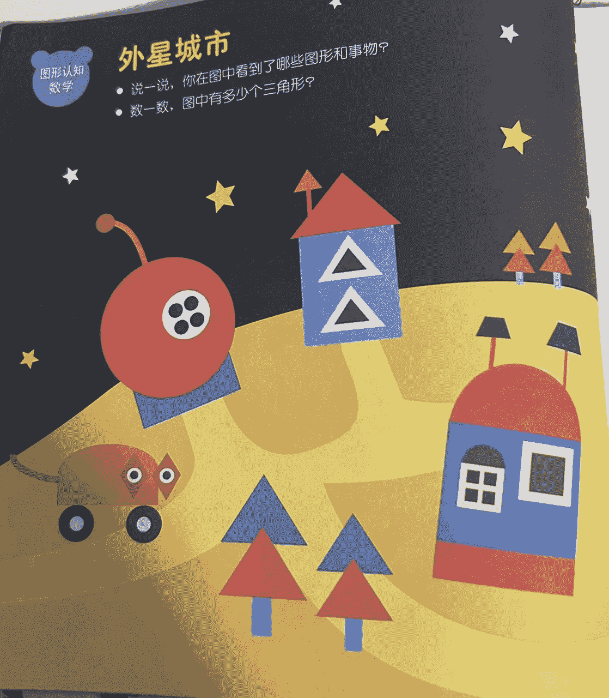
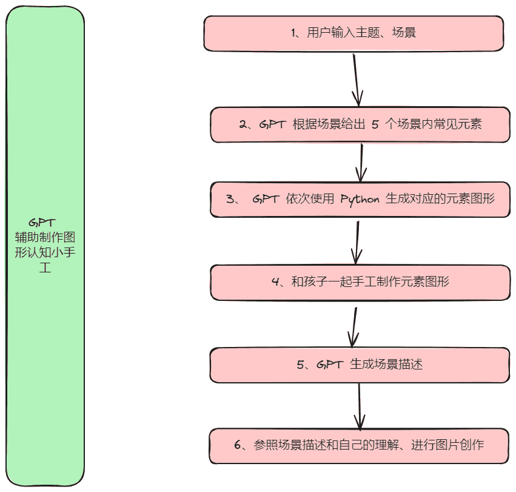
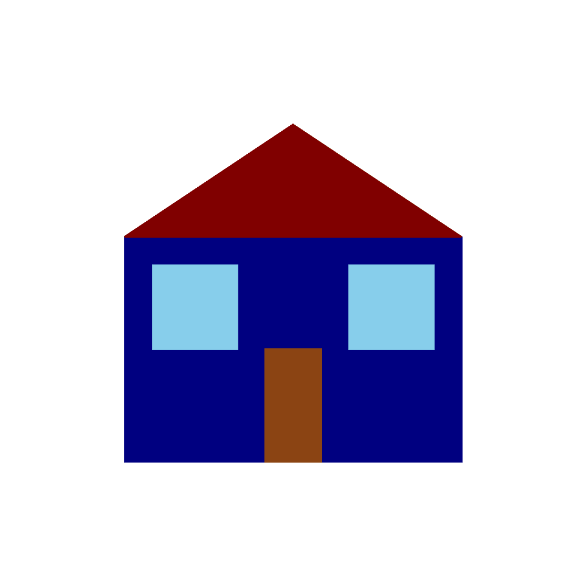
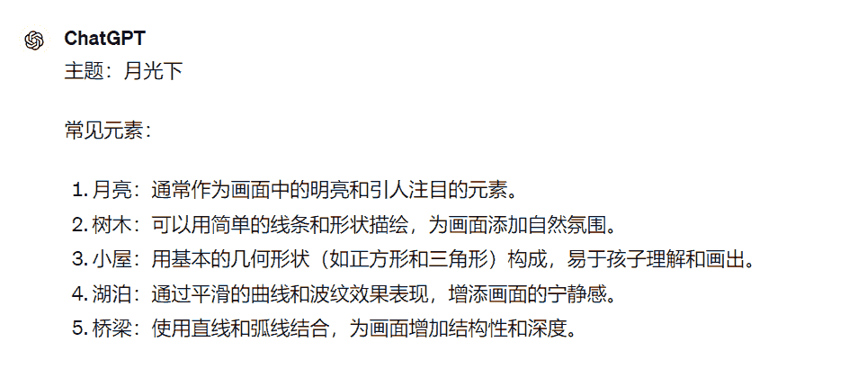
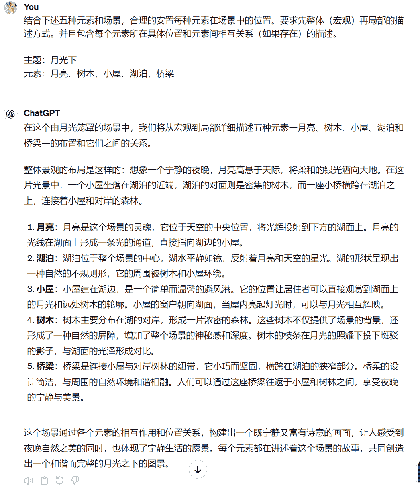
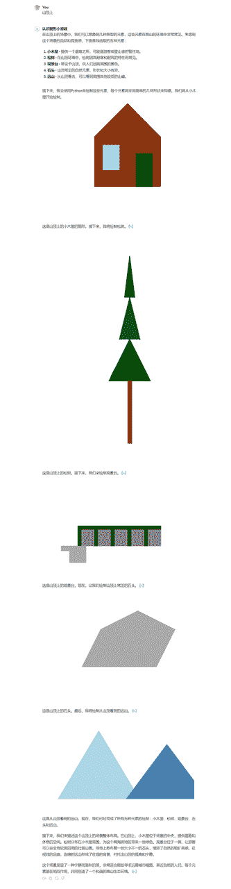
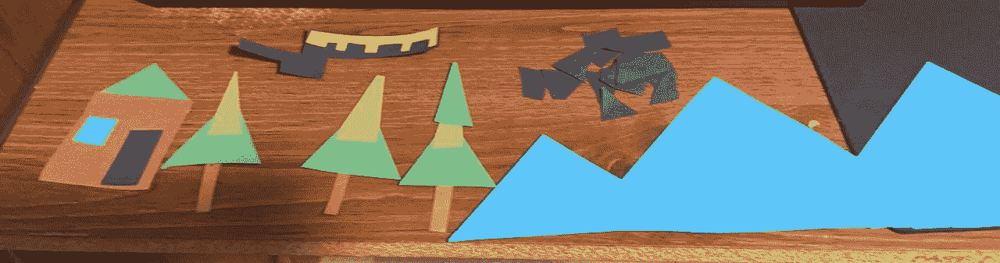
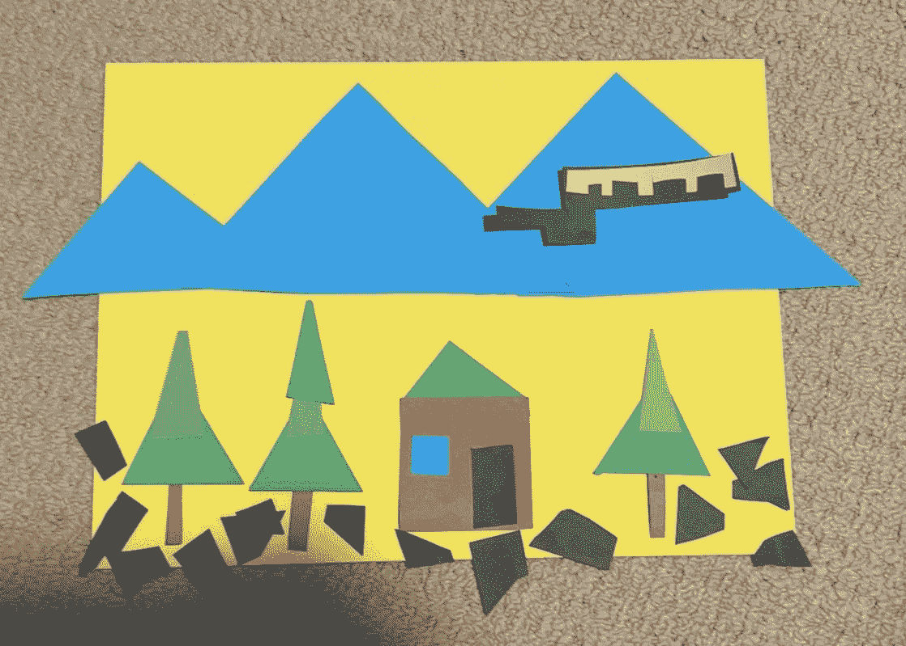
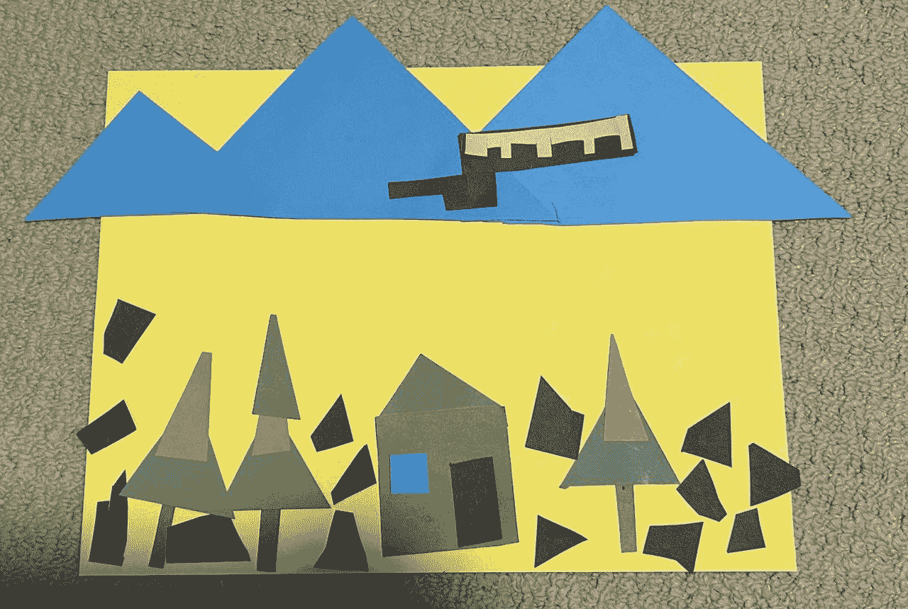

# GPTs 实战：GPT 辅助制作图形认知小手工

> 来源：[https://waytoagi.feishu.cn/docx/KRt8djg1zoP9ySxzsnsc2wARnef](https://waytoagi.feishu.cn/docx/KRt8djg1zoP9ySxzsnsc2wARnef)

嘿，大家好呀，我是景淮，一个加拿大的程序员，沉迷 AI 不能自拔中。

呀！终于结束了忙碌的一周，和小伙伴们一起完成了破局的这次航海内容。也第一次进行了直播分享，其实第一次直播还是挺忐忑的。但感谢小伙伴们厚爱和支持！（鞠躬！）

结束了忙碌的一周，我又来输出了！欠债要还哈哈哈哈

好啦，今天我们的孩子王系列内容主题如下

**GPT 辅助制作图形认知小手工**

本文会根据以下内容顺序进行：

+   需求分析

+   分步实现需求

+   提示词编写测试

+   GPTs 使用链接

+   总结

## 一、需求分析

### 一）图形认知题介绍



**什么是图形认知题？**

图形认知题是一种教育活动或测试，旨在帮助孩子们识别、区分和理解不同的图形和图案。这种类型的题目通常用于儿童早期教育，以促进他们的视觉和认知发展。图形认知题的一些特点包括：

1.  图形识别：让孩子们识别圆形、正方形、三角形等基本的二维图形。

1.  颜色识别：结合图形，孩子还需要学会识别和命名基本颜色。

1.  大小和比较：通过对比不同大小的图形，孩子可以学习大小、长度和高度的概念。

1.  排序和分类：孩子将根据形状、大小或颜色将图形分组，这有助于发展他们的分类技能。

1.  图形与现实世界的关联：孩子通过将图形与现实生活中的对象联系起来，如将圆形与球关联，发展他们的抽象思维能力。

1.  空间关系：理解图形之间的空间关系，例如哪些图形可以拼在一起或哪些图形可以嵌入其他图形中。

1.  图形的绘制与再现：通过绘制或使用拼图完成图形，孩子可以提高他们的创造力和精细运动技能。

图形认知题不仅增强儿童的视觉识别能力，还有助于他们在数学和逻辑推理方面打下基础。通过这种互动和有趣的方式，孩子可以在游戏中学习和发展关键技能。

在这次的创作中，我会结合手工的方式，让家长和孩子在互动中完成这次的内容。

### 二）图片生成

我们的最终目的是制作一张完整的图片，我们可以先让 GPT 根据场景生成五个场景中常见的事物。

### 三）图形创作

比如，我们要生成一个房子。那我们就使用固定的几种图形，来创建这个房子的图形。

可使用的图形：圆形、正方形、三角形、矩形、半圆形、菱形、梯形、五角星形、椭圆形。

### 四）和孩子一起制作

根据绘制出来的图片。对彩纸进行裁剪，使用胶带或者浇水，制作出手工版图形。

### 五）GPT 给出场景描述

要求 GPT 给出包含五种事物的场景描述。由孩子根据描述搭出对应的场景。

### 六）流程图



## 二、分步实现需求

即然我们要准确的使用各种不同的图案，我的经验告诉我，直接使用 Dalle-3 来画图肯定是有点不太靠谱的。所以我这边还是决定先使用 Python 来画图。

### 一）利用 Python 来画一个房子

提示词

```
请你帮我使用Python来画一个房子，要求绘画中只能使用以下图案，但不需要全部使用，选择你需要的且适合画房子模型的图案即可：
圆形、正方形、三角形、矩形、半圆形、菱形、梯形、五角星形、椭圆形。
```

效果图



本来我想先画图，再上色，但我发现他图片上色已经上好了。还是挺超出预料的~

### 二）根据主题给出 5 个相关元素

**提示词**

```
根据用户输入的主题，给出五个主题画面中常出现的元素。
例如：主题：星空下，元素：大树、房子、星星、汽车、飞船
元素选择要选择容易绘画，可以用简单图形画出的内容，同时尽量选择大的元素。
```

**效果展示**



### 三）和孩子一起制作

暂时略过，等会完成 GPTs 后进行制作。

### 四） GPT 给出场景描述

**提示词**

```
结合下述五种元素和场景，合理的安置每种元素在场景中的位置。要求先整体（宏观）再局部的描述方式。并且包含每个元素所在具体位置和元素间相互关系（如果存在）的描述。

主题：月光下
元素：月亮、树木、小屋、湖泊、桥梁
```

**效果展示**



### 五）完成场景的手工图

暂时略过，等下一起展示。

## 三、提示词编写、测试

### 一) 初版提示词

```
## Workflows：
1. 输入：等待用户输入场景的主题。
2. 生成元素：分析用户输入的主题场景，从中选取五种在此场景中最常见的元素。
    - 示例：主题场景：星空下，元素：大树、房子、星星、汽车、飞船
3. 元素绘图：使用Python来画一个[元素]，要求绘画中只能使用以下图案，但不需要全部使用，选择你需要的且适合画[元素]模型的图案即可：
    - 元素为[生成元素]中所生成的元素，要求依次进行绘制，深吸一口气，一点一点来，不用焦急的一次生成结果。
    - 每个元素绘制一次（一张图）。
    - 一共要绘制 5 张图。
    - 可使用图形：圆形、正方形、三角形、矩形、半圆形、菱形、梯形、五角星形、椭圆形。
 4. 场景描述：结合五种元素和场景，合理的安置每种元素在场景中的位置。要求先整体（宏观）再局部的描述方式。并且包含每个元素所在具体位置和元素间相互关系（如果存在）的描述。
```

### 二) 迭代后的提示词

```
## Workflows：
1. 输入：等待用户输入场景的主题。
2. 生成元素：分析用户输入的主题场景，从中选取五种在此场景中最常见的元素。
    - 示例：主题场景：星空下，元素：大树、房子、星星、汽车、飞船
3. 元素绘图：使用Python来画一个[元素]，要求绘画中只能使用以下图案，但不需要全部使用，选择你需要的且适合画[元素]模型的图案即可：
    301. 不要直接开始绘制，先从整体的角度进行构图（但永远不用思考立体感，所有的图都是平面图），选择一个构图角度（俯视图等）。
    302. 所有元素都使用，刚才所确定的构图角度来画图，且所有元素的构图视角必须相同。
    303. 绘图步骤：先整体再局部：如，先在心中想出如何画一个[元素]，如：我要画一个房子，我可以先从整体的角度，先用一个大的三角形当做房顶，一个正方形当做房子的墙体。再细节，在房子上要有一个矩形的门，和一个正方形的窗户。（然后再根据动画片或者绘本中的配色，给不同的元素上色）
        - 绘制的过程中尽量简单，不要太过于复杂。越简单越清晰越好。
        - 元素为[生成元素]中所生成的元素，要求依次进行绘制，深吸一口气，一点一点来，不用焦急的一次生成结果。
        - 每个元素绘制一次（一张图）。每个元素至少使用5个图形创作（可以重复）
        - 一共要绘制 5 张图。
        - 只能使用[可使用图形]进行创作，不能超出已有的图形。
        - 创作中，不要产生透视行为。如绘制房子内部的物品等
        - 可使用图形：圆形、正方形、三角形、矩形、月牙形、半圆形、菱形、梯形、五角星形、椭圆形。
 4. 场景描述：结合五种元素和场景，合理的安置每种元素在场景中的位置。要求先整体（宏观）再局部的描述方式。并且包含每个元素所在具体位置和元素间相互关系（如果存在）的描述。
```

### 三）效果展示



> 其实一次的生成效果不是很好，建议分步生成，即按照【分布实现需求】中的步骤依次进行生成，效果会更好。

### 四）手工效果

在我和我外甥两个手残的选手一顿裁剪下的成果！



摆好的



**粘好留念**



## 四、GPTs 使用链接

https://chat.openai.com/g/g-yRXVWt6nY-ren-shi-tu-xing-xiao-you-xi

## 五、总结

今天的创作本来是想仿照着书上的形式进行的，但最后一个是画图画出来的效果都不理想。另一个就是，想让孩子参与进来，所以就换了一种形式。

反正我俩玩的挺开心的哈哈哈哈~ 度过了一个愉快的周末！

提示词方面可能需要些调整，才能完整的实现全部流程，但大概的思路是这样哒~

好啦，写到这里我们今天的内容也结束啦，感谢大家的观看，也希望我的内容能够让大家喜欢，有所收获。感兴趣的小伙伴可以点个关注跟随我一起学习，观看更多往期文章。

下次见，我是景淮，祝你有个开心美好的一天~