# Glif图像流: 5分钟学会制作一个冰淇凌🍦 甜品地标

> 来源：[https://waytoagi.feishu.cn/docx/X7UHdZ2vGoBsgRxBQJWctDsMn2D](https://waytoagi.feishu.cn/docx/X7UHdZ2vGoBsgRxBQJWctDsMn2D)

> 最近三思大师傅又教了新的SD技能, 然后火速在社交媒体火[教程：冰淇淋甜品地标](https://waytoagi.feishu.cn/wiki/DhKlwDntCiQrTIk91Dnci6mdnhc): 冰淇淋🍦 甜品 🍰 地标 :  . 师傅讲课, 徒弟得交作业😂. 一直都懒的下载模型和LoRA, 有没有什么速成法?

这个可以有 -- 今天教大家新技能来速出SD交作业图. 关键这个sd算力还是白嫖的!

# 图像流

啥, 你说coze的图像流? 你还不知道?八月十五月儿圆, 圆圆的扣子⭕️要收费...

哦, 你说现在还还能白嫖一会? 行,《下一篇》教大家**用coz**e做. 本篇教大家用一个新工具 glif.

Glif的产品定位是一个低代码平台, 貌似和Coze的定位差不多, 但是实际的产品逻辑和风格相差十万八千里. 篇幅有限, 不做详细介绍. 从体验者的角度, 简单的一句话描述:

> Coze可能觉得自己是一个**效率工具开发平台**, 负责大而全.

> Glif觉得自己是**创意工具创作平台**, 主打简洁且好看.

观察比较一下Glif的主页, 估计能给大家一个快速的感受:

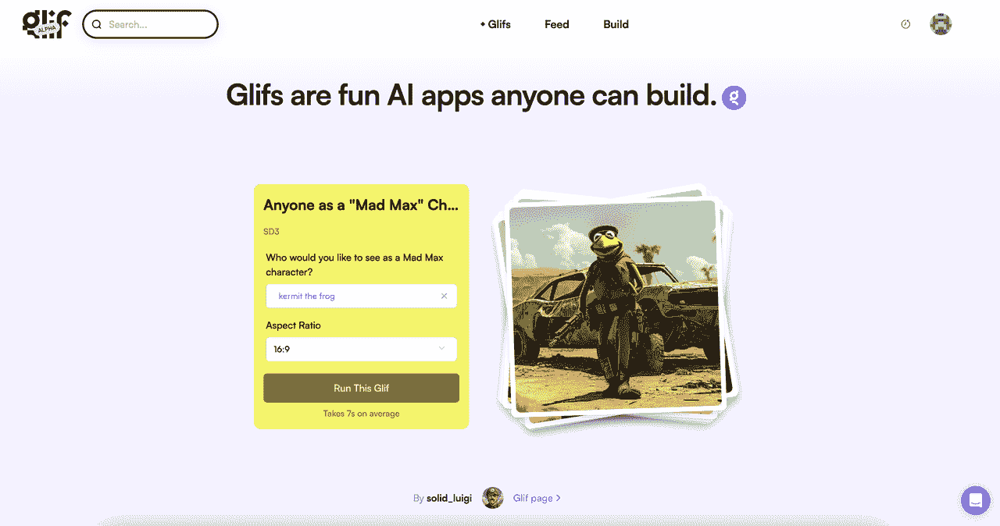

这么说起来, Glif这个工具大家可能依旧不太熟悉, 但是可能很多人看到下图就会觉得熟悉, 而glif就靠此梗图出圈😂:

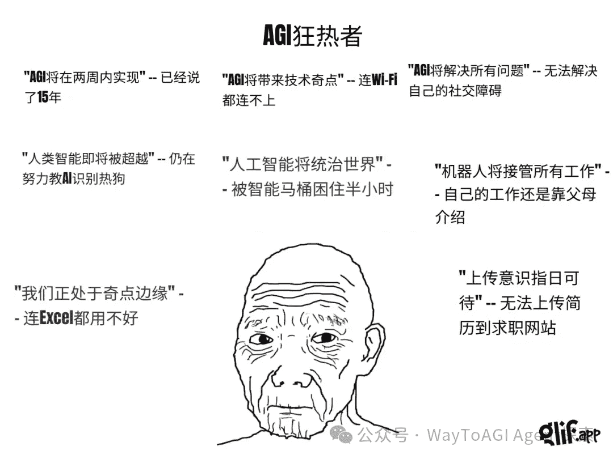

# 1分钟交作业

回归正题, 咱们是奔着1分钟交作业来的.

点击这个网址: [h](https://glif.app/@jian-Stuart/glifs/cly85fy2i000cqe87zcu72i5l)ttps://glif.app/@jian-Stuart/glifs/cly85fy2i000cqe87zcu72i5l 选一张主体区分度比较高, 且主体就是这个地标的图, 比如这种:

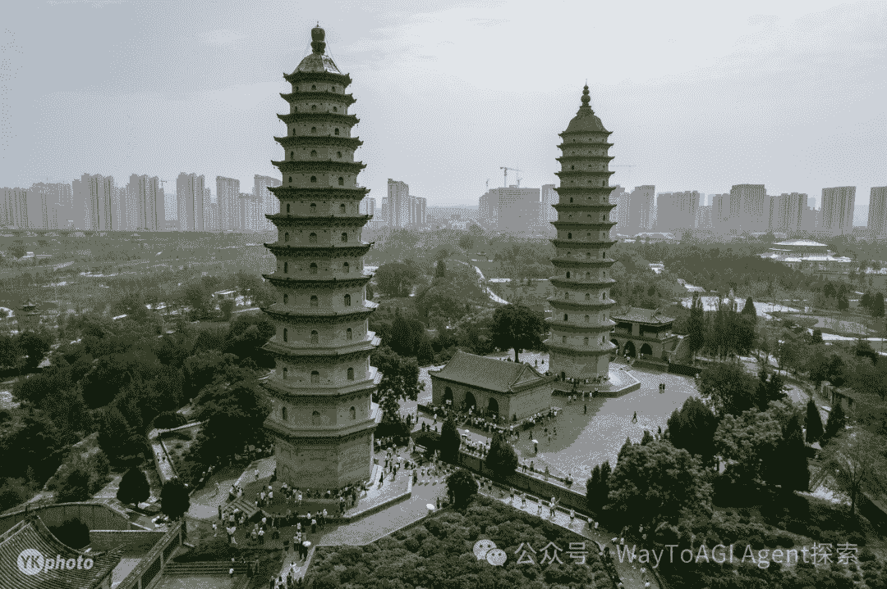

上传你的图片, 并点击下面这个按钮:

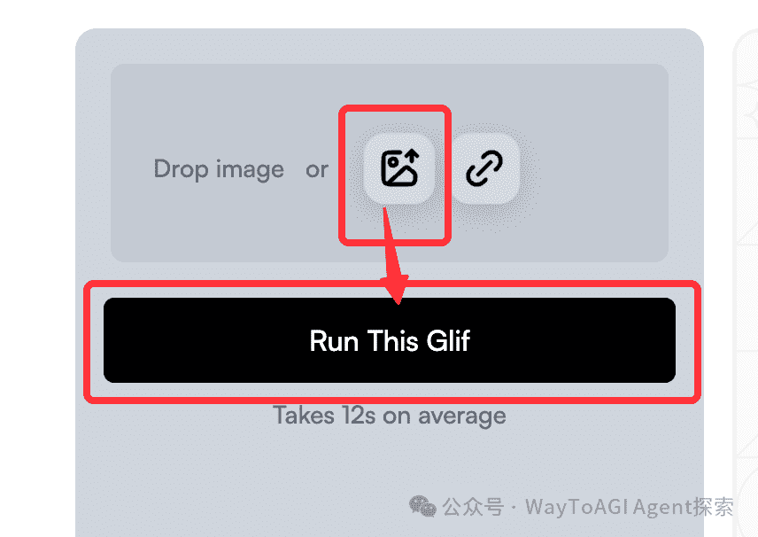

多点几次, 选一张你觉得不错的, 交作业! 1分钟搞定!

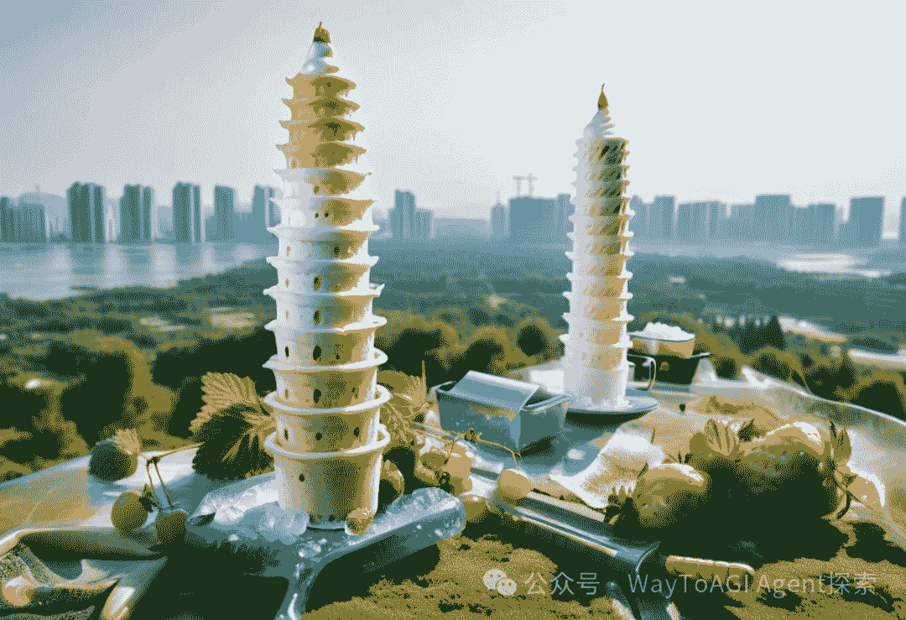

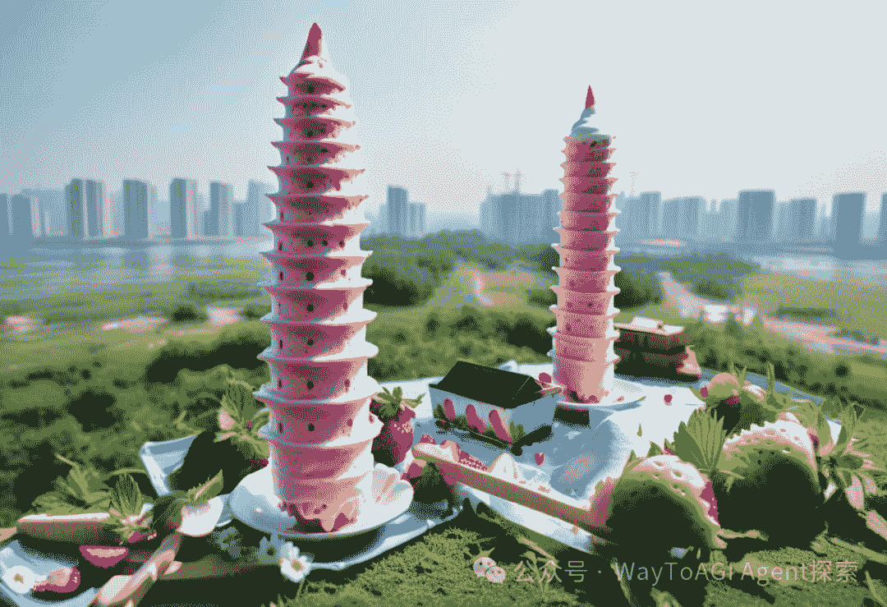

# 学习工作流

啥, 你还想学怎么做? 行, 接下来就是5分钟学习怎么做一个这样的工作流. 这里的核心就是咱师傅三思的知识产权了.

别担心, 这个工具使用起来不复杂, 以下是“喂饭级”教程:

+   点击顶上的“build”按钮.

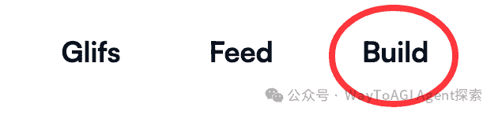

+   点击这个“+”加号

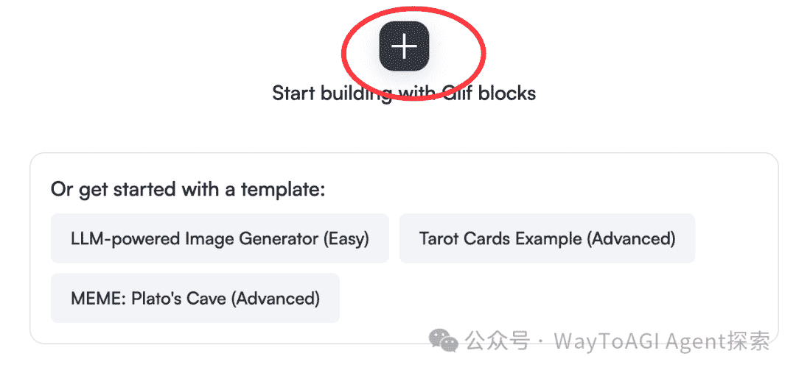

+   选择“img input“

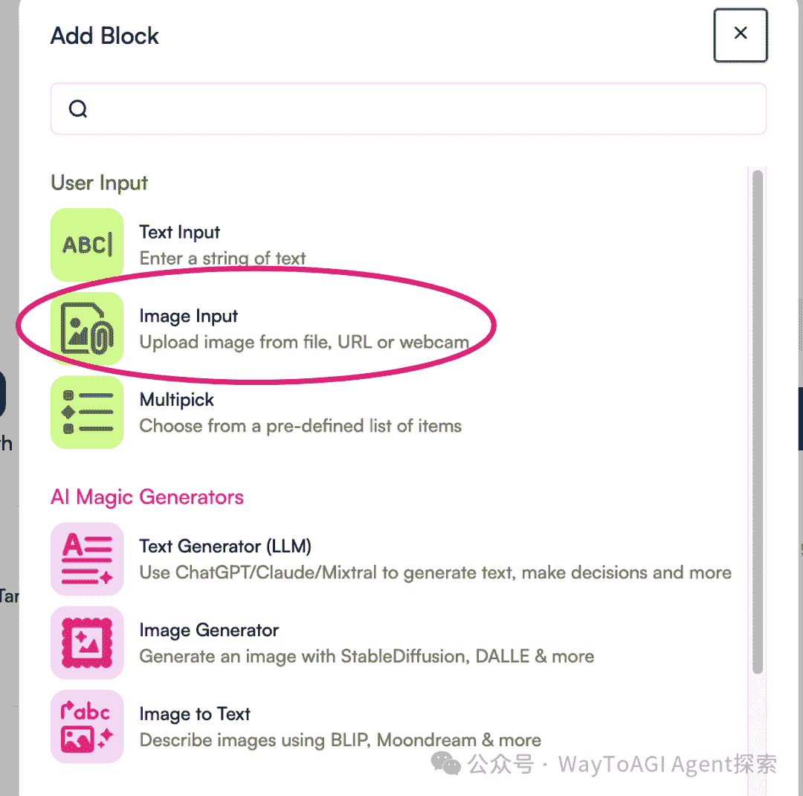

+   再点下面这个“+”加号

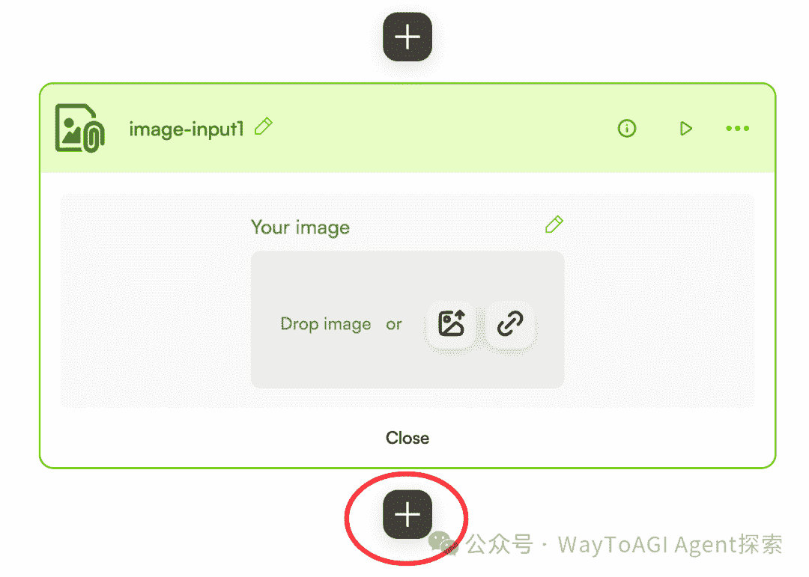

+   这次选“image generator”

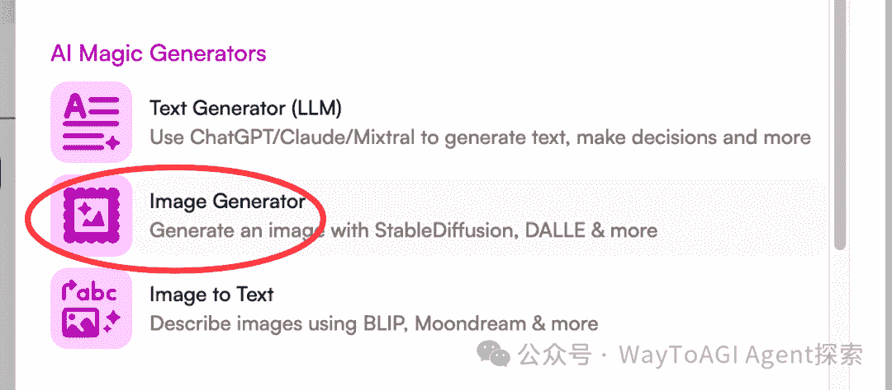

+   把提示词放进这个节点:

```
high-quality,hd,photographic work,appetitive,ice cream,bright colors,summer,lightpink,lightyellow,cream,white long upper shan,strawberry,cherry,fruit,kekou,ice cream,
```

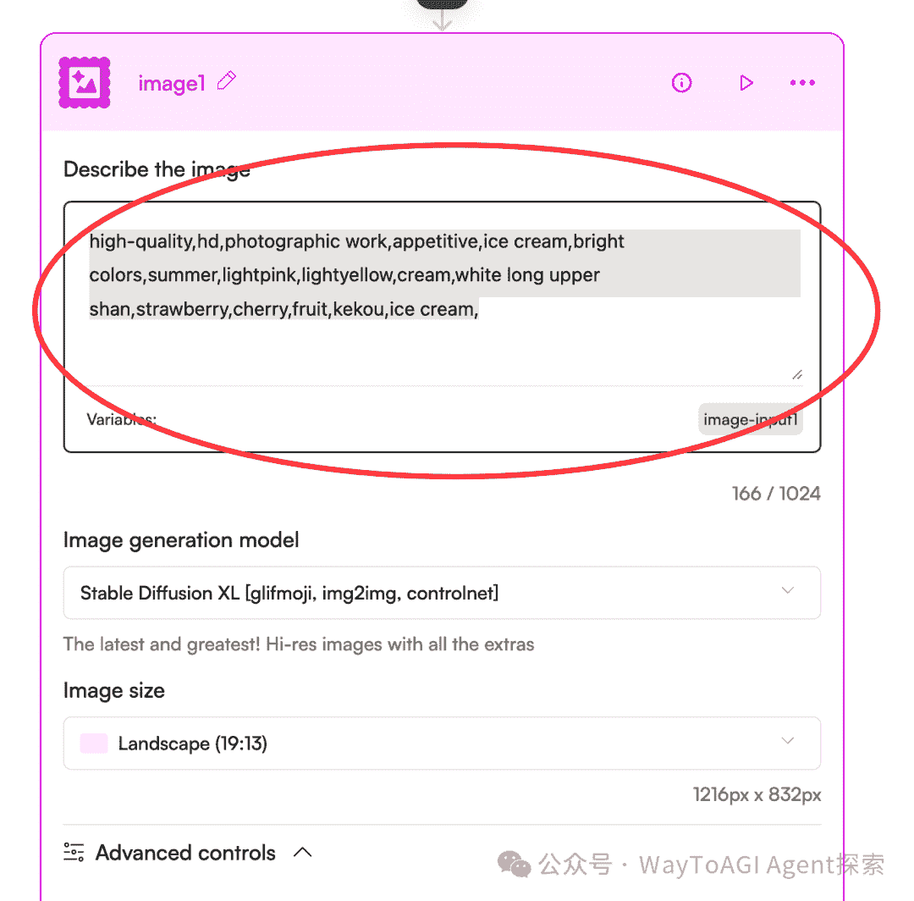

+   打开“advanced controls”, 修改下图中的参数到我截图里设置的数值, 尤其那个图像的URL要换成咱们输入的图像“image-input1”(修改方式为删除原有框里的内容, 按照下面第二张图那个地方, 点它, 别管跳出来的框, 点它!).

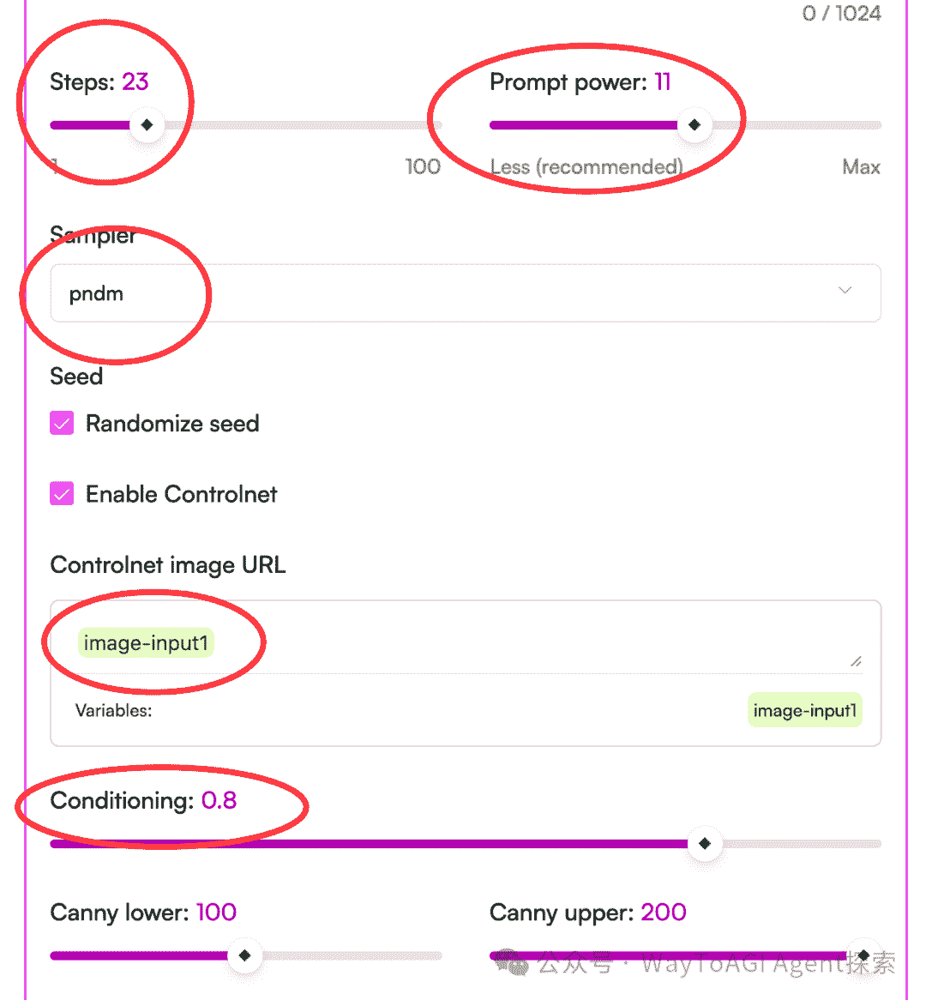

+   同样这个节点, 再勾选☑️“Eable input image(img2img)”, 同样改参数如下图:

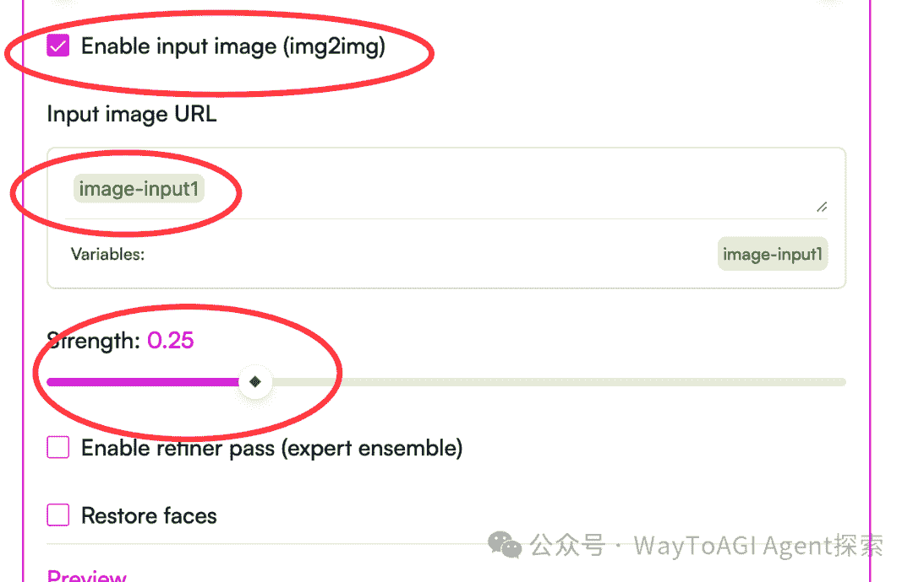

# 效果优化

啥, 你这么贪婪, 还想优化效果?

emm, 也不是不行, 上面几张图里的参数学习下, 他们背后的潜空间原理学习一下.

啥? 不想学, 嫌太麻烦? 也不是不行, 那就当玩“找规律游戏”, 以下这几个主要参数, 你用ctrl+F找到他们在工作流里的位置, 手动改了比比效果, 多试几次总能找到规律!

+   Conditioning

+   Prompt power

+   Conditioning

+   Sampler