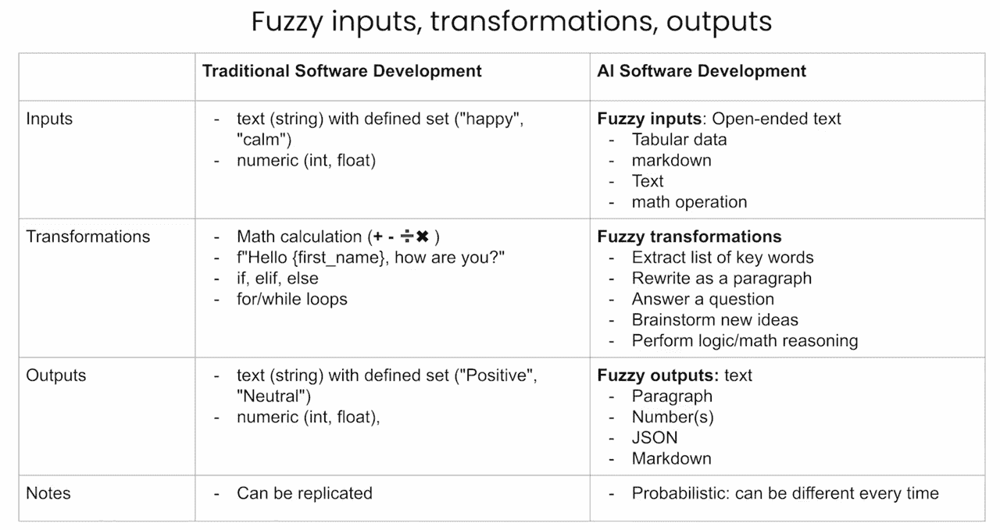

# 3. 进阶知识篇: AI Agents深入浅出

> 来源：[https://waytoagi.feishu.cn/docx/FFH0dFxxzoh2WWxyXJZcb35Pnxb](https://waytoagi.feishu.cn/docx/FFH0dFxxzoh2WWxyXJZcb35Pnxb)

### 传统软件工程 VS. 智能体软件工程

+   模糊 (Fuzzy) 更贴近真实世界

+   变化 = 惊喜 = 不可控

