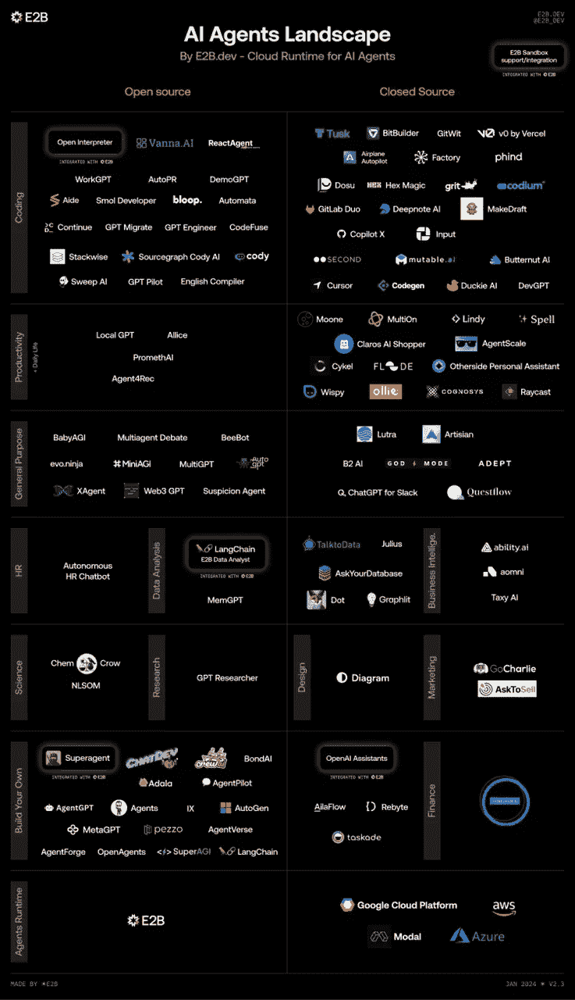

# 框架: 挑选合适的 Agent 框架

> 来源：[https://waytoagi.feishu.cn/docx/ZVSXd0oRLoe25Jxr9rScBbxjnEd](https://waytoagi.feishu.cn/docx/ZVSXd0oRLoe25Jxr9rScBbxjnEd)

| **技能需求** | **Agent框架** | **框架特点简介** |
| --- | --- | --- |
| 新人 | +   Coze | 免费使用各种大语言模型 |
| 进阶 | +    |  |
| 程序员 | +   neuflow |  |

+   [魔搭agent实操](https://modelscope.cn/search?page=1&search=Agent%E5%AE%9E%E6%93%8D&type=headline)

除此之外, 开源Agent框架已经是百花齐放:

来自: https://github.com/e2b-dev/awesome-ai-agents