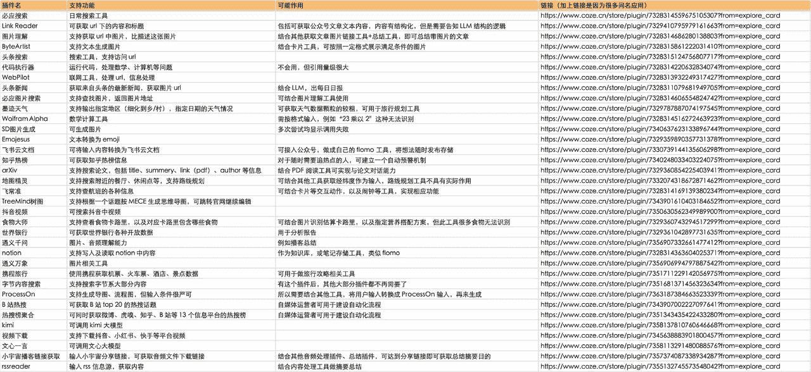

# 工具篇: 自制Agents中的工具

> 来源：[https://waytoagi.feishu.cn/docx/D0f8dhzJqojOEsx4lOLc09FYn5e](https://waytoagi.feishu.cn/docx/D0f8dhzJqojOEsx4lOLc09FYn5e)

> 人和动物的本质区别之一, 就是会使用工具. --- 因此工具也是智能体中非常基础和重要的一环.

> 是通常Agent框架中会自带非常多的工具, 请先熟悉这些自带的工具,

# 制作工具

### 互联网API

| 工具 | 说明 | 手册 |
| --- | --- | --- |
| Jina |  | https://jina.ai/ |
| 高德API | [高德地图开放API](https://lbs.amap.com/api/)是高德地图提供的一套开放接口，可以实现地图展示、地理编码、逆地理编码、路径规划、地点搜索等功能。开发者可以通过调用这些API来实现自己的地图应用。 | https://lbs.amap.com/api/ |

### 本机软件

## 自行构建

# 平台自带工具/插件

特别推荐: 大聪明的插件: webcopilot

### Coze.cn 插件列表:

#### coze插件说明文档(百人共创)

[                         沉浸式智能体插件法](https://waytoagi.feishu.cn/wiki/VlZMwHHfri6Xp8kVlemceCBznPb?from=from_copylink) 小技巧: 采用罗文提供的提示词可以获取插件说明:

(⚠️ 施工中... 目前差错非常多, 暂时处于不可用状态, 在后续持续的共创活动中将逐步完善)