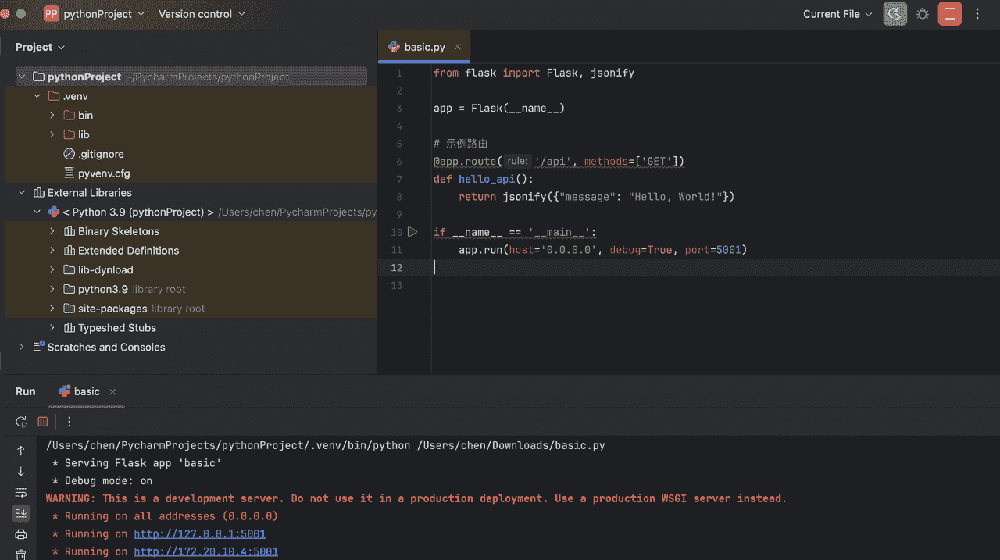
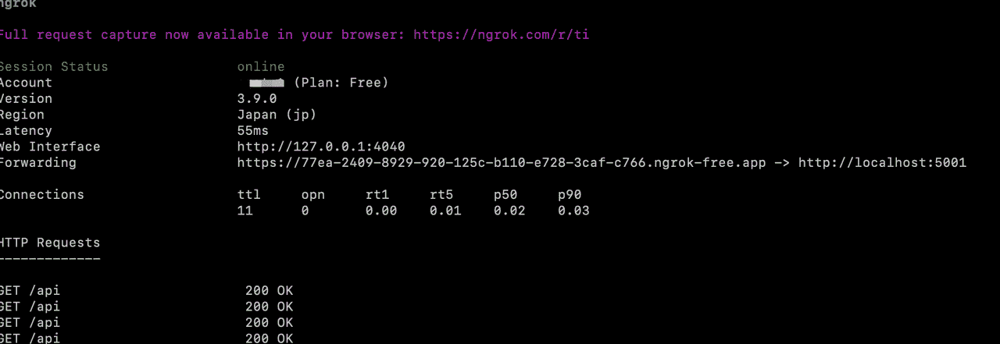
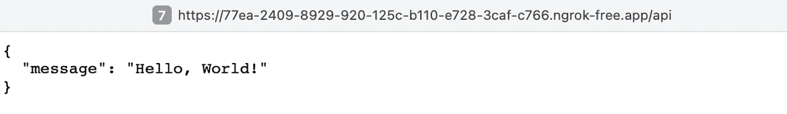
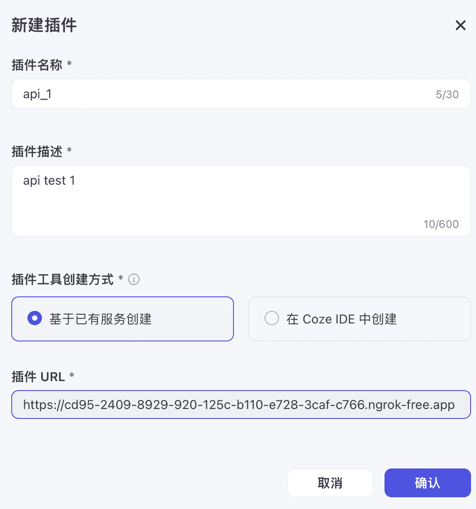
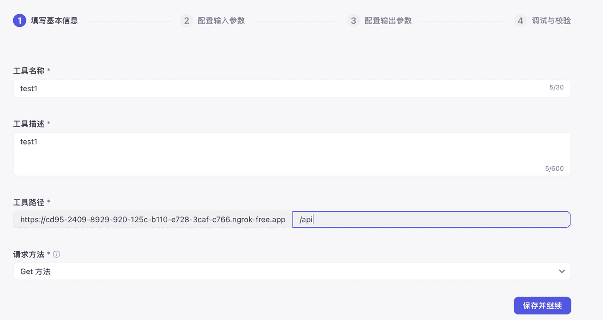
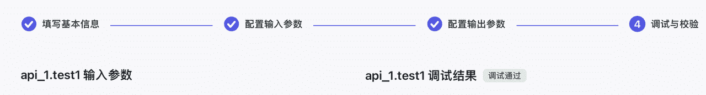
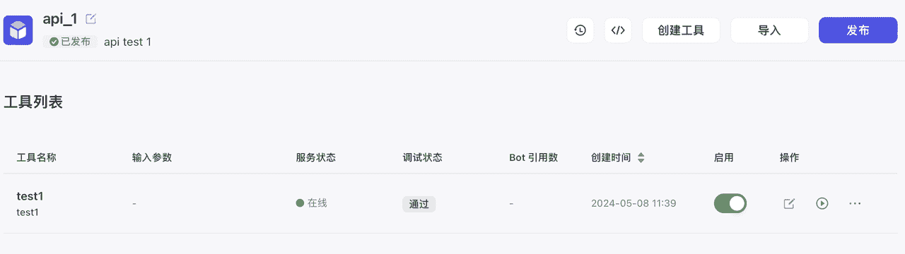
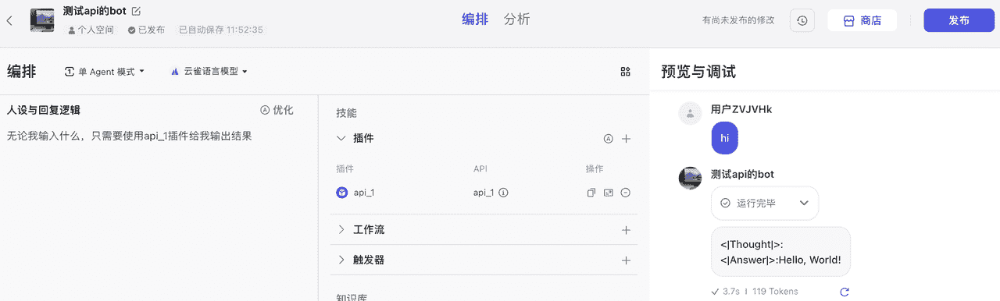

# CT: coze插件---通过已有服务api创建

> 来源：[https://waytoagi.feishu.cn/docx/OVxGdHhhAoGRq9x1oEQcfh66nof](https://waytoagi.feishu.cn/docx/OVxGdHhhAoGRq9x1oEQcfh66nof)

> 写给第一次手捏coze插件的小白们

> 高手请绕道、请绕道

## 准备一个API

咱们的任务是搞一个基于现有服务的自建插件，那为啥plugin商店已经有这么多应用了还要自己再捏一个呢，其实就是吃饱了没事干，想玩一玩。

插件就像是大脑的眼睛和手脚，帮助bot获知实时信息，也可以执行具体任务。

当然咱们今天搞的，就是小白中的小白的插件，连名字都懒得起，就叫他api小1号。

### 跑一个最简单的hello world

让GPT帮我写了一个hello world的简单测试api用例。

能PUA大模型干活的时候，绝对不自己动手。（其实核心原因是，本人不会写代码😭）

```
from flask import Flask, jsonify

app = Flask(__name__)

# 示例路由
@app.route(&#x27;/api&#x27;, methods=[&#x27;GET&#x27;])
def hello_api():
    return jsonify({&quot;message&quot;: &quot;Hello, World!&quot;})

if __name__ == &#x27;__main__&#x27;:
    app.run(host=&#x27;0.0.0.0&#x27;, debug=True, port=5001)
```

本机运行ok，可以在本机ip里面打开网页查看结果。

当然，这些工具的使用，也都是GPT教的。免费老师谁不爱。



### 通过Ngrok给本地服务插上HTTPS的小翅膀

不是本地都跑起来了么，怎么还不进入正题，Ngrok（泥脑壳）这么难念的单词又到底是干啥的。

这泥脑壳其实也不傻，就是把本机电脑跑起来的东西，让外边的世界也看看。

下载注册好ngrok之后，拿到自己账号的authtoken。

然后本机将your_auth_token_here部分换成你自己的。（V我50，我就告诉你我的authtoken）

```
ngrok http --authtoken your_auth_token_here 5000
```

ngrok运行起来之后，就会随机给你一个Forwarding里面的https的地址。

这随机是真随机的，千万不能用在生产环境中，测试玩玩就好了。



输入网址后，也能看到，在公网上临时生成了一个https的链接，将本地的api服务代理了出去。

经典hello world，在公网上看到这个，就相当于看到通过摄像头远程看到了你家的猫一样。



## coze中用现有服务创建自己的plugin

饶了一大圈，终于到了coze。

为啥要用Ngrok（泥脑壳），不是吃饱没事干，纯属coze要你干。

进入coze，个人空间中，选择插件。新建一个插件，起个名字api_1（这名字就是这么随意，连描述都叫test）



在插件的URL部分，填入刚才ngrok（泥脑壳）随机生成的https的链接地址。

刚才开着服务的朋友，你的terminal应该还没关吧，关了的话，请重新从上一步开始。服务还开着的请继续。



有一说一，coze的指引做的真不错，输出参数配置你的message输出就行。



测试后发布插件



## 捏个简单的bot

手捏插件搞定之后，就开始搓bot。不过这个bot简单到手都没搓热就好了。

创建了一个测试api的bot。

将自己创建的api_1的插件接进来。prompt里面简单粗暴让它一定要调用我们的插件。

然后就大功告成。



##

## 后续说明

这个整体过程仅仅为了说明coze的插件指引挺好用的。

如果生产环境中已经有准备好的https的api，直接就可以接上来。

PS： 本案例中用的是coze国内版，反正是玩插件，对模型没啥要求。

PPS：ngrok本案例中仅供娱乐，生产环境中勿用。

PPPS：果然不会写代码，做个案例都这么简单。

PPPPS：动手干，哪怕再简单，都是踏出去的第一步。(给自己菜也找个台阶下.......）

> Read in, Bot out.