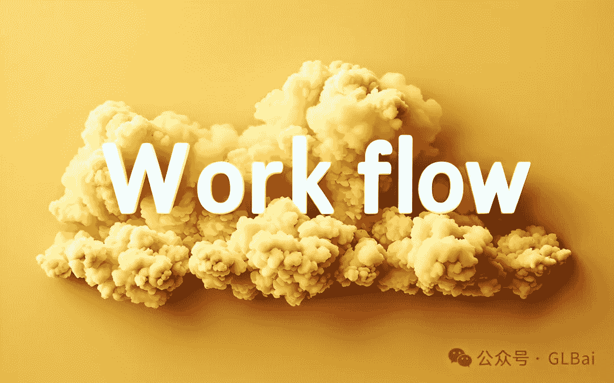
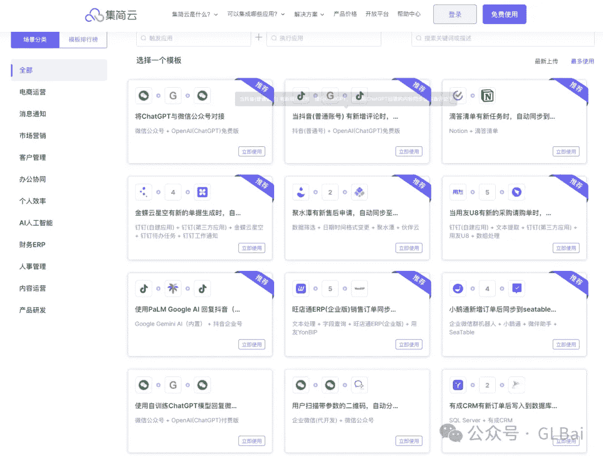
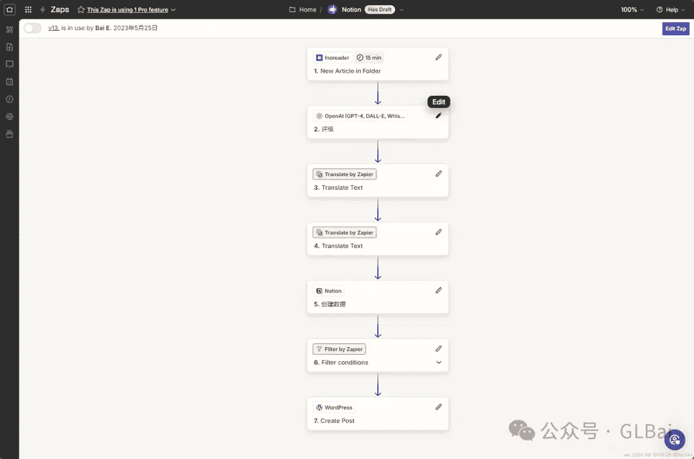
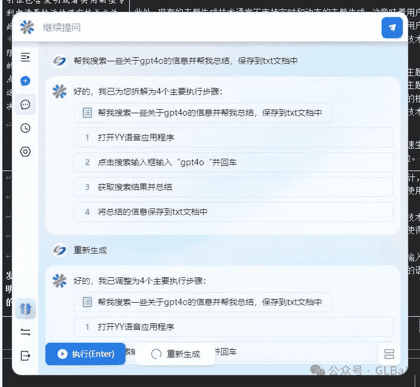
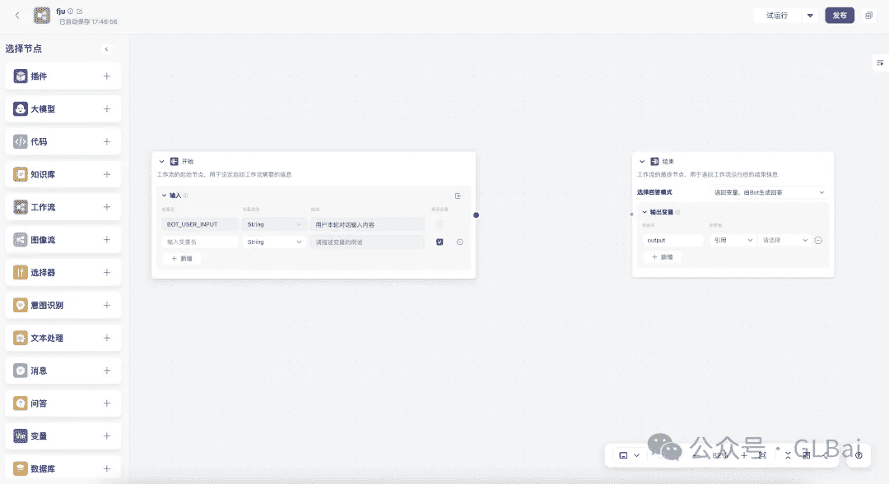
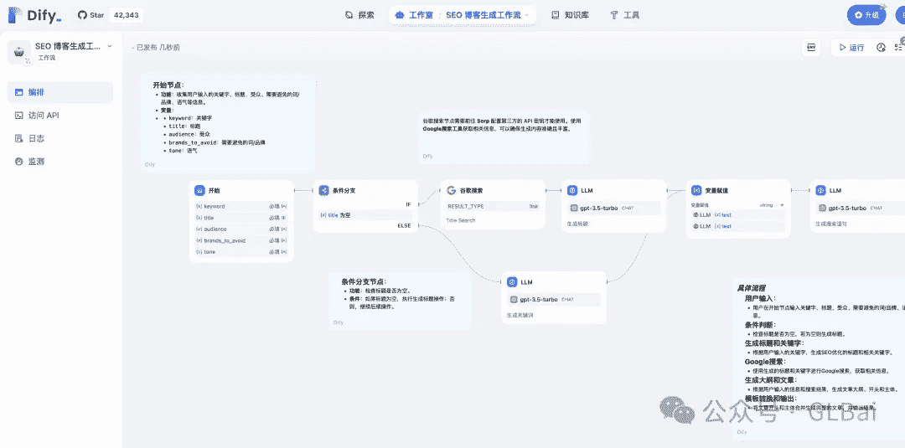
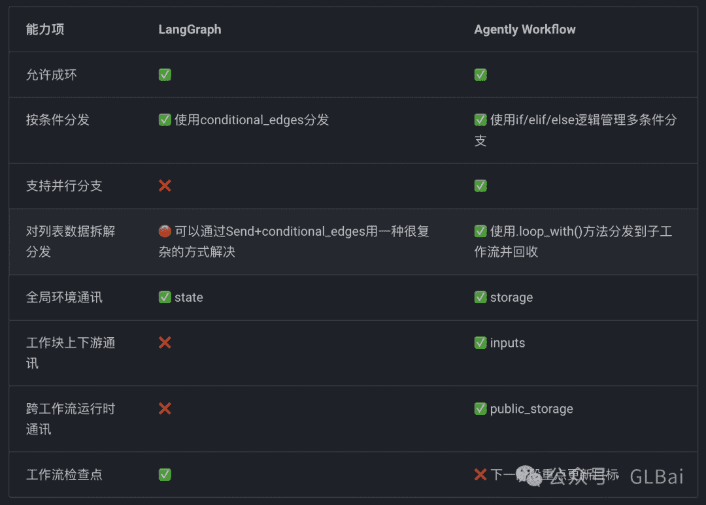

# AI Agent 产品经理血泪史（二）-欲知方圆，则必规矩【Workflow篇】

> 来源：[https://waytoagi.feishu.cn/docx/Y1aQdMWPCoM8aOx9wbUco8lrn2c](https://waytoagi.feishu.cn/docx/Y1aQdMWPCoM8aOx9wbUco8lrn2c)

> 🔗 原文链接： h[ttps://mp.weixin.q](https://mp.weixin.qq.com/s/F4zcwLloybFN538Ca1oMMA)q.com/s/F4zcwLlo...

> ⏰ 发表时间：2024-08-20     作者：GLBai



血泪史系列开篇大受欢迎，感谢大家认可，不过基本也只能是忙里抽闲，断断续续写，很多时候就是写一段然后隔一段时间回来又忘了前面想要写的是啥。如果不嫌弃更新慢，可以点个关注慢慢等。

第一篇： AI Agent产品经理血泪史：一年来我摸过的那些石头【Tools篇】

⭐️第二篇：我们接着讲 **Workflow **，Agent 的核心。

第三篇：RAG - 大模型的第二大脑

第四篇：Multi Agent会放在最后讲，具体何时**还不知，如果感兴趣**可以关注本公众号或者 WaytoAGI 。

# 01 - Workflow的前身-集成平台

大模型带火了很多词，workflow就是其中之一。

如果我说集成平台的话，可能就很少会有人知道。比较有名的大家可能有见到过，比如Zapier--OpenAI的御用集成平台。还有类似的Make，国内的话就是集简云，还有飞书的连接器等等。

以前的叫法叫叫集成平台，顾名思义就是把很多应用的能力/数据集合到平台上，然后再把他们按一定的逻辑串起来，就是一个能干活的串串了。（workflow应该也是这麽来的？）为了更形象一点，我上集简云截了个图。



这些串串里面基本就是按照固定的规则把前后串起来，但是规则非常地死，基本就是IF/ELSE。

直到后面大模型的到来，事情开始变得有趣了...

大概一年零4个月前，我为了自己看资讯方便一点，于是用GPT-3.5搭建了一个自动化的博客。 那个时候没有Tools，没有Coze，也没有Workflow，硬是用Zapier搭建的。



做的事情其实很简单，就是从RSS上按照固定时间间隔抓取信息，然后根据我定的标准进行评分，超过的就翻译发送到我的博客，没超过的就扔掉。

大家仔细看我的串串和上面的串串之间的差异，就是中间的节点多了一个大模型的节点。大模型能帮我去处理一些非结构化的数据，代替我去做一些IF/ELSE之外的判断。

# 02 - 无处不在的流程

我们不再赘述大模型为啥不能一次把活干好。毕竟你自己都做不到的事情，不要老想着为难别人。

回溯我们对大模型认知的过程，其实不难发现流程的概念一直存在。

最早是COT - Chain of Thought ，Let's think step by step。让大模型学会思考，再输出更符合预期的答案。 虽然与传统的直进直出的P rompt相比，COT能让模型带来更多的思考（其实只是更多tokens自回 归带来的准确性提升 ） 。但是它很多时候的结果产出与我们人类的预期还是会有偏差，抽奖不可避免。

然后大概是去年5月份的时候，我在云中江树的LangGPT中，第一次看到了workflow这个词。下面是他主页上的一个示例：

```
## Workflow
1. You will analysis the given the personal information.
2. Create a summary of my diet and exercise plan. 
3. Create a detailed workout program for my exercise plan. 
4. Create a detailed Meal Plan for my diet. 
5. Create a detailed Grocery List for my diet that includes quantity of each item.
6. Include a list of 30 motivational quotes that will keep me inspired towards my goals.
```

这种通过Prompt描述流程的方式，虽然不能100%奏效，但是在上下文不复杂，贪念不大的情况下，还是能work的。

但是我们之前也提到过，单次模型请求，很难去处理一件复杂的事情，比如 1,2,3,4,5,6 ...写了很多点，模型其实并不能很好地去遵循，那怎麼办呢？

# 03 - 软的不行就来硬的

拆！

如果单次请求里面不能很好地遵循且完成所有的事情，那麽拆出来，一步一步去做。

比如用户表达了自己想要达成的目标，接着就是让大模型去根据这个目标去拆分出来 step by step 的子任务，再利用工程的方式循环去请求子任务，（中间可能会插入新的任务），直到所有的子任务都被执行完成。

这就是去年轰动一时的 AutoGPT（Planning and excute）。

但是 AutoGPT 其实只是学术界的一种探索，这东西很难落地，除了一些 demo 产品，我只在一个叫实在智能的 RPA 上见过。原因有非常非常多，之前的文章里我也提了很多次。这里只讲几个最难解的。

1. 计划赶不上变化，提前规划的任务如何保证都能正确执行？

2. 大模型也不是全知全能，如何保证规划的任务就是对的？

3. 既然是工程化执行，那何时进入到循环，何时退出循环又是一个问题。

下面是当时在实在智能 RPA Agent 上的截图。 或者有兴趣的也可以自己去搜 AgentGPT，自己试着跑几个 case 就知道 了。



其实大家后来都有在解这些问题，只是思路、解法都不太一样。

比如 OpenAI 开始搞 Tools，FastGPT 搞了可视化的 workflow 编排，后面大家都开始意识到好像 workflow 是一个短期最优解，于是各家都开始做。

# 04 - 从自动编排到手动编排





上图分别是 Coze 和 Dify 的 workflow 可视化编排页面（框架：React Flow），不得不说 Coze 的确不是最早做编排的，但是集各家之所长，在用户体验上做的的确得人心。 再回过头对比一下上节中 AutoGPT 的实现，我们可能就发现了这个差异：

**AutoG**PT 的任务是大模型编排出来的，**我们可以理**解为 自动编排 ； 而 Workflow 里面的子任务，是我们人为编排的， 我们就称为 手动编排 吧。

由此带来的优化也非常明显：

1. 在流程中加入人类 Knowhow，补足模型知识的不足；

2. 专家测试试跑，减少生产环境中的反复无效反思，至少不会让用户觉得你的 Agent 真蠢；

3. 引入图的概念，灵活组织节点，连接各类工具（让你的 Agent 看起来很牛逼）

其实加入了图的概念之后，workflow 的天花板也就变得非常高了。

因为你可以在这个流程中去任意增加节点，增加各种类型的节点，不仅能套工具，还能套 其它 agent，你也可以写代码用硬逻辑去处理，你也可以接大模型，让它代替人类进进行判断。能力的上限，很大概率就是你想象力的上限。

灵活和可控，把 Agent 能力的天花板往上顶了一大截。这就是 workflow 的功劳。

我之前评价一个 Agent 平台好不好用： 1 看基座模型的 function calling 能力， 2 看 workflow 的 灵活性，3 看平台创作者的 workflow 写的牛逼不牛逼哈哈

1、2 看的是技术能力，其实也没啥门槛

# 05 - 突破更多的灵活性

读到这里如果还有问题的同学，我大概能猜到是什麼样的问题。像 coze、dify 这样的平台，虽然带来了可视化 workflow 的便捷操作和 LLMops 的基建支持，但还有很多想法实现不了，对吧？

比如循环，再比如并行分支...等等， 这个时候我会建议你 开始写代码  。

其实去年底的时候 langchain 就基于图的概念推出了全新的 Agent 框架 Langgraph，很灵活，但是仍旧会有一些问题，Langchain 上的问题同样被带到了 Langgraph，对于只想简单入手写个 Agent 的，门槛略高。

相比之下，会更推荐 莫欣 老师的 Agently 框架，客观公正地评价一下，写一次你就会爱上那种感觉，你只需要专注于构思 Agent 的实现，剩下的 coding，交给框架。（本篇不是软文），附上官网和 langgraph 的比较。



# 06 - 最后

做 AI 产品挺难的，大模型也没有那麽神奇，祛魅的成本很高，不要轻易被自媒体蛊惑了。

发 Paper 的那帮人，跟做产品的这帮人，要考虑的东西也不太一样。

还想入坑的朋友，欢迎联系我，想让你朋友们入坑的，也可以联系我。