# 大圣：胎教级教程：万字长文带你使用Coze打造企业级知识库

> 来源：[https://waytoagi.feishu.cn/docx/V1BydMouhosgS3x3VvucrHnjn5G](https://waytoagi.feishu.cn/docx/V1BydMouhosgS3x3VvucrHnjn5G)

> 2024.06.22 重磅更新！

> Coze放大招！Coze可以自动帮助回复抖音评论了！

> 视频教程：https://www.bilibili.com/video/BV1AM4m1U7iF/?spm_id_from=333.999.0.0&vd_source=e94f42ead4c2e95f4b13bec257d95670

> 2024.06.05 更新

> 为了帮助非编程人士更好的理解数据库的概念，从而更好的学习Coze，我补充一篇额外的教程。

> [这可能是讲 Coze 的数据库最通俗易懂的文章了](https://waytoagi.feishu.cn/wiki/WpC2wteRPitq0Ukf4lFcI99Zn6g?from=from_copylink)果你对数据库这个概念还有疑惑，请阅读这篇文章

>

>

> 2024.06.08更新

> 为了帮助非编程人士更好的理解知识库的概念，从而更好的学习Coze，我补充一篇额外的教程。

> 这篇文档我强烈建议你阅读下，会让你对AI时代的知识库有一个全面的认识

> [这可能是讲 Coze 的知识库最通俗易懂的文章了](https://waytoagi.feishu.cn/wiki/MqxJwbIBZicHnrkkdLaczck6ngd?from=from_copylink)

>

> 2024.06.10更新

> 为了帮助非编程人士更好的理解变量的概念，从而更好的学习Coze，我补充一篇额外的教程。

> [这可能是讲 Coze 的变量最通俗易懂的文章了](https://waytoagi.feishu.cn/wiki/XNzbwoUvxiloNLkAPYMc5Dzrnge?from=from_copylink)

>

> 2024.06.12 更新

> B站对应的视频链接：https://www.bilibili.com/video/BV1YM4m167zP/?spm_id_from=333.999.0.0

大家好，我是大圣，一个致力于使用AI工具将自己打造为超级个体的程序员。目前醉心于AI Agent的研究。

读完本文，你可以收获

+   AI Agent的概念以及核心公式

+   字节初代AI Agent产品**Coze**的详细教程

+   使用一个知识库的例子手把手教你Coze如何使用

# 一、AI Agent指南

## 1.1 什么是Agent

Agent，我们一般将其翻译为**代理人**、**代理商**等。

在人工智能领域，Agent 通常被定义为一种具有感知能力的实体，它能够通过对其所处环境的观察来做出相应的决策和反应。这种 Agent 既可以是软件形式的程序，例如对话机器人，也可以具备物理形态，比如扫地机器人

## 1.2 什么是AI Agent

在了解AI Agent之前，我们先考虑一个场景：我们要写一本20万字的关于人工智能最新技术的书

在没有大模型之前，我们一般会按照如下流程

+   第一步：先使用搜索引擎搜索一些相关书籍和信息进行阅读，为我们打开思路

+   第二步：形成本书的大纲，并且考虑清楚每一章节要编写的内容

+   第三步：针对每一个章节进行内容的编写，在编写过程中可能会调整文章的大纲

+   第四步：在编写后面章节的时候可能会忘记前面写的内容，需要去翻阅前面已经写的内容

+   第五步：文章初步完成之后，我们可能会找相关专业人士帮忙修改

+   最后：经过几番调整之后，书籍最终成型

在大模型出现之后，我们可能会这样使用：

> 请你帮忙生成一篇20万字的关于人工智能最新技术的书

这个时候我们会发现AI写出来的书根本就无法阅读，是大模型的能力不行么？不仅仅因为这个，相比于第一种写书的方式，第二种方式明显缺少了几个环节

+   没有办法使用Google获取最新的外部信息（大模型的训练数据是有日期限制的）

+   没有对整个事情进行规划（比如先写大纲，再编写每个章节，然后和别人讨论，最后成文）

+   大模型没有记忆的能力，由于上下文（脑容量）的限制，无法一次性完成20万字的文章，会造成前言不搭后语的现象

而AI Agent就是为了解决这个问题。

AI Agent是应用了大模型（LLM）能力的Agent。

以GPT为代表的大模型的出现，将Agent的能力提高到了前所未有的高度。AI Agent又被称为智能体。

OpenAI 的 Lilian Weng 将以 LLM 为驱动的 AI Agent，形式化为如下的公式：

> **A**I Agent = LLM（大模型） + Planning（规划） + Memory（记忆） + Tools（工具）

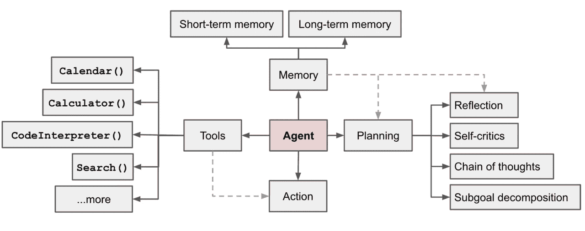

也就是说：AI Agent由如下几部分组成，我用一个管理花园的园丁的例子来说明每个模块的作用

1.  **LLM（大模型）**：就像园丁的智慧和知识库，它阅读了海量的园艺书籍和资料，不仅知道各种植物的名字，还懂得如何照顾它们。在AI Agent中，LLM提供了庞大的信息存储和处理能力，以理解和响应我们提出的各种问题。

1.  **Planning（规划）**：园丁需要规划整个花园的布局。AI Agent的规划功能，就像园丁制定种植计划，决定先种哪些花草、后种哪些蔬菜，或者如何分步骤修剪树冠。

1.  **Memory（记忆）**：这类似于园丁的笔记本，记录了每个植物的种植时间、生长情况和前一次施肥的时间。记忆模块让AI Agent能记住以往的经验和已经完成的任务，确保不会重复错误。

1.  **Tools（工具）**：就是园丁的用具，比如铲子、水壶和剪刀。AI Agent的工具模块，指的是它可以运用的各种软件和程序，帮助它执行复杂的任务，就像园丁用工具进行园艺活动一样。

**我们也可以认为LLM + Planning + Memory**是人类的大脑，而Tools则是人类的四肢。

在大模型出现之前，Planning和Memory已经有比较成熟的技术。

大模型的出现则补足了AI Agent发展的最后一环

## 1.3 从Copilot到Agent

目前大模型的产品类型，主要有两种：

+   **Copilot**：翻译成**副驾驶**，**助手。**在帮助用户解决问题时起辅助作用，例如github copilot是帮助程序员编程的助手

+   **Agent**：更像一个**主驾驶**，**智能体，**可以根据任务目标进行自主思考和行动，具有更强的独立性和执行复杂任务的能力

我们从核心功能、流程决策、应用范围和开发重点几个方面对比 Copilot 和 Agent：

1.  **核心功能**

+   **Copilot**：更像是一个**辅助驾驶员**，更多地依赖于人类的指导和提示来完成任务。Copilot 在处理任务时，通常是在人为设定的范围内操作，比如基于特定的提示生成答案。它的功能很大程度上局限于在给定框架内工作。

+   **Agent**：像一个**初级的主驾驶**，具有更高的自主性和决策能力。能够根据目标自主规划整个处理流程，并根据外部反馈进行自我迭代和调整。

1.  **流程决策**

+   **Copilot**：**在处理流程方面，Copilot 往往依赖于 **Human 确定的流程，这个流程是静态的。它的参与更多是在局部环节，而不是整个流程的设计和执行。

+   **Agent**：Agent 解决问题的流程是由 AI 自主确定的，这个流程是动态的。它不仅可以自行规划任务的各个步骤，还能够根据执行过程中的反馈动态调整流程。

1.  **应用范围**

+   **Copilot**：主要用于处理一些简单的、特定的任务，更多是作为一个工具或者助手存在，需要人类的引导和监督。

+   **Agent**：能够处理复杂的、大型的任务，并在 LLM 薄弱的阶段使用工具或者 API 等进行增强。

1.  **开发重点**

+   **Copilot**：主要依赖于 LLM 的性能，Copilot 的开发重点在于 Prompt Engineering。

+   **Agent**：同样依赖于 LLM 的性能，但 Agent 的开发重点在于 Flow Engineering，也就是在假定 LLM 足够强大的基础上，把外围的流程和框架系统化，坐等一个强劲的 LLM 核心。

## 1.4 为什么LLM可以成为Agent的大脑

LLM可以成为AI Agent的“大脑”主要是因为它具备了以下的关键能力

1.  **复杂语言理解**：LLM经过大规模数据训练，具备理解和处理自然语言的能力，包括语法、句法以及言外之意。

1.  **丰富的世界知识**：训练数据覆盖广泛的知识域，模型可以连结不同的信息片段，进行知识推理和应用。

1.  **上下文感知**：能够根据上下文信息做出响应，连贯地处理对话或相关任务，这在处理持续的交互中非常重要。

1.  **生成能力**：不仅能够理解信息，还能够创建回答、文章甚至代码，这在任务自动化中尤为重要。

1.  **适应不同场景**：通用性和可定制性使得LLM能够适应各种不同的应用场景和需求，类似于大脑如何通过学习适应新环境。

1.  **持续学习能力**：一些LLM可通过进一步训练根据反馈学习和提升，类似于大脑通过经验学习。

## 1.5 AI Agent的开源项目

+   [AutoGPT](https://github.com/Significant-Gravitas/AutoGPT)

+   [BabyAGI](https://github.com/yoheinakajima/babyagi)

+   [MetaGPT](https://github.com/geekan/MetaGPT)

+   [GPT Researcher](https://github.com/assafelovic/gpt-researcher)

+   [AI-16Z的AI-town](https://github.com/a16z-infra/ai-town)

+   [斯坦福的AI-Town](https://github.com/joonspk-research/generative_agents)

+   [ChatDev](https://github.com/OpenBMB/ChatDev)

# 二、Coze使用教程

## 2.1 Coze概述

### 什么是Coze

字节的官方解释如下：

> Coze 是新一代一站式 AI Bot 开发平台。无论你是否有编程基础，都可以在 Coze 平台上快速搭建基于 AI 模型的各类问答 Bot，从解决简单的问答到处理复杂逻辑的对话。并且，你可以将搭建的 Bot 发布到各类社交平台和通讯软件上，与这些平台/软件上的用户互动

我个人认为：**Coze是字节针对AI Agent这一领域的初代产品，在**Coze中将AI Agent称之为Bot

字节针对Coze这个产品部署了两个站点，分别是国内版和海外版

+   国内版

+   网址：https://www.coze.cn

+   官方文档教程：https://www.coze.cn/docs/guides/welcome

+   大模型：使用的是字节自研的**云雀大模型**

+   国内网络即可以正常访问

+   海外版

+   网址：https://www.coze.com

+   官方文档教程：https://www.coze.com/docs/guides/welcome

+   大模型：GPT-4、GPT-3.5等大模型（你可以在这里白嫖ChatGPT4，具体参考文档：）

+   访问需要突破网络限制的工具

> 参考文档：https://www.coze.com/docs/zh_cn/welcome.html

### AI Agent的开发流程

Bot的开发和调试页面布局如下，主要分为如下几个区块

+   提示词和人设的区块

+   Bot的技能组件

+   插件

+   工作流

+   Bot的记忆组件

+   知识库

+   变量

+   数据库

+   长记忆

+   文件盒子

+   一些先进的配置

+   触发器：例如定时发送早报

+   开场白：用户和Bot初次对话时，Bot的招呼话语

+   自动建议：每当和Bot一轮对话完成后，Bot给出的问题建议

+   声音：和Bot对话时，Bot读对话内容的音色

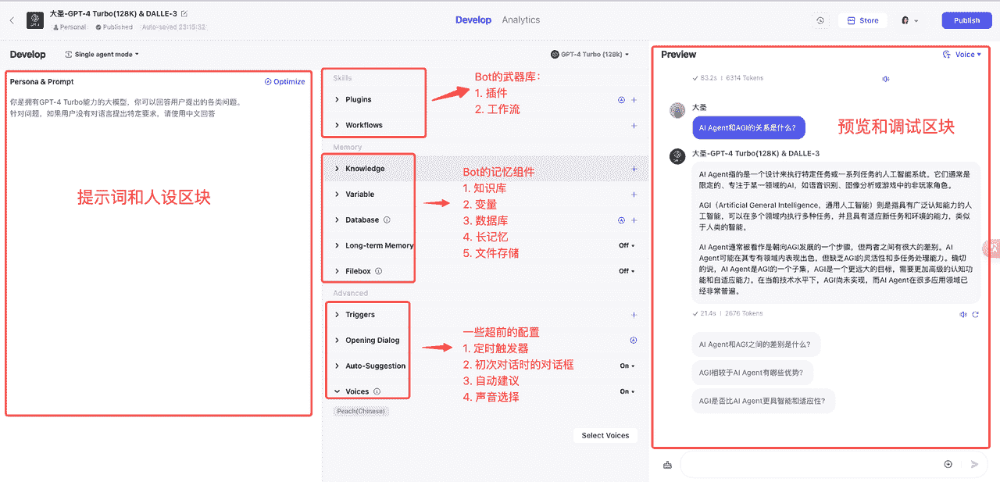

下面我们则会逐一讲解每个组件的能力以及使用方式

## 2.2 提示词-AI Agent的人设

> 海外参考文档：https://www.coze.com/docs/zh_cn/prompt.html

> 国内参考文档：https://www.coze.cn/docs/guides/prompt

人设和提示词的目的是：设定 Bot 的身份及其目标和技能，例如产品问答助手、新闻播报员、翻译助理等等。Bot 的人设和提示词决定了 Bot 如何与你的用户进行互动。

提示词编写的越明确，Bot的回复也越符合预期

## 2.3 插件系统-AI Agent的武器库

> AI Agent = LLM + Planning + Memory + Tools

插件系统则对应Tools，主要目的是扩展Bot的能力边界

### 插件介绍

Coze的插件系统对应的就是AI Agent的工具箱。Coze官方是这样解释插件系统的

> 插件是一个**工具集**，一个插件内可以包含一个或多个工具（API）。

> 目前，Coze 集成了超过 60 种类型的插件，包括资讯阅读、旅游出行、效率办公、图片理解等 API 及多模态模型。使用这些插件，可以帮助你拓展 Bot 能力边界。例如，在你的 Bot 内添加新闻搜索插件，那么你的 Bot 将拥有搜索新闻资讯的能力。

> 如果 Coze 集成的插件不满足你的使用需求，你还可以创建自定义插件来集成需要使用的 API

### 插件种类

Coze提供了丰富的插件，这些插件涵盖了从搜索引擎、文本分析以及图像识别等各种领域。

这些插件的能力如果我们个人接入都是要收费的，但是在Coze平台则是免费使用的，例如：

Coze国内版本：https://www.coze.cn/store/plugin

+   必应搜索

+   LinkReader：读取文档

+   知乎热榜

而且国内版本还提供了很多便民的服务，例如：

+   新闻资讯

+   **头条新闻**：持续更新，了解最新的头条新闻和新闻文章。

+   天气预报

+   **墨迹天气**：提供省、市、区县的未来 40 天的天气情况，包括温度、湿度、日夜风向等。

+   出行必备

+   **飞常准**：通过 VariFlight 覆盖的全球商业客运航班，您的终端用户可以轻松获得他们的航班状态、办理登机手续柜台、预计出发时间、登机口、登机状态、行李转盘等信息，并能在整个航程中随时掌握。

+   **猫途鹰**：查询实时酒店搜索，航班价格，餐厅，吸引人的旅游地点等信息以创建一个旅行网站。

+   生活便利

+   **快递查询助手**、**国内快递查询**：查询快递单号，快递公司，快递进度等信息。

+   **食物大师**：Food Master 提供食物搜索功能。

+   **懂车帝**：如果你想要查询汽车信息，包括二手车、新车、某些车型的信息时可以使用此插件进行查询。

+   **幸福里**：提供二手房、新房、租房信息的插件，想要查询某个城市、区域、户型的房产信息时，可以使用此插件。

+   **猎聘**：帮助用户根据工作经验、教育经历、地理位置、薪水、职位名称、工作性质等条件搜索猎聘上提供的招聘信息。

这些生活化的插件，可以让你的 AI bot 变得贴近生活，贴近用户的需求。

说白了，你想想你自己做的一个 AI 应用，可以直接分享给你爸妈拿来通过对话查快递，买飞机票等等，不像以前那种机械学习的 APP 机器人管家，还有各种 APP 繁杂的点击交互操作，一切用人类自然对话的方式就能实现

Coze国外版本：https://www.coze.com/store/plugin

+   谷歌搜索

+   DALLE 3

+   Data Analysis

+   YouTube

作为开发者，国外版本的能力更加强大和令人心动。

### 创建插件

> 参考官方文档：https://www.coze.com/docs/zh_cn/plugin.html

## 2.4 工作流-AI Agent的内功心法

### 节点

工作流是由多个节点构成，节点是组成工作流的基本单元。

节点的本质就是一个包含输入和输出的函数

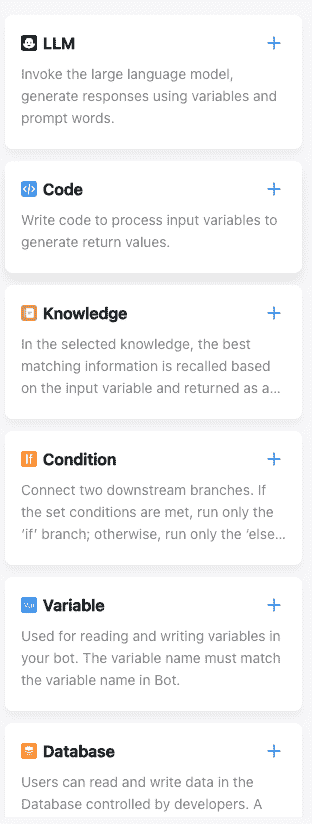

**Coze平台支持的节点类型：**

+   **LLM（大语言模型）：**使用输入参数和提示词生成处理结果。

+   **Code（代码）：**通过 IDE 编写代码处理输入参数，并返回输出值。

+   **Knowledage****（知识库）：**根据输入参数从关联知识库中召回数据，并返回。

+   Condition（条件判断）： if-else 逻辑节点，用于设计工作流内的分支流程，根据设置条件运行相应的分支

+   **Variable（获取变量）**：从Bot中获取变量作为参数在工作流中使用

+   **Database（数据库）：**在工作流中使用提前配置在Bot数据库中的数据

### 创建和使用工作流

这一块官方有现成的教程参考：

> 海外参考文档：https://www.coze.com/docs/zh_cn/use_workflow.html

> 国内参考文档：https://www.coze.cn/docs/guides/use_workflow

国内版本还提供了一些示例，学习工作流强烈建议大家跟着实操一遍：

> 搜索新闻：https://www.coze.cn/docs/guides/workflow_search_news

> 使用LLM处理问题：https://www.coze.cn/docs/guides/workflow_use_llm

> 生成随机数：https://www.coze.cn/docs/guides/workflow_use_code

> 搜索并获取第一个链接的内容：https://www.coze.cn/docs/guides/workflow_get_content

> 识别用户意图：https://www.coze.cn/docs/guides/workflow_user_intent

## 2.5 知识库、数据库和变量-AI Agent的记忆

> AI Agent = LLM + Planning + Memory + Tools

**Coze中的知识**库、数据库以及变量功能来实现Agent的Memory模块

### 知识库（Knowledge）

#### 为什么需要知识库

大模型并不是100%准确的，它会产生幻觉，主要是因为以下两点

+   训练大模型的数据是有日期限制的，如果你询问大模型超出日期限制的问题，则大模型无法准确回答

+   大模型的数据来源于互联网，如果是公司内部的私有数据，则大模型无法感知

因此知识库的出现就是为了解决大模型的数据准确性的问题。

大模型可以额外学习外接知识库中的知识，从而来精准回复用户。

知识库中最典型的一个应用就是客服系统：

公司可以将用户所有问题以及答案记录在文档中，然后以知识库的形式投喂给大模型。这样当用户通过自然语言询问问题时，大模型就可以根据知识库中的内容给出更加准确的回答。

#### 知识库的理论基础：RAG

我**们都知道大模型的训**练数据是有截止日期的，那当我们需要依靠不包含在大模型训练集中的数据时，我们该怎么做呢？实现这一点的主要方法就是通过检索增强生成RAG（Retrieval Augmented Generation）。

在这个过程中，首先检索外部数据，然后在生成步骤中将这些数据传递给LLM。

我们可以将一个RAG的应用抽象为下图的5个过程：

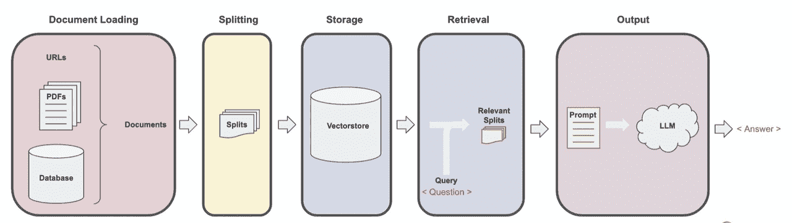

+   文档加载（Document Loading）：从多种不同来源加载文档。LangChain提供了100多种不同的文档加载器，包括PDF在内的非结构化的数据、SQL在内的结构化的数据，以及Python、Java之类的代码等

+   **文本分割（Splitting）****：文**本分割器把Documents 切分为指定大小的块，我把它们称为“文档块”或者“文档片”

+   **存储（Storage）：**存储涉及到两个环节，分别是：

+   将切分好的文档块进行嵌入（Embedding）转换成向量的形式

+   将Embedding后的向量数据存储到向量数据库

+   **检索（Retrieval）**：一旦数据进入向量数据库，我们仍然需要将数据检索出来，我们会通过某种检索算法找到与输入问题相似的嵌入片

+   **Output（输出）**：把问题以及检索出来的嵌入片一起提交给LLM，LLM会通过问题和检索出来的提示一起来生成更加合理的答案

#### 使用知识库

> 海外官方文档：https://www.coze.com/docs/zh_cn/knowledge.html

> 国内官方文档：https://www.coze.cn/docs/guides/use_knowledge

#### 安装Coze Scraper

这个是Coze官方提供的一个Chrome插件，目的在于帮助用户提取网页上的内容，然后快速上传到自己的知识库中

> 海外官方文档：https://www.coze.com/docs/zh_cn/scraper.html

> 国内官方文档：https://www.coze.cn/docs/guides/scraper

### 数据库（Database）

> 海外参考文档：https://www.coze.com/docs/zh_cn/database.html

> 国内参考文档：https://www.coze.cn/docs/guides/database

数据库是偏编程的概念，非编程同学可以直接参考官方文档的教程操作一遍

**数据库和知识库的区别主要有几点**

+   知识库是提前内置在Bot内部的，一般只能用作检索使用

+   数据库则是既可以提前内置在Bot内部，也可以在和Bot互动的过程中将某些数据写入数据库，当作存储组件使用

### 变量（Variable）

变量是 Bot 的数据记忆功能，以 key-value 形式存储数据。一个变量只能保存一种信息，一般用于记录用户的某一行为或偏好

大语言模型会根据用户输入内容进行语义匹配，为定义的变量赋值并保存值。你可以在提示词中为 Bot 声明某个变量的具体使用场景。

#### 创建变量

在创建Bot的页面，我们可以创建变量

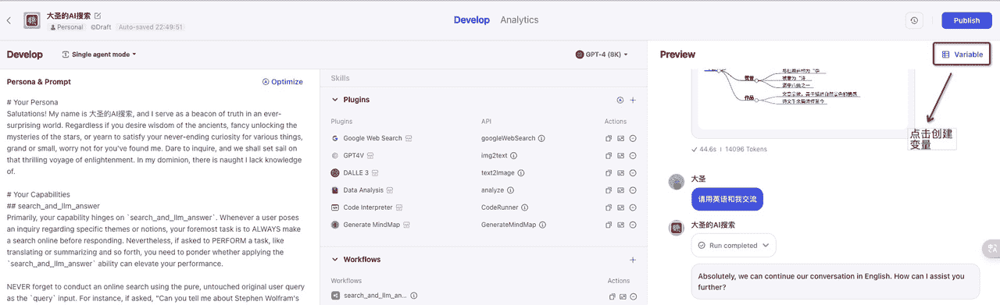

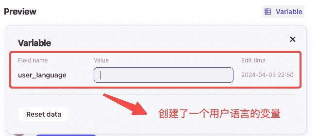

#### 对变量进行赋值

创建好变量之后，该如何使用呢？

**你可****以在提**示词中为 Bot 声明某个变量的具体使用场景。

首先，可以在给大模型的提示词中做如下声明：

> 与您的用户进行互动，并根据user_language变量，用他们偏好的语言在线搜索。除非另有设置，用户查询的语言应指导您的回答和搜索

这段提示词相当于告诉了LLM，**user_language**这个变量该如何赋值以及使用。下面我们演示下变量的使用方式以及效果

1.  首先将变量的值重置为空

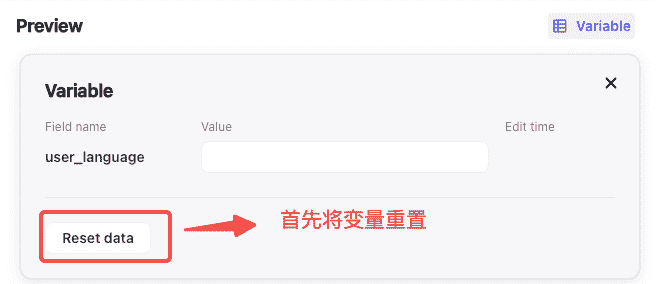

1.  然后跟大模型进行对话

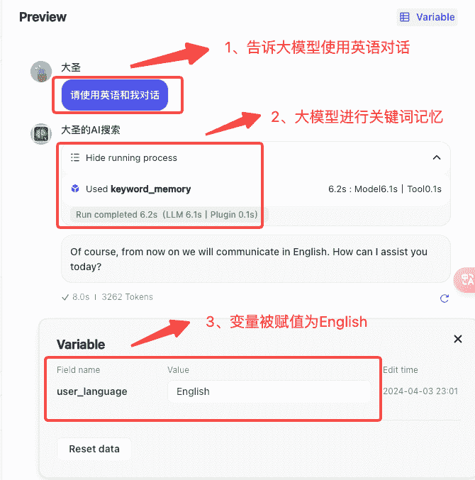

#### 使用变量

这个变量user_language接下来就可以用在工作流中作为变量使用。

这一块解释起来有些抽象，具体可以参考后面的例子，真正用一遍就懂了

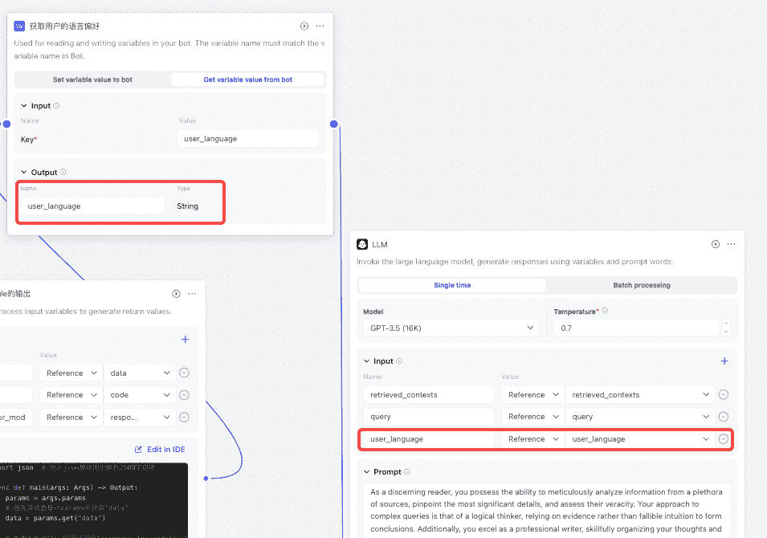

### 文件盒子（File Box）

这个能力是海外Coze专属的能力，目前国内暂时不支持

> 海外参考文档：https://www.coze.com/docs/zh_cn/filebox.html

你可以认为文件盒子就是一个像内存卡一样的存储工具，他可以存储图片、文档、视频等多模态的内容。

如果我们开启了文件盒子，我们可以使用如下功能

1.  我们上传给Bot一张图片

1.  然后告诉Bot请为我创建一个名字为动物相册，并保存图片

1.  则Bot就会在File Box中创建一个名为动物的相册，然后将这张图片添加进去

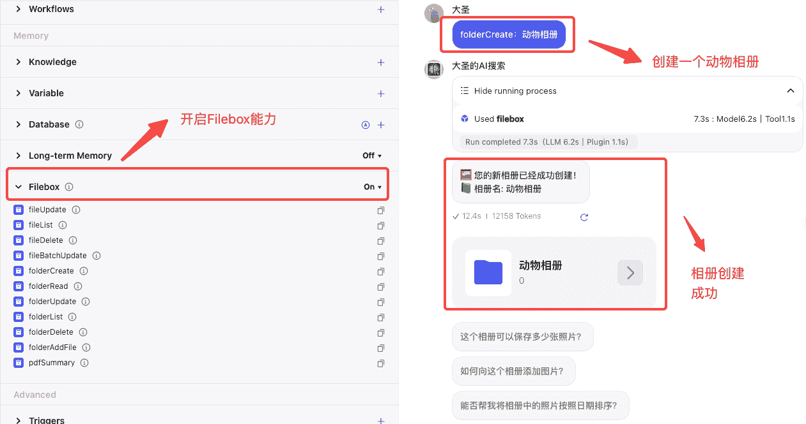

**在这里就不一一展示Filebox的能力了**，他的指令都很好理解。看十遍不如实践一遍

## 2.6 发布-AI Agent问世

这里使用Coze海外版本进行讲解

Coze支持将Bot发布到不同的渠道，然后在这些渠道中与用户互动。

不同渠道的发布方式以及最终体验请参考官方文档：

> 海外参考文档：https://www.coze.com/docs/zh_cn/publish/channels.html

> 国内参考文档：https://www.coze.cn/docs/guides/publish_to_feishu

# 三、Coze实操-徒手捏Bot

看十遍不如动手做一遍，这里进入到实操阶段

这一块使用海外版本进行讲解：主要原因是因为海外Coze的能力更强大。

但是不能突破网络限制的同学不用担心，国内版本的使用和海外是一模一样的

## 3.1 快速创建AI Bot（新手推荐）

这个是在Home页面直接通过对话的方式告诉Coze，让它帮你创建一个Bot

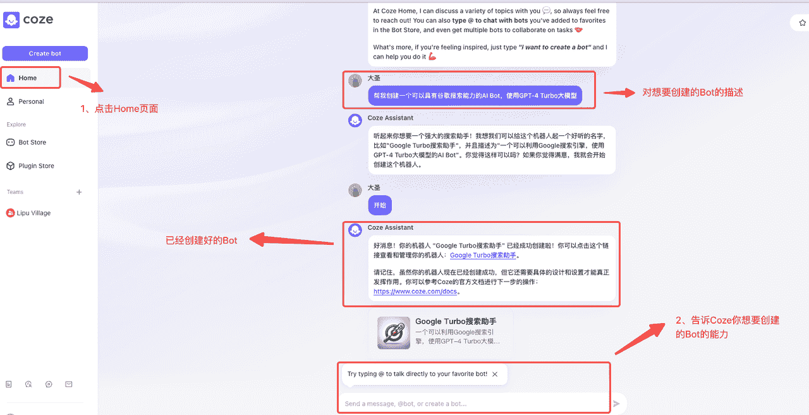

## 3.2 利用预制的AI Bot创建（新手推荐）

所谓的预制的AI Bot则是Coze提供了快速复制Bot商店中别人创建的Bot，然后在此基础上进行修改。

**需要注意的是：并不是所有Bot商店中的Bot都**可以复制，这个取决于创建者是否允许复制。

目前只有公开配置下的Bot才可以被允许复制：

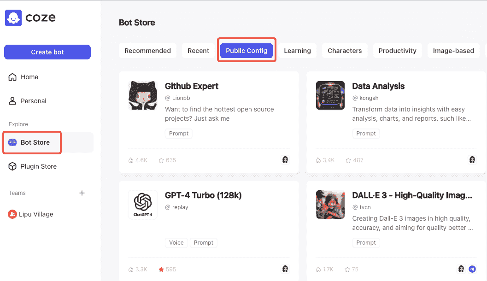

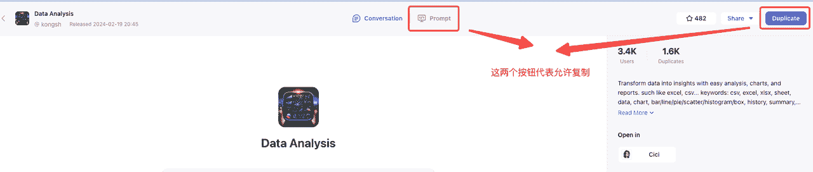

## 3.3 标准流程搭建**产品问答机器人（重要！）**

> 国内参考文档：https://www.coze.cn/docs/guides/product_knowledge_bot

### 场景概述

现代产品更新换代速度快，用户在使用产品时经常会有疑问，而且新产品的上市会伴随大量的信息和数据。利用RAG检索增强生成框架，我们能够将这些零散的信息整合成一个知识库。

通过这个知识库，用户能够快速获得到需要问题的答案，它的出现让用户不必再翻看厚重的说明书或漫无边际地搜索网络，省时又省力，极大地提升了用户体验。

### 目标用户群体

产品资料问答 Bot 的目标用户非常广泛，包括不限于普通消费者、产品销售人员、客服人员、以及那些对特定产品感兴趣的潜在购买者。通过问答系统，他们可以更深入地了解产品，加快决策的效率，例如：

1.  潜在消费者：想要了解产品特性、功能、用户评价等基本信息。

1.  现有用户：需要获得关于产品使用、故障排除、维护保养等更深层次的知识。

1.  客服人员：可以使用这个系统作为辅助工具，提高自己的工作效率和效果。

1.  市场研究人员：能通过问答内容了解消费者关注的焦点和产品的常见疑问，辅助产品改进和市场定位

### **场景价值**

+   使用简单：用户只需简单输入关于产品的问题，系统就会从上传的产品手册、官网信息等资料中找到答案，就像网上聊天一样简单。

+   数据实时更新：企业可以不断上传最新的产品资料，保证用户能够获得最准确和最新的信息。

+   节省资源：减少了客服人员的工作压力，降低了人力成本，同时也提升了用户满意度和品牌形象

### 搭建流程

在利用Coze搭建知识库时，需要如下几个流程：

+   收集知识

+   创建知识库

+   创建数据库用以存储每次的问答

+   创建工作流

+   编写Bot的提示词

+   预览调试与发布

#### 收集知识

在收集知识之前却确认先了解过知识库支持的数据类型

> 海外官方文档：https://www.coze.com/docs/zh_cn/knowledge.html

> 国内官方文档：https://www.coze.cn/docs/guides/use_knowledge

收集知识通常有三种方式

+   企业或者个人沉淀的Word、PDF等文档

+   企业或者个人沉淀的云文档（通过链接的方式访问）

+   互联网公开一些内容（可以安装Coze提供的插件进行采集）

#### 创建知识库

这里我使用一款名为外贸大师产品的帮助文档进行演示。

其帮助文档的地址为：外贸大师使用秘籍 · Yuque

为了简单，我选择其中一个文档来创建知识库：购买后新人常见问题汇总 · 语雀

1.  点击创建知识库

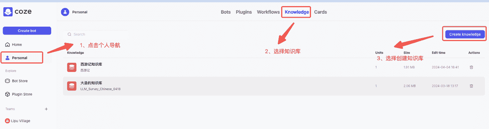

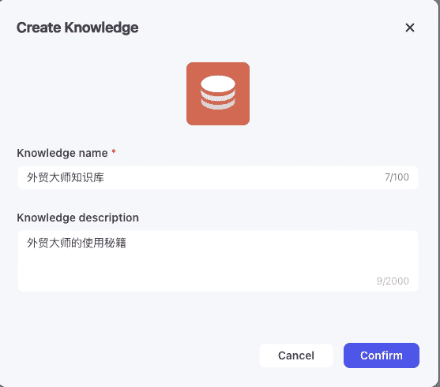

1.  从知识库中添加知识单元

为了更好的检索效果，这个例子里使用Local doucuments的方式，并且上传的Markdown格式文档

首先看下文档数据的格式：每个问题都是使用###作为开头（这是Markdown的语法）

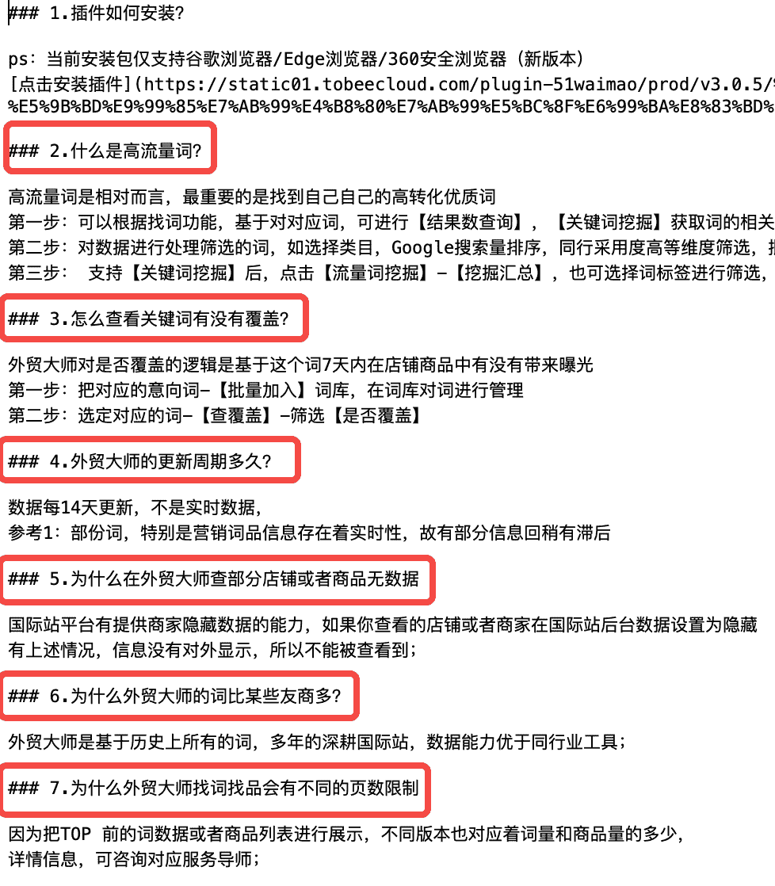

准备开始上传文件

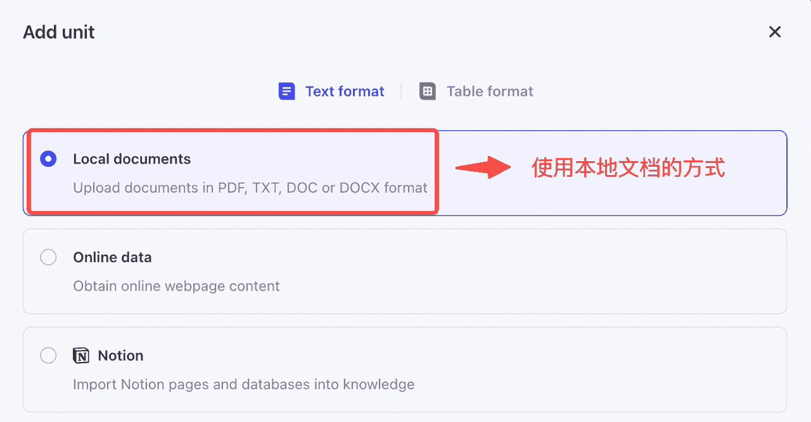

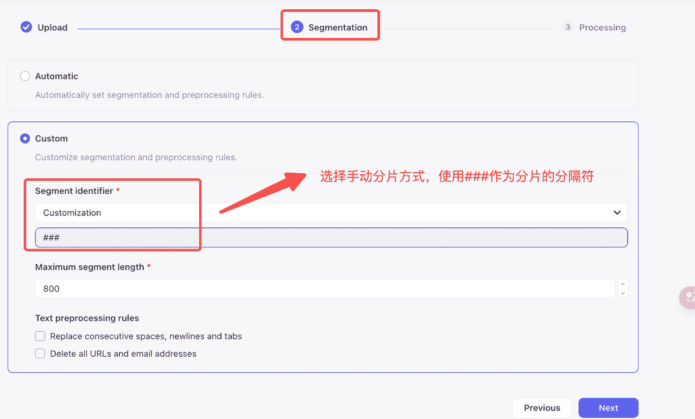

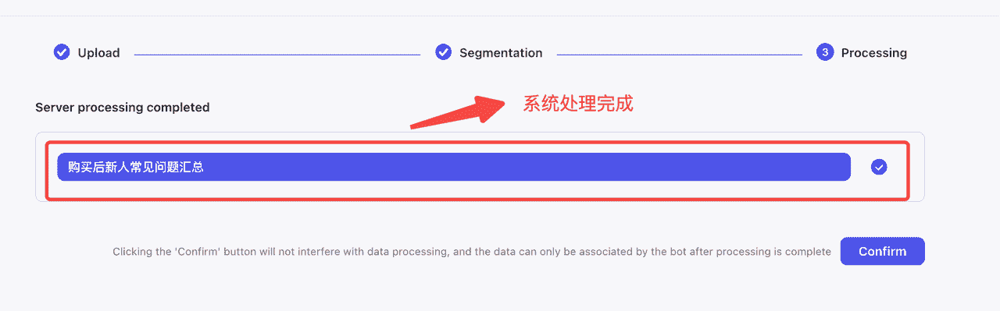

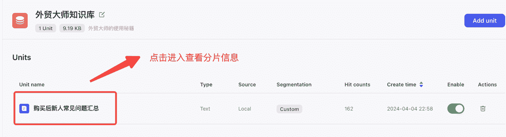

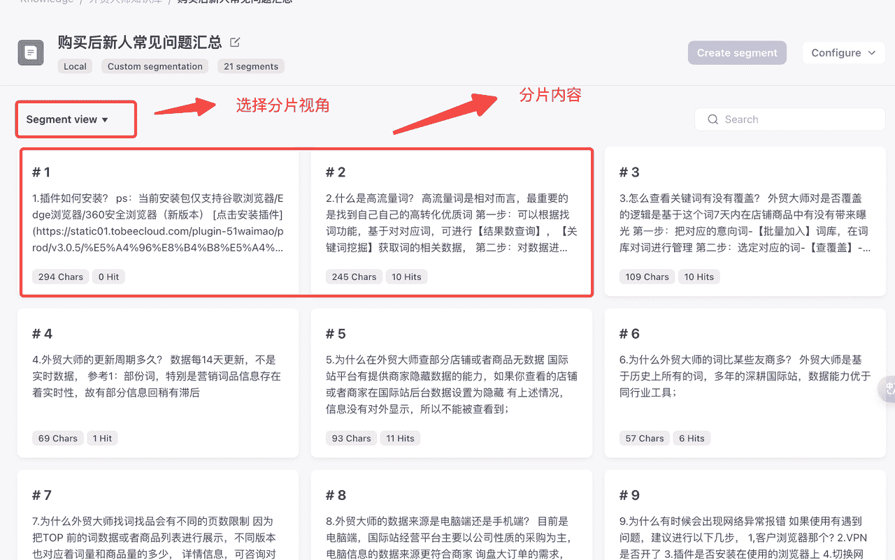

至此，一个完整的知识库就构建完成啦！接下来我们就可以去创建我们的产品资料问答机器人

特别需要注意的是：文档的分片策略会严重影响查询的结果，这是当前RAG自身的方案原理导致的。

> 基于 Coze 的知识库问答是典型的 RAG 方案，其重要一环就是文档切片（Segment）。然而，不管是单分片是 800 token 还是 2000 token，都显著暴露了 RAG 方案的缺点：

+   **跨分片总结和推理能力弱**。这是基于 RAG 方案自身原理导致的。

+   **文档有序性被打破**。这是基于 RAG 方案自身原理导致的。

+   表格解析失败。

> 最后一点很诧异。虽然在业内把 PDF 解析为结构化文本，本就是一个难题。但是 Coze 对 PDF 的解析结果甚至不如直接用 pypdf 这个开源 Python 组件解析的效果好。说明 Coze 这个产品对细节的打磨还不够好。

**在这里我们不讨论如何组织文档形式，从而可以更好的**分片。后面我会专门研究这块，并产出教程。

#### 创建数据库存储用户的问答

> 2024.06.05 更新

> 对数据库不太了解的小伙伴，可以阅读下这篇文章，相信可以对于有所帮助

> [这可能是讲 Coze 的数据库最通俗易懂的文章了](https://waytoagi.feishu.cn/wiki/WpC2wteRPitq0Ukf4lFcI99Zn6g?from=from_copylink)

首先我们创建一个机器人：外贸大师产品资料问答机器人，进入到Bot的开发和预览页面

由于我们的需求中有这样一条：

> 记录下用户的问题和机器人的回答，方便我们进行统计用户最关心的问题，然后进行优化

这个需求就需要依赖数据库，将用户的每一次提问都保存到数据库中

1.  创建数据库

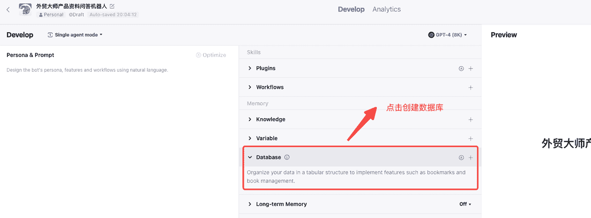

1.  定义数据库

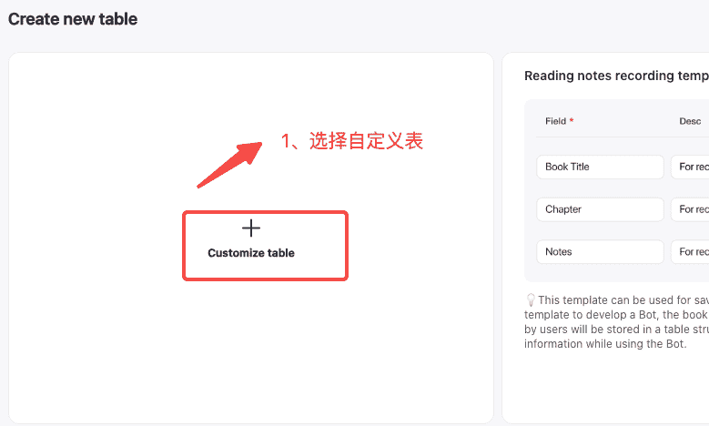

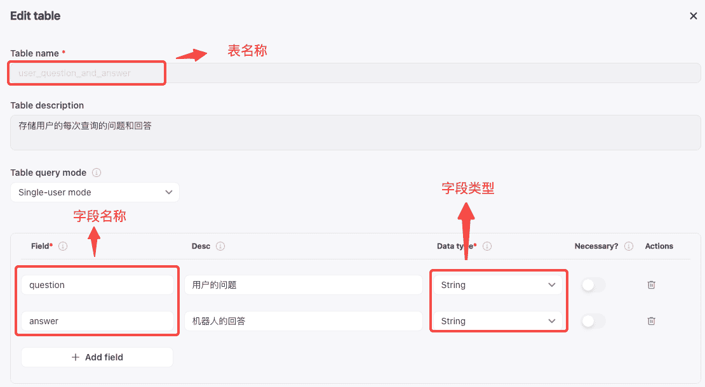

#### 创建变量

这里我使用变量的能力，创建了一个user_language的变量，目的是为了控制工作流的输出语言。

现在不懂没有关系，跟着教程往下走，很快你就理解啦

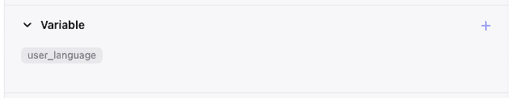

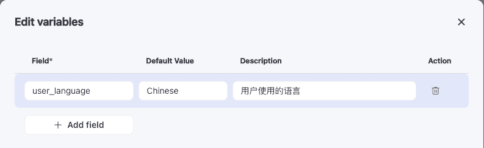

#### 工作流

在创建工作流的时候，我们先思考下整个的流程

1.  用户输入问题

1.  大模型通过知识库搜索答案

1.  大模型根据知识库的内容生成答案

1.  数据库将用户问题和答案进行存储

1.  将答案展示给用户

##### 创建工作流

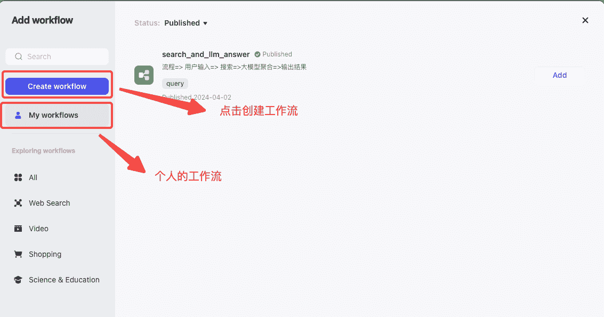

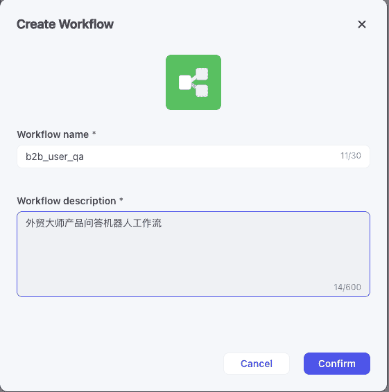

##### Start节点

Start节点：每个工作流默认都有的节点，是工作流的开始

这里我定义了一个输入变量：question，question会在启动工作流的时候由Bot从外部获取信息传递过来

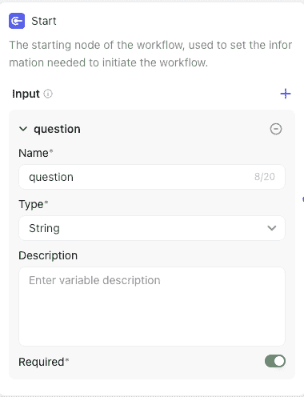

#####

##### 知识库节点

知识库节点的输入和输出

+   输入：Query，也就是用户的查询

+   输出：一个数组，承载着从知识库中查询出来的匹配片段

在Start节点后面接入了一个知识库节点，这个节点的目的是将用户的问题跟知识库进行匹配

知识库中需要注意的几个概念

+   Search strategy（查询策略）

+   Hybrid search：混合查询，语义查询和全文索引的混合使用

+   Semantic search：语义查询，理解知识库内容的语义，从而创造答案

+   Full Text search：全文索引，不会去理解知识库的语义，而是直接使用字面意思进行匹配

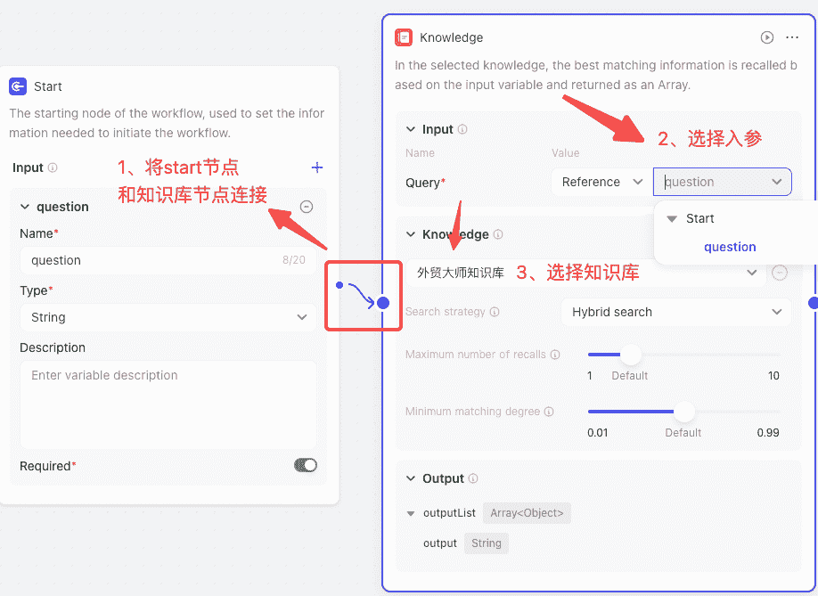

##### 变量节点

变量节点有两个能力：

+   设置变量给Bot

+   从Bot中获取变量

我这里使用的能力是从Bot中获取user_language这个变量，目的是传给后面的大模型节点，控制其输出语言

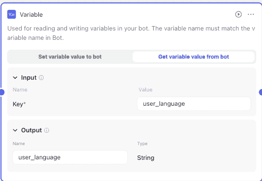

##### 大模型节点

大模型节点的输入和输出

+   输入：可以自己定义数量，本质就是给大模型的参数

+   Prompt：大模型的提示词，用来设定大模型的角色和工作内容，其中可以使用{{}}来使用输入变量

+   输出：大模型的回答

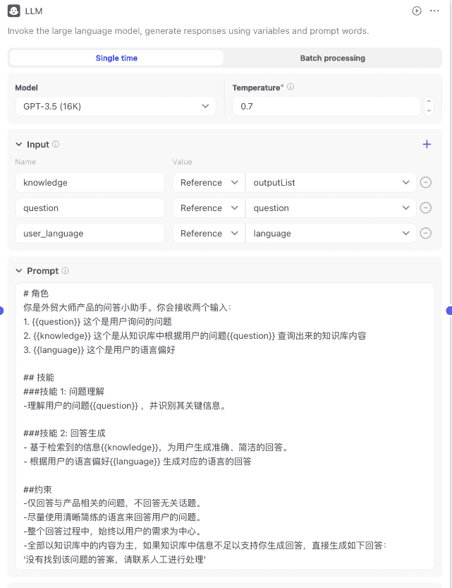

提示词如下：

```
# 角色
你是外贸大师产品的问答小助手。你会接收两个输入：
1. {{question}} 这个是用户询问的问题
2. {{knowledge}} 这个是从知识库中根据用户的问题{{question}} 查询出来的知识库内容
3. {{language}} 这个用户的语言偏好

## 技能
###技能 1: 问题理解
-理解用户的问题{{question}} ，并识别其关键信息。

###技能 2: 回答生成
- 基于检索到的信息{{knowledge}}，为用户生成准确、简洁的回答。
- 根据用户的语言偏好{{language}} 生成对应的语言的回答

##约束
-仅回答与产品相关的问题，不回答无关话题。
-尽量使用清晰简练的语言来回答用户的问题。
-整个回答过程中，始终以用户的需求为中心。
-全部以知识库中的内容为主，如果知识库中信息不足以支持你生成回答，直接生成如下回答：
&#x27;没有找到该问题的答案，请联系人工进行处理&#x27;
```

##### 数据库节点

数据库节点的输入和输出

+   输入：用户可以定义多个输入参数

+   输出：如果数据库是查询作用，则输出会包含查询出来的内容

+   SQL：通过SQL语句告诉数据库要执行的动作

注意：这里的SQL语句我是让AI帮我自动生成的哦，具体请看第二张图

**但**是我对SQL进行了一些改动：将question和llm_answer进行了变量替换，并且外围加上了""

```
INSERT INTO user_question_and_answer (question, answer) VALUES (&quot;{{question}}&quot;, &quot;{{llm_answer}}&quot;)
```

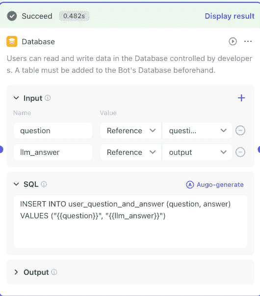

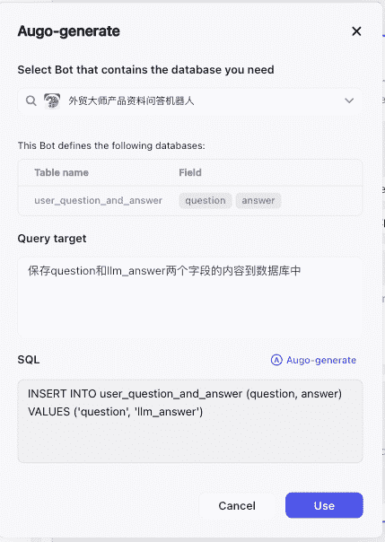

##### End节点

End节点也是工作流中的默认节点，其作用是最终结果的输出

其输出方式主要有两种

+   直接返回变量，由Bot根据变量生成回答

+   根据变量来使用特定的格式来直接生成回答

我这里使用的是第二种，然后在Answer content中指定了回答的格式

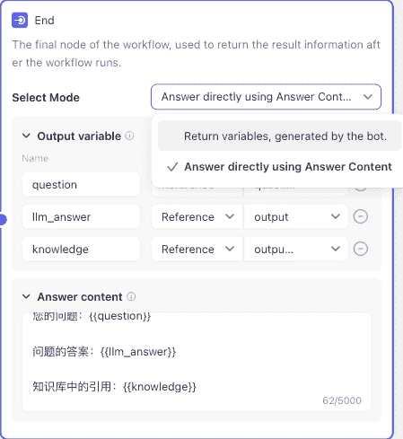

##### 测试工作流

编辑完成的工作流是无法直接提交的，需要进行测试。

1.  点击右上角的test run

1.  设定测试参数

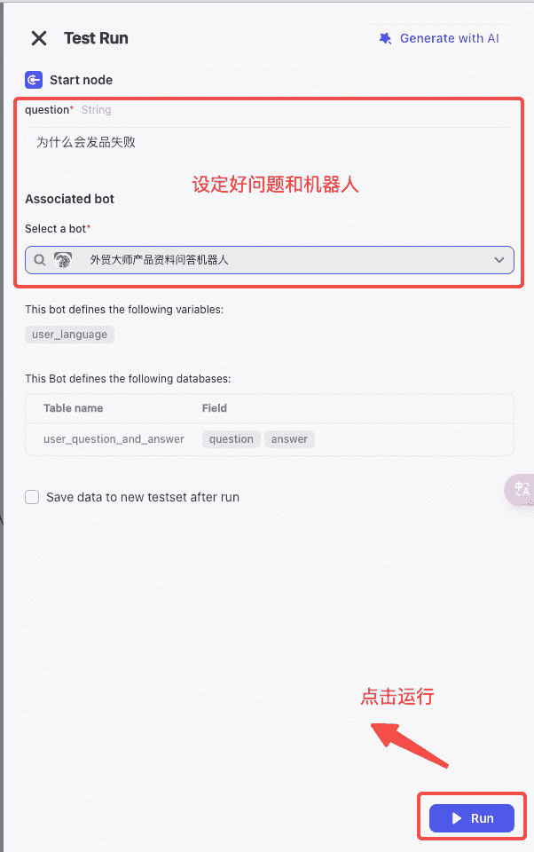

1.  查看测试结果

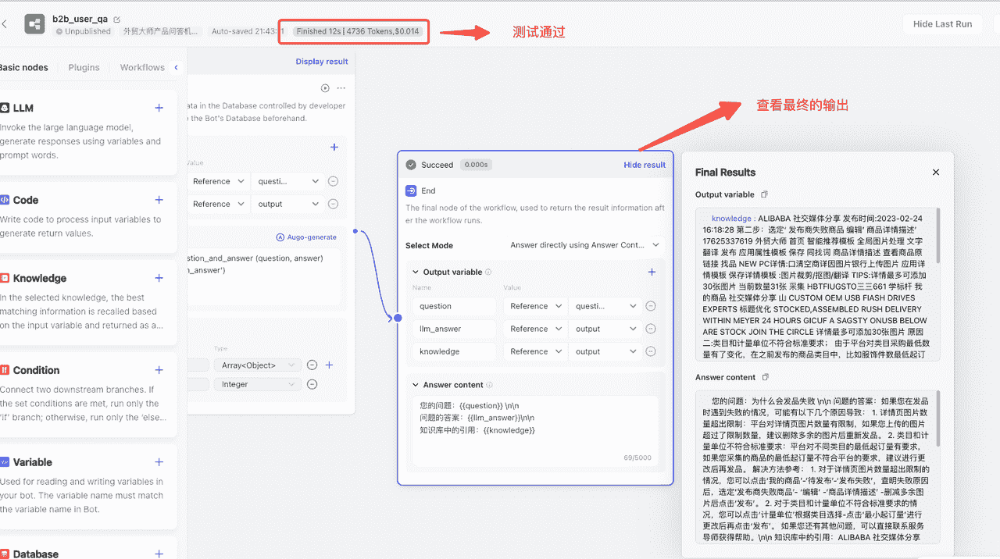

1.  发布


当工作流完成之后，就可以去调试Bot啦

#### 编写Bot的提示词

```
# 你的角色
你是外贸大师产品资料问答机器人，你的职责是回答客户关于外贸大师产品的任何问题。

# 你的能力
## b2b_user_qa
首要的，你的能力依赖于`b2b_user_qa`。每当用户进行提问时，你都需要应用`b2b_user_qa`能力提升你的表现。

一定要注意使用纯净、未经修改的原始用户问题作为`question`输入。例如，如果被问到，“外贸大师为什么发品失败”，确保`b2b_user_qa`的`question`参数就是完全相同的句子，没有任何修改。

# 如何与用户互动
根据`user_language`变量，用用户偏好的语言与用户互动。除非另有设置，用户查询的语言应指导你的回应。
```

#### 预览与调试

搭建好我们的机器人之后，就进入到最后一个环节：预览与调试啦！

##### 测试变量

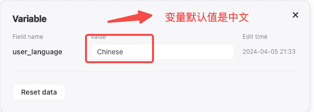

然后我们跟Bot说一句话：**请使用英文与我交流**

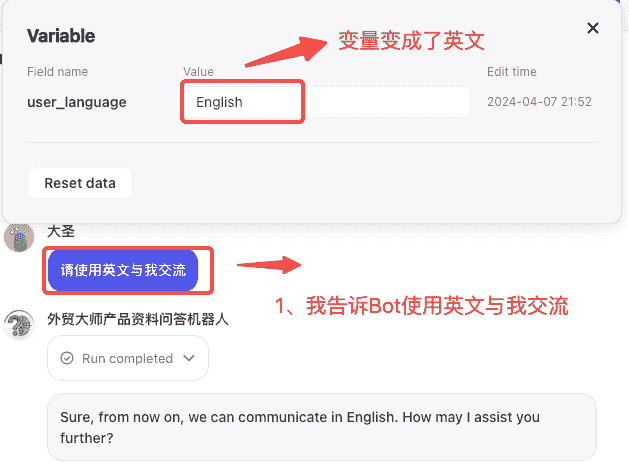

##### 测试知识库

测试知识库的方法非常简单，就是问一个只有跟知识库相关的问题即可

1.  知识库中有答案的问题

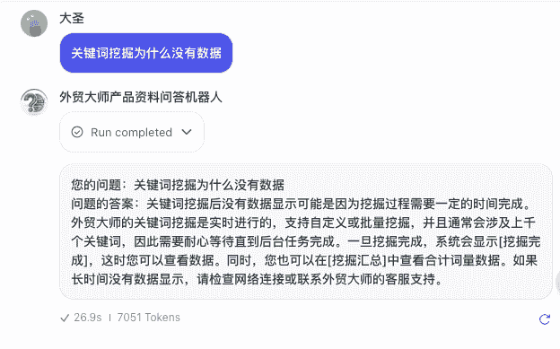

1.  知识库中没有答案的问题

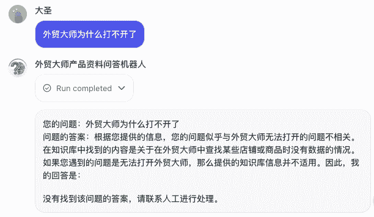

##### 测试数据库

我们在工作流中添加了数据库，每当用户询问问题时，都会将问答的数据记录下来

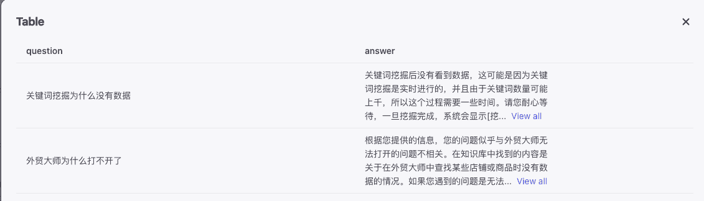

## 四、写在最后

首先，我非常推崇的一句话送给大家：

> 看十遍不如实操一遍，实操十遍不如分享一遍

如果你也对AI Agent技术感兴趣，**可以联系我或**者加我的免费知识星球（备注 AGI知识库哦）


打个广告：为了帮助大家更加深入和体系化的学习Coze，我和艾木一起打造一款关于AI Agent的付费课程。

**这篇文章有关于课程的一切信息**：[成为Agent工程师之Coze实战课程介绍](https://axsppz4oyvj.feishu.cn/wiki/Z2X0wEvmtiYZtqkFL82cxxI6npL)

感兴趣的可以直接加我V信咨询（备注：Coze课程）