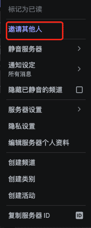
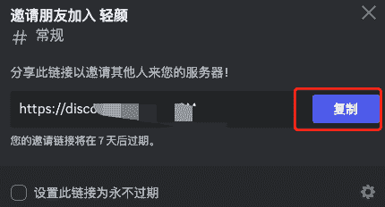
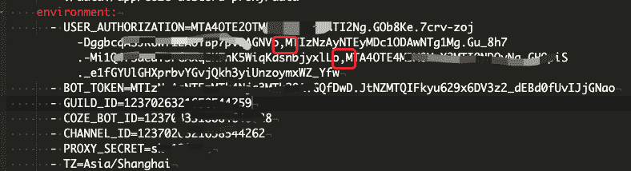
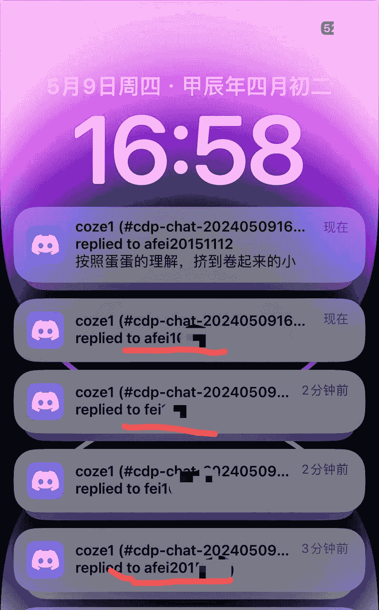

# 刚需教程：coze海外版多discord账号配置方法

> 来源：[https://waytoagi.feishu.cn/docx/VwZOdEKQ7ovGFxxWbO4c5d0zn5f](https://waytoagi.feishu.cn/docx/VwZOdEKQ7ovGFxxWbO4c5d0zn5f)

该方法由空心菜传授,需要在张梦飞教程：mp.weixin.qq.com 基础上使用，否则也用不了：

# **配置目的和原理：**

Coze对discord单账号使用次数有限制，每个账号只能每天回复50-100轮对话，传到微信里也会被同样限制，肯定是不够用的。

那么服务器中申请多discord账号由cdp均衡调用来撸coze机器人，就可以解决次数限制，达成次数限制*2-n的效果。

# **配置方法：**

1、在discord中已经配置好的cozebot服务器上右键选“邀请其他人”，得到一个邀请链接，点击复制，链接保存到一边备用。

2、注册新谷歌账号，或者掏出多余的谷歌账号，此步骤省略。

3、打开另一个未登录过discord的浏览器或者谷歌无痕浏览器（这步要特别注意，后边解释），用步骤2的谷歌账号注册一个新discord账号

4、复制步骤1的邀请链接到注册账号的新浏览器中，此时就将新discord账号拉入了cozebot服务器，如果需要多个就多次重复以上步骤。但请注意不要解除前边账号的登陆状态，所以特别推荐谷歌无痕浏览器。

5、按F12,新账号在对话框中发言，复制新账号的“USER_AUTHORIZATION”值，多个账号就挨个发言+复制“USER_AUTHORIZATION”值。

6、打开宝塔，在/data/coze-discord-proxy/docker-compose.yml文档中，将多个“USER_AUTHORIZATION”值粘贴进来，以逗号分开。然后 docker-compose up -d 重启cdp即可。

7、重新扫码后你的coze对话轮次就多了n倍啦。

8、如何验证自己成功了？最简单的办法是手机下载discord，登录后打开通知。每当有对话产生，你的手机都会收到消息，当每条消息发送账号都不同，就说明你已经成功了。当然每轮对话都会在discord以临时聊天框的形式存在一小会儿，那里也能看到不同账号的参与。

# **Q&A：**

**为啥要保证之前账号的登陆状态？**

因为账号登出后“USER_AUTHORIZATION”值就变了，需要重新取用，很多人发现突然登不上去了，就是因为登出状态后这个值变化了。