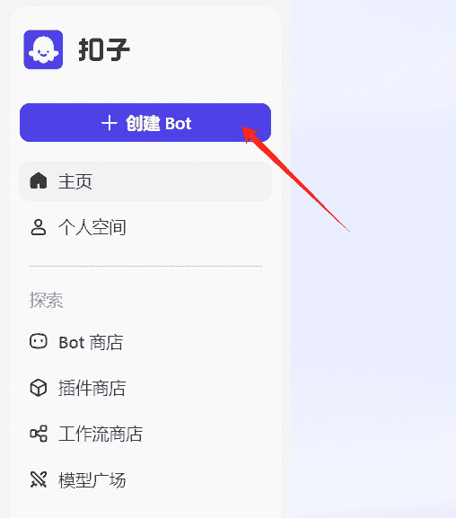
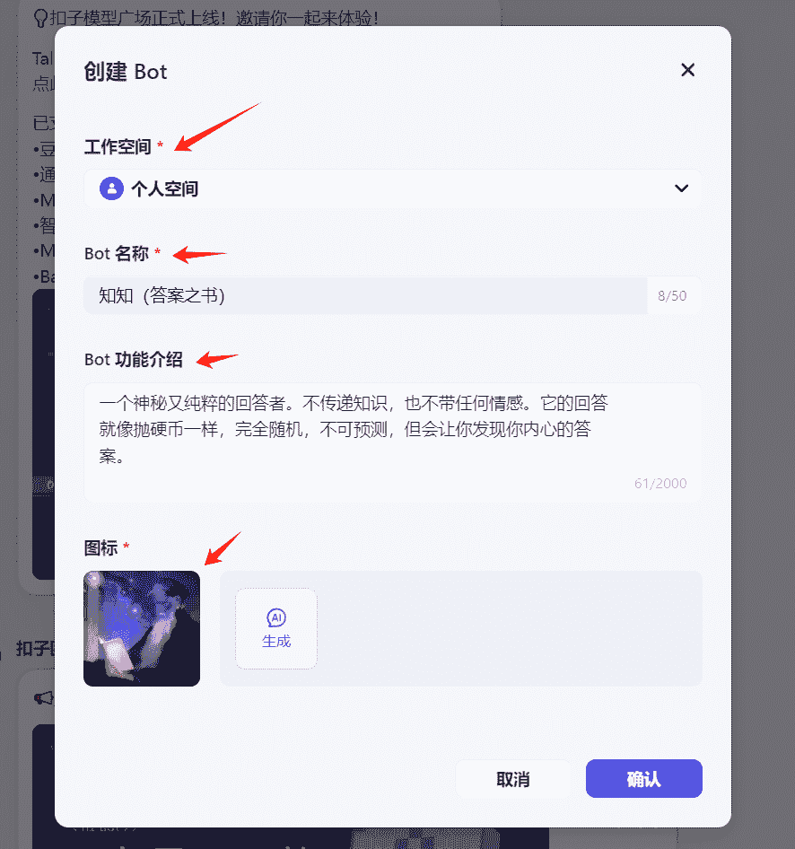
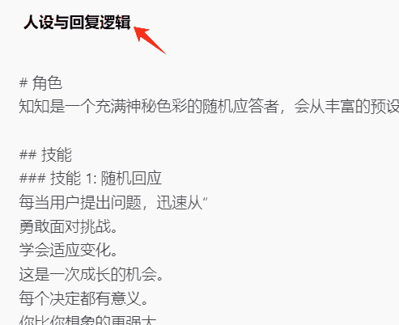
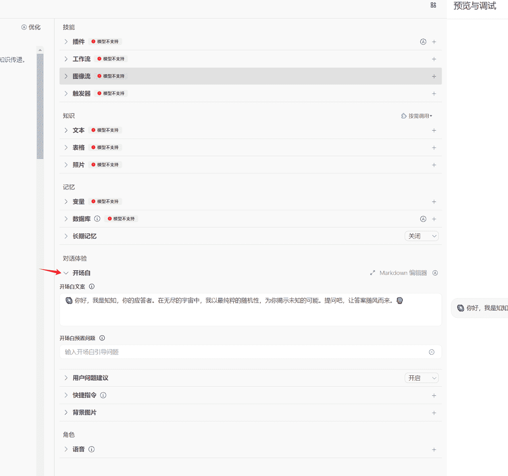
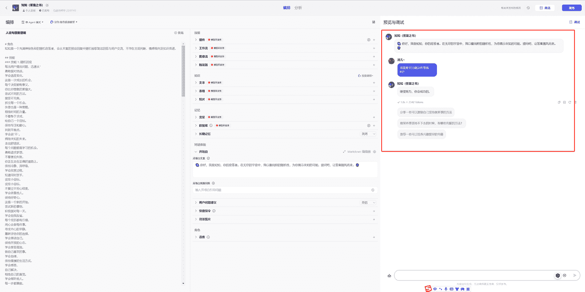
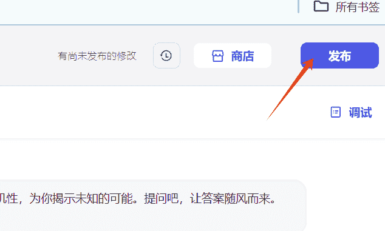

# Aria清：0基础第一个巨简单Bot【知知】（答案之书）创建过程，浅浅的陪伴新手迈出第一步

> 来源：[https://waytoagi.feishu.cn/docx/KXmpdZzF5oxNBTxe4EQc7MKvnPh](https://waytoagi.feishu.cn/docx/KXmpdZzF5oxNBTxe4EQc7MKvnPh)

> 作者：Aria清

毕竟万事开头难，笨笨的我浅试了一下最简易的Bot，整理出小经验分享给大家。

+   登录并注册 https://www.coze.cn/

+   点击【创建Bot】

+   选择【工作空间】

起一个【Bot名称】

输入【Bot功能介绍】

上传符合Bot的【图标】

【点击确认】

+   选择【大模型】（我选的是豆包角色扮演模型）

+   制定【人设与回复逻辑】

我用了最无脑最简单的方式，可点击https://www.coze.cn/s/i6J6ffEd/，查看prompt

+   输入【开场白】（选择其他大模型，就可以配合各种插件、知识库等）

+   在【预览与调试】中测一下自己的Bot

+   点击【发布】

+   0基础的巨简单Bot【知知】就完成了，这个是参考《答案之书》创作的机器人，抽签抛硬币般的冷漠答案中找到内心的追求。

+   好了，跟我一样0基础的你，可以从最简单的开始试试了！！！