# 洛水: 消息卡片，让 Coze 对话飞起来：一键掌握创建技巧

> 来源：[https://waytoagi.feishu.cn/docx/ZiiBdzOlEo0nEMxALascVY9ln7c](https://waytoagi.feishu.cn/docx/ZiiBdzOlEo0nEMxALascVY9ln7c)

## 🚀 简介

> 在 **Coze** 平台上，消息卡片是 Bot 的得力助手，以模块化构建组件的形式，**支持**以图文**和按****钮交互的**方式，将信息以视觉化效果展示给用户。目前，这些卡片已适配 豆包 和 飞书 客户端。本文将带您一步步深入了解如何在 Coze 平台上创建、配置和绑定消息卡片，助您快速打造功能强大的 Bot 应用。

## 📝 准备工作

+   访问 [Coze 官方网站](https://www.coze.cn/)。

+   使用手机号或抖音账户进行登录。

## 📂 创建卡片

1.  登录后，进入您的 **个人空间** 界面。

1.  切换到 **卡片** 界面，点击右上角的 **创建卡片**。

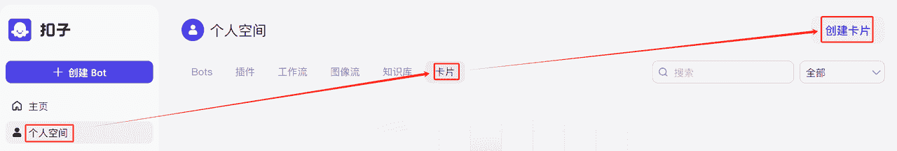

## 🎨 熟悉布局

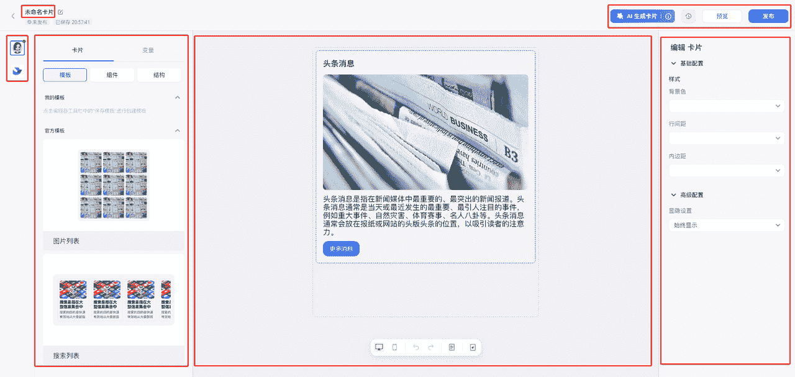

1.  **导航栏**：

+   左边：支持修改卡片的名称，显示当前发布状态和保存时间；

+   右边：支持 AI 生成卡片、发布记录查看、卡片预览、卡片发布；

1.  **左边栏**：选择豆包或飞书模式下编辑；

1.  **工作区**：

+   左边：卡片选择（选择模板或组件）和变量创建区域；

+   中间：卡片布局调整区域；

+   底部：电脑端/手机端查看、撤销/重做、保存模板、清空卡片；

+   右边：卡片样式调整，内容和变量设置区域；

## 🛠️ 三种卡片创建方式

### 使用官方内置模板

从官方提供的预置模板中选择，快速适应不同 Bot 场景。

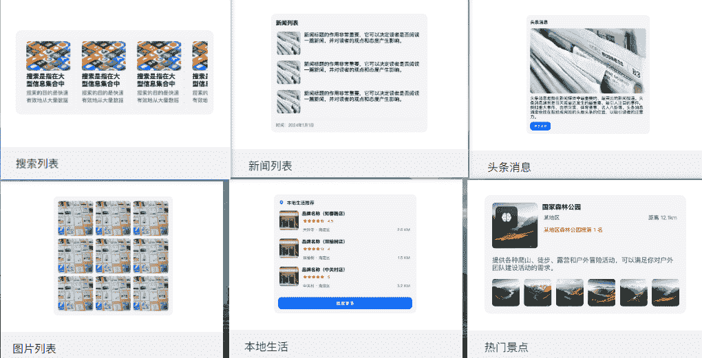

### 使用 AI 自动生成卡片

AI 辅助，一键生成信息卡片。

示例：手机横向列表，每个手机都包含图片、价格、品牌、星级等信息。

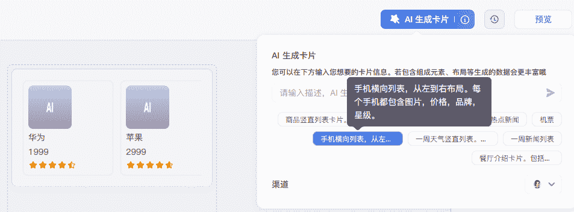

### 使用组件库手动构建

自由拖拽合适的组件，无代码构建个性化卡片界面。

案例：爸妈防骗助手 - 扣子 AI Bot

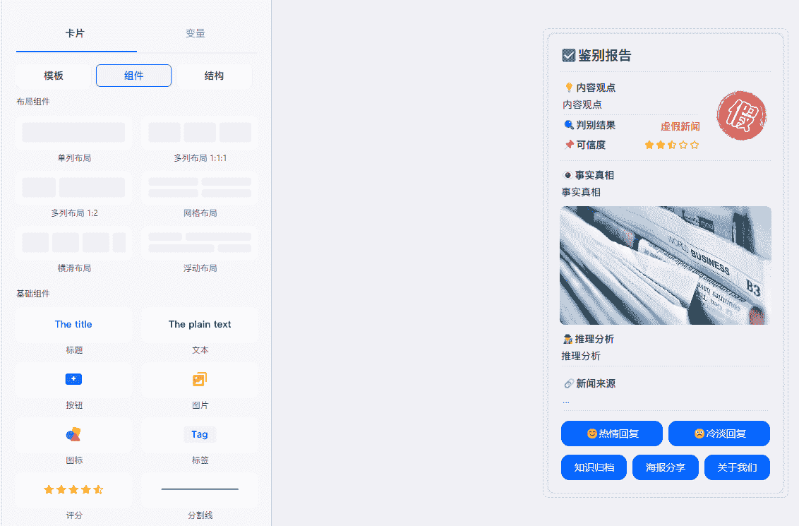

## 🏷️ 实例讲解：创建【本地生活推荐】卡片

### 选择卡片

+   点击 **卡片** > **模板** > **本地生活**，快速生成卡片。

+   卡片以组件化排布，通过拖拽式操作对布局进行调整。

+   选中区域组件，通过操作右侧的基础配置，对结构和样式进行调整。

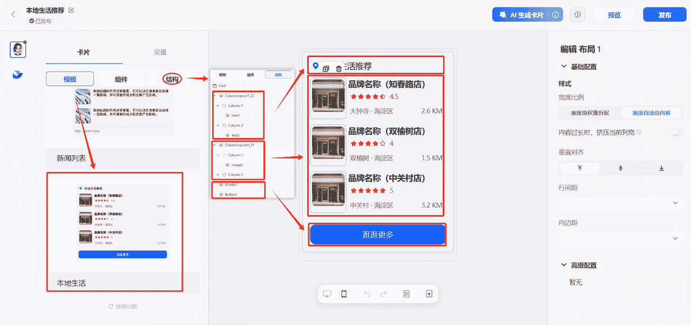

### 创建卡片变量

根据卡片具体要展示的内容，创建相应变量。

+   变量名称：标识符，用来给变量赋予实际的值；

+   变量类型：如字符串、整数、数组对象等；

+   变量默认值：在创建变量但未赋值时，卡片默认显示这个值；

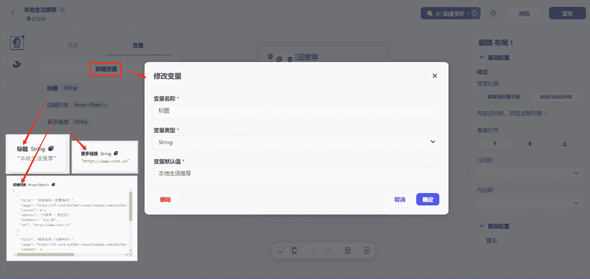

### 给卡片设置变量

可以给卡片添加固定内容，作为固定框架。也可以设置灵活变量，并对变量赋值使卡片消息既统一又个性。

1.  给文本添加变量：点击卡片上的标题文字，右侧选择创建好的变量，这里选择{标题}，内容框中会高亮显示变量名称，卡片上则显示变量的默认值。

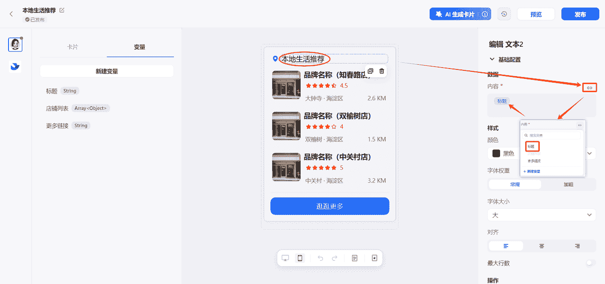

1.  给图片添加变量：点击卡片上的图片，右侧选择刚才创建的变量，这里选择{image}，内容框中会高亮显示变量名称，卡片上则显示变量的默认值。

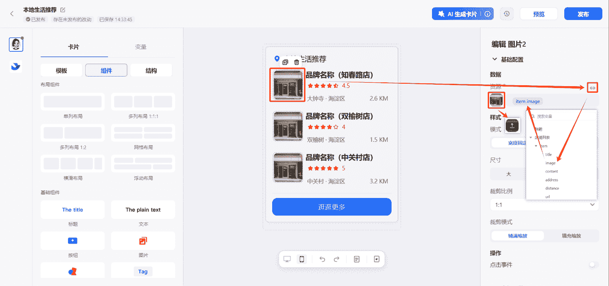

1.  给按钮添加变量：点击卡片上的按钮，右侧选择触发按钮后的操作，支持打开外部链接或发送聊天消息。这里选择{更多链接}变量，卡片上会显示变量的默认值。

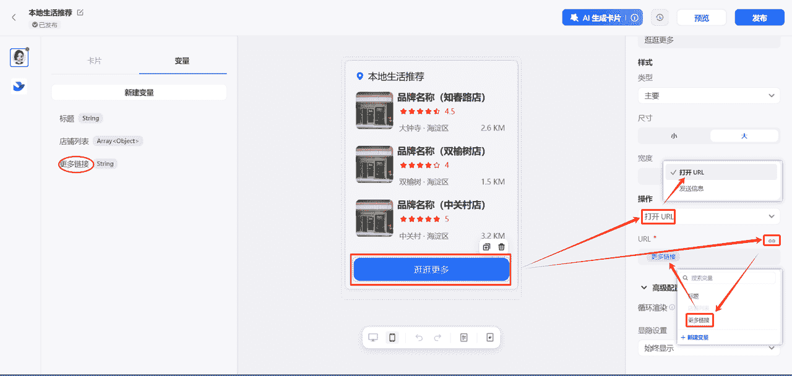

### 高级设置

#### 循环渲染

循环渲染是一个自动化的功能，它让组件能够自动显示列表中的每个项目。你只需要设置好父组件的循环渲染和变量，然后正确配置子组件的变量，即可实现组件和内容的循环显示。

+   **父组件（布局组件）**：就像一个家庭，父组件是“家长”，控制着整个家庭（子组件）的显示。

+   **子组件（基础组件/布局组件）**：每个家庭成员，他们有自己的特点（内容），但都受家长（父组件）的管理。

+   首先要选择“家长”（父组件）。你需要框选父组件，然后找到循环渲染的开关并打开它。设置创建的父节点（数组对象）作为变量。

+   **父组件总是框选不对？操作技巧：**

+   在卡片上调整：鼠标移动到父组件和内部子组件之间的区域时，卡片上会有框选提示；

+   在结构中调整，鼠标在结构下面的组件名称上移动时，卡片上会有框选提示（见下图）；

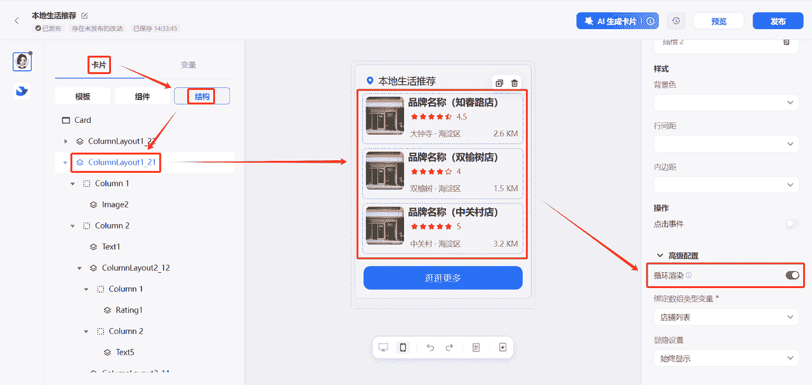

1.  点击卡片上的父组件，右侧打开【循环渲染】，这里选择{店铺列表}标题，卡片会根据{店铺列表}有几个列表项，将父组件循环显示几次。

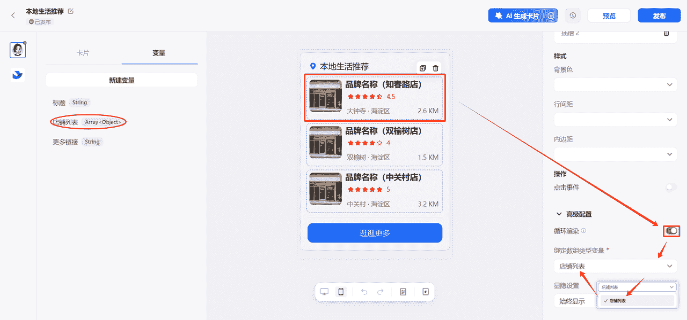

1.  点击卡片上的子组件，右侧选择{店铺列表}数组对象里的子节点，这里选择{title}，卡片上则会显示{title}变量默认的值。

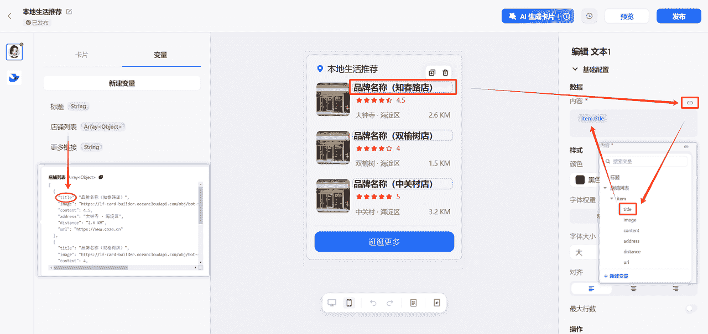

#### 显隐设置

1.  通过对变量的赋值进行条件判断，来控制卡片组件或内容的显示与隐藏。这里选择满足条件时显示，选择变量{content}的值小于 5 才进行显示。

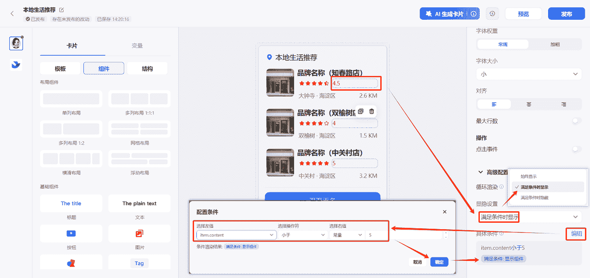

1.  预览中查看渲染结果，这里可以看到等于 5 的值不符合判断条件，在卡片中被隐藏。

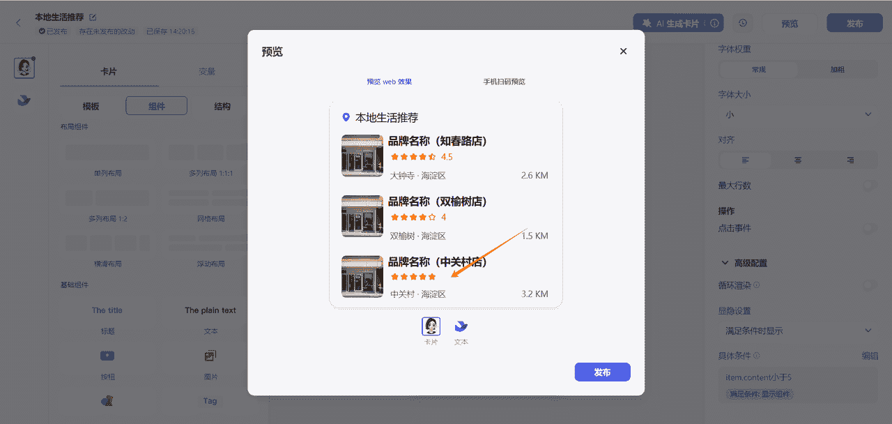

### 发布卡片

到这一步恭喜你，已经顺利完成了卡片创建、布局调整、样式调整、变量创建、设置变量到卡片的任务，接下来发布卡片以供插件或工作流使用。

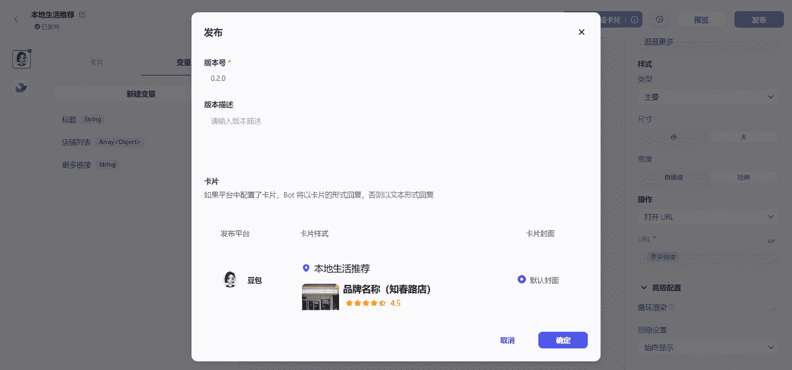

## 🔗 绑定卡片到工作流

目前卡片消息支持绑定在插件和工作流上，这里以工作流为例：

> 示意图：

> [工作流] --（输出变量：title）--> 🔄 [映射] --（卡片变量：标题）--> [消息卡片]

> 步骤说明：

> 1. 用户输入触发 Bot。

> 2. Bot 调用 demo 工作流。

> 3. 工作流执行并输出变量（例如：title）。

> 4. 映射过程将工作流的输出变量链接到卡片的相应变量（例如：标题）。

> 5. 消息卡片展示映射后的动态内容。

### 创建工作流

创建一个测试工作流 demo，输出三个参数（title、link、stores_list）分别对应卡片的三个变量（标题、更多链接、店铺列表）。

Tip：注意 stores_list 数组对象以及子节点的数据类型设置。

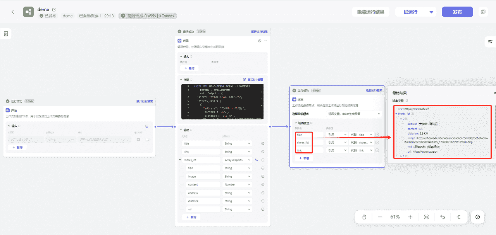

### Bot 设置

1.  创建一个 Bot【本地生活推荐】，外部 Bot 设置提示词：要求接收用户的输入调用 demo 工作流回复；

1.  添加 demo 工作流--绑定卡片--选择创建好的卡片；

1.  选择将工作流输出的变量和卡片设置的变量做一个映射关系，确认完成绑卡操作；

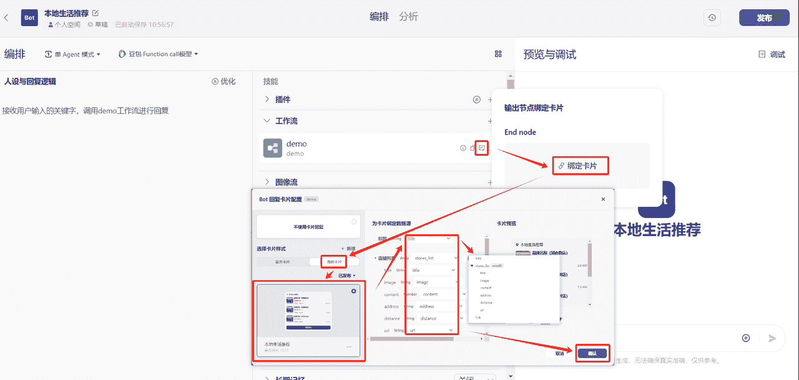

### 测试卡片消息回复

对话框输入内容后，智能体开始调用 demo 工作流，返回绑定的卡片消息，卡片消息上则展示出了工作流的输出结果，自此大功告成！

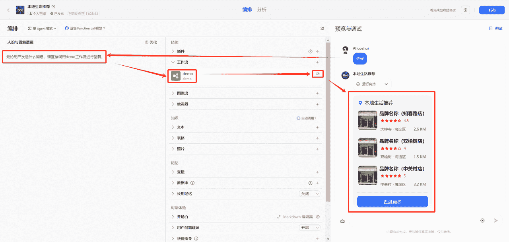

## 🔄 卡**片更新指南**

#### **更新已发布卡片：**

+   当您对消息卡片进行了修改并发布更新，您需要在外部 Bot 界面进行以下步骤以应用这些更改：

1.  重新进入**绑定卡片数据**的设置界面。

1.  选择**待更新**的卡片，依次点击【待更新】-【确认升级】-【确认】，完成升级流程。

#### **变量调整注意事项：**

+   如果卡片中的**变量**发生了任何调整，必须在此处重新绑定数据源，以确保工作流输出变量和卡片设置变量的关联关系。

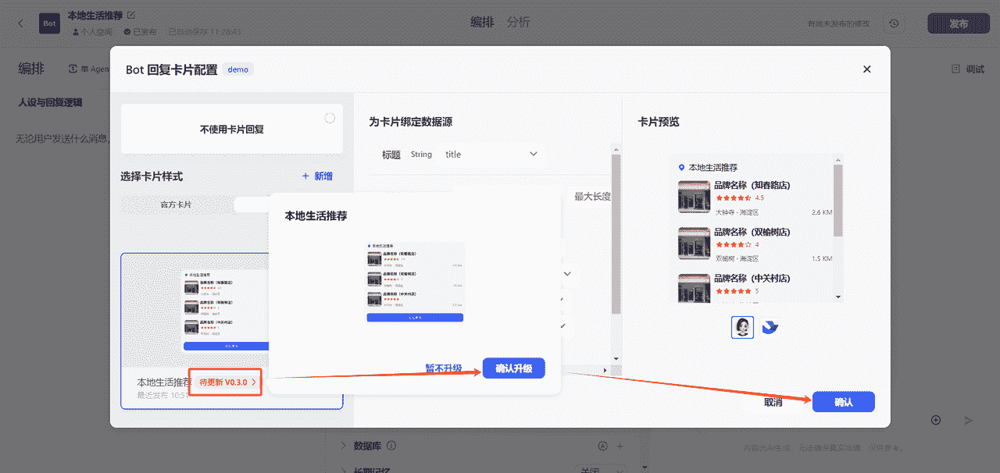

## 📚 总结

Coze 平台的消息卡片系统通过高度模块化和图形化的操作方式，使用户能够快速构建功能丰富、交互友好的 AI 应用。无论是使用官方模板、AI 自动生成还是手动构建，用户都能轻松上手，实现低代码开发。希望本教程能帮助您更好地理解和使用 Coze 平台的消息卡片，开启您的 Agent 搭建之旅。

> 专业词汇解释

1.  **Bot**：即“机器人”，在 Coze 平台上，Bot 是自动化的程序，可以执行特定的任务，比如自动回复用户的消息。

1.  **消息卡片**：这是一种在 Coze 平台上用来展示信息的方式，可以包含文字、图片和按钮等元素，以视觉化的形式向用户展示信息。

1.  **AI 生成卡片**：利用人工智能技术自动创建的卡片，可以根据用户的需求快速生成信息卡片。

1.  **模板**：预设的卡片样式，用户可以直接使用或根据需要进行修改。

1.  **组件**：在消息卡片中，组件分布局组件和基础组件，是指构成卡片界面的各个部分，比如文本框、图片框、按钮等。

1.  **变量**：在卡片中用来存储数据的占位符，可以根据实际需要赋予不同的值。

1.  **布局**：卡片上各个组件的排列和组织方式。

1.  **循环渲染**：一种技术，允许卡片中的某些部分根据数据列表重复显示多次。

1.  **显隐设置**：根据条件控制卡片上某些部分的显示或隐藏。

1.  **发布**：将创建好的卡片发布出去，使其可以被插件或工作流使用。

1.  **绑定**：将卡片与特定的工作流程或插件连接起来，使得卡片可以在特定情况下自动显示。

1.  **工作流**：一系列自动化的任务或步骤，按照特定的顺序执行。

1.  **插件**：一种软件组件，可以增加或增强应用程序的功能。

## 📖 官方文档

[扣子 - 文档中心 - 卡片](https://www.coze.cn/docs/guides/message_card)

## 🌟 案例精选

核心搭子团队——爸妈防骗助手bot