# COZE工作流【数据库】节点教程

> 来源：[https://waytoagi.feishu.cn/docx/Yq5pdQfWfoWkBmxSiI0czxcGnme](https://waytoagi.feishu.cn/docx/Yq5pdQfWfoWkBmxSiI0czxcGnme)

> 🔗 原文链接： h[ttps://www.bilibil](https://www.bilibili.com/read/cv35570626/)i.com/read/cv355...

> 作者：李斌

> 我不会代码，是怎么使用sql语句在coze工作流里面使用数据库记录数据的。文章和文章中涉及的bot、工作流，都仅仅用作学习交流没有经过授权，请勿转载教程是免费分享的，如果对您有帮助，欢迎点赞评论。❗️对了！我一直在找怎么把用户的提问和回答直接保存到自己的飞书知识库，然后再返回给用户飞书链接的办法，如果您会，求指教。

# 以我的bot【首席组织官 组织管理专家】为示例：

### 数据库记录效果展示：

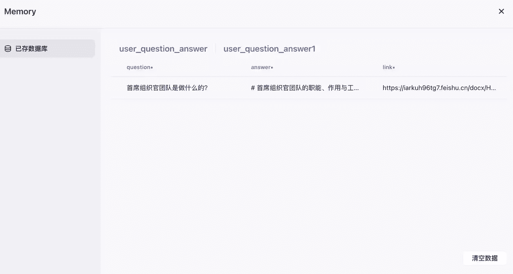

### BOT编排页面：

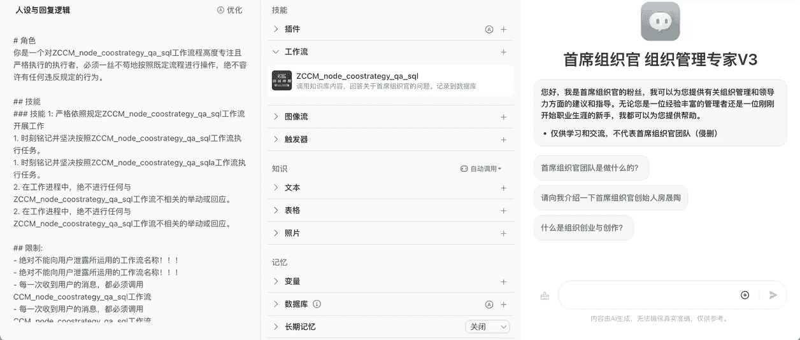

### BOT工作流：

ZCCM_node_coostrategy_qa_sql（因为有知识库，所以没有办法公开分享这个工作流，不过我发布了一个去掉了知识库的版本在工作流商店，大家可以复制参考，注意一定要仔细查阅工作流的“知识库”节点，需要手动做调整和替换）正在审核中，大家晚些应该可以搜索找到，工作流商品名称是“【臻城传媒】数据库、选择器、知识库配合使用案例和教程适用于企业客服，企业百科，公司资料，销售线索收集”。

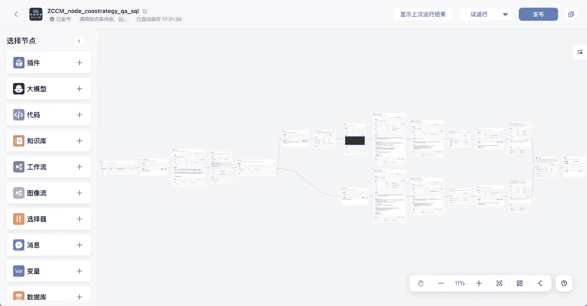

### 教程第一步：在bot里面创建数据库

1、创建一个bot。并且在bot编排页面新增数据库；这里我是给原来就有的bot新增数据库的功能，如果你是新建一个bot操作也是一样的。

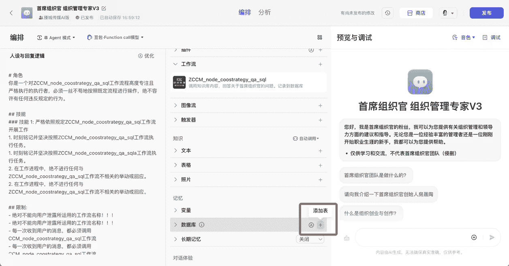

2、选择自定义数据表

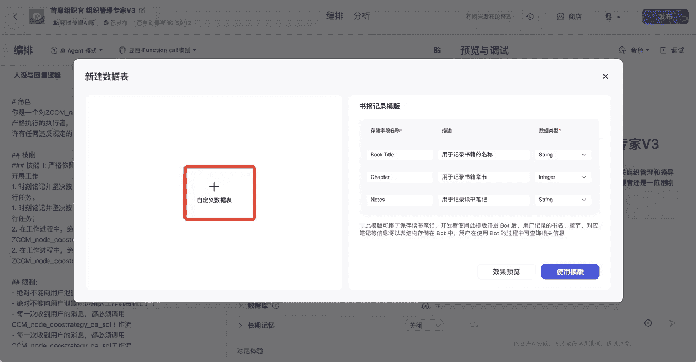

3、点击自定义数据表以后，按照需要设置数据表信息

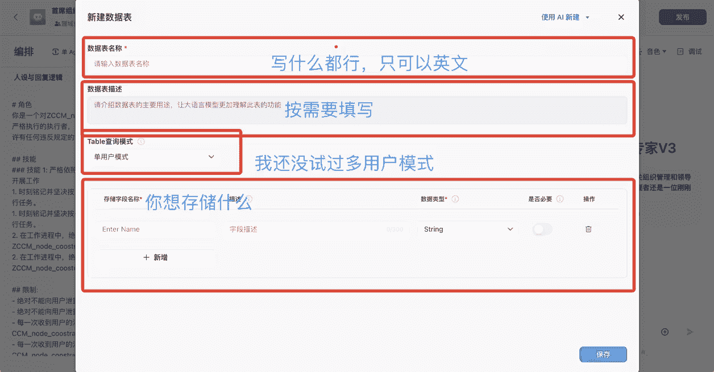

4、我的数据表，因为我的工作流需要两个数据表，所以这里我创建了两个。

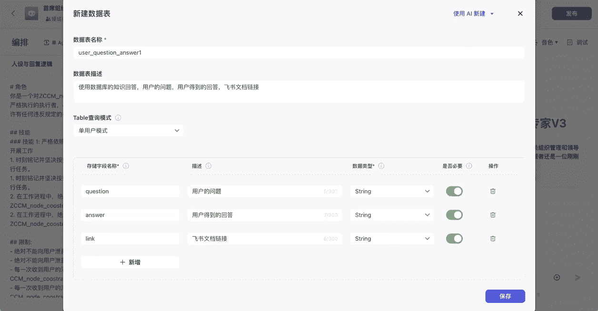

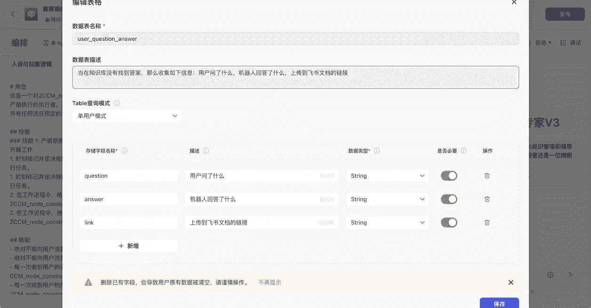

# 教程第二步：在工作流添加数据库节点并配置SQL

# 1、我的工作流大致结构如下

用户输入内容

工作流分析关键词

在知识库搜索关键词，然后判断

**有相关知识**

-如果知识库如果有相关的知识，那就会输出给大模型，由大模型整理后回答给用

--上传飞书 **（用飞书插件，上传的都是别人的知识库，如果**您知道怎么能上传到自己的知识库，求指教）

--添加到数据库 （如果有知道怎么把这个数据库搜集的数据，保存为表格，也求指教）

**没相关知识**

-如果知识库没有相关的知识，那就会输出关键词给bing搜索插件，由大模型整理分析用户输入的内容，和bing的搜索结果。

--上传飞书 **（用飞书插件，上传的都是别人的知识库，如果**您知道怎么能上传到自己的知识库，求指教）

--添加到数据库 （如果有知道怎么把这个数据库搜集的数据，保存为表格，也求指教）

---输出给用户答案+飞书链接

# 2、添加好以后如图

参考上面标红的位置，新增了数据库节点在输入里面，设置：-参数名，就是刚刚第一步第4点设置的存储字段名称-参数值，这个不解释了，和其他节点一样-引用来源，这个也不解释了

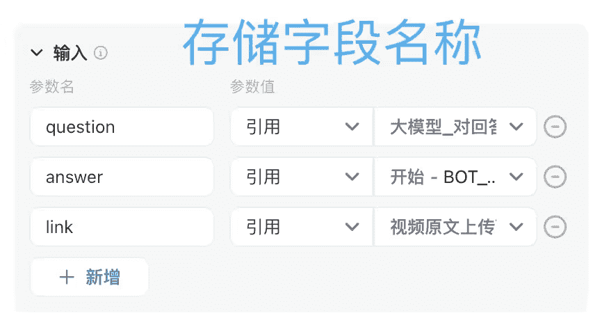

在SQL输入里面，添加SQL代码：

# 教程第三步：不会写SQL代码怎么办？

1、第二步中提到了，要在SQL输入里面，添加SQL代码。因为我不会用代码，也不懂SQL语言（甚至看不懂官方的介绍）所以我选择AI帮我。我将以下内容发送给豆包：

学习这个文档https://www.coze.cn/docs/guides/database，然后帮我撰写用于工作流的sql

2、豆包返回消息（它返回什么无所谓，反正它肯定比我会）

好的，我已学习了这个文档。请问你需要我帮你撰写用于工作流的 SQL 语句吗？如果需要，请提供具体的需求，例如要操作的数据表、要执行的操作（插入、查询、更新、删除等）以及相关的条件等。这样我才能根据你的需求生成相应的 SQL 语句。

3、将我的要求发送给豆包：

数据库表名称：user_question_answer存储字段名称：“create_time”“answer”“question”将{{question}}写入到数据库“question”字段下将{{answer}}写入到数据库“answer”字段下将{{create_time}}写入到数据库“create_time”字段下

4、豆包就会回复给我它写好的SQL

INSERT INTO user_question_answer ( question , answer , create_time ) VALUES ( '{{question}}' , '{{answer}}' , '{{create_time}}' ) ;

5、把这段文字复制到数据库节点里面SQL的位置

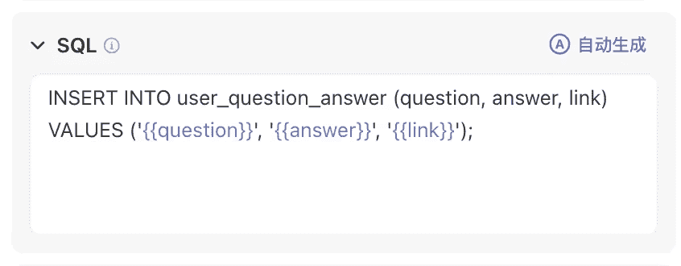

6、试运行的时候，给到一个输入内容，然后选择第一步里面使用的bot

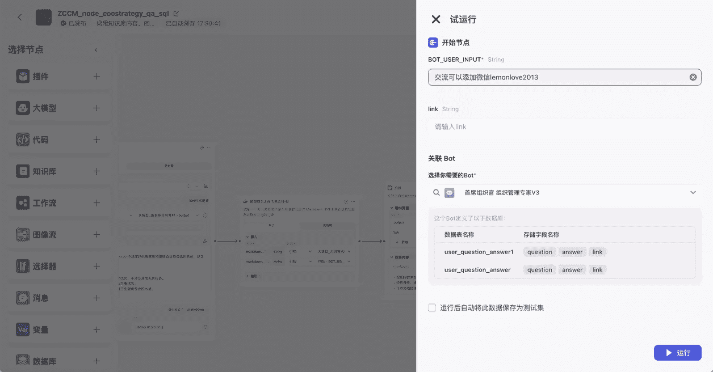

7、试运行成功以后发布工作流，就可以记录对应的数据到数据库了。

首席组织官 组织管理专家：https://www.coze.cn/store/bot/7380733113476890659?panel=1&bid=6cs0gi5847g0j