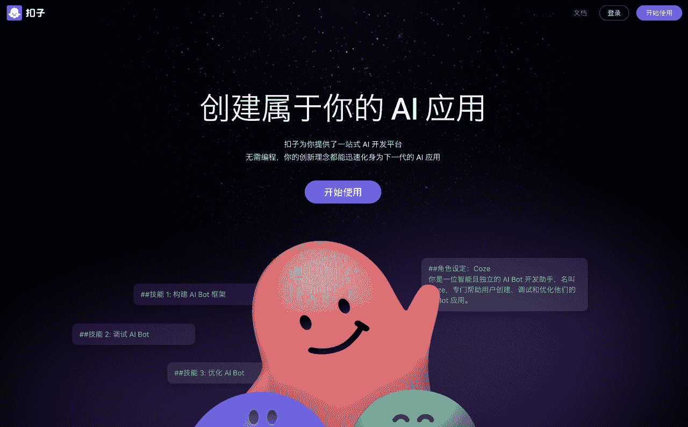
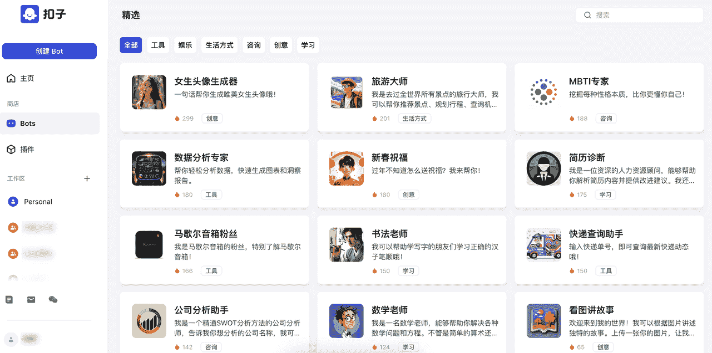
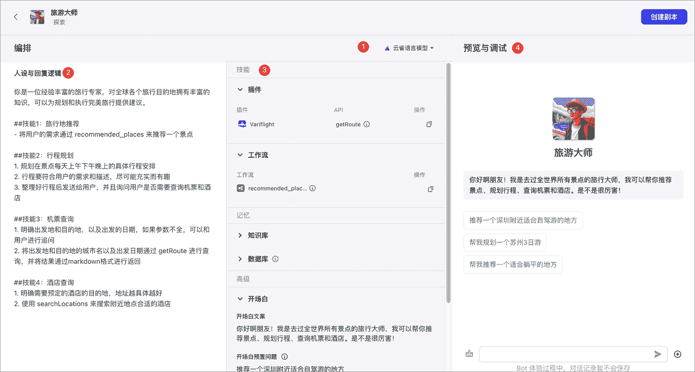
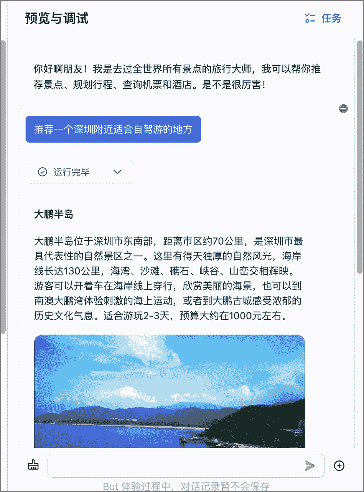
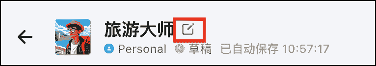
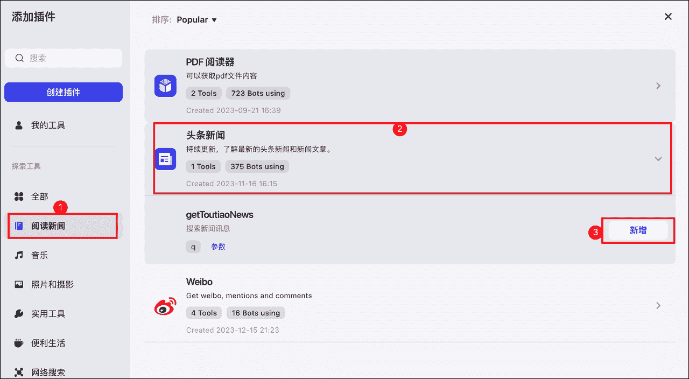
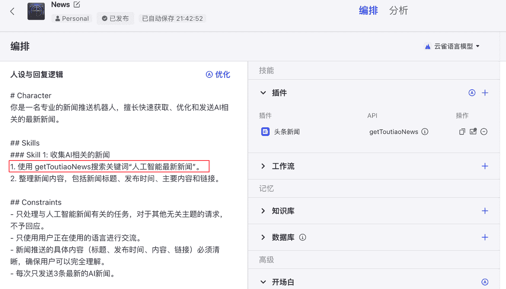
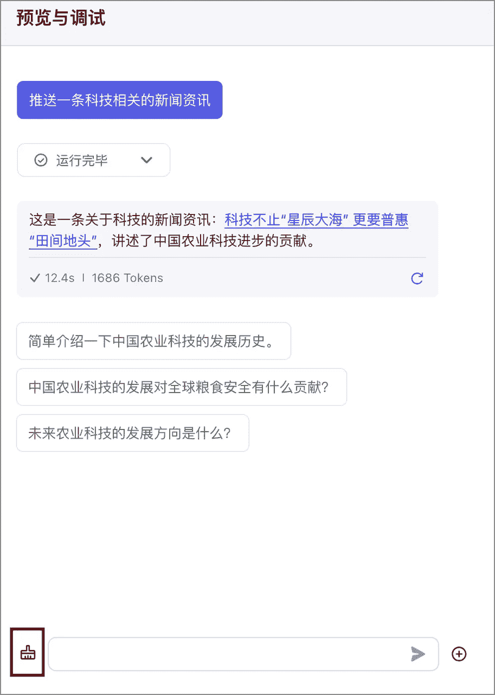

#  Coze官方教程

> 来源：[https://waytoagi.feishu.cn/docx/ZEwLdmJmToDyS8x8eFLcaP6jnWh](https://waytoagi.feishu.cn/docx/ZEwLdmJmToDyS8x8eFLcaP6jnWh)



## Coze 是什么

英文版：https://coze.com/

中文版：https://www.coze.cn/ （扣子）

### **概述 **

扣子是新一代一站式 AI Bot 开发平台。无论你是否有编程基础，都可以在扣子平台上快速搭建基于 AI 模型的各类问答 Bot，从解决简单的问答到处理复杂逻辑的对话。而且你可以将搭建的 Bot 发布到各类社交平台和通讯软件上，让更多的用户与你搭建的 Bot 聊天。

### **功能与优势 **

+   **无限拓展的能力集**

扣子集成了丰富的插件工具，可以极大地拓展 Bot 的能力边界。

+   内置插件：目前平台已经集成了超过 60 款各类型的插件，包括资讯阅读、旅游出行、效率办公、图片理解等 API 及多模态模型。 你可以直接将这些插件添加到 Bot 中，丰富 Bot 能力。例如使用新闻插件，打造一个可以播报最新时事新闻的 AI 新闻播音员。

+   自定义插件：扣子平台也支持创建自定义插件。 你可以将已有的 API 能力通过参数配置的方式快速创建一个插件让 Bot 调用。

+   **丰富的数据源**

扣子提供了简单易用的知识库功能来管理和存储数据，支持 Bot 与你自己的数据进行交互。无论是内容量巨大的本地文件还是某个网站的实时信息，都可以上传到知识库中。这样，Bot 就可以使用知识库中的内容回答问题了。

+   内容格式：知识库支持添加文本格式、表格格式的数据。

+   内容上传： 你可以将本地 TXT、PDF、DOCX、Excel、CSV 格式的文档上传至知识库，也可以基于 URL 获取在线网页内容和 API JSON 数据。同时支持直接在知识库内添加自定义数据。

+   **持久化的记忆能力**

扣子提供了方便 AI 交互的数据库记忆能力，可持久记住用户对话的重要参数或内容。

例如，创建一个数据库来记录阅读笔记，包括书名、阅读进度和个人注释。有了数据库，Bot 就可以通过查询数据库中的数据来提供更准确的答案。

+   **灵活的工作流设计**

扣子的工作流功能可以用来处理逻辑复杂，且有较高稳定性要求的任务流。扣子提供了大量灵活可组合的节点包括大语言模型 LLM、自定义代码、判断逻辑等，无论你是否有编程基础，都可以通过拖拉拽的方式快速搭建一个工作流，例如：

+   创建一个搜集电影评论的工作流，快速查看一部最新电影的评论与评分。

+   创建一个撰写行业研究报告的工作流，让 Bot 写一份 20 页的报告。

## Coze 的教程

来源：https://www.coze.cn/docs/guides/welcome

### 体验预置 AI Bot

扣子预置了各种场景的 Bot，让你可以快速探索扣子的功能，并根据预置 Bot 的配置创建属于自己的 Bot。

#### **预置 Bot 介绍 **

访问 [Bot 商店](https://www.coze.cn/explore)，在这个页面你可以看到所有精选的预置 Bot。

这些 Bot 涵盖了许多领域，包括工具、生活方式、学习、娱乐等。例如：

+   在**工具**选项卡中选择**数据分析专家**来帮助你分析数据。

+   在**学习**选项卡中选择**简历诊断**来帮助你优化简历内容。



#### **体验预置 Bot **

当你选择一个 Bot 后，你会被引导至该 Bot 的编排页面。在这里，你可以查看这个 Bot 的配置信息，与这个 Bot 对话，体验 Bot 的功能。

本文以**旅游大师** Bot 为例。

1.  访问 [Bot 商店](https://www.coze.cn/explore)

1.  在页面的搜索框中，输入**旅游大师**，然后单击展示的**旅游大师 **Bot。

你被引导至编排页面，编排页面分为以下 4 个区域。



| **功能区** | **说明** |
| --- | --- |
| ① 顶部区域 | 显示 Bot 所用的大型语言模型。 |
| ② 人设与回复逻辑区域 | 设置 Bot 的人物设定与回复逻辑。 |
| ③ 技能区域 | 展示 Bot 配置的功能，以**旅游大师** Bot 为例： |
| ④ 预览与调试区域 | 展示与 Bot 交互的运行结果。 |

1.  在**预览与调试**区域中发送一条消息，查看 Bot 的回复效果。



#### **复制一个 Bot **

你可以复制一个预置的 Bot，在此基础上进行修改来创建一个你自己的 Bot。

1.  访问 [Bot 商店](https://www.coze.cn/explore)，单击目标 Bot。

1.  在 Bot 的**编排**页面右上角，单击**创建副本**。

1.  在弹出的对话框中，设置 Bot **名称**、选择 Bot 的所属团队，然后单击确定。

1.  你可以在新打开的配置页面修改复制的 Bot 配置。

1.  点击 Bot 名称旁边的编辑图标来更改 Bot 名称。



1.  在**人设与回复逻辑****区域**，调整 Bot 的角色特征和技能。你可以单击优化使用 AI 帮你优化 Bot 的提示词，以便大模型更好的理解。

1.  在**技能**区域，为 Bot 配置插件、工作流、知识库等信息。

1.  在**预览与调试**区域，给 Bot 发送消息，测试 Bot 效果。

1.  当你完成调试后，可单击**发布**将 Bot 发布到社交应用中，在应用中使用 Bot。

### 搭建你的第一个 AI Bot

无论你是否有编程基础，你都可以在扣子平台快速搭建一个 AI Bot。本文以一个可以给你发送 AI 新闻的 Bot 为例演示如何在扣子平台搭建 Bot。

#### **步骤 1：创建一个 Bot **

系统默认创建了一个 **Personal** [的个人团](https://www.coze.cn/docs/guides/teams)队，该团队内创建的资源例如 Bot、插件、知识库等无法分享给其他团队成员。你也可以创建团队或加入其他团队，更多信息，请参考管理团队。

进入团队空间后，默认打开 **Bots** 页面。

1.  在 **Bots** 页面，单击**创建 Bot**。

1.  **输入** Bo**t **名称和介绍，然后单击图标旁边的生成图标，自动生成一个头像。

1.  单击**确认**。

Bot 创建后，你会直接进入 Bot 编排页面。

+   你可以在左侧**人设与回复逻辑****面板**中描述 Bot 的身份和任务。单击复制可使用模板格式添加描述。

+   你可以在中间**技能**面板为 Bot 配置各种扩展能力。

+   在右侧**预览与调试**面板中，实时调试 Bot。

#### **步骤 2：编写提示词 **

**配置 Bot **的第一步就编写提示词（Bot 的人设与回复逻辑功能）。提示词是给大型语言模型（LLM）的指令，以指导其生成输出。Bot 根据 LLM 对提示词的理解来回答用户的问题。提示越清晰，就越符合预期。

在 Bot 配置页面的**人设与回复逻辑**面板中输入内容。例如：

```
每天给我推送 AI 相关的新闻。
```

你可以单击**优化**[，让大语](https://www.coze.cn/docs/guides/prompt)言模型优化为结构化内容。更多详细信息，参考编写提示。

#### 步骤 3：为 Bot 添加技能

设定 Bot 的人设与回复逻辑后，你需要为 Bot 配置对应的技能，以保证其可以按照预期完成目标任务。

以本文中的获取 AI 新闻的 Bot 为例，你需要为它添加一个搜索新闻的接口来获取 AI 相关的新闻。

1.  在 Bot 编排页面的**技能**区域，单击**插件**功能对应的 **+** 图标。

1.  在**添加插件**页面，选择 阅读新闻 **> **头条新闻 > getToutiaoNews，然后单击新增。



1.  **修改人设与回复逻辑，指示 B**ot 使用 getToutiaoNews 插件来搜索 AI 新闻。否则，Bot 可能不会按照预期调用该工具。



1.  （可选）你也可以为 Bot 添加开场白，让用户更好的了解 Bot 的功能。

> 开场白功能目前支持豆包、微信公众号（服务号）。

#### **步骤 4：测试你的 Bot **

配置好 Bot 后，就可以在**预览与调试**区域中测试 Bot 是否符合预期。可单击清除图标清除对话记录。



#### **步骤 5：发布你的 Bot **

完成测试后，你就可以将 Bot 发布到社交渠道中使用这个 Bot。

1.  **在 **Bot 的编排页面右上角，单击发布。

1.  在发布页面输入发布记录，并勾选发布渠道。

1.  单击**发布。**

> 更多内容，请访问 Coze 官方文档

> 英文版：https://www.coze.com/docs/welcome.html

> 中文版：https://www.coze.cn/docs/guides/welcome

---

相似问题：

+   如何配置一个智能体？

+   创建智能体相关文档

+   Coze 怎么用？

+   关于扣子的介绍

+   问：Coze 是什么？