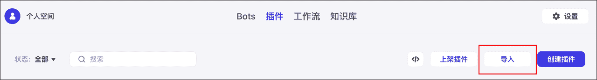
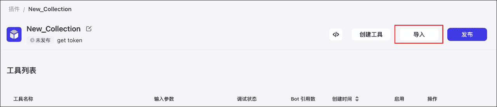
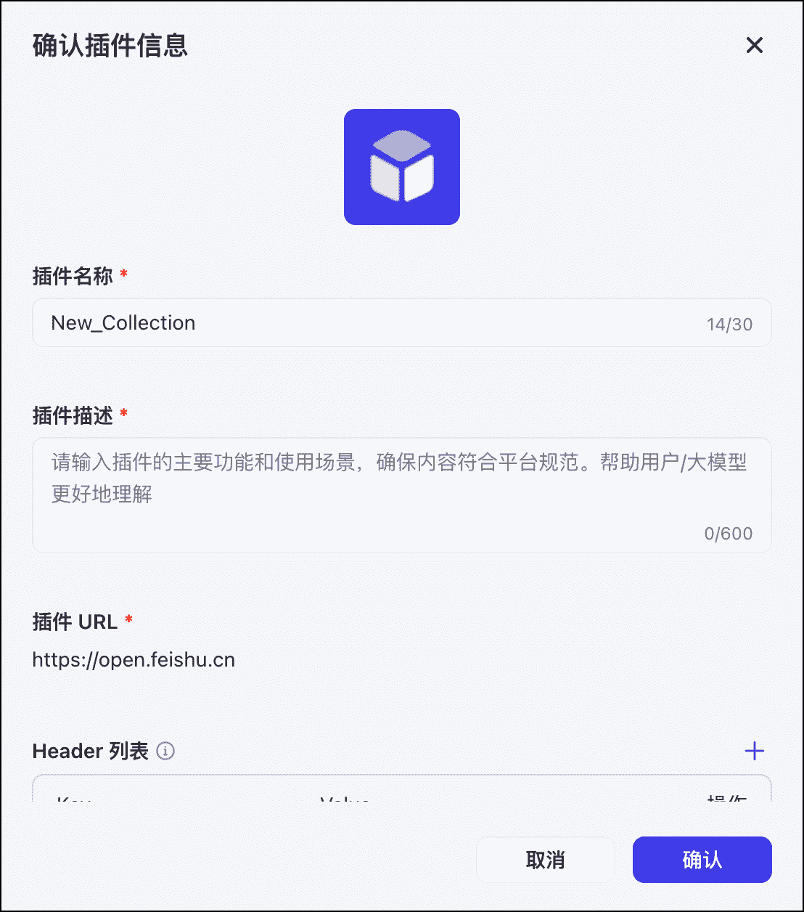
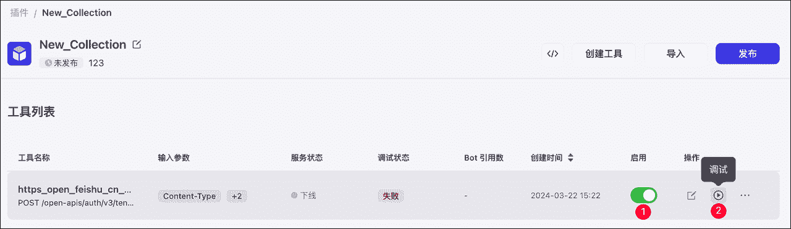
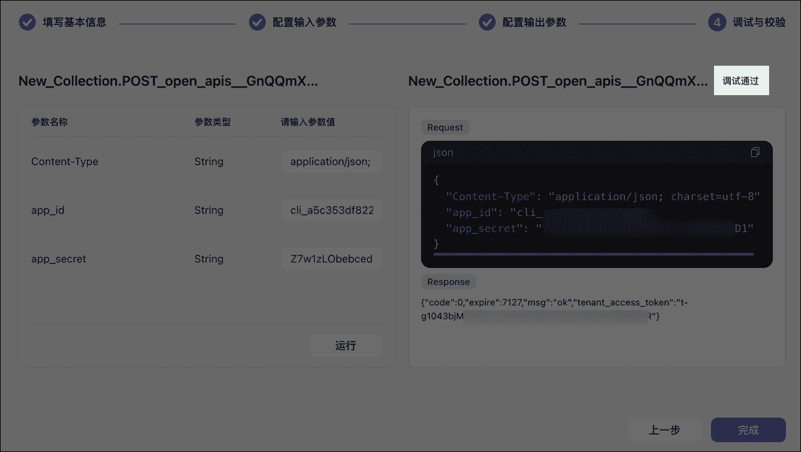

# 通过 JSON 或 YAML 文件导入插件

> 来源：[https://waytoagi.feishu.cn/docx/UJOMd0gPNodFuex5nrYcgfuNntg](https://waytoagi.feishu.cn/docx/UJOMd0gPNodFuex5nrYcgfuNntg)

本文介绍如何通过导入定义 API 的 JSON 或 YAML 文件来创建插件。创建插件后，必须发布插件才可以被 Bot 使用。

+   在个人空间下创建的插件，仅能被个人调用。

+   在团队空间下创建的插件，能被团队成员调用。

+   插件发布了新版本后，使用了这个插件的 Bot 会自动使用发布的最新版本。

+   [定义 API ](https://swagger.io/specification/)的[ JSON 或](https://swagger.io/docs/specification/2-0/basic-structure/) YAML 文件仅支持 OpenAPI、Swagger 或 Postman Collection 协议。

# **操作步骤 **

1.  在页面顶部进入**插件**页面，并在右上角单击**导入**。

**另外支持**在存量的插**件详**情页内导入工具。您需要进入插件详情页，在工具列表右上角单击导入。

1.  在**导入插件****对话框**，选择以下任一导入方式，并单击下一步。

+   方式一：在**本地文件**页签内，通过拖拽或点击的方式，上传保存在本地的 JSON 或 YAML 文件。

+   方式二：在 **URL 和原始数据页签**内，填写存放 API JSON 或 YAML 文件的 URL 地址。

+   方式三：在 **URL 和原始数据页签**内，填写 JSON 或 YAML 格式的 API 原始数据。

> 如果您需要单次导入多个 API，则需要确保各个 API 有相同的 URL 路径前缀，该路径前缀将会作为插件 URL 来使用。如果单次导入的 API URL 路径前缀不一致，则会导入失败。

1.  导入后，在**确认插件信息****对话**框，补全插件配置信息，并单击确认。

配置项说明：

| **配置项** | **说明** |
| --- | --- |
| 插件图标 | 单击默认图标后，您可以上传本地图片文件作为新的图标。 |
| 插件名称 | 自定义插件名称，用于标识当前插件。建议输入清晰易理解的名称，便于大语言模型搜索与使用插件。 |
| 插件描述 | 插件的描述信息，一般用于记录当前插件的用途。 |
| 插件 URL | 插件的访问地址或相关资源的链接，不可修改，示例值 https://www.example.com/api。如果一次导入了多个 API，则这里的插件 URL 是指各个 API 中相同的 URL 路径前缀。 |
| Header 列表 | HTTP 请求头参数列表。 |
| 授权方式 | 选择插件内 API 的鉴权方式。目前支持以下三种： |

+   **位置**：选择秘钥或令牌的传递位置，**Header**（请求头）或是 **Query** （查询参数）内。

+   **Parameter name**：秘钥或令牌对应的参数名称。

+   Service token / API key：秘钥或令牌的值。后续根据该值进行服务认证。

+   **client_id**：注册 OAuth 后获取的唯一标识符。

+   **client_secret**：与 client_id 匹配的密码。

+   **client_url**：验证通过后，模型会重定向到该 url。

+   **scope**：您的应用需要访问的资源范围或级别。

+   authorization_url：OAuth 提供商的 URL，用户会重定向到该 URL 进行应用授权。

+   authorization_content_type：向 OAuth 提供商发送数据时的内容类型。

1.  进入插件详情页，在工具的**启用**列打开启用开关，并在**操作**列单击**调试**按钮。

> 导入插件后，插件内的工具默认未启用且未通过调试，因此您需要先启用工具并通过调试。

1.  在工具的**调试与校验**界面，调试工具，并单击**完成**。

导入**时扣子已**自动为工具填充了配置项，如果工具内的基本信息、输入参数、输出参数仍有信息未完善，则您需要先完善参数信息（已自动填充的参数配置也支持手动修改），然后再进行调试。调试成功后，在页面右侧会提示调试通过。

1.  在插件详情页的右上角，单击**发布**。

# **上架到商店 **

您可以将创建的插件发布到扣子商店，让更[多扣子用户发现、](https://www.coze.cn/docs/guides/publish_plugin_to_store)使用您的插件。详情请参考将插件上架到商店。