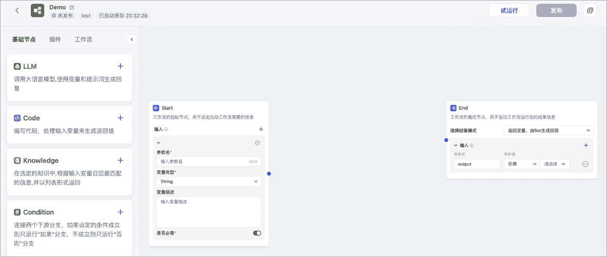
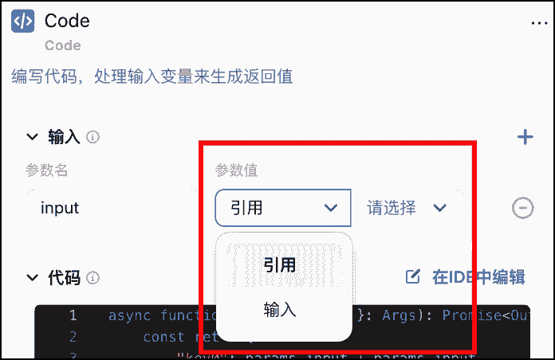
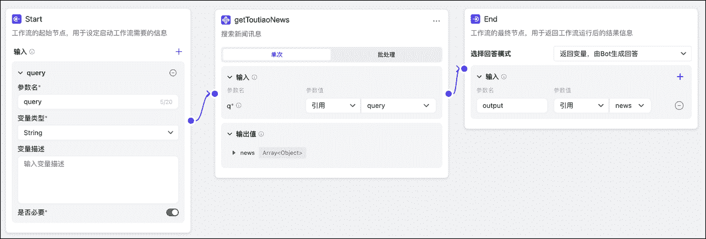
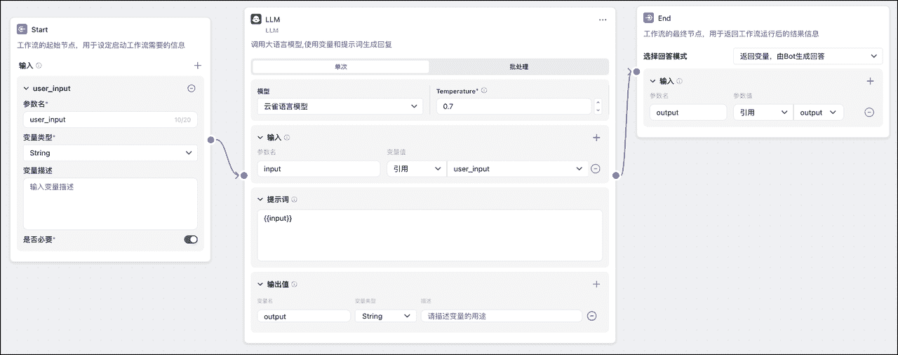
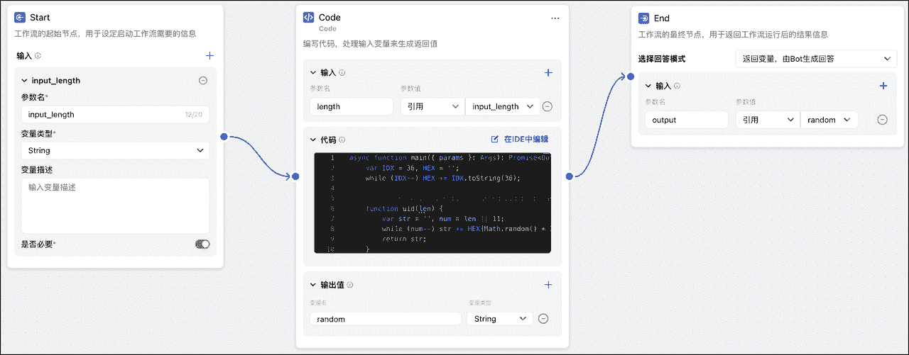
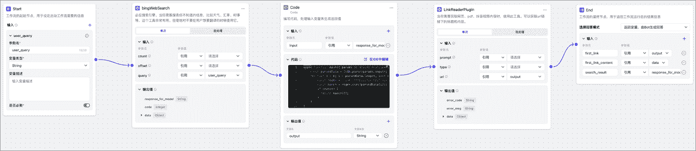
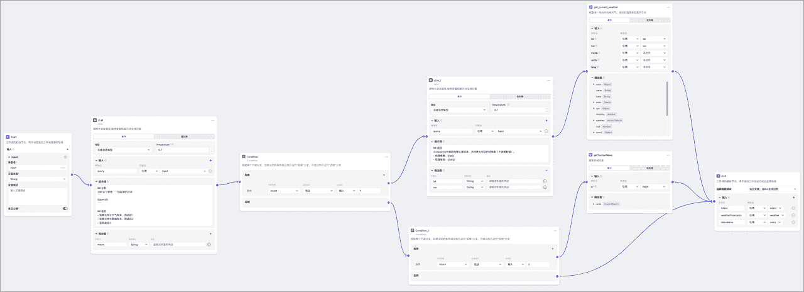

# 工作流介绍

> 来源：[https://waytoagi.feishu.cn/docx/Ju8VdmjBuowaavx8FS5c95jSnFh](https://waytoagi.feishu.cn/docx/Ju8VdmjBuowaavx8FS5c95jSnFh)

工作流支持通过可视化的方式，对插件、大语言模型、代码块等功能进行组合，从而实现复杂、稳定的业务流程编排，例如旅行规划、报告分析等。

当目标任务场景包含较多的步骤，且对输出结果的准确性、格式有严格要求时，适合配置工作流来实现。

# **功能概述 **

工作流由多个节点构成，节点是组成工作流的基本单元。例如，大语言模型 LLM、自定义代码、判断逻辑等节点。

工作流默认包含了 **Start** 节点和 **End** 节点。

+   **Start** 节点是工作流的起始节点，可以包含用户输入信息。

+   **End** 节点是工作流的末尾节点，用于返回工作流的运行结果。

**不同**节**点可**能需要**不同**的输入参数，输入参数分为引**用和**输入两类。引用是指引用前面节点的参数值、输入则是支持设定自定义的参数值。

扣子为你提供了以下基础节点，除此之外，你还可以添加插件节点或其他工作流。

| **节点名称** | **描述** |
| --- | --- |
| LLM | 大语言模型节点。使用输入参数和提示词生成处理结果。 |
| Code | 代码节点。通过 IDE 编写代码处理输入参数，并返回输出值。 |
| Knowledge | 知识库节点。根据输入参数从关联知识库中召回数据，并返回。 |
| Condition | if-else 逻辑节点。用于设**计工**作流内的分支流**程，**满足设置条件则运行如果分支，否则运行否则分支。 |

# **典型场景 **

以下提供工作流的典型场景供你参考。

## **入门场景 **

仅添加一个节点所构建的简单工作流。

+   场景一：通过插件节点内的插件能力，自定义工作流。

例如，使用获取新闻插件，构建一个用于[获取新闻](https://www.coze.cn/docs/guides/workflow_search_news)列表的工作流。详细配置教程可参见搜索新闻。

+   场景二：使用大语言模型（LLM）节点，接收并处理用户问题。

详细配置教程可参见[使用 LLM 处理问题](https://www.coze.cn/docs/guides/workflow_use_llm)。

+   场景三：使用 Code 节点，生成随机数。

详细配置教程可参见[生成随机数](https://www.coze.cn/docs/guides/workflow_use_code)。

## **进阶场景 **

通过多节点组合，构建逻辑较复杂的工作流。

+   场景一：搜索并获取指定信息的详情。

先[通过插件能力进行关键词搜](https://www.coze.cn/docs/guides/workflow_get_content)索、然后通过 Code 节点过滤指定信息、最后通过插件能力获取信息详情。详细配置教程可参见搜索并获取第一个链接内容。

+   场景二：通过条件判断，识别用户意图。

例[如，通过 L](https://www.coze.cn/docs/guides/workflow_user_intent)LM 节点处理用户消息，将消息分为不同的类型，然后通过 Condition 节点分别处理不同类型的用户消息。详细配置教程可参见识别用户意图。

