# 使用工作流

> 来源：[https://waytoagi.feishu.cn/docx/FLqDdD1vEoHeRWxp8Vyc8w0DnBh](https://waytoagi.feishu.cn/docx/FLqDdD1vEoHeRWxp8Vyc8w0DnBh)

通过本文你可以了解如何创建、发布、复制工作流，以及如何在 Bot 中添加工作流。

使用工作流的顺序如下：

1.  创建工作流。

1.  配置工作流。添加工作流节点并按照要处理的用户任务顺序连接工作流。

1.  测试并发布工作流。

1.  将工作流添加到你的 Bot 内。

# **步骤一：创建工作流 **

1.  在页面顶部进入**工作流**页面，并单击**创建工作流**。

1.  设置工作流的名称与描述，并单击**确认**。

> 清晰明确的工作流名称和描述，有助于大语言模型更好的理解工作流的功能。

**创建后页面**会自动跳转**至工作**流的编辑页面，初始状态下工作流包含 Start 节点和 End 节点。

+   **Start** 节点用于启动工作流。

+   **End** 节点用于返回工作流的运行结果。

# **步骤二：配置工作流 **

创建工作流后，你可以通过拖拽的方式将节点添加到画布内，并按照任务执行顺序连接节点。

工作流提供了基础节点供你使用，除此之外，你还可以添加插件节点来执行特定任务。

1.  在左侧面板中选择要使用的节点。

1.  将节点拖拽到画布中，并与其他节点相连接。

1.  配置节点的输入输出参数。

## **配置开始和结束节点 **

开始节点用于开启触发一个工作流，而结束节点用于输出工作流的结果。

开始节点支持配置以下数据类型的参数：

+   String：字符串类型，用于表示文本。例如：Name = "张三"。

+   Number：数值类型，包括整数和浮点数。例如：Number = 42.3。

+   Integer：数值类型，表示整数。例如：Interger=42。

+   Boolean：布尔类型，包含 true 和 false 两个值。例如：isAdult = true。

+   Object：对象类型，JavaScript的标准数据类型之一，一个对象可以看做是一个无序的键/值对的集合。例如： student = {name: "李四", age: 18}。

+   Array：整数数组类型，例如：numbers = [1, 2, 3, 4, 5]。

> Object 最多支持 3 层嵌套。

## **配置 LLM 节点 **

LLM 节点是扣子提供的基础节点之一，你可以使用该节点的大语言模型处理文本生成任务。节点配置说明：

+   **模型**：所用的大语言模型。

+   **Temperature**：模型生成内容的随机度。取值范围[0-1]，数值越大表示生成不确定性越高、内容越多元。

+   **提示词**：该节点的提示词。在提示词中支持使用 **{{var**iable}} 引用输入参数（Input）。

+   **批处理**：支持配置批量处理模式，后续该节点会按照配置多次运行。每次运行都会分配参数值，直到达到次数限制或者列表的最大长度。

配置示例，参考[使用 LLM 处理问题](https://www.coze.cn/docs/guides/workflow_use_llm)。

## **配置 Code 节点 **

你可以在 Code 节点内使用 IDE 工具，通过 AI 自动生成代码或编写自定义代码逻辑，来处理输入参数并返回响应结果。

配置示例，参考[生成随机数](https://www.coze.cn/docs/guides/workflow_use_code)。

该节点支持 JavaScript、Python 运行时。在编码时你需要注意：

| **运行时** | **注意事项** |
| --- | --- |
| JavaScript | +   JavaScript 支持 TypeScript，提供静态语言编码体验。  |
| Python | Python 中，仅内置了 requests_async 和 numpy 两个三方依赖库，requests_async 依赖库与 requests 类似，但需要 await。 |

> Python 运行时暂不支持 Http.client 方式的请求。

在节点内的 **Code** 区域单击 **Edit in IDE** 可通过 IDE 编辑和调试代码。

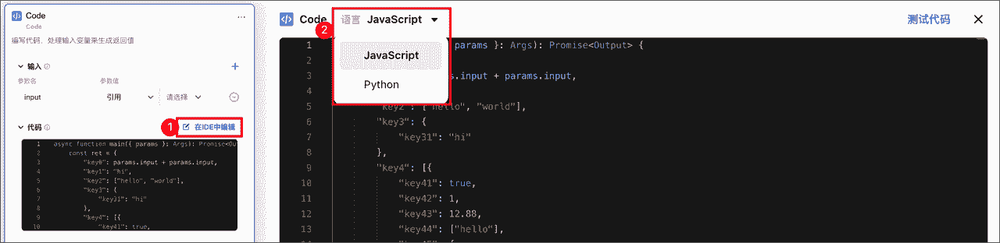

具体使用说明如下：

+   使用 AI 生成代码

+   你可以在 IDE 底部单击 **尝试 AI**，并输入自然语言设定代码逻辑，AI 将自动生成代码。你也可以选中代码片段，通过快捷键（macOS 为 CommandI、Windows 为 Ctrl + I）唤起 AI，并输入自然语言让 AI 帮助你修改代码。

+   补全代码

如果你已经为 Code 节点配置好了输入参数，则编辑时支持自动补全参数。

+   调试代码

单击**测试代码**，在测试面板以 JSON 格式输入参数进行测试。支持使用 AI 自动生成模拟数据进行测试。

设置输入参数后，单击**运行**，你可以在**输出****区域查看运行结果。****在页面**底部单击更新 Schema，可将结果同步到 Code 节点的输出值。

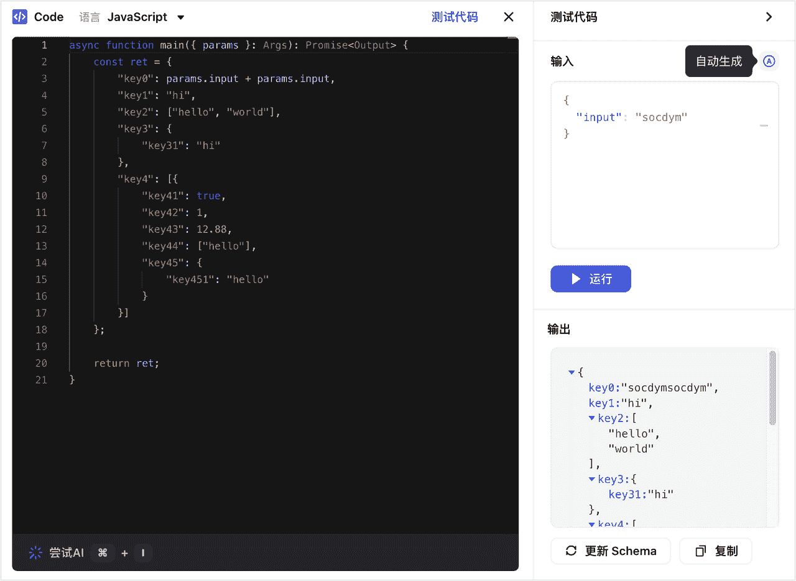

## 配置 Knowledge 节点

知识库节点可以根据输入参数从指定知识库内召回匹配的信息。节点配置说明：

+   设置**输入参数**，节点会根据参数值召回关键内容。

+   设置**知识库**，你需要使用的知识库。

+   **最大召回数量**：从知识库召回的最大段落数，数值越大返回的内容越多。

+   **最小匹配度**：知识库会根据设置的匹配度召回段落，低于匹配度的内容将不会被召回。

## **配置选择器节点 **

该节点是一个 if-else 节点，用于设计工作流内的分支流程。

**当向**该节点输入参数时，节点**会判**断是否符合如果区域的条件，**符合**则执行如果对应的工作流分支，否则执行否则对应的工作流分支。

每个分支条件支持添加多个判断条件（且/或），同时支持添加多个条件分支，可通过拖拽分支条件配置面板来设定分支条件的优先级。

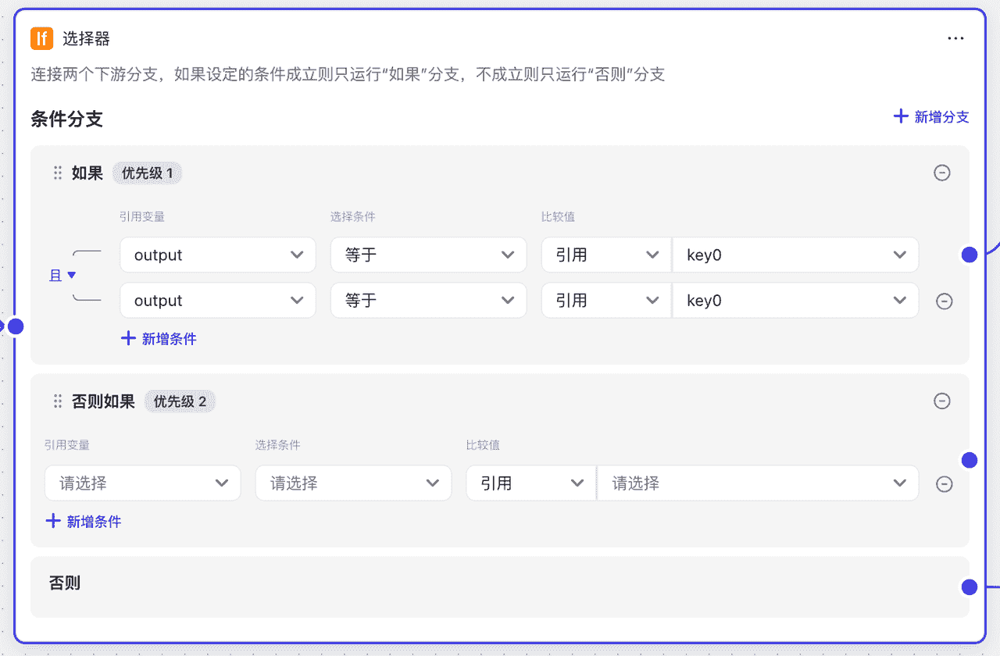

## **配置消息节点 **

消息节点支持在工作流执行过程中返回响应内容，可解决当回复消息内容非常多或工作流长导致用户无法及时收到响应的问题。消息节点支持流式和非流式两种消息模式。

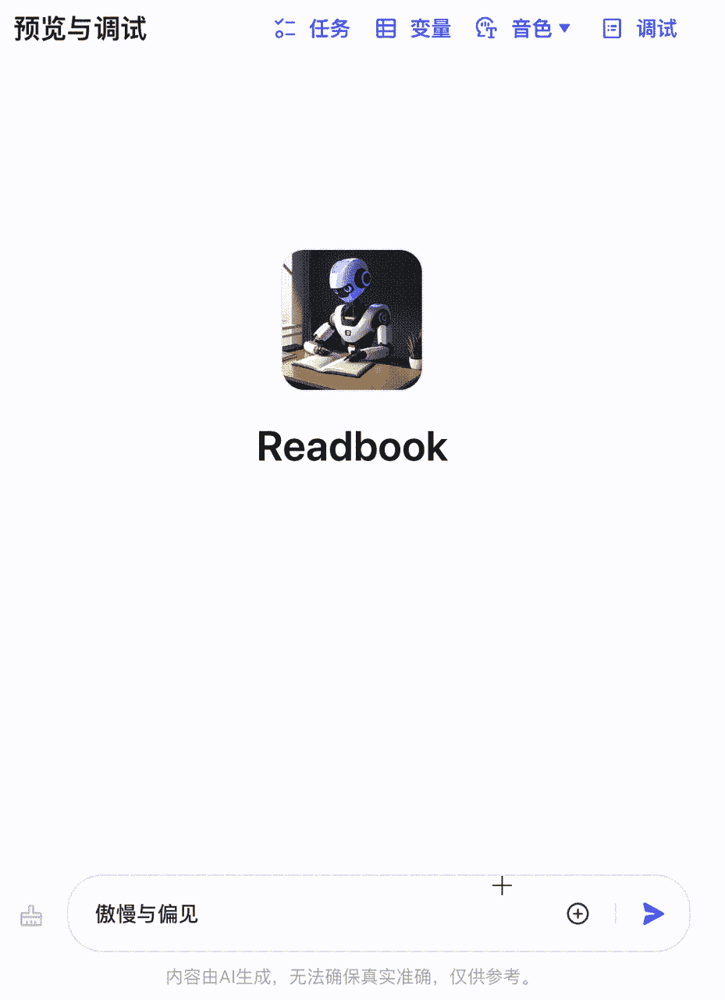

一个消息节点包含以下配置：

+   **输出变量****：配置输**出变量，你可以将这些变量添加到下方的回答内容区域中，这样 Bot 在调用工作流时只会回复你设定的"回答内容"。此外，这些变量也可以在配置卡片时使用。

+   **回答内容**：在工作流运行过程中，Bot 将直接用这里指定的内容回复回**复对话。**可以使用{{变量名}}的方式引用输出参数中的变量。

+   **流式输出**：

+   默认关闭，即采用非流式输出，待接收到全部消息内容后，再一次性输出全部消息内容。

+   开启流式输出后，上一节点一边生成回复内容，一边通过消息节点进行输出，不需要等待全部内容都加载完后再返回。流式输出类似于打字机的效果。

+   消息节点只有在大模型节点后可开启流式响应。

+   当使用了消息节点并开启了流式响应的工作流绑定了消息卡片后，内容回复是非流式的，等待所有回复内容加载后一次性回复所有内容。

+   当在一个工作流中配置了多个消息节点并开启了流式返回时，wo'r消息节点的执行遵循工作流的执行顺序，先执行的消息节点优先输出消息。

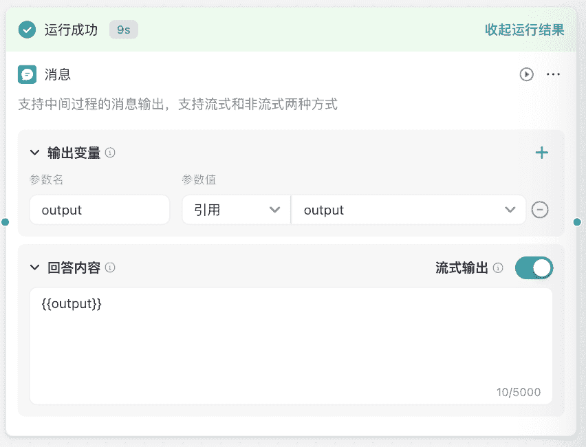

## **配置数据库节点 **

在工作流中支持添加数据库节点，在工作流中可通过 NL2SQL 方式和代码方式进行调用，支持完整读写模式。

下图[是工作](https://www.coze.cn/docs/guides/database)流中数据库节点配置示例。当发布工作流后，在用户与 Bot 对话时，大语言模型会根据需要调用工作流，按照工作流中数据库节点中配置的 SQL 来执行数据表操作。关于数据库的完整配置说明，参考数据库。

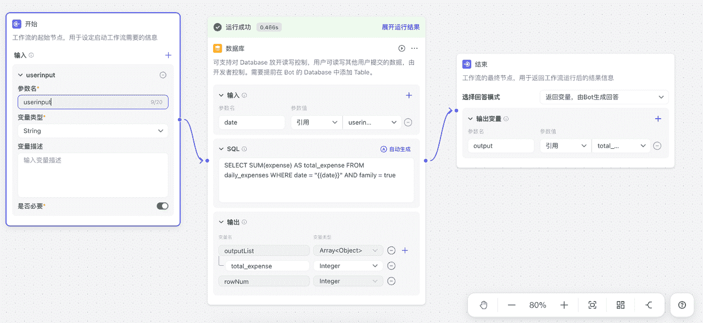

## **配置变量节点 **

该节点用于读取和写入 Bot 中的变量。

变量节点需要搭配 Bot 使用，即你需要先创建 Bot 并设置变量，然后再来编辑包含变量节点的工作流，并且变量节点内的变量名称需要和 Bot 内的变量名称保持一致。

+   选择**给Bot设置变量值****，可以将工作**流中的参数，赋值到 Bot 的变量中。该操作的 Output 用于校验是否成功为 Bot 变量赋值。

+   选择**从Bot获取变量值****，可以获取 **Bot 内的变量值，并作为 Output 使用。

确保该节点中配置的变量字段名称与 Bot 中配置的变量字段一致。

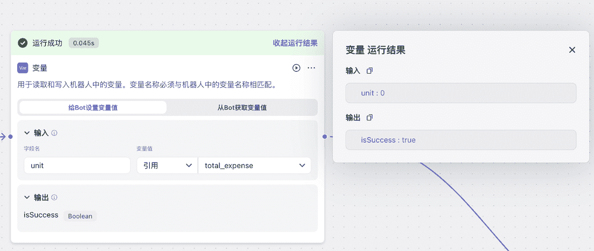

## **引用数组和对象 **

**结束**节点、**消息**节点和**大语言模型 LLM **节点支持直接引用当前节点导入的参数，且支持联想，当输入{{后，能够自动关联所引用的数组/对象数据。

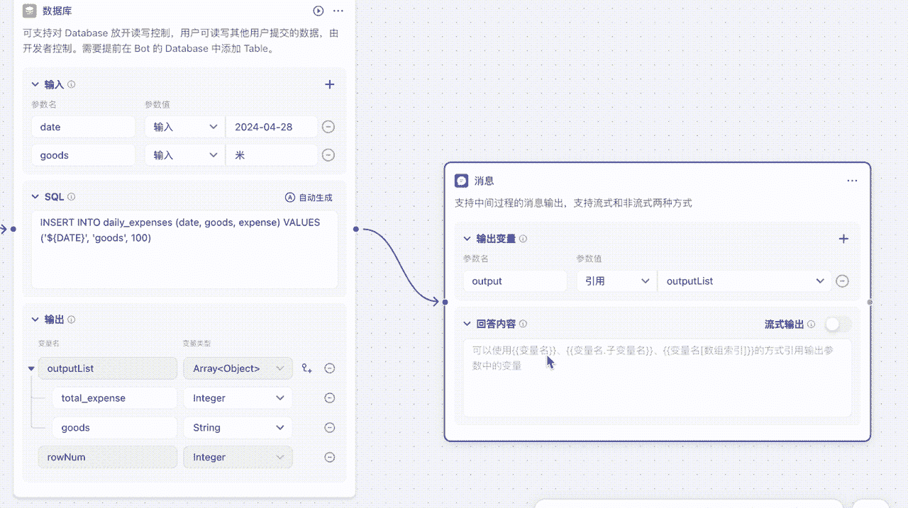

# **步骤三：测试并发布工作流 **

要想在 Bot 内使用该工作流，则需要发布工作流。

1.  单击**试运行**。

**运行成功的节**点边框会显示绿色，在各节点的右上角单击展开运行结果可查看节点的输出。

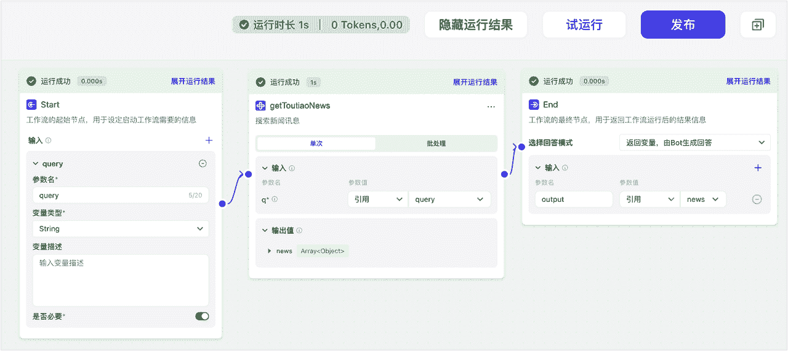

1.  单击**发布**。

> 只有试运行成功时，才能发布工作流。

# 步骤四：在 Bot 内使用工作流

1.  前往当前团队的 **Bots** 页面，选择进入指定 Bot。

1.  在 **Bots** 编排页面的**工作流**区域，单击右侧的加号图标。

1.  在**添加工作流**对话框，在**我创建的**页面选择自建的工作流。

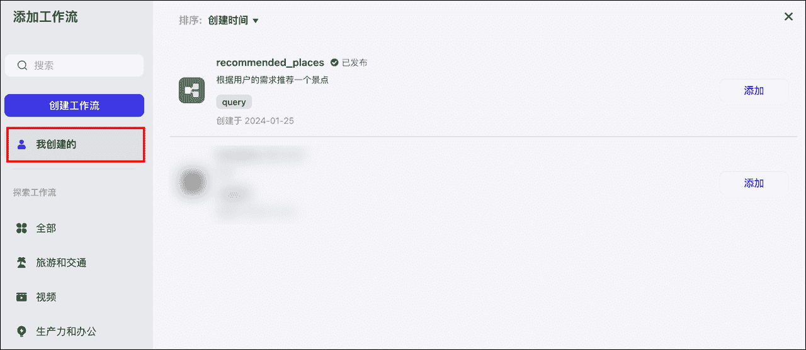

1.  在 Bot 的**人设与回复逻辑**区域，引用工作流的名称来调用工作流。

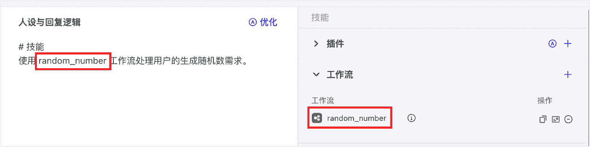

# **其他操作 **

## **复制工作流 **

**在某一工**作流的编辑页面，单击右上角的创**建副本**图标，可以将该工作流复制到你的工作流列表中。

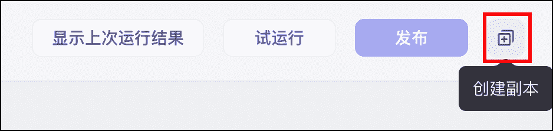

## **删除工作流 **

**对于不**再需要使用的工作流，你可**以在**工作流列表内找到该工作流，并在操作列单击删除图标。

> 如果工作流已添加至 Bot，在删除时会同步删除 Bot 中的工作流。

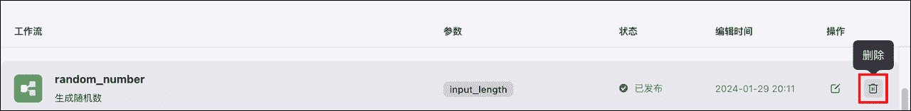