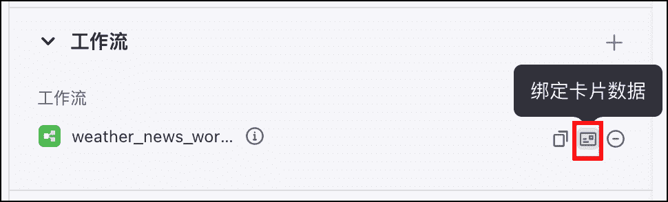
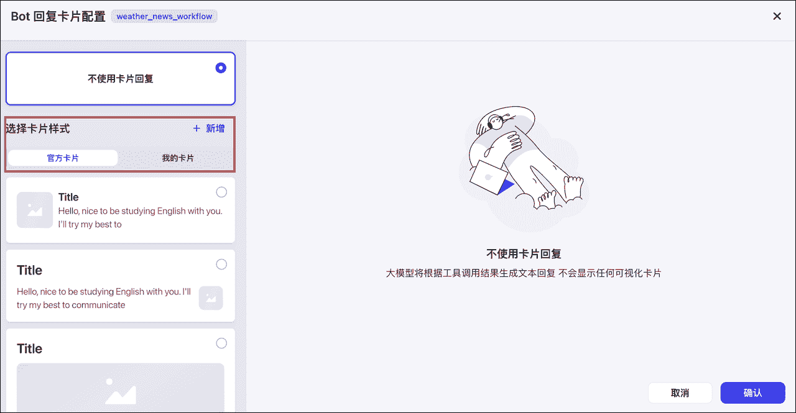
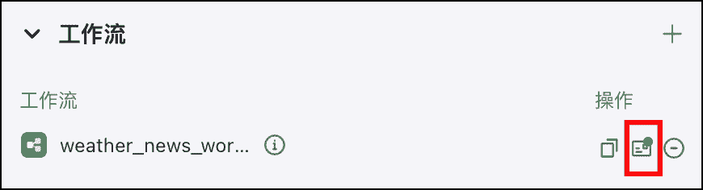
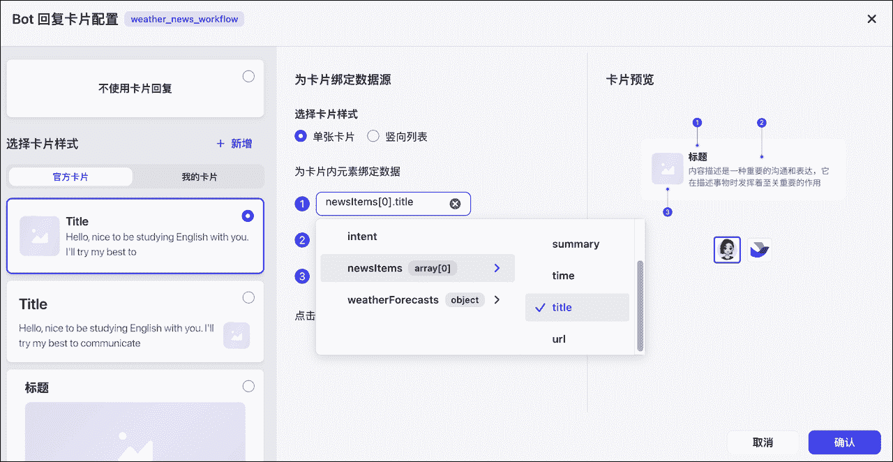
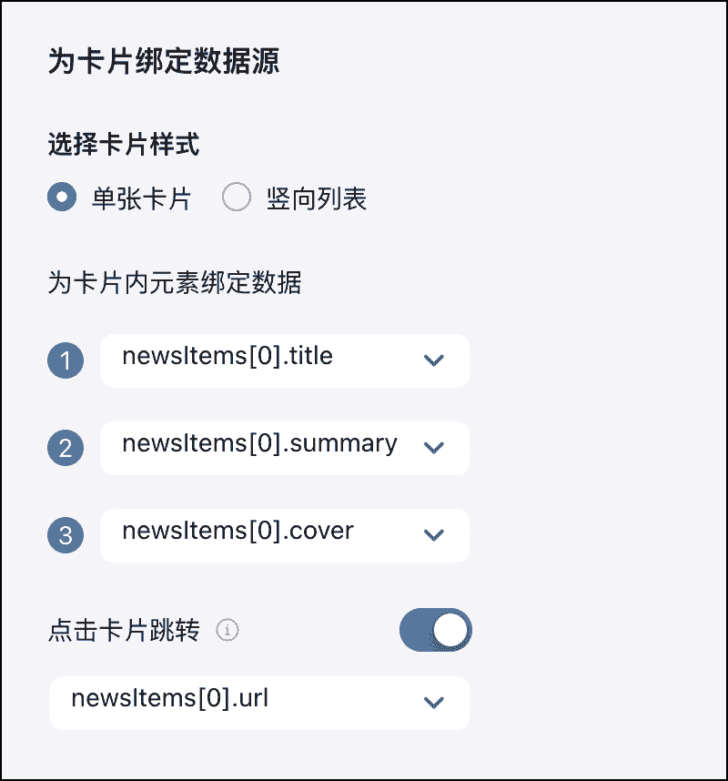
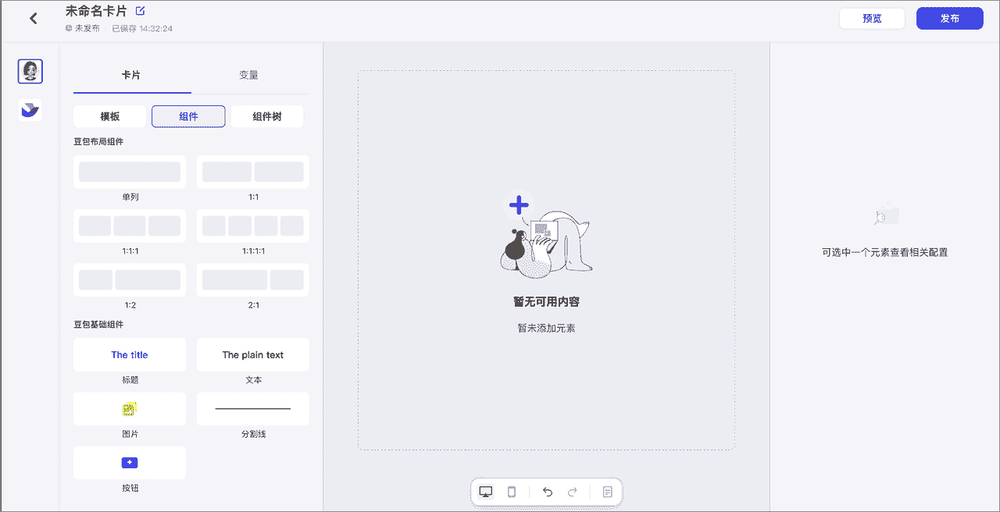
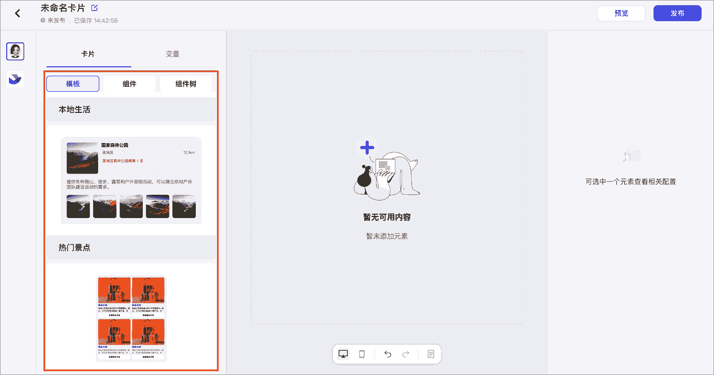
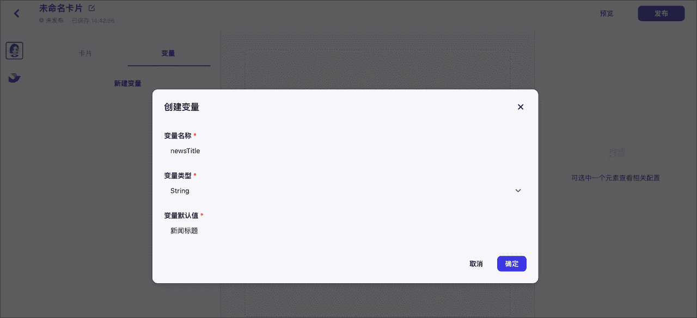
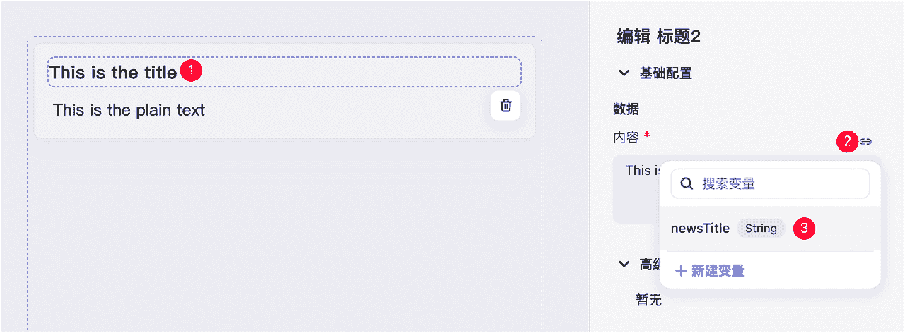

# 消息卡片

> 来源：[https://waytoagi.feishu.cn/docx/QlEgdOQMloNLfkxEuY3cz6ShnZg](https://waytoagi.feishu.cn/docx/QlEgdOQMloNLfkxEuY3cz6ShnZg)

扣子支持 Bot 以消息卡片的形式发送消息。

+   目前消息卡片仅在豆包客户端、飞书客户端内生效。

+   仅工作流和插件功能支持添加消息卡片。

# **添加消息卡片 **

按照以下步骤，为工作流或插件的输出消息配置消息卡片。

1.  在 **Bots** 页面，选择需要添加消息卡片的 Bot。

1.  在 Bot 编排页面，找到**插件**或**工作流。**

1.  单击**绑定卡片数据**图标。

1.  在 **Bot 回复卡片配置**对话框，选择扣子提供的**官方卡片**，或创建自定义卡片。

1.  配置消息卡片后，卡片图标将会显示绿点。

1.  发布 Bot，使配置生效。

# **使用官方卡片 **

扣子提供了消息卡片模板，你可以选择适用的模板，并根据页面提示配置卡片参数。

1.  在 **Bot 回复卡片配置**对话框，选择扣子提供的**官方卡片**。

1.  配置消息卡片。

1.  选择卡片样式。

+   **单张卡片**：该类型的卡片适合展示单一内容。

+   **竖向列表**：该类型的卡片适用于展示多条内容。例如，工作流搜索到多条新闻，则会通过列表依次展示新闻内容。

1.  （可选）如果选择了**竖向列表**的卡片样式，则需要配置以下属性。

+   **卡片列表最大长度**：即列表展示的内容条数。

+   **为卡片整体绑定一个数组**：需要选择工作流内的数组参数。

1.  绑定卡片数据。

**根据页面提**示，在卡片模板的不同区域绑定不同的工作流数据。例如，在 Title 区域，绑定工作流返回的标题参数。

1.  设置**点击卡片跳转**开关。

打开开关后，你需要绑定工作流内的 URL 参数，后续当用户单击卡片时，会跳转访问该 URL。

1.  单击**确认**。

# **创建自定义卡片 **

如果官方提供的卡片模板不能满足你的需要，你可以创建自定义卡片。

1.  在 **Bot 回复卡片配置**对话框左侧，单击**新增**。

页面将跳转至卡片编辑页面。

1.  在页面左侧的**卡片**页签内，选择模版布局或者自行拖拽组件构建卡片，其中组件支持设置样式与内容。

+   **模板**：双击使用模板，你可以参考模板构建属于你的卡片。

+   **组件**：通过拖拽布局组件和基础组件，自定义卡片内容。

+   **组件树**：以导航树的形式查看或调整组件布局。

1.  在页面左侧的**变量**页签内，创建变量。

例如，新增 **newsTitle** 变量，**String** 类型，默认值为**新闻标题**。

1.  返回卡片画布内，选择需要添加变量的组件。

1.  在组件的**内容**区域，单击变量图标并选择要使用的变量。

1.  在页面右上角单击**预览**，扫描二维码在豆包或飞书中查看预览效果。

1.  在编辑器右上角单击**发布**。