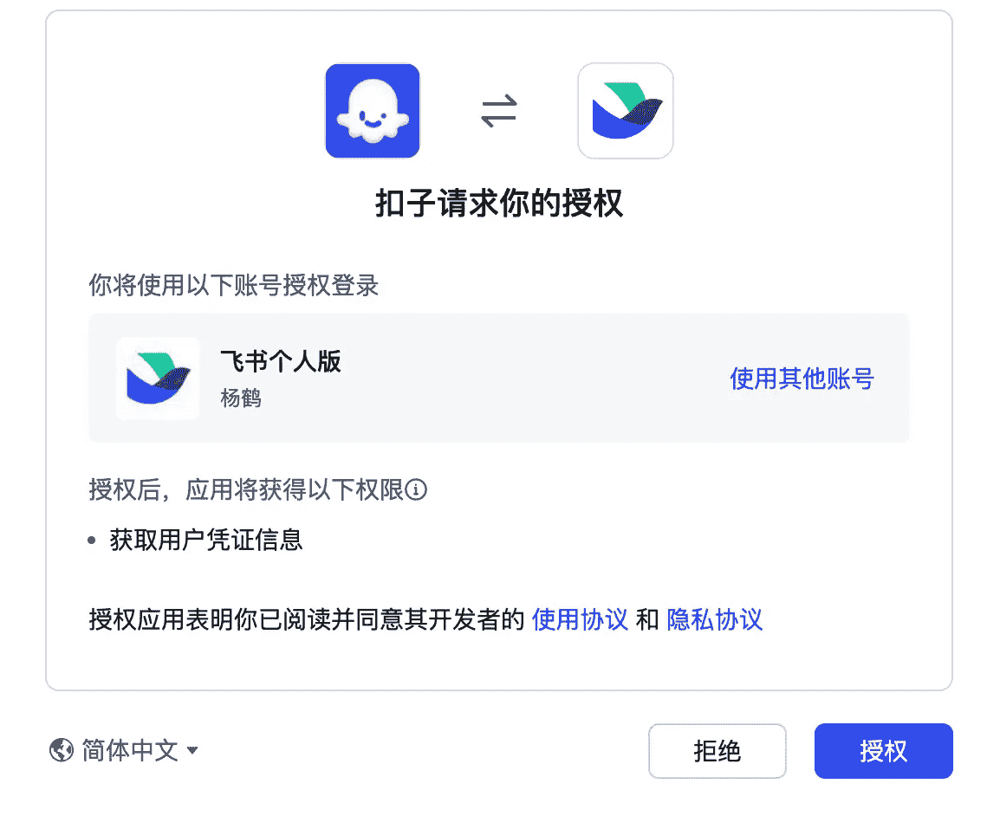
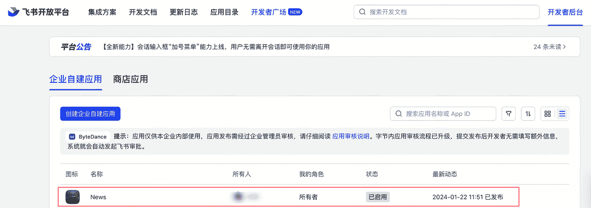
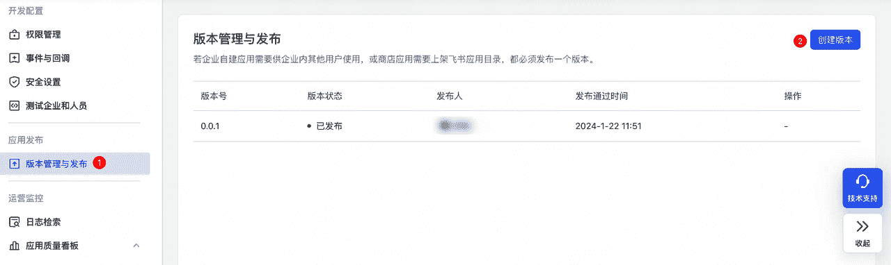
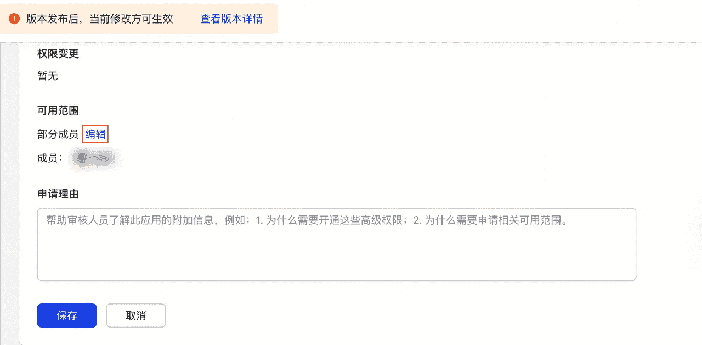
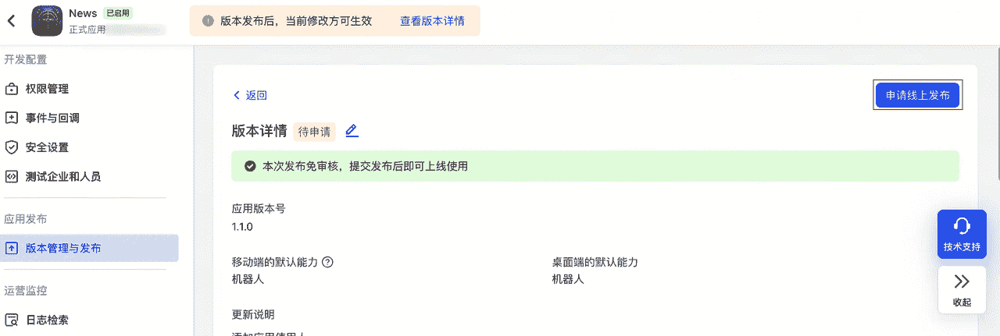

# 发布到飞书

> 来源：[https://waytoagi.feishu.cn/docx/AoObdOpOVo5vmxx8wgLc8Cl0nwb](https://waytoagi.feishu.cn/docx/AoObdOpOVo5vmxx8wgLc8Cl0nwb)

飞书是一站式协同办公平台，为企业提供各种数字化办公解决方案。你可以将搭建的 Bot 发布到飞书中，让飞书中的用户与 Bot 对话。

# **如何发布到飞书 **

1.  登录[扣子](https://www.coze.cn/home)平台。

1.  在左侧导航栏，选择打开个人空间或一个团队空间。

1.  在 **Bots** 页面，选择需要发布的 Bot。

1.  在 Bot 编排页面，单击**发布**。

1.  首次发布时需要进行授权，根据引导完成授权。

1.  单击 **配置**。

1.  在打开的页面，单击**点击获取当前应用**链接。

1.  单击**获取**。

1.  **在打开的页**面，（可选）配置安装范围，然后勾选隐私协议，最后单击授权并安装。

1.  **应用**安装完成后，返回扣子 Bot 的发布页面，再次单击 配置。

1.  在弹出的页面，单击**授权**。

1.  输入发布信息，勾选**飞书**渠道，然后单击**发布**。

发布完成后，可点击在**飞书中打开**链接跳转至飞书应用中，与 Bot 对话。

> 如果这是你的飞书租户第一次发布扣子 Bot 应用，你会收到飞书消息提醒。如果提醒应用审核通过，则你可以直接使用 Bot。否则你需要等待企业管理员审核完成之后，才可以使用 Bot。

# **在飞书中分享你的Bot **

> 目前只支持在同一飞书租户内分享 Bot，不支持跨飞书租户分享 Bot。

你可以通过以下两种方式分享 Bot：

+   方式一：分享 Bot 链接。

1.  打开飞书客户端，单击 Bot 头像，然后再单击分享按钮将 Bot 分享给飞书好友。

1.  被分享人需要点击链接申请使用权限，待 Bot 开发者通过权限申请后，被分享人即可使用 Bot。

+   方式二：在开发者后台，修改 Bot 应用的可见范围。

1.  登录[飞书开发者后台](https://open.feishu.cn/)。

1.  单击已发布的 Bot 应用，进入应用详情页。

1.  在左侧菜单栏，单击**版本管理与发布**，然后再单击**创建版本**。

1.  **输入****版本**信息和更新版本说明，然后单击可用范围配置下的编辑链接，添加可使用该 Bot 的人员。最后单击保存。

1.  单击**申请上线发布**完成应用发布。

发布后，添加的用户就可以在飞书中搜到这个 Bot，并与其对话。

