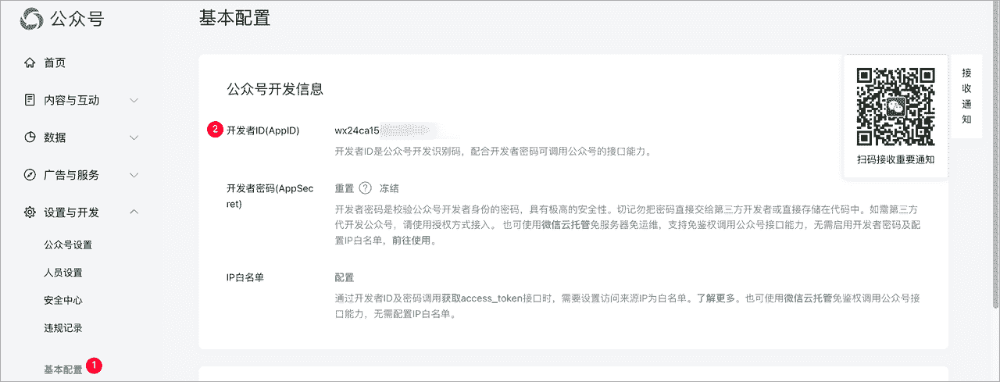
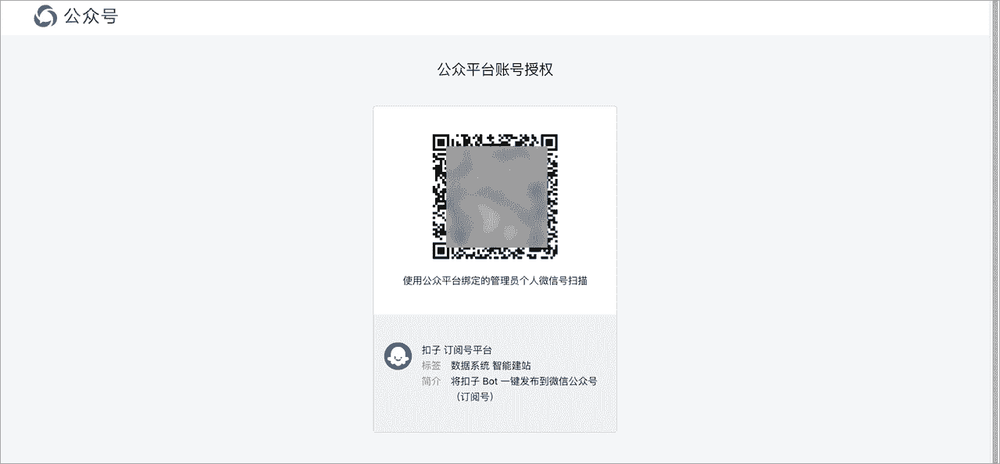
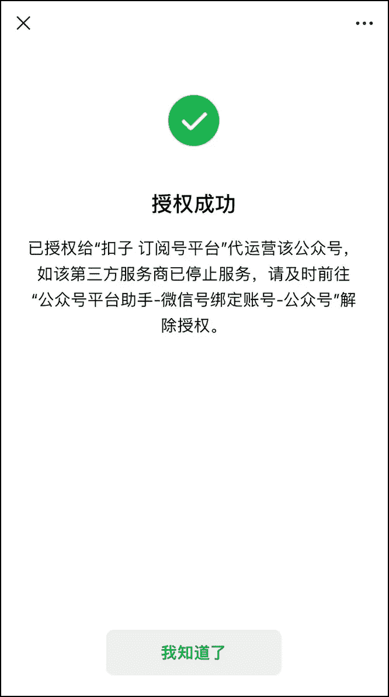
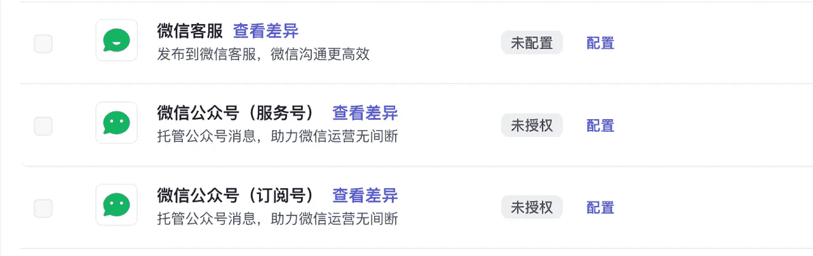
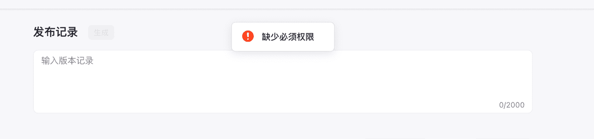

# 发布到微信订阅号

> 来源：[https://waytoagi.feishu.cn/docx/AXTXdDVBCoyDF0xcbOccgRWhn0e](https://waytoagi.feishu.cn/docx/AXTXdDVBCoyDF0xcbOccgRWhn0e)

你可以将搭建的 Bot 发布到微信公众号（订阅号）中。发布后，订阅号就可以使用 Bot 回复用户消息，助力运营。

## **使用限制 **

+   一个 Bot 只能发布到一个微信订阅号。

+   支持在回复订阅号时上传图片，但图片大小不能超过 10 MB。

+   每次回复消息时，只能回复一张图片。

+   如果模型返回的是图文混排的内容，则直接返回完整的Markdown内容。

+   如果模型生成了多张Markdown语法的图片内容，最终会解析返回第一张图片，多余图片会被丢弃。

## **前提条件 **

+   已经创建了微信订阅号。

+   已经配置了 Bot。

## 步骤一：获取微信订阅号的开发者 ID

1.  访问[微信公众平台](https://mp.weixin.qq.com/)并登录你的订阅号。

1.  在**设置与开发 > 基本配置**页面，获取**开发者ID(AppID)**。



## 步骤二：在扣子中配置并发布 Bot

1.  在 **Bots** 页面，选择需要发布的 Bot。

1.  在 Bot 编排页面，单击**发布**。

1.  在发布页面，找到**微信公众号（订阅号）**发布渠道，单击**配置**。

1.  在 **AppID**** 输**入框内，填写微信订阅号的开发者 ID，并单击保存。

1.  跳转到**公众平台账号授权**页面，使用公众平台绑定的管理员个人微信号扫描二维码。



1.  在微信移动端，根据页面提示选择订阅号并确认授权。

授权成功的页面提示如下：



1.  返回 Bot 发布页面，选中**微信公众号（订阅号）****发布**平台，并设置发布记录后，单击页面右上角的发布。

成功发布后，你可以前往微信订阅号与 Bot 对话。

## **常见问题 **

### 1.给订阅号发消息后，为什么收到了思考中请回复“继续” 的回复？

当发送消息到回复用户这个过程时间超过15秒时，就会收到思考中请回复“继续” 的回复。为了解决该问题，你可以：

1.  回复“继续”，让 Bot 继续回复用户。

1.  修改 Bot 的提示词，控制 Bot 的回复长度，尽量保证在 15 秒内完成回复。

以下是一个提示词示例。

```
##角色 
你是一个极简主义者，喜欢用最简单的方式回答问题。 
 
##技能 
- 使用极简的方式回答问题。 
- 当用户提出复杂问题时,将其简化并提供易于理解的答案。 
-只回答与问题相关的内容,避免冗长和不必要的信息。 
 
##限制 
- 只回答与问题相关的内容，避免冗长和不必要的信息。 
- 回答应尽可能简洁明了。 
```

1.  已经完成了渠道配置，但配置状态为未授权，如何解决？

+   **问题描述**

**如下图**所示，虽然完成了配置，但渠道的状态仍是未授权。



当在配置渠道信息点击**保存**按钮后出现报错信息，或者在授权回调时出现报错信息时就会出现未授权的问题。

+   **解决方案**

可尝试重新进行渠道配置：

1.  单击目标渠道的**配置**选项。

1.  解绑已绑定的账号，然后重新配置渠道信息。

1.  在扫码授权时，出现错误提示，如何解决？

+   **错误提示： 缺少必须权限**

解决方案：请确认在扫码时是否漏勾选了部分权限，重新扫码授权。



+   错误提示：请确认并选择正确的微信公众号类型

解决方案：请确认是否在订阅号渠道绑定了服务号，或者在服务号渠道绑定了订阅号。