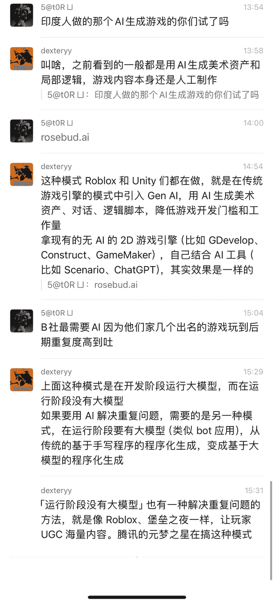
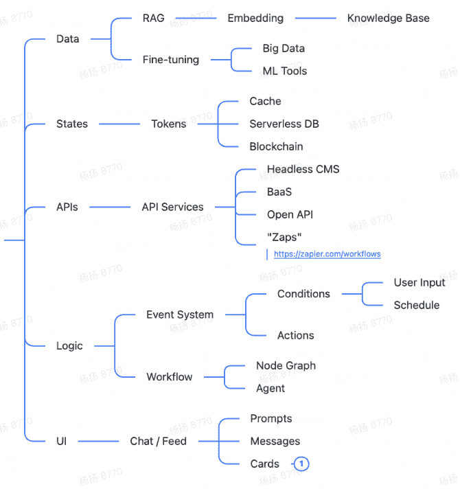

# 观点：像字节 Coze 这样的工具本质上是「AI-first aPaaS」

> 来源：[https://waytoagi.feishu.cn/docx/Gr3TdVfr3oI0qqx7sFscAvlingg](https://waytoagi.feishu.cn/docx/Gr3TdVfr3oI0qqx7sFscAvlingg)

像字节 Coze 这样的工具本质上是「AI-first aPaaS」。

「aPaaS」是指这些 Bot Builder 完完全全就是以前的 aPaaS，把实现一个应用所需的不同类型代码——数据、状态、API 调用、逻辑（工作流、事件系统等）、UI，用不同的可视化工具来实现，比如数据库建模、服务插件、节点图工具、拖拽式 UI 搭建工具。且生成的不是新应用的完整代码，而是「配置」，所有创建出来的「应用」都是 aPaaS 本体这个单一应用读取不同配置的运行结果。

Bot Builder 只是对其中部分类型，换了不同的可视化工具，比如针对「数据」类型用 RAG 工具，对「状态」类型用 Token 缓存等工具、对「工作流逻辑」用 Agent 搭建工具，对「UI」用提示词和卡片配置工具。得到的「应用」一部分作为「配置」存储和运行在 Bot Builder 平台自身，一部分作为「配置」存储和运行在各种 Chatbot 平台（比如 ChatGPT）。

「AI-first」是指它们不但开发应用时用 AI 辅助或依赖 AI，开发出来的也是 AI 应用（目前主要形态是各平台上的 chatbot）。应用的开发阶段有大模型加持（比如用自然语言描述任务），应用的运行阶段也有大模型支撑（大模型扮演两个角色，最平庸的角色是用大模型的 prompt 调用取代手工编写的代码， 更重要的角色是借助大模型做到手工代码做不到的事情）。

像这样的 AI 应用开发平台，存在的问题是：aPaaS 这种单一应用的模式，跟内容平台（比如微信公众号、Medium、头条抖音，很多内容平台同样有「开发」需求，比如文章的 HTML 排版和 widget 组合配置，视频中的   AR 效果）、乃至元宇宙平台（比如 Roblox、堡垒之夜、Decentraland、VRChat、元梦之星，这些平台中用户创建的每个 3D 世界，都是应用，传统上都需要专门开发）是非常一致或者说一脉相承的。

缺点是，不生成完整、专业的应用代码，跟专业应用开发（包括开发方式、最佳实践、技术生态、抽象积累）割裂，自成体系，重新发明一切，无法灵活深度的混搭和优化（我以前写的《「全码」 通用搭建》里有讨论过）。

优点是，天然趋向把同一个应用在开发阶段的形态和运行阶段的形态统一，类似本帖引用中 Ego 的说法「a game engine that is also a game」，应用自身就是应用开发工具、就是编辑器，开发应用的同时就是在使用应用，开发游戏的时候就是在玩游戏 。

aPaaS 们（含 Bot Builder）显然还远远没实现这种优点，仍然有使用门槛，使用 Bot Builder 过程中的复杂性也远高于使用 Bot。

Bot Builder 们只做到「AI-first」，并没做到「AI-native」。

引用中的 Ego 是一个「AI-native App Builder」的例子。

定位是「AI-native simulation/game engine and platform」

+   相当于元宇宙 AI App Builder

+   Ego 的编辑器状态和运行状态似乎都是同一个 PWA 形式的 3D Web 应用

+   开发阶段有大模型，让用户能用自然语言创建人物、世界、脚本交互，「AI-native」的设计让使用门槛甚至低于 Roblox

+   运行阶段也有大模型，游戏人物都是 agent 像人类一样自主行动和互动（「做到手工代码做不到的事情」）

开发团队用这个引擎做了两款 demo 游戏，一个是 Stanford Generative Agents 论文的 3D 实现 Townworld，一个是 AI 人物组成的选秀游戏 CharacterIdol。愿景是让用户能用自然语言创建 GTA、模拟人生、Minecraft、动物之森，同时里面的人物都具备人类行为能力（「让召唤一个 Agent 像填写一张龙与地下城人物卡一样简单」——创始人这句话暴露了自己的成分…）。

补充另一个上下文：有 AI 加持的游戏引擎 vs AI 游戏引擎

再补一张「AI-first aPaaS」的成分示意图

原帖地址：https://twitter.com/dexteryy/status/1768510684206342543