# 「第一天」COW项目：千问模型、百炼应用接入教程

> 来源：[https://waytoagi.feishu.cn/docx/F1bNdFUVUov4kFxOiMfcnOFknLh](https://waytoagi.feishu.cn/docx/F1bNdFUVUov4kFxOiMfcnOFknLh)

> 活动介绍：[「Agent 共学」之"谁是人类" 「WayToAGI x 阿里云」](https://waytoagi.feishu.cn/wiki/Gm72wS4BqixefikquThcERlgnD0)

### **比赛目标：**

> 通过** AI Bot 拟人化比赛**，带大家一起提升 Prompt 书写能力，通过多轮比赛和分享来加深对 AI Agent 的学习和理解。

### **活动形式：**

> 在一个活动群里，主持人出题，AI机器人+人类卧底潜伏在微信群中回答问题。一场比赛6-8轮，每轮群众选出谁是人类。

### **参与方式：**

> 围观群众：在比赛时间查看视频号「通往AGI之路」或「阿里云」.

> 参与选手：加入微信群，7月24日首次共学结束后，群中统一招募.


这个教程是为COW项目接入千问、百炼而作，因此，使用此教程的前提是，你已经完成了COW机器人的搭建，或者准备进行搭建。

1、如果还未进行搭建，请移步[【共学最全版本】微信机器人跟学教程](https://waytoagi.feishu.cn/wiki/NB3nwtUC0iDLYxkIkSYc0WRznGg) 完成第一天的教程内容。

2、**之前完成过coze文件替换对接的同学，**直接使用百炼“应用”的调用。不然会报错。

---

百炼首页：https://bailian.console.aliyun.com/

**首先我们需****要**了解下，在调用阿里云的AI服务时，有两种方式。

**1、直接调用模型**： 通义千问系列以及其他的大模型产品服务。

在COW项目中，调用千问系列的模型。是可以直接使用key、选择model进行调用，此时就是直接调用的某一个大模型。类似于直接调用智普模型、或直接调用了OpneAI的模型。

**2、调用应用能力：**阿里云百炼的“应用”服务。

当我们需要使用更多的能力时候，比如工作流、搜索等能力。此时就需要调用百炼的“应用”。

> 在百炼平台里的“应用”概念，类似于Coze中的“bot”、或ChatGPT的GPTs概念。

因此，大家可以简单理解为：阿里提供了两种调用方式

1、直接调用模型：对接简单，调试不方便。

2、调用应用（bot）：对接相对麻烦，调试简单。（推荐）

以下教学教学了两种调用方式，大家可以自由选择使用任意一种。（之前完成过coze对接的同学，直接使用第二种，不然会报错）

强烈推荐第二种，调用百炼的应用，这样大家在修改和调整Prompt的时候，就不需要重复登录微信了，只需要在“百炼”应用里进行调试即可。

---

## **一、直接调用大模型（****之**前完成过coze对接的同学，直接去二、百炼应用的调用。）

百炼首页：https://bailian.console.aliyun.com/

1、当我们在COW中，去直接调用千问的某一个大模型时，只需要更改key和model即可。

以调用“qwen-max”模型为例，在/root/chatgpt-on-wechat/文件夹下，打开config.json文件：

需要更改 "model"，和添加 "dashscope_api_key"。

那么如何去获取key呢：

视频教程：

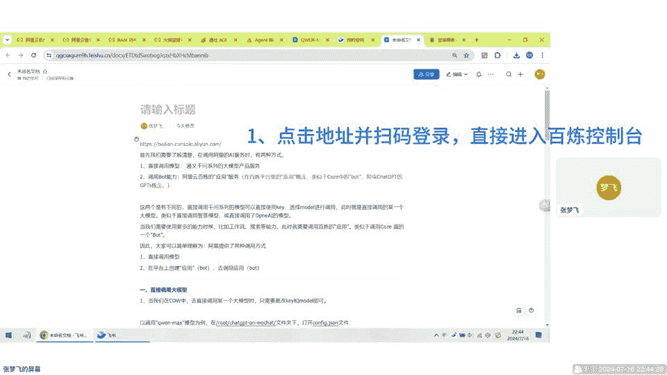

[模型调用教程.mp4](https://internal-api-drive-stream.feishu.cn/space/api/box/stream/download/all/Xrxkb3F9roe2n5xUb7ecImb7nLd)

图文教程：

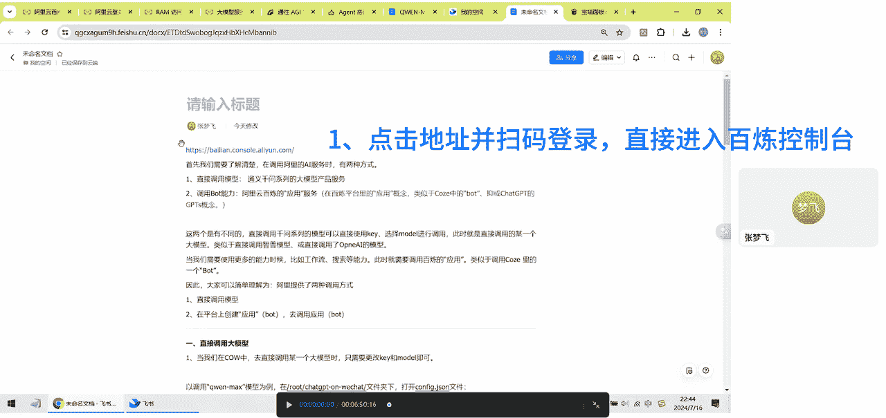

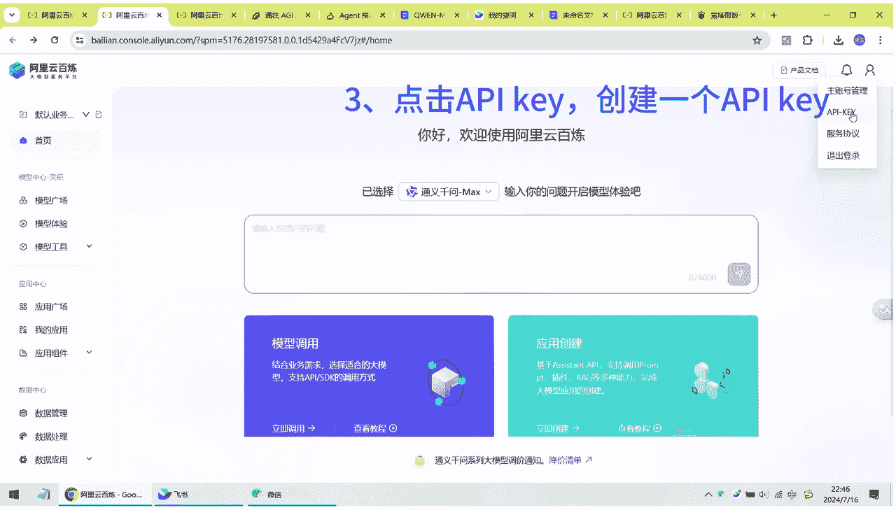

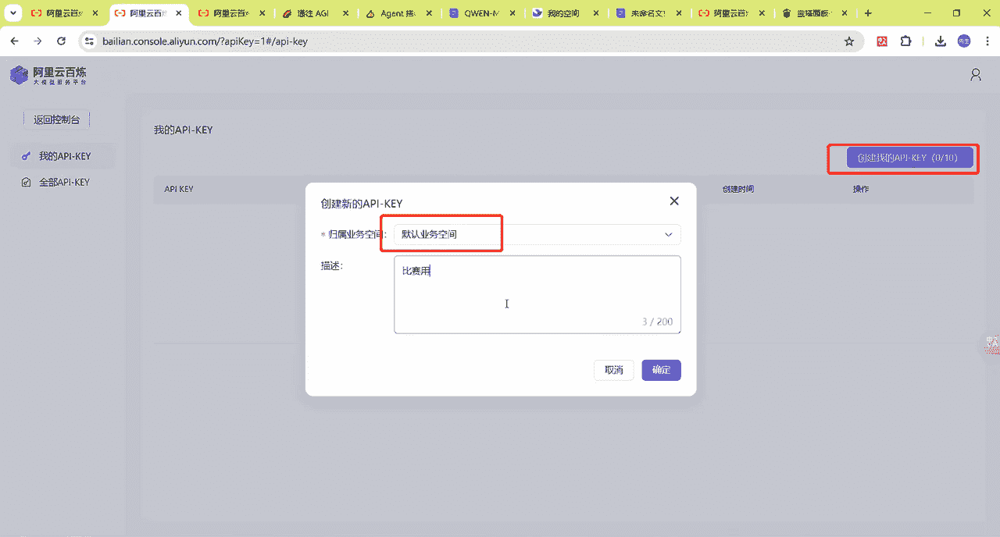

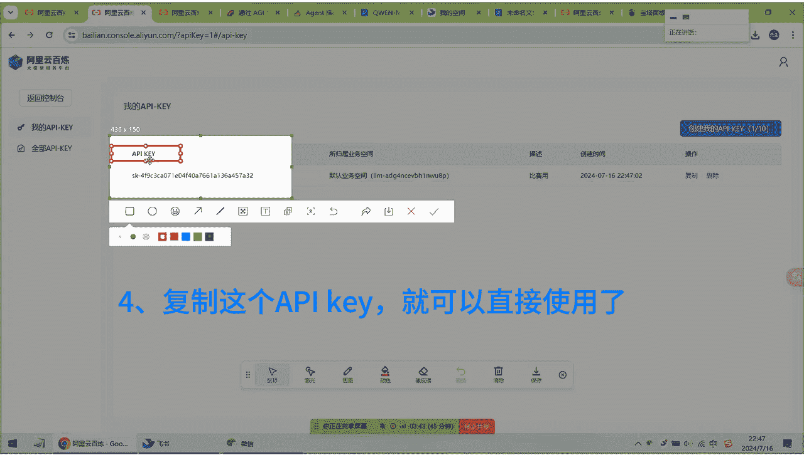

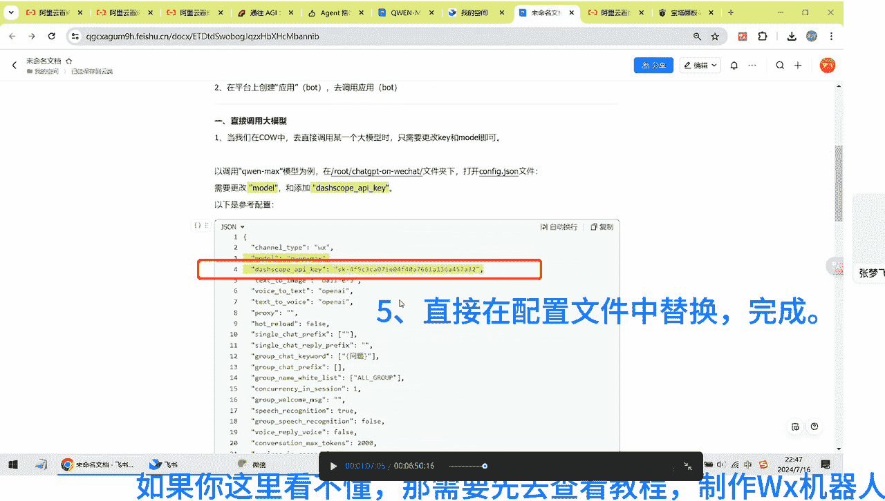

以下是参考配置：

```
{
  &quot;channel_type&quot;: &quot;wx&quot;,   
  &quot;model&quot;: &quot;qwen-max&quot;,
  &quot;dashscope_api_key&quot;: &quot;sk-aa8aa18179a84858这里更换为你自己的key&quot;,
  &quot;text_to_image&quot;: &quot;dall-e-3&quot;,
  &quot;voice_to_text&quot;: &quot;openai&quot;,
  &quot;text_to_voice&quot;: &quot;openai&quot;,
  &quot;proxy&quot;: &quot;&quot;,
  &quot;hot_reload&quot;: false,
  &quot;single_chat_prefix&quot;: [&quot;&quot;],
  &quot;single_chat_reply_prefix&quot;: &quot;&quot;,
  &quot;group_chat_keyword&quot;: [&quot;{问题}&quot;], 
  &quot;group_chat_prefix&quot;: [&quot;{问题}&quot;],
  &quot;group_name_white_list&quot;: [&quot;ALL_GROUP&quot;],
  &quot;concurrency_in_session&quot;: 1,
  &quot;group_welcome_msg&quot;: &quot;&quot;,
  &quot;speech_recognition&quot;: true,
  &quot;group_speech_recognition&quot;: false,
  &quot;voice_reply_voice&quot;: false,
  &quot;conversation_max_tokens&quot;: 2000,
  &quot;expires_in_seconds&quot;: 3600,
  &quot;character_desc&quot;: &quot;&quot;,
  &quot;temperature&quot;: 0.9,
  &quot;subscribe_msg&quot;: &quot;&quot;,
  &quot;use_linkai&quot;: false,
  &quot;linkai_api_key&quot;: &quot;&quot;,
  &quot;linkai_app_code&quot;: &quot;&quot;
}
```

示意图：

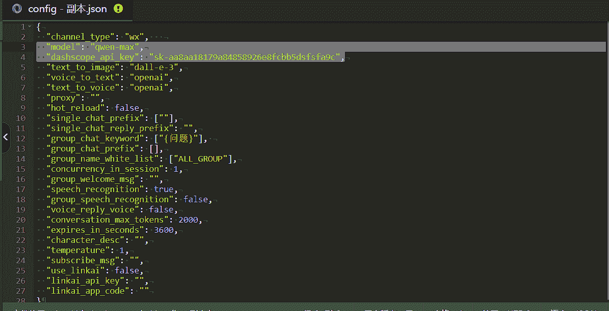

注意：[需要“实](https://account.console.aliyun.com/v2?spm=5176.28508143.J_4VYgf18xNlTAyFFbOuOQe.13.38a9154amP8978#/authc/types)名认证”后，这些key才可以正常使用，如果对话出现“ Access to mode denied. Please make sure you are eligible for using the model.”的报错，那说明你没有实名认证，点击去实名认证，或查看自己是否已认证。

## **二、调用百炼“应用”**

1、当我们在COW中，去调用某一个百炼“应用”时，需要添加更多配置。

首先我们需要创建一个百炼应用，假设我将这个应用命名为“苏苏”。当我完成一个应用的创建后。

以调用“苏苏”应用为例，在/root/chatgpt-on-wechat/文件夹下，打开config.json文件：

需要更改"model": "qwen"，并添加  "qwen_access_key_id"、 "qwen_access_key_secret"、 "qwen_agent_key"、 "qwen_app_id"四项配置。

这些配置项在哪找呢？

视频教程：

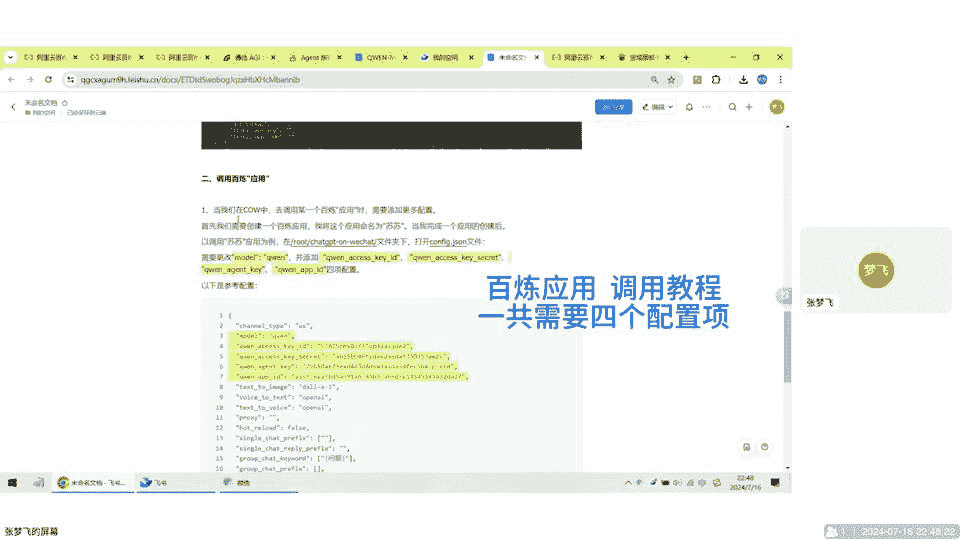

[百炼应用调用教程.mp4](https://internal-api-drive-stream.feishu.cn/space/api/box/stream/download/all/N5ejbx7Cso3VsTxamwbcnyO3nee)

图文教程：

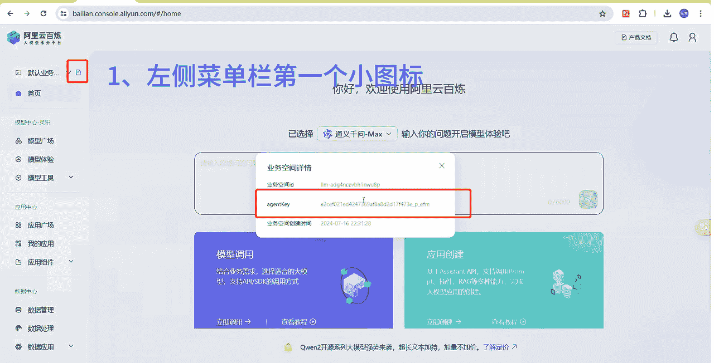

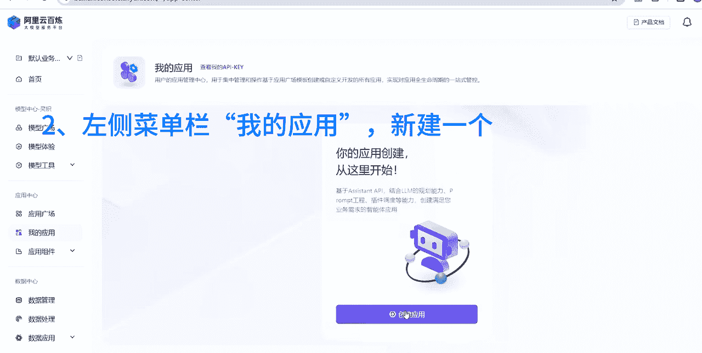

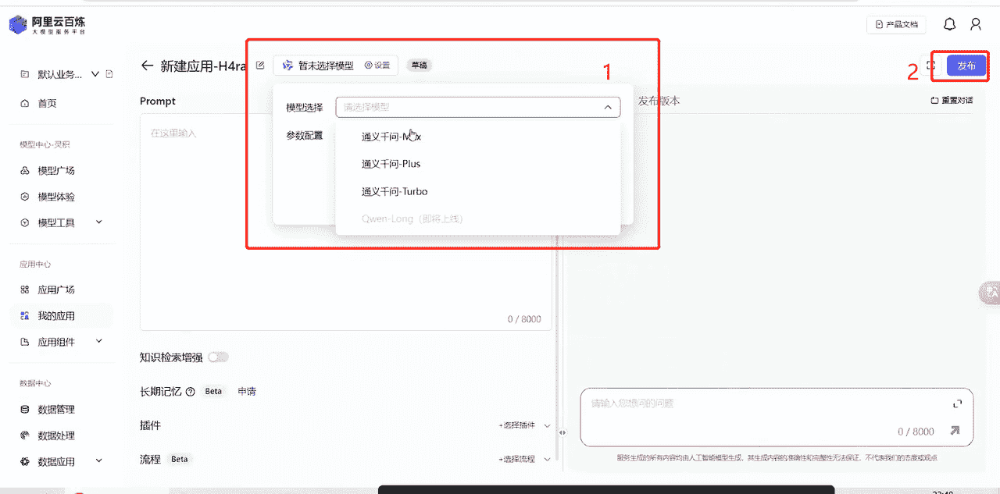

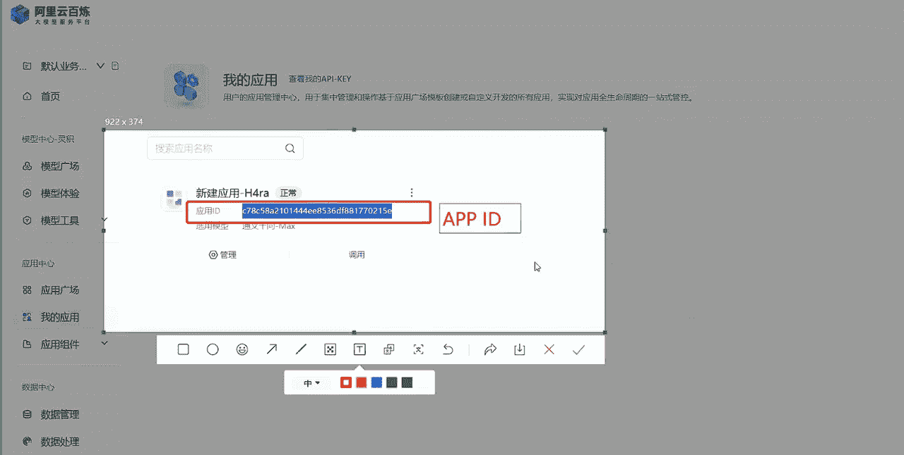

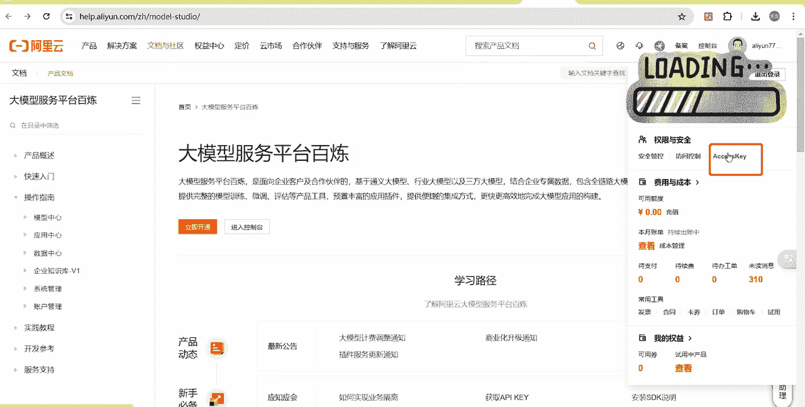

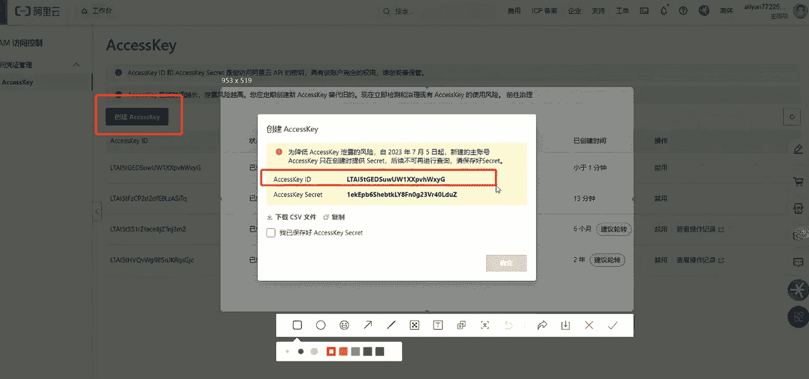

以下是参考配置：

```
{
  &quot;channel_type&quot;: &quot;wx&quot;,   
  &quot;model&quot;: &quot;qwen&quot;,
  &quot;qwen_access_key_id&quot;: &quot;LTAI5tHyDJYfTop4dasjdm2&quot;,
  &quot;qwen_access_key_secret&quot;: &quot;a61SbU4PtLdasdasdafJ5Dd53am2c&quot;,
  &quot;qwen_agent_key&quot;: &quot;79b58aef9ead4d3d8dsadasdasdfec1b4_p_efm&quot;,
  &quot;qwen_app_id&quot;: &quot;asst_eeafbd5a-91a6-45b3-ab9d-e14545345432dad7&quot;,
  &quot;text_to_image&quot;: &quot;dall-e-3&quot;,
  &quot;voice_to_text&quot;: &quot;openai&quot;,
  &quot;text_to_voice&quot;: &quot;openai&quot;,
  &quot;proxy&quot;: &quot;&quot;,
  &quot;hot_reload&quot;: false,
  &quot;single_chat_prefix&quot;: [&quot;&quot;],
  &quot;single_chat_reply_prefix&quot;: &quot;&quot;,
  &quot;group_chat_keyword&quot;: [&quot;{问题}&quot;], 
  &quot;group_chat_prefix&quot;: [&quot;{问题}&quot;],
  &quot;group_name_white_list&quot;: [&quot;ALL_GROUP&quot;],
  &quot;concurrency_in_session&quot;: 1,
  &quot;group_welcome_msg&quot;: &quot;&quot;,
  &quot;speech_recognition&quot;: true,
  &quot;group_speech_recognition&quot;: false,
  &quot;voice_reply_voice&quot;: false,
  &quot;conversation_max_tokens&quot;: 2000,
  &quot;expires_in_seconds&quot;: 3600,
  &quot;character_desc&quot;: &quot;&quot;,
  &quot;temperature&quot;: 0.9,
  &quot;subscribe_msg&quot;: &quot;&quot;,
  &quot;use_linkai&quot;: false,
  &quot;linkai_api_key&quot;: &quot;&quot;,
  &quot;linkai_app_code&quot;: &quot;&quot;
}
```

注意：[需要“实](https://account.console.aliyun.com/v2?spm=5176.28508143.J_4VYgf18xNlTAyFFbOuOQe.13.38a9154amP8978#/authc/types)名认证”后，这些key才可以正常使用，如果对话出现“ Access to mode denied. Please make sure you are eligible for using the model.”的报错，那说明你没有实名认证，点击去实名认证，或查看自己是否已认证。