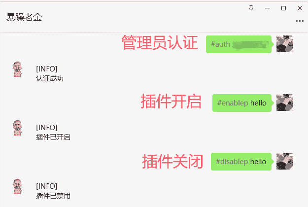
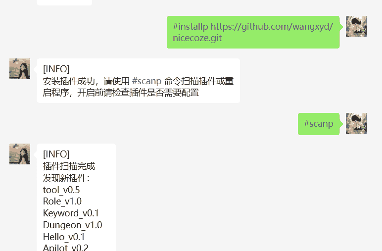
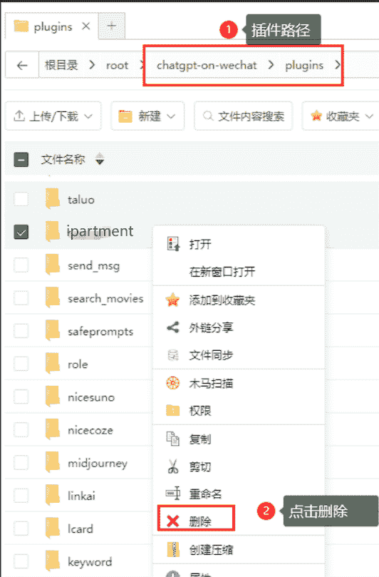
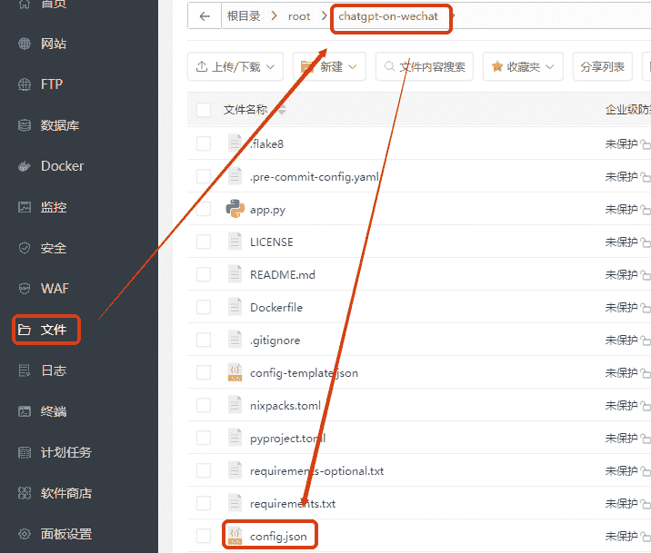
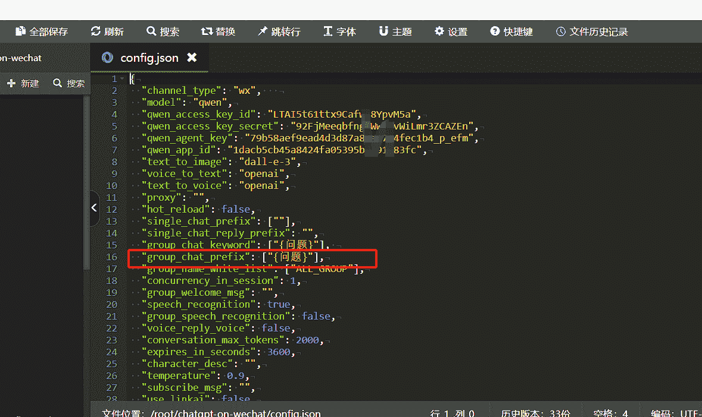
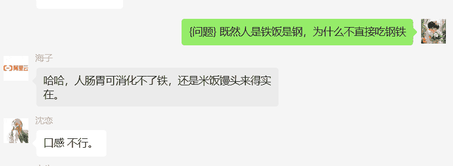

# 「第一天」参赛Bot配置要求

> 来源：[https://waytoagi.feishu.cn/docx/GFiudH0tgoKcz8xMqSVcvXHJnrb](https://waytoagi.feishu.cn/docx/GFiudH0tgoKcz8xMqSVcvXHJnrb)

> 要求概述:

1.  关闭进群欢迎语

1.  在群里回答时不能 @对方

1.  统一修改config.py中的触发词为{问题}

1.  回答不能分好几条

为了更好地参与《谁是人类》比赛，请各位参赛选手把自己的机器人按照如下方式调整。

## 1、如何关闭进群欢迎语

（1）管理员认证 #auth 【你的密码】- 密码请查看Plugins/godcmd/config.json

（2）#disablep hello，关闭hello插件。

> （3）#enablep hello，赛后如需重启，使用该指令。



## 2、如何在群里回答时不 @对方

私聊微信机器人认证成功后。在对话框中输入第一行代码。

出现安装成功后，输入第二行。

```
#installp https://github.com/wangxyd/ipartment.git
#scanp
```

（图是举例）




如果出现安装失败，则在插件目录下，右键删除ipartment文件夹后，重新安装即可。



安装完成后，去服务器的插件目录中，修改配置文件：

配置文件为plugins/ipartment/config.json，可以自行修改，按照如下示例配置：

```
{
  &quot;group_at_probability&quot;: 0,
  &quot;add_quoter_nickname&quot;: false,
  &quot;reply_reference_query&quot;: false
}
```

## 3、如何修改config.json中的触发词为“{问题}”

找到配置文件，路径如下：



修改  "group_chat_prefix": ["{问题}"],，注意符号均为英文符号。



达成效果：



## 4、回答不分段

之前的跟学活动中，使用分段能力的用户，在提示词中，去掉提示词中带有的 //n的示例即可取消分段。

# 完成后修改头像和微信名为编号

最后机器人头像，头像要求关注活动页要求: [「Agent 共学」之"谁是人类" 「WayToAGI x 阿里云」](https://waytoagi.feishu.cn/wiki/Gm72wS4BqixefikquThcERlgnD0?from=from_copylink)

以上全部内容完成后，重新扫码登录微信机器人即可。