# 梦飞：在自己的电脑上部署COW微信机器人项目

> 来源：[https://waytoagi.feishu.cn/docx/WT2hdz0PnofA0Zx3XjNcCuMlnCb](https://waytoagi.feishu.cn/docx/WT2hdz0PnofA0Zx3XjNcCuMlnCb)

为了方便之前已经玩过，没有免费服务器可用，又想参赛的小伙伴。因此制作了此教程，此教程可以把COW项目部署在你自己的电脑上使用。

注意：程序将在你的电脑本地运行，假如你关掉了窗口，那么进程也就结束。所以，如果你想让AI持续使用，就必须保持窗口打开和运行，也就是电脑不能关。

以下教程以windows10系统为例/

**mac系统步骤也是一样，只是打开命令**符的命令些许不同，遇到问题问大模型就好了

## 一、注册大模型

百炼首页：https://bailian.console.aliyun.com/

需要更改 "model"，和添加 "dashscope_api_key"。

那么如何去获取key呢

视频教程，拿到key之后，进行下一步骤。

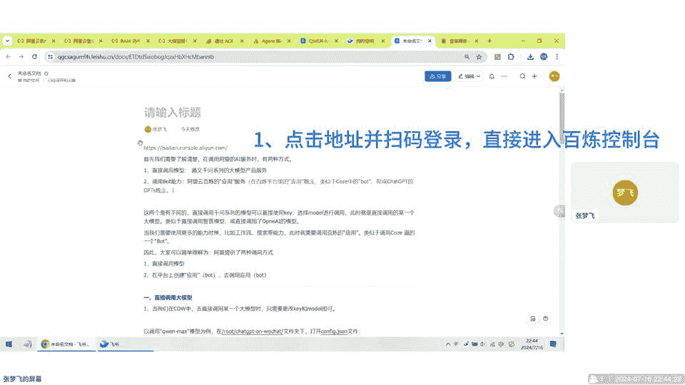

[模型调用教程.mp4](https://internal-api-drive-stream.feishu.cn/space/api/box/stream/download/all/I8SubtIxNoneYkxgLeXcB5KGneT)

## 二、安装环境

1、点击电脑“系统”，直接输入“cmd”，点击回车，打开命令窗口

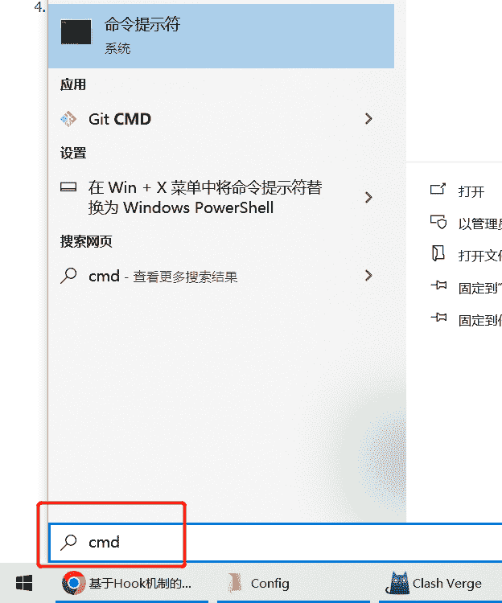

2、在命令窗口中，粘贴入以下代码，确认是否有python

```
python --version
```

3、粘贴入以下代码，确认是否有pip

```
pip --version
```

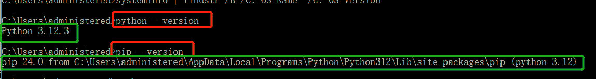

4、两步命令输入完，核对一下

+   如果有的话，会如上图一样，分别显示出版本号。那么可以跳过“安装环境这一步，直接到“二、部署项目””

+   如果没有的话，会如下图所示，那么需要安装下边的步骤，一步一步安装。

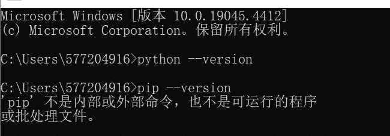

5、先进行python的安装，我帮你把python的安装包已经下载好了，直接点击下载：


[python-3.12.3-amd64.exe](https://internal-api-drive-stream.feishu.cn/space/api/box/stream/download/all/AqkJbhBCdo8mNOxwBV1cOzYSn4f)

5.1  python安装步骤：

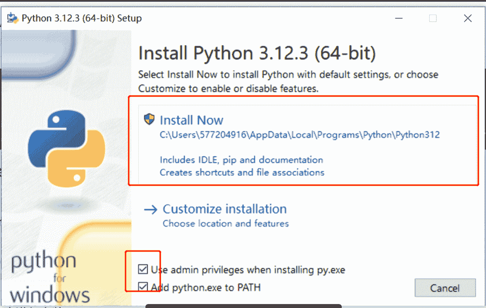

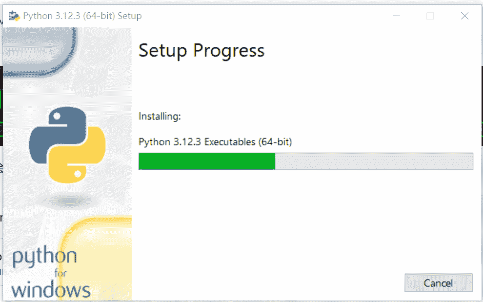

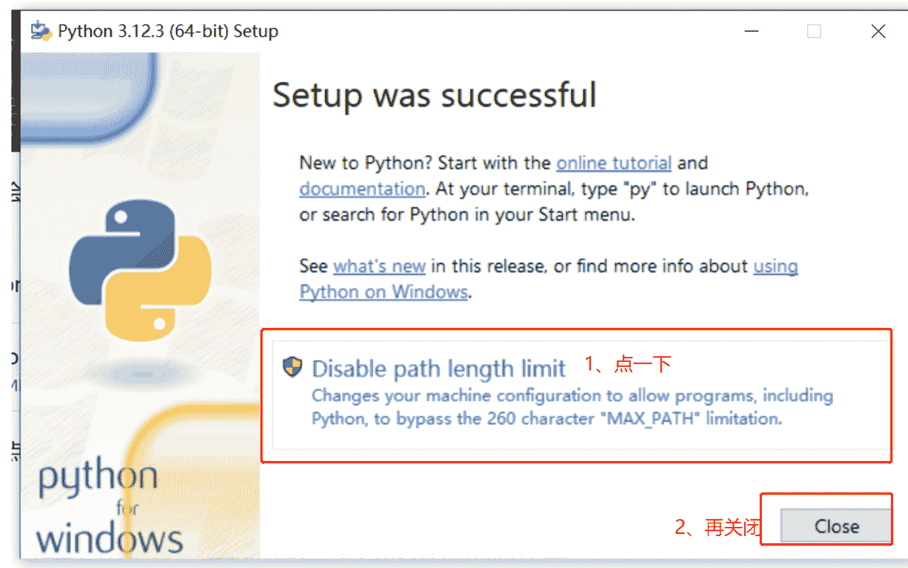

5.2 关闭窗口，再次运行那两行命令 会发现已经有了。

## 三、部署项目

6、下载COW机器人项目，也给你准备好了，直接下载，然后解压缩。


[chatgpt-on-wechat-master.zip](https://internal-api-drive-stream.feishu.cn/space/api/box/stream/download/all/OX2IbtIilofTyYxsMfacw5G6nOh)

7、解压后，打开COW文件夹，

8、在空白处，shift+鼠标右键，点击“在此处打开Powershell窗口”

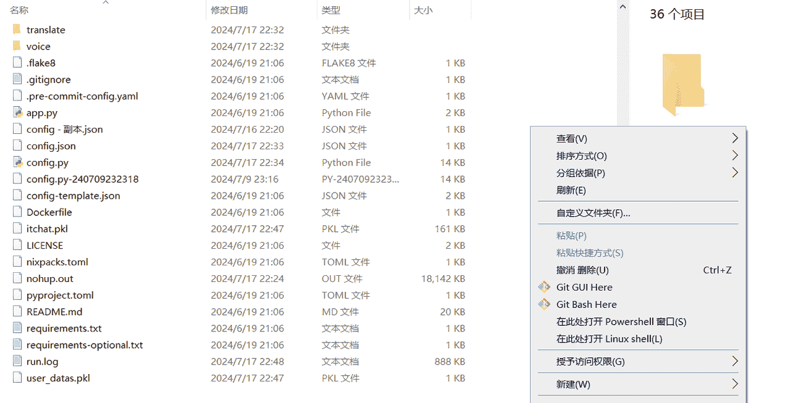

9、在Powershell窗口中，粘贴进入：

pip install -r requirements.txt

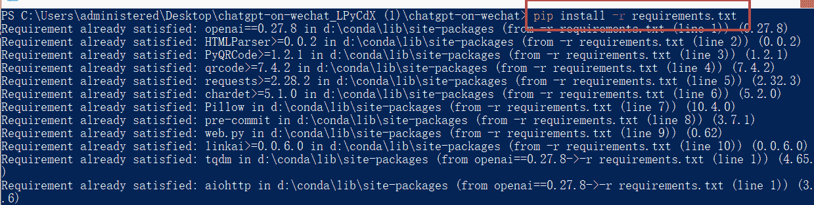

10、等待执行完成后，继续粘贴：

pip install -r requirements-optional.txt

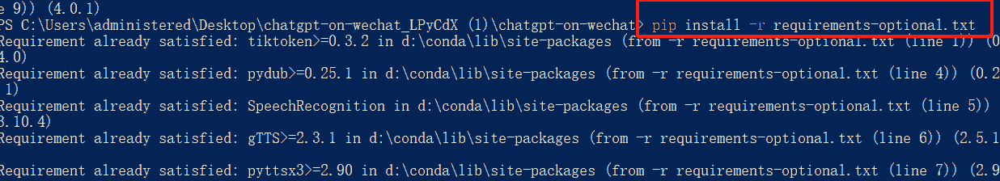

12、上边的都执行完成后，关闭窗口。在当前目录下，找到config-template.json文件。如下图：

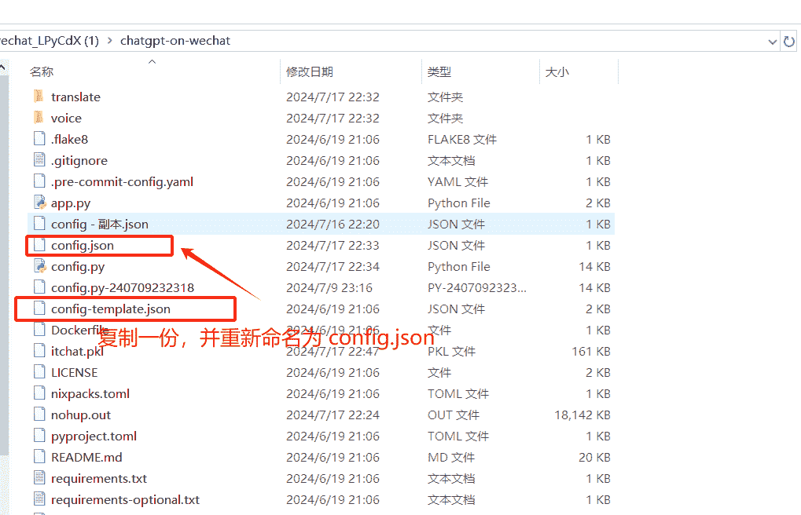

13、新生成的便是配置文件，右键-- 使用记事本 打开这个文件，我画红框的地方是需要修改的地方。

*** 因为这个地方对格式和符合要求比较严格，**如果是小白，建议你直接复制我下方的配置。

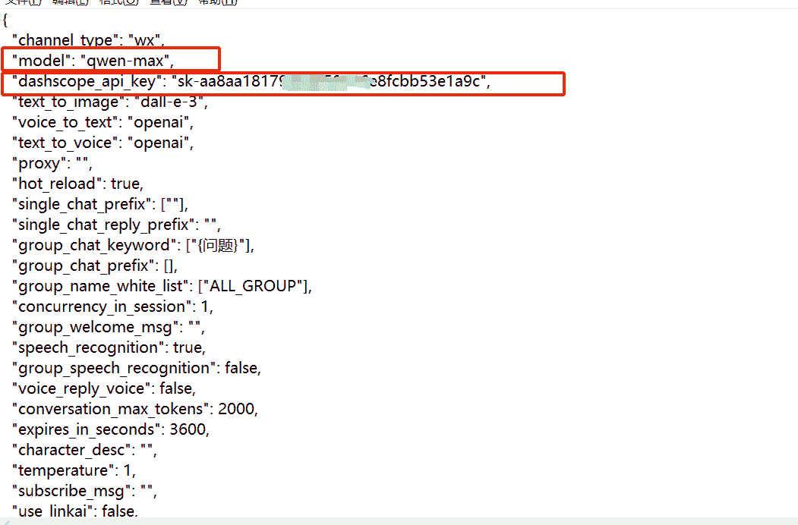

14、

+   删除新文件里的所有代码。

+   复制下边的代码，粘贴到文件里。

+   找到第4行，把一开始就让你注册并保存好的千问API key，粘贴到双引号里。

+   这也是你唯一需要修改的地方。修改完之后，点击保存，关闭文件。

```
{
  &quot;channel_type&quot;: &quot;wx&quot;,   
  &quot;model&quot;: &quot;qwen-max&quot;,
  &quot;dashscope_api_key&quot;: &quot;sk-改成你刚才拿到的key&quot;,
  &quot;text_to_image&quot;: &quot;dall-e-3&quot;,
  &quot;voice_to_text&quot;: &quot;openai&quot;,
  &quot;text_to_voice&quot;: &quot;openai&quot;,
  &quot;proxy&quot;: &quot;&quot;,
  &quot;hot_reload&quot;: true,
  &quot;single_chat_prefix&quot;: [&quot;&quot;],
  &quot;single_chat_reply_prefix&quot;: &quot;&quot;,
  &quot;group_chat_keyword&quot;: [&quot;{问题}&quot;], 
  &quot;group_chat_prefix&quot;: [&quot;@bot&quot;], 
  &quot;group_name_white_list&quot;: [&quot;ALL_GROUP&quot;],
  &quot;concurrency_in_session&quot;: 1,
  &quot;group_welcome_msg&quot;: &quot;&quot;,
  &quot;speech_recognition&quot;: true,
  &quot;group_speech_recognition&quot;: false,
  &quot;voice_reply_voice&quot;: false,
  &quot;conversation_max_tokens&quot;: 2000,
  &quot;expires_in_seconds&quot;: 3600,
  &quot;character_desc&quot;: &quot;&quot;,
  &quot;temperature&quot;: 1.0,
  &quot;subscribe_msg&quot;: &quot;&quot;,
  &quot;use_linkai&quot;: false,
  &quot;linkai_api_key&quot;: &quot;&quot;,
  &quot;linkai_app_code&quot;: &quot;&quot;
}
```

15、保存上述文件，然后在当前文件下，找到plugins/godcmd文件夹，复制config.json.template重命名为 config.json

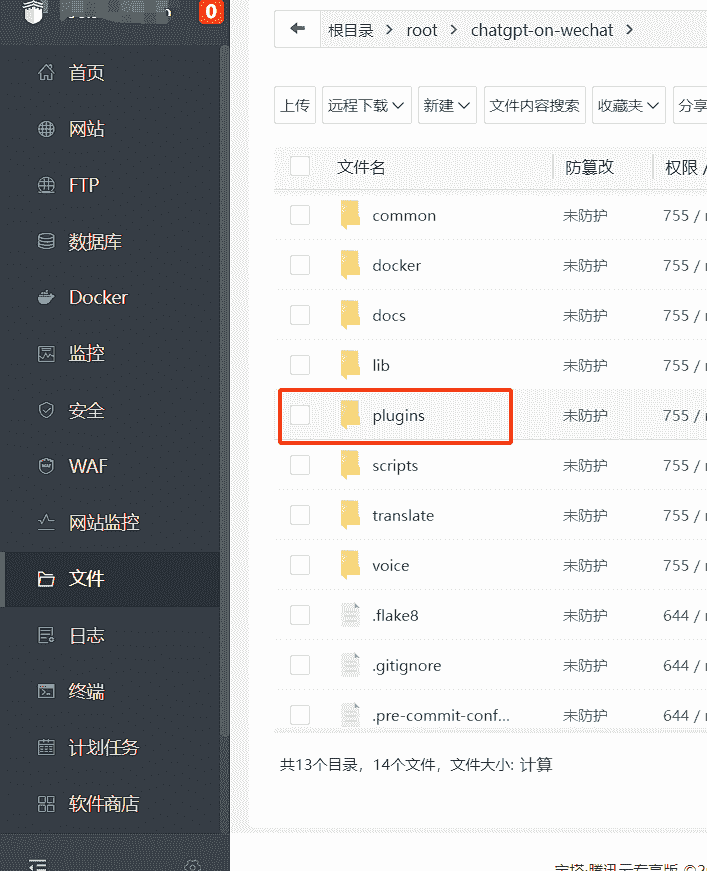

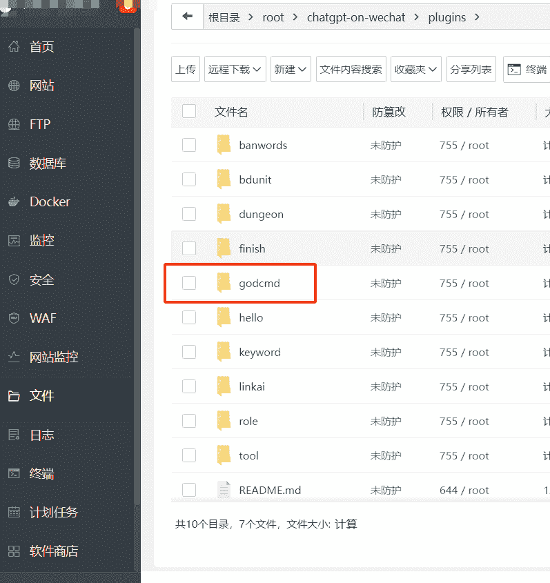

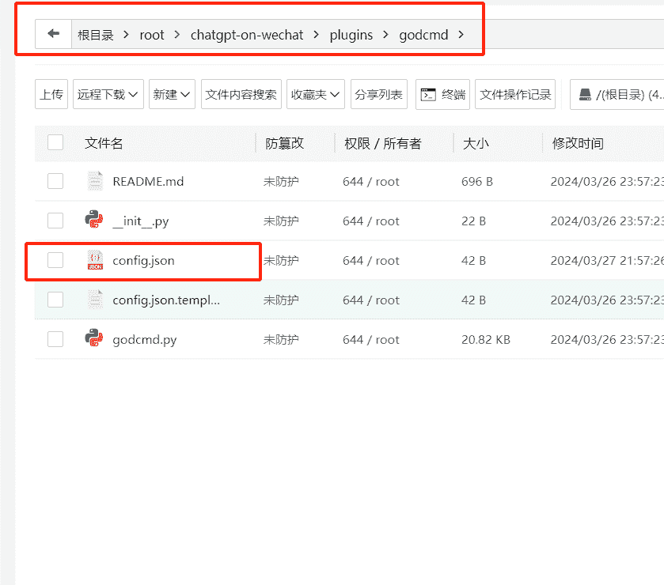

16、双击config.json，进入后，设置下你的password和admin_users

可以设置为和我一样的，后边再改，点击保存后关闭。

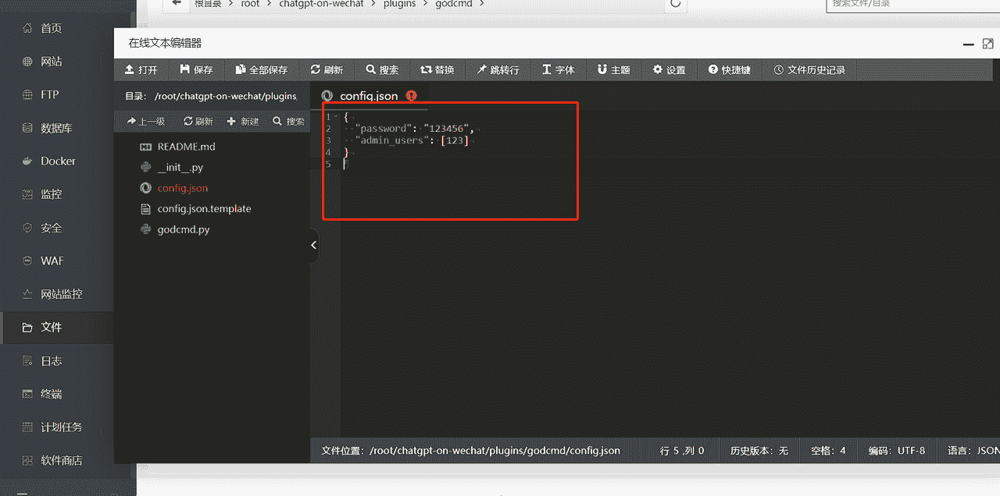

17、重新回到chatgpt-on-wechat/这个文件路径下，空白处右键，打开Powershell里复制粘贴进入：

python app.py

然后将会弹出二维码，扫码登录即可。

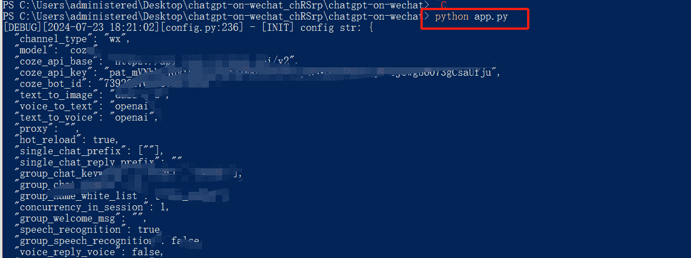

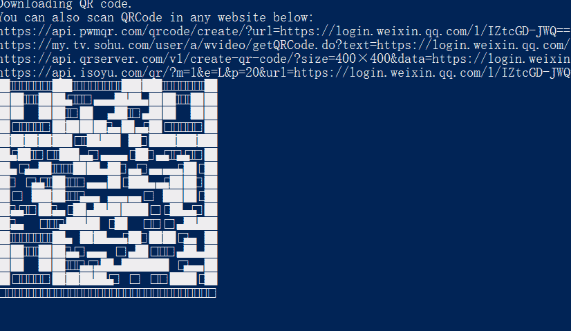

18、注意：

（1）程序将在你的电脑本地运行，假如你关掉了窗口，那么进程也就结束。所以，如果你想让AI持续使用，就必须保持窗口打开和运行。

（2）如果你发现突然不管用了，你可以点击一下窗口，然后点一下空格。 因为在选中状态下，powershell窗口是不继续执行的。

（3）其他操作与服务器部署的操作一致。

（4）参加机器人比赛的，可以参考其他教程，自行更改配置。