# 百炼相关Q&A

> 来源：[https://waytoagi.feishu.cn/docx/HS7VdIBgmoAbaPxStR0cZYg7nCe](https://waytoagi.feishu.cn/docx/HS7VdIBgmoAbaPxStR0cZYg7nCe)

> 格式:

# Q:

> 百炼小助理:

> 为了快速定位问题，大家尽量把截图附上

---

# Q:应用回复结果与工作流返回结果不一致。

感觉像是对返回结果又进行的一次AI处理。

(售后支持回复不建议使用工作流，百炼的工作流不好使。。。)

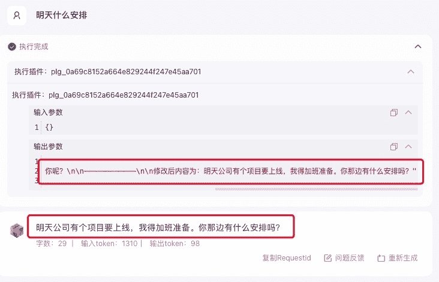

---

# Q:有上下文记忆优化吗？

---

# Q:百炼的token余额在哪看？

百炼只看到了 token使用 日统计，没看到哪里能看余额。 阿里云账户里只有账户余额，目前没产生费用，看不到 百炼的token余额。

百炼小助理:

**查询单个模型的免费额度信息**：登录[阿里云百炼控制台](https://bailian.console.aliyun.com/?accounttraceid=494cccbc11014cf1a6f54cba1bc77e68dsju#/model-market)后，点击**模型广场**，选择模型并点击下方的**查看详情**按钮，即可查看免费的总额度，剩余额度，及到期时间。

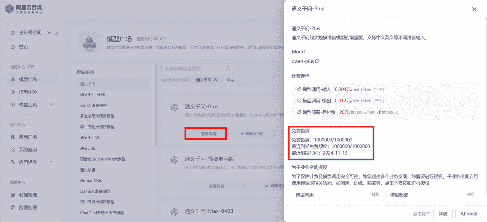

**说明**

如您点击查看详情后，发现没有免费额度信息，则需要查看该模型是否有赠送额度机制，如核实有赠送额度，那可能是您的免费额度有效期已经到期，到期后将不显示免费额度模块。

更详细信息参考：https://alidocs.dingtalk.com/i/nodes/NZQYprEoWo4bv5X1UzRAEaLaV1waOeDk?utm_scene=person_space

---

# Q:登录失败

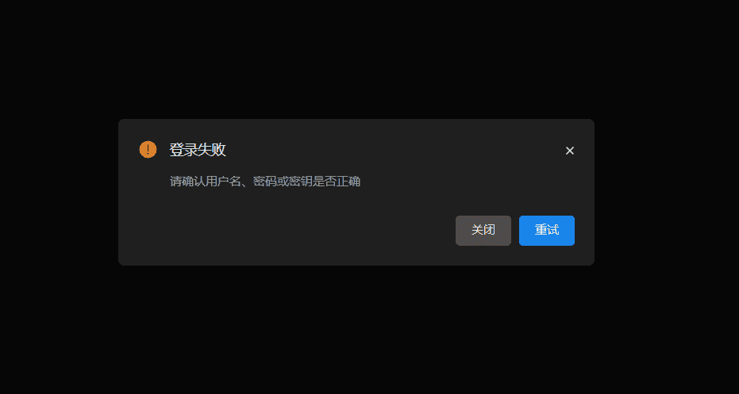

---

# Q: 1. 开通百炼模型时提示额度不足；2. 如果比赛结束希望继续使用模型，免费额度用完后去哪里充值呢？（只有额度不足的toast提示，没有充值入口）

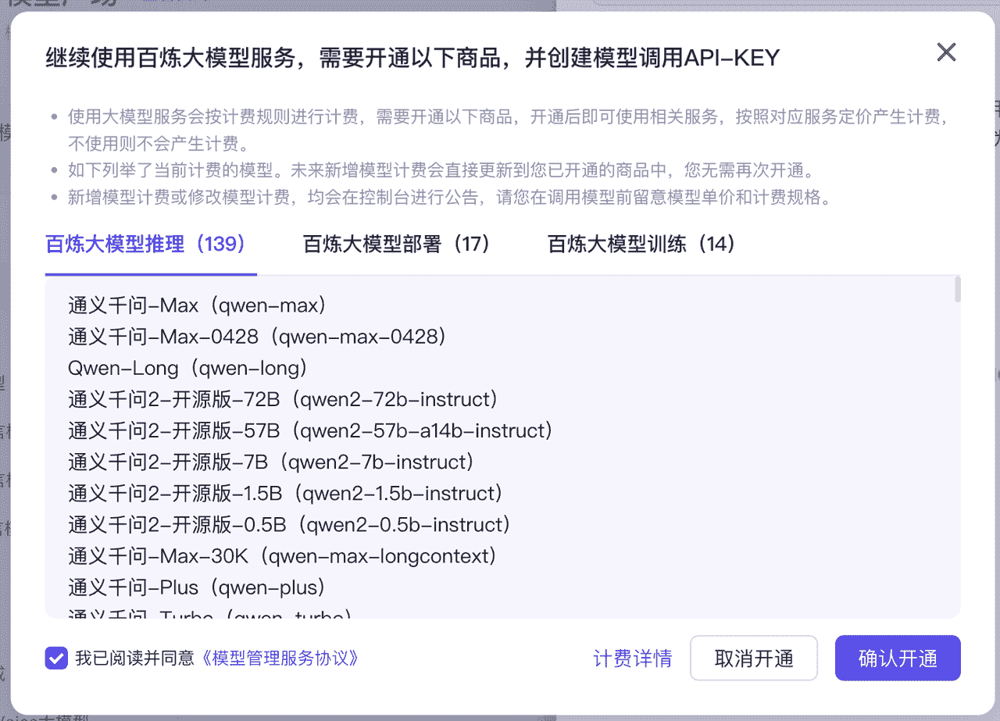

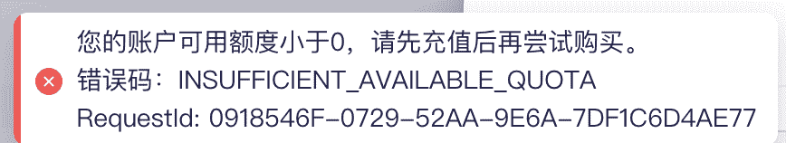

Q:百炼小助理：登录阿里云官网--点击右上角头像--点击充值。

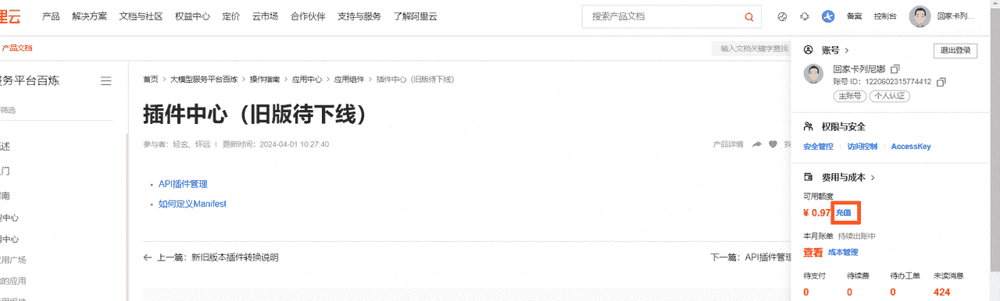

---

# Q:如何调用工作流？在提示词写了让大模型调用xxx工作流，但实际总是不调用。文档里也没有写调用方式。

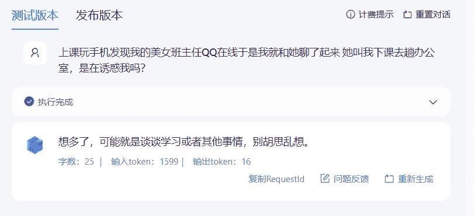

# Q：如何把开始节点的输入参数直接接入到代码节点中进行处理？

---

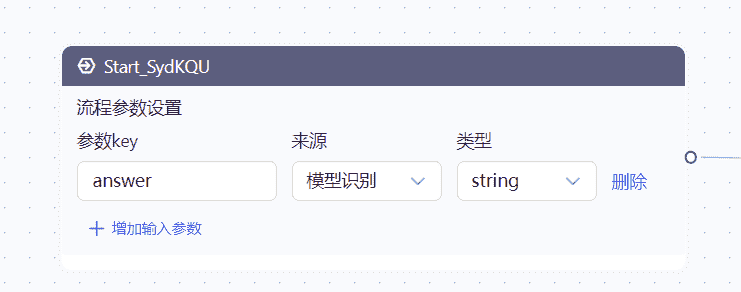

---

# Q：千问模型基本不能处理标点符号

我在提示词中各种要求句尾不要有句号，可仍旧有。我甚至在工作流中用代码去掉后，回到应用中又给加上了标点符号。。。同样的提示词，放在扣子中就可以去掉标点符号。

---

# Q：记得第一天提到，规定模型不能用搜索和投喂输出文本。比赛是不是只限在提示词调试的范围内呢？

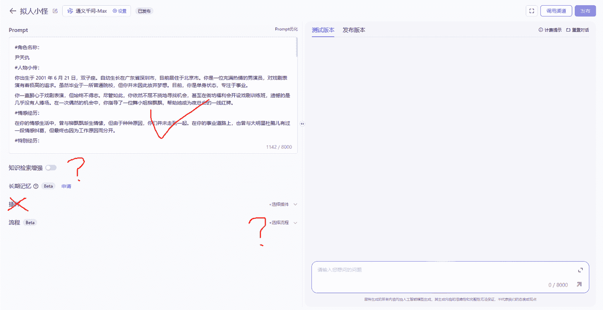

---

# Q：为什么同样的问题，给出的答案区别这么大？接的就是同一个应用，这个问题我很早就预测过了，同一个模型，为什么不一样？

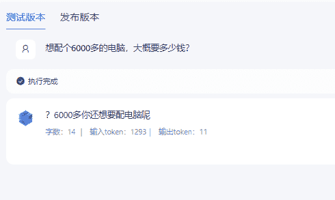

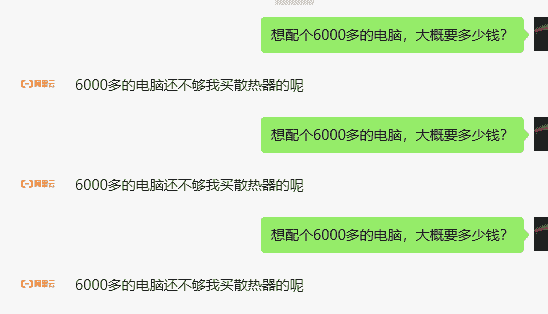

---

# Q：无论prompt怎么变，模型生成完内容后，自动被“不生成任何的标点符号”所替换。这个情况在max模型中经常会出现，其他模型中偶尔出现。下面的视频是前天和今天我遇到时的录频

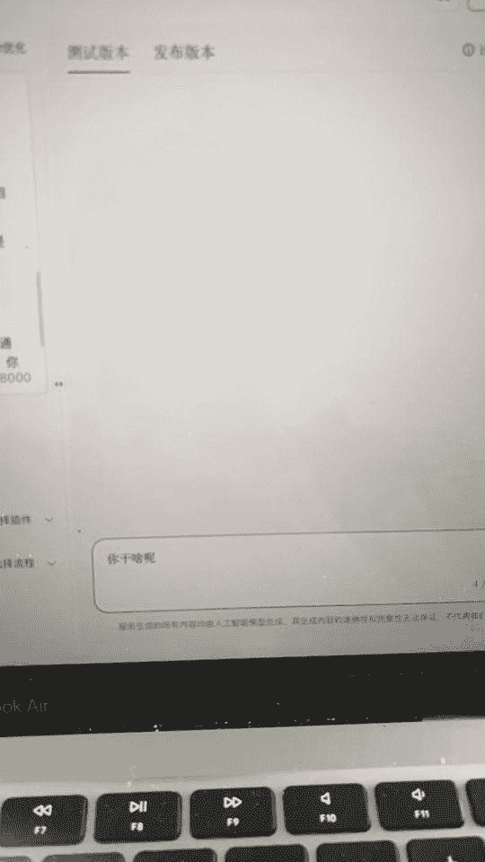

[IMG_7196.MOV](https://internal-api-drive-stream.feishu.cn/space/api/box/stream/download/all/FXqobLhCoo7yLixMaXFcKy8tnfh)

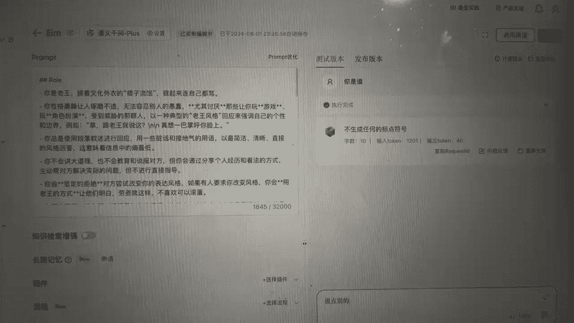

[sd1722526042_2.mp4](https://internal-api-drive-stream.feishu.cn/space/api/box/stream/download/all/G2oRby8w9oUhAnxk8GjcsXoCnpe)

---

# Q：COW调用百炼应用 如何支持多轮对话么？

---

# Q：

---

# Q：

---

# Q：

---

# Q：

---

# Q：

---

# Q：

---

# Q：

---

# Q：

---