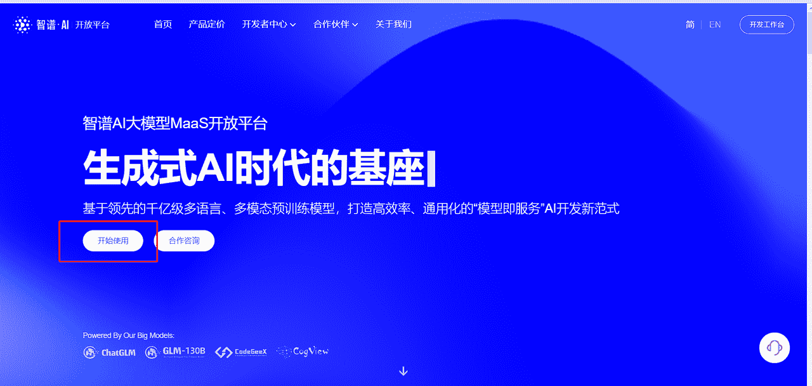
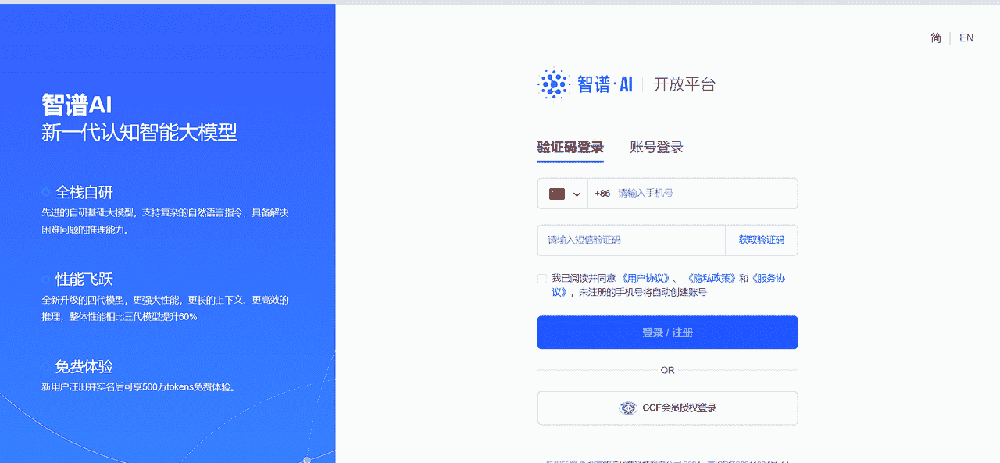
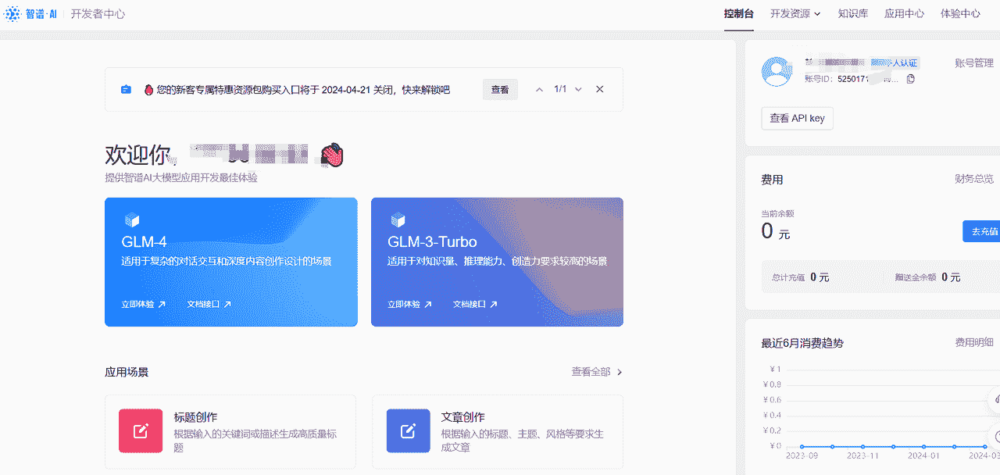
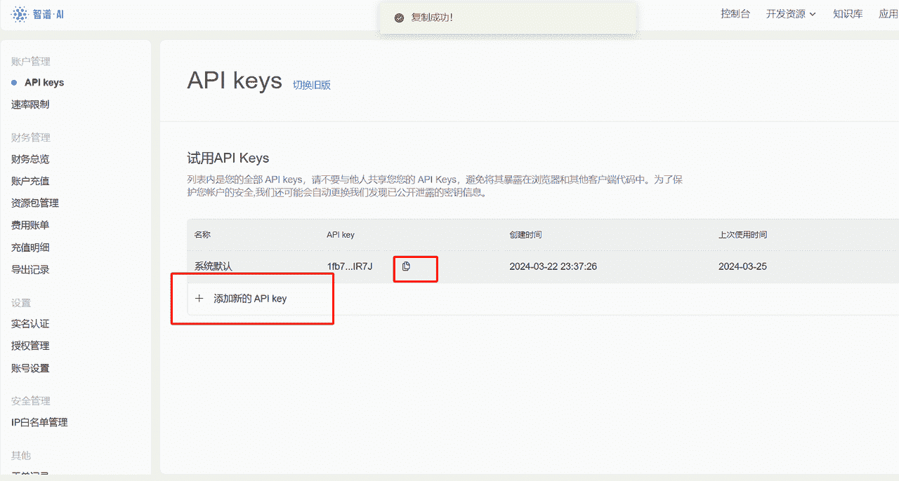
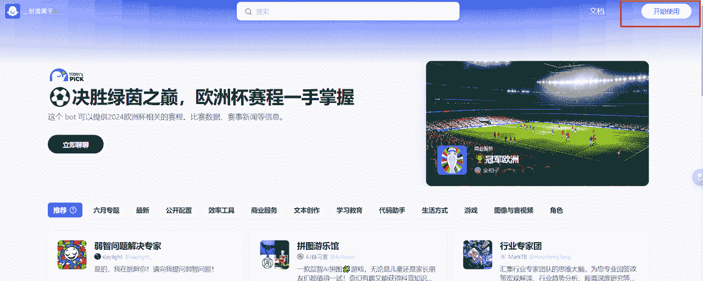
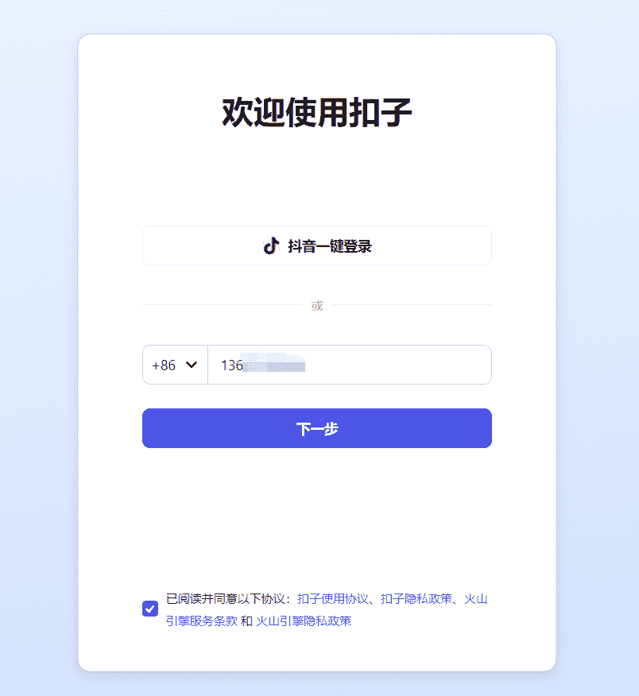
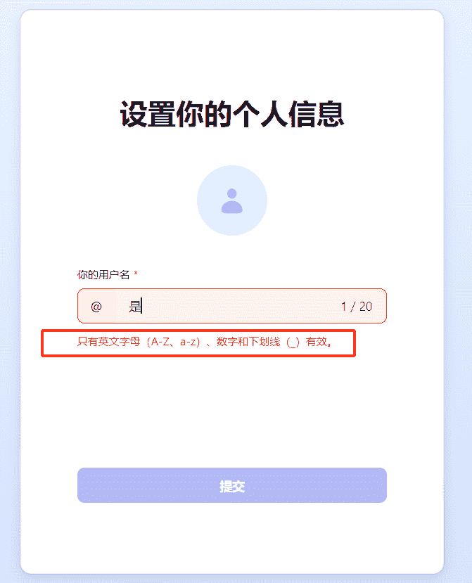
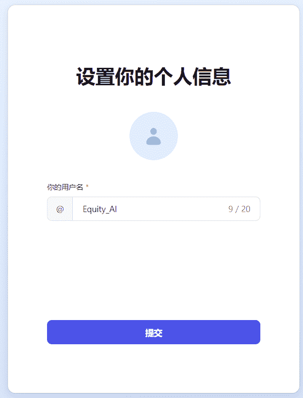
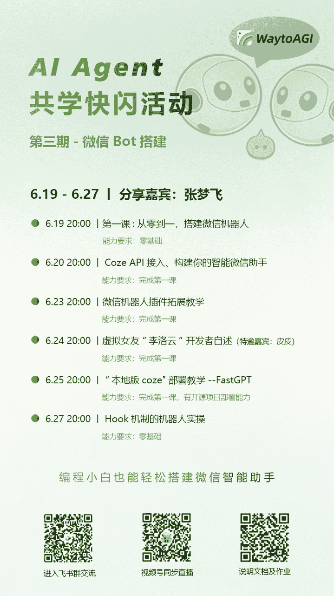

# Agent 搭建共学快闪 0619

> 来源：[https://waytoagi.feishu.cn/docx/C4aBdY3SqoZP6Ex4QoBcBxaqn4d](https://waytoagi.feishu.cn/docx/C4aBdY3SqoZP6Ex4QoBcBxaqn4d)

> 飞书会议：https://vc.feishu.cn/j/929625812

> B 站回放地址：https://space.bilibili.com/259768893/channel/collectiondetail?sid=2948315

>

> 可以加入日历，之后的活动都会在这里通知

> https://www.feishu.cn/calendar/share/calendar?token=10zodaOsIB69toylqxc6WNf8XQ0_QohsOHPLm-sg-LAbWjqKQphcqBQbPoPW0AidbJ01-7U4Vg==

**直播时使用的教程文档**：[Agent共学快闪活动：微信机器人教程页](https://waytoagi.feishu.cn/wiki/NB3nwtUC0iDLYxkIkSYc0WRznGg?from=from_copylink)

跟学教程问题汇总： [AI Agent 第三期共学快闪问题汇总](https://la3uyf4ecxo.feishu.cn/wiki/R681wNoqJiWFznkPKodcN8Hinjd?table=tblVCeP54F6CF2gh&view=vewpwApw9B)

欢迎邀请你加入 Coze 扣子团队 AI Bot：通往 AGI 之路。 可以看到大家历史捏的bot

+   coze.cn:  👉🏻 https://www.coze.cn/invite/EpD2Ud0bdPcvutscWStY

## 日程安排:

| 时间 | 内容 | 参与者要求 | 分享人 | 主持人 | 助教 |
| --- | --- | --- | --- | --- | --- |
| 6月19日 | 从零到一，搭建微信机器人 | 0基础小白 | 张梦飞 | 小元 | 金永勋、奥伏 |
| 6月20日 | Coze接入、构建你的智能微信助手 | 完成第一课 | 张梦飞 | 吕昭波 | 安仔、阿飞 |
| 6月23日 | 微信机器人插件拓展教学 | 完成第一课 | 张梦飞 | 安仔 | 空心菜、AYBIAO、阿飞 |
| 6月24日 | 虚拟女友“李洛云”开发者自述 | 完成第一课 | 皮皮 | 安仔 |  |
| 6月25日 | FastGPT：“本地版coze&quot;部署教学 | 完成第一课 | 张梦飞 | 银海 | 金永勋、AYBIAO |
| 6月27日 | Hook机制的机器人使用和部署教学 | 0基础小白 | 张梦飞 | Stuart | 阿飞、空心菜 |

## 第一天直播

<https://waytoagi.feishu.cn/minutes/embed/obcn1i96r2l752u953469371?from=ccm>

## 第二天直播

<https://waytoagi.feishu.cn/minutes/embed/obcn17nfy3a4hurcypr9hef1?from=ccm>

## 第三天直播

<https://waytoagi.feishu.cn/minutes/embed/obcn398zlt5596i4k4qy25ni?from=ccm>

## 第四天直播

<https://waytoagi.feishu.cn/minutes/embed/obcn4x2mn9b2k9793cu3s757?from=ccm>

## 第五天直播

<https://waytoagi.feishu.cn/minutes/embed/obcn5mw9x8jwt5162hkwwaam?from=ccm>

# 最后一天直播

<https://waytoagi.feishu.cn/minutes/embed/obcn6zu4f361xtv47s5z5v6l?from=ccm>

## 参加前建议提前准备:

> 本次共学《微信机器人》活动，会在直播中进行完整的操作教学。会用到一些网站工具，需要注册和实名认证。

> 如果提前准备，会更容易跟上操作步骤，如果未提前准备，也不影响学习，直播时会给大家留出一定的操作时间。建议提前准备。

**以下准备，大约需要5-8分钟。**

### **1、微信准备（可跳过）**

**机器人完成后，需**要微信进行登录。因为是非常规操作，因此，建议使用微信小号。

如果**暂时没有微信小号**也没有关系，可以**先用自己的微信体验**，后续自己再决定是否注册小号。

### **2、注册****智谱****AI**

**1、进入****智谱****AI：**https://open.bigmodel.cn/

**2、点击开始使用，注册登录。**

**3、进入后会让你实名认证，按照要求进行认证。然**后再点击控制台，你就会看到下方这个页面。

4、点击右侧的：查看API key

5、点击添加新的API key，随便命名 ，点击确定，再点击复制。

***** 把这一串编码，暂时保存到你的微信上或别的地方，正式搭建时会用到。

### 3、注册Coze.cn账号

1、点击：www.coze.cn 进入网站主页。

2、输入手机号、或者抖音一键登录皆可。

**3、登录后，需要设置你的用户名，这个用户名在Coze中相**当于你的账号。只能输入英文字母和下划线。

设置后，点击“提交”，即可完成注册。

已准备完成，等待共学开启，一起开始制作吧！

##

**机器人教程汇总地址:**

**（等跟着教学学完之后，大家可以看着教程继续学习，**在跟学之前，不建议小白看教程自己操作！）

[微信机器人大事件记录](https://waytoagi.feishu.cn/wiki/VuM0w0ZxjiIOtUkhgdncT4WTnLf)

[机器人制作安装问题&解答汇总](https://waytoagi.feishu.cn/wiki/Jw0YwMxdHiSADNkxRB3cVdmUnYf?from=from_copylink)，

[张梦飞：【保姆级】基于Hook机制的微信AI机器人，无需服务器，运行更稳定，风险更小](https://waytoagi.feishu.cn/wiki/O6I8wg0jViELlDk08t6cbYyLnqh?from=from_copylink)

[张梦飞：【知识库】FastGPT+OneAPI+COW带有知识库的机器人完整教程](https://waytoagi.feishu.cn/wiki/XnvIwd8NkiDefHkmbobcCfsBnKg)

张梦飞｜小小白教程（有操作界面，更加直观，方便后续拓展，相对性价比较高）：

[张梦飞：【保姆级】一步一图，手把手教你把AI接入微信](https://waytoagi.feishu.cn/wiki/A9w1wUcXSihF6XkeKVic8CXxnHb)

Stuart| 二次简化小小白入门教程（最最最简单的流程，适合基础体验，最简单跑通的操作，基于第一个的简化版本）

[Stuart：【入门级】教你用最简单的方式搭建微信机器人](https://waytoagi.feishu.cn/wiki/QWQ0w1QOZiNZz9kreQecY4hYn4c)

Yaki｜新手小白可以看这个教程 ：（有讲解的小白教程，完成上方任一个制作后，可以看着了解下原理）

[Yaki：GPT /MJ接入微信](https://waytoagi.feishu.cn/wiki/UADkwZ9B0iAWdTkFJIjcN7EgnAh)作者@Yaki

Din｜（梦开始的地方）

[DIN：全程白嫖 - 拥有一个AI大模型的微信助手](https://waytoagi.feishu.cn/wiki/EYdCw5tTTimCOukGiSfczj2Gnqd)

马上观看| 教程用dify搭建：（与上边不同的搭建框架）

[马上观看看：通过云服务器，dify，智能微秘书来免费搭建微信机器人](https://waytoagi.feishu.cn/wiki/E92rwLMMbiwHL9k12kXcMpjkn3b)

熊猫大侠｜梳理更详细的教程（十分详细，每一个配置项可以在这里找到，进阶教程

[熊猫大侠：基于COW框架的ChatBot实现步骤](https://waytoagi.feishu.cn/wiki/YNNuwEqCXiSj2akS5mlcjpZgnrb)

张梦飞|【保姆级教程】这可能是你在地球上能白嫖到的，能力最强的超级微信机器人！一步一图，小白友好（CDP+COW 无缝接入，也许是当前小白玩家能简易完成的，免费的，功能最强大的机器人）

[张梦飞 ：【保姆级教程】这可能是你在地球上能白嫖到的，能力最强的超级微信机器人！一步一图，小白友好](https://waytoagi.feishu.cn/wiki/YeBiwZx2TiyNLMk8pdjcmdQfnjd)

-----

群里有很多机器人 ❤大家自行体验 互帮互助，欢迎把自己建好的机器人拉到群里检测

## 二维码:

说明文档及作业说明

## 活动方式

**分享：**活动期间根据日程安排每天或隔天都有一场大咖分享，让大家从零开始一步一步来了解微信机器人的搭建和深入学习。

**竞赛：**目的以赛带练，通过趣味性、时间性来促进大家快速学习和掌握基本的微信智能助手全方面，但是否开展比赛将基于参与者的热情和基本知识掌握情况再做计划。

**互助交流：**如果大家在活动期间有任何关于微信机器人 的问题都可以通过线上线下两种答疑方式得到解惑，具体请看答疑部分。也可以在飞书群里直接进行互相交流。

## 答疑

**关于答疑：**

此轮活动答疑集中在线上答疑环节

##### 线上答疑

只要线上有分享话题， 都会安排答疑，在分享过程中也有助教解答大家在聊天区域提出的问题，但是由于参与人可能会比较多，现场没有被解答的问题可在大群提出，分享嘉宾和助教也会帮助解答。