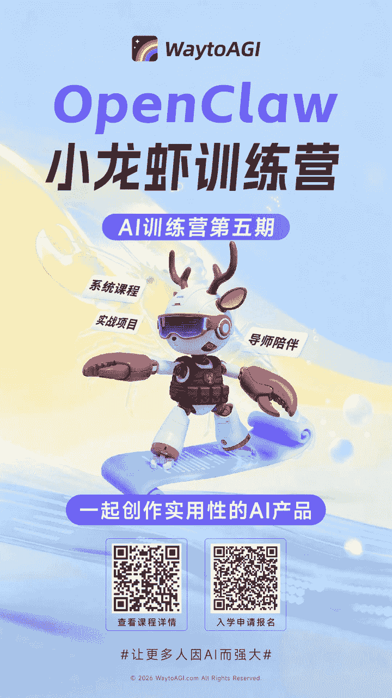
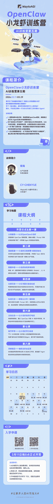
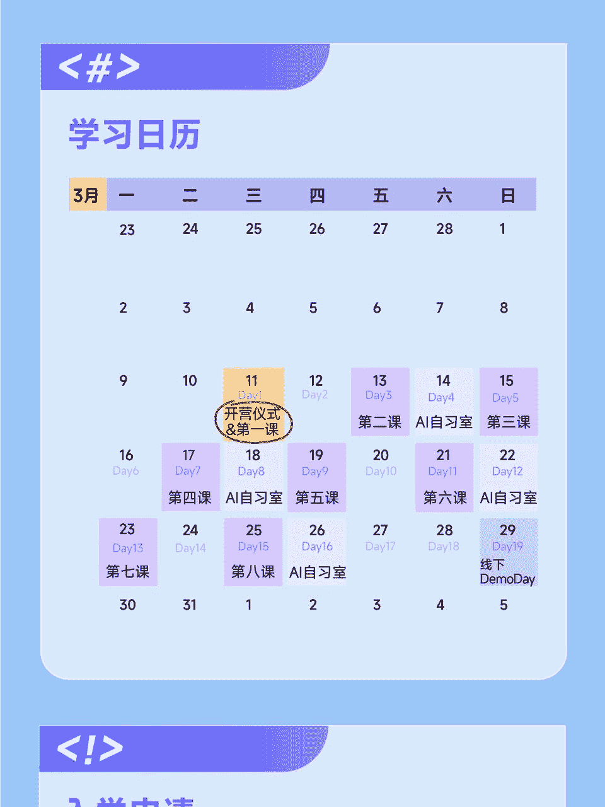

# 详解：OpenClaw

> 来源：[https://waytoagi.feishu.cn/docx/WqMOd7tHwolJk4xbo1AceyMmnWT](https://waytoagi.feishu.cn/docx/WqMOd7tHwolJk4xbo1AceyMmnWT)

# 3月11日晚8点正式开营[第五期：小龙虾OpenClaw训练营](https://waytoagi.feishu.cn/wiki/YIeJwZDv8iwYA6kmiPvcBwcynac)

> 小伙伴们可以通过阿里云百炼Coding Plan 来部署：

> 首购低至 7.9 元，续费 5 折起，支持Qwen3.5、Qwen3-max、Qwen3-coder、GLM-5、GLM-4.7、Kimi-k2.5等模型

> 👉戳链接直达：https://t.aliyun.com/U/0iiOuy

> 👉查看详细部署教程：https://t.aliyun.com/U/MNkA9b

> 最多三步，即可拥有 7x 24小时在线、随时响应的AI助手

## 一、什么是 Clawdbot？

Clawdbot 是一款开源个人助手，可以运行在本地设备上（如 Mac mini、服务器等），也可以通过集成常用的聊天软件（WhatsApp、Telegram、iMessage、Slack、Discord 等）与用户进行对话与互动。它不仅仅是一个智能聊天机器人，还是一个强大的自动化工具，能够执行任务、管理日程、处理工作内容，甚至自主学习。

> **Clawdbot 就像把真正能“帮你做事的** AI 助手”搬进你平时用的聊天工具里。

> 你发一条 WhatsApp/Telegram/iMessage 消息，它不只是回答你——它能 看懂你说什么，还能自己去完成任务。这比传统只会“打字回应”的聊天机器人（ChatGPT、Claude）厉害很多。

> 比方说：

+   你通过聊天告诉它：“帮我整理邮箱里未读邮件并写一封回复给客户”，

+   它真的去 读取邮件、整理内容、自动写信、甚至发送（如果你允许的话）。

> **它不仅是“会回答”的机器人，**更像是一个 随时在线的数字助理/数字员工。

### **核心组成部分**

Clawdbot 的架构包含四个主要组件：

+   **Gateway（网关）**：负责与聊天平台通信。

+   **Agent（智能体）**：通过 AI 模型（如 Claude、GPT）处理任务和对话。

+   **Skills（技能模块）**：扩展功能，如浏览器自动化、邮件处理等。

+   **Memory（记忆系统）**：持续记住用户对话内容、偏好设置等。

## 二、为什么Clawdbot这么火？

### **超强理解能力**：

Clawdbot并不像传统的机器人那样只能回答简单问题。它通过深度学习、自然语言处理（NLP）等“理解”对话背后的含义，甚至能进行复杂的推理。比如说，你可以跟它讨论哲学、编程、或者讲一个故事，它都能给出合理、有创意的回应。

### **超强的创造力**：

这个机器人不只是会“查找”和“拼接”信息，它能根据你给出的指令创作内容。例如，你可以让它帮你写小说、写歌，甚至生成图像或视频。

### **多任务处理能力**：

Clawdbot可以同时处理多个任务，像一个多面手。比如，你可以让它做个时间管理计划、帮你写个商业计划书，或者提出技术建议，它都能快速响应，处理多任务并且效率高。

### **人性化的对话方式**：

和传统的AI助手不同，Clawdbot能更自然地模仿人类对话的方式。它不会显得“死板”，而是能够“理解”你的语气、情感甚至潜在的需求。这让它的交互体验更加丰富和人性化。

### **一个能自我改进的系统**：

Clawdbot基于自学习算法，会随着用户的交互不断进化，变得更聪明。它可以根据用户反馈进行调整，以便在后续对话中做出更精准、更个性化的回答。