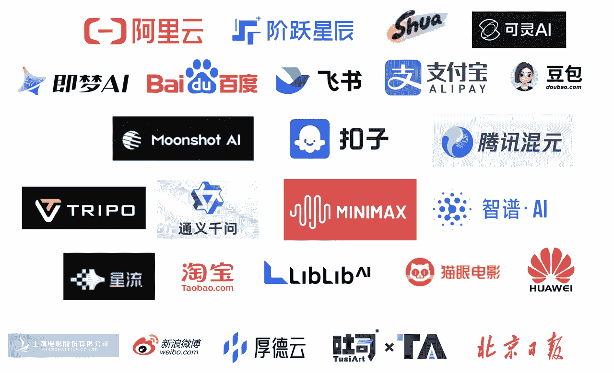
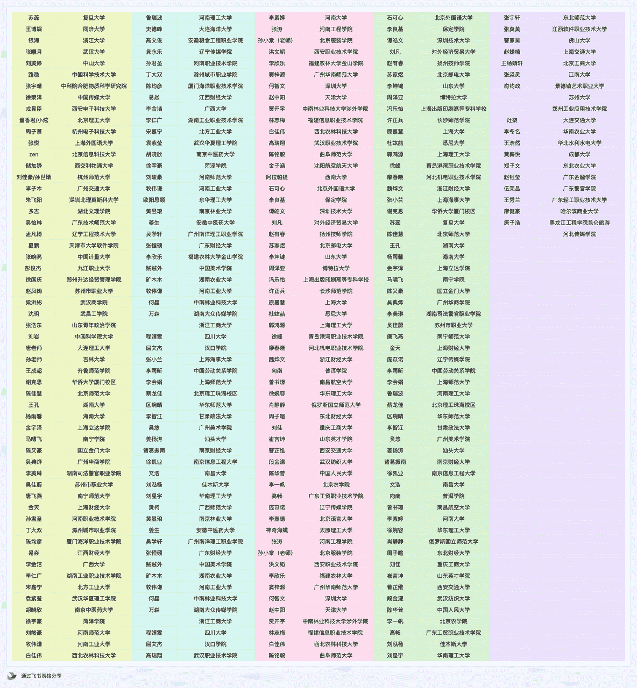

# WaytoAGI 高校板块

> 来源：[https://waytoagi.feishu.cn/docx/ItAidzMpXo8WNuxk8NockzmJnte](https://waytoagi.feishu.cn/docx/ItAidzMpXo8WNuxk8NockzmJnte)

> 欢迎来到 WaytoAGI 高校板块！本板块是为推动 AI 技术在高校场景的落地与普及而搭建，旨在为高校师生、AI 领域从业者及合作伙伴提供全面、系统、实用的 AI 进校园相关信息，助力构建高校 AI 生态，加速 AI 技术在校园的应用与创新。

> 如果你有意向挖掘有潜力的大学生，欢迎报名！

> https://waytoagi.feishu.cn/share/base/form/shrcnzx3fATuFLrCNlPhxQJ5AKe

# 一、高校核心板块

## WaytoAGI校园大使机制

### 校园大使招募

还在为找不到 AI 实践平台而发愁？想让校园生活与前沿科技深度绑定？WaytoAGI 校园大使社区等你来！我们以 “让 AI 走进校园，让成长可见可及” 为目标，打造了连接高校学子与 AI 资源、企业的专属桥梁。

在这里，你不再是 AI 浪潮的旁观者 —— 通过校园大使身份，你能第一时间接触 WaytoAGI的独家 AI 活动、训练营资源，还能与全国高校的 AI 爱好者并肩，成为校园里的 “AI 推广先锋”，让你的影响力被更多人看见！

**申请成为校园大使：**

https://waytoagi.feishu.cn/share/base/form/shrcnv7s9sYLfiC9MUIaxOdQrvg

成为校园大使，你能收获的远不止 “身份标签”！我们为每位大使带来实践证书、实习内推、项目奖金等多重激励，让你的付出有回报、成长有印记。在这里，你可以分享不同校园的 AI 活动案例，组队参与跨校 AI 创新项目，无论是想拓展人脉、提升技能，还是想为校园 AI 生态贡献力量，这里都是你的理想选择！

### 社区校园大使画像

#### **校园大使：**

#### **往期活动校园大使名单：**

### **校园大使计划**

> **定位&福利&规则详见：**[WaytoAGI校园大使计划](https://waytoagi.feishu.cn/docx/ApsVdsNHVoMESlx2IkkcnepCnvb?from=from_copylink)

## AI训练营

AI 训练营是 WaytoAGI为高校学生打造的实战型 AI 学习平台，本板块详细介绍训练营的课程体系、报名方式、学习模式、成果展示等内容，助力学生提升 AI 实践能力。

## 找到校园搭子

> 在2024年11月我们就依托第一届AIPO校园AI创投活动构建高校AI知识库网络，经过10个月的努力。

> 校园社群从最初的50所高校到现在覆盖海内外近200所高校；

> 高校专题社群学生总数突破2W+（不包含常规社群学生群体）。

> **填写问卷直达高校社群：****h**ttps://waytoagi.feishu.cn/share/base/form/shrcnxXIvUKdb8mSj00nFhKH51g

> 查询不到高校➡️报名校园大使成为高校第一个社区的推动者

## 了解高校活动

#### 往期活动画册

多维表格（Te3AbMVQjaxaydsttoVctNXLnSq_tblP5ucaGtV6F2WG）

# 二、知识库使用指南

1.  **信息查询**：用户可通过知识库首页的导航栏，直接进入各个核心板块，也可通过搜索框输入关键词（如 “校园大使招募”“AI 训练营报名”“高校 AI 活动策划” 等），快速查询所需信息。

1.  **信息更新**：WaytoAGI 会定期更新知识库中的信息，包括新增校园大使招募信息、高校 AI 活动案例、AI 训练营课程内容、专项高校社群动态等，用户可关注知识库的更新通知，及时获取最新信息。

1.  **问题反馈**：若用户在使用知识库过程中遇到问题，或对知识库内容有建议，可通过知识库首页的 “问题反馈” 通道提交反馈信息，WaytoAGI 工作人员会及时处理并回复。

# 三、合作&介绍-联系我们

**更多信息：**[WaytoAGI校园资源介绍](https://waytoagi.feishu.cn/wiki/X5qywXYXrifAOpkovzjcfgvXnPe?from=from_copylink)

如果您对 WaytoAGI AI 进校园知识库有任何疑问或合作需求，欢迎通过以下方式联系我们：

+   官方网站：[WaytoAGI.com](http://waytoagi.com/)

+   联系人：

+   电子邮箱：🌈咖啡 <waytoagi@waytoagi.com>

WaytoAGI 致力于打造专业、全面的 AI 进校园知识库，为高校 AI 生态建设贡献力量，期待您的关注与支持！