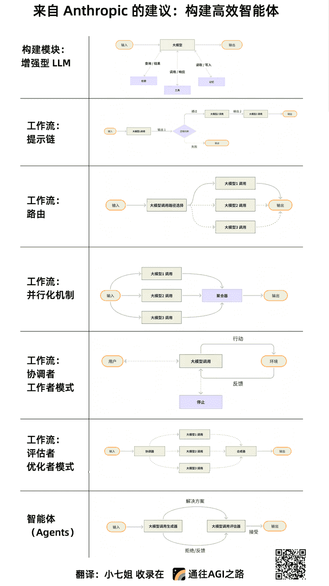

# 1.3  AI Agents (智能体)

> 来源：[https://waytoagi.feishu.cn/docx/FgO8doR9Yob87YxIpGQcIBJ2nme](https://waytoagi.feishu.cn/docx/FgO8doR9Yob87YxIpGQcIBJ2nme)

## 学习路径

https://lilianweng.github.io/posts/2023-06-23-agent/

[学习路径: 基于Agent的创造者](https://waytoagi.feishu.cn/wiki/QSVJwSkMfijmeZkcUSnckVXhnnd?from=from_copylink)

# 社区Agent开发者榜单

🎉 欢迎提交需求并联系合适的开发者合作。

<https://waytoagi.feishu.cn/share/base/view/shrcnHK6IYhlhajsqPTuc1ItJrd?iframeFrom=docx&ccm_open=iframe>

# Agent板块内容

## 共创Bot试玩

<https://waytoagi.feishu.cn/sync/LBczdKUfjsDwOEbdYrscLzznnAh>

## 应用场景

---

## 🙋🏻‍♀️ 友情链接

更多 AI 相关的实践、模板欢迎来飞书了解~

<https://www.feishu.cn/community?from=AGIknowledge>