# 1.6 AI 音乐

> 来源：[https://waytoagi.feishu.cn/docx/YwmMdoKi0okA2CxFP9fcNLQRnIh](https://waytoagi.feishu.cn/docx/YwmMdoKi0okA2CxFP9fcNLQRnIh)

你好👋 Hi！这是一个共享编辑文档，欢迎大家分享自己喜欢的AI音乐。

---

> **Suno**[**教程**](https://waytoagi.feishu.cn/wiki/SxuWw6zrIilDV1kdJV3cTTaznMg?from=from_copylink)[**→**](https://waytoagi.feishu.cn/wiki/SxuWw6zrIilDV1kdJV3cTTaznMg?from=from_copylink)

> [**Udio教程 **](https://waytoagi.feishu.cn/wiki/TyM6waWxlizrJSk5Lg5cYFExn4g?from=from_copylink)[**→**](https://waytoagi.feishu.cn/wiki/TyM6waWxlizrJSk5Lg5cYFExn4g?from=from_copylink)

> [**音乐资讯**](https://waytoagi.feishu.cn/wiki/UD4uw9qmYiKW9kkxNeXcUDCbnog)[**→**](https://waytoagi.feishu.cn/wiki/UD4uw9qmYiKW9kkxNeXcUDCbnog)

> ** **[**创作案例→**](https://waytoagi.feishu.cn/wiki/AahewcMOBiIQ9vks1XzcVaNange)

> [**风格流派**](https://waytoagi.feishu.cn/wiki/A9iZwWHhZiF88tk5SoDc6yVsnAc?from=from_copylink)[**→**](https://waytoagi.feishu.cn/wiki/A9iZwWHhZiF88tk5SoDc6yVsnAc?from=from_copylink)

以上是大家共建的教程，案例，以及音乐知识，可以快速导航

---

AI 音乐共建者

> **使用方式**

> 这个文档大家可以贴上自己喜欢的音乐或者投稿自己的教程

> 定期会组织音乐交流会

> 社群中可以实时交流音乐相关创作作品和经验分享

**加入AI音乐板块社群**

---

+   至少有一首以上的 AI 音乐作品

+   添加AAAAAAAJ备注音乐

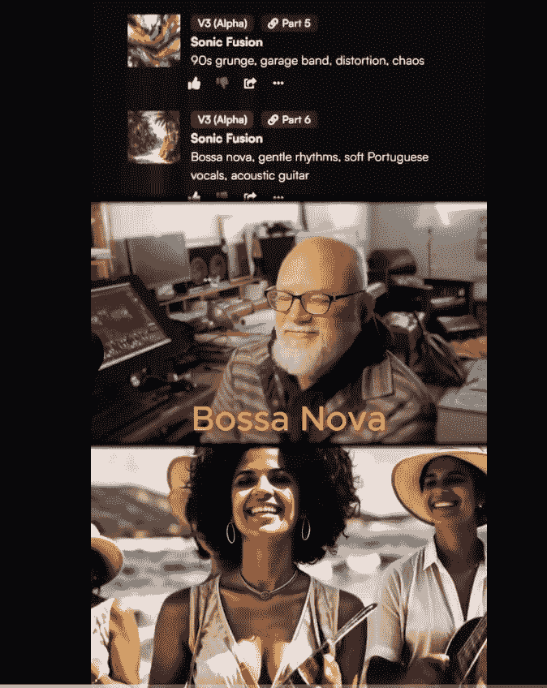

[

😃 ](https://bytedance.feishu.cn/docx/doxcnJvUY8zVwdG8rcrFARvf1vb)**近期活动**

+   **「在线音乐会」**** **网友出题，现场生音乐（时间待定）

+   **「Reaction」**收集AI音乐，大家一起欣赏，记录大家听到意想不到的好听的歌的反应（时间待定）

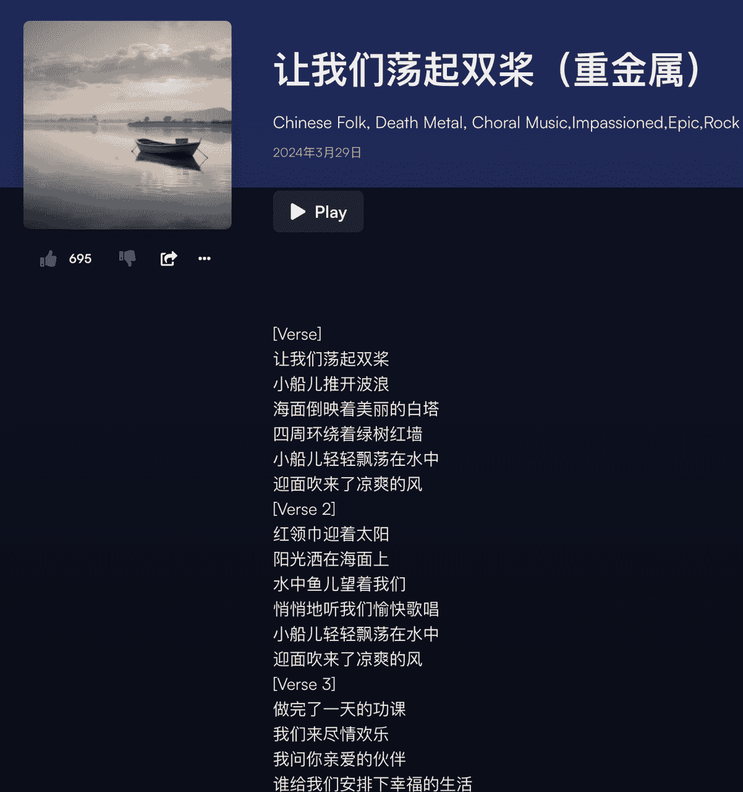

[**

🎉 **](https://wmkvl2j8ww.feishu.cn/docx/doxcnUbBXDjIibJNsa6207HmfDb)**贴上有趣的音乐**

+   你喜欢的音乐可以贴在文档下方

+   持续收集中

> [梁明晶：探索AI音乐，人人都能出专辑的时代来了！](https://waytoagi.feishu.cn/wiki/IoNTwuYGNiTtBCk6lcpchSn0n6c)

> [新诗新声：新诗音乐化前景展望](https://waytoagi.feishu.cn/wiki/FEihwOtbsidfjCk6pb1cWixSnQs)

> [大峰：AI音乐创作全流程解析《梦回温州》AIMV荣获AI金曲奖并获央视推荐！](https://waytoagi.feishu.cn/wiki/WJ7JwGRnoi3luMkoyMDcsUSWntc)

> [群友接龙做成一首歌](https://waytoagi.feishu.cn/wiki/C5FBw8ePAiCcgTkglX7czG7pnvb)

> [元：小白的Suno探寻笔记](https://waytoagi.feishu.cn/wiki/X9gSwxjA2ijeLnkOY8ucdVk6nxb)

> [张吃吃：AI歌手| ACE Studio入门教程及工作流分享](https://waytoagi.feishu.cn/wiki/R98Qw2sZfijiIYkHKIic0yvynPb)

> [KEEN：Suno AI 创作案例复盘](https://waytoagi.feishu.cn/wiki/IlaEwkImMiAJtFksvfLcissMn3e)

> [十三：AI 音乐获奖作品解析春潮带福来](https://waytoagi.feishu.cn/wiki/I4wnwJA2AiZeWwkIbTVct0JOnnb)

> [金属文：AI春晚《西游不能停》创作过程分享](https://waytoagi.feishu.cn/wiki/TdmXwHgd2i9W1dkwlz2c0JHhnFc)

> [音乐人聊AI ：Suno时代，音乐行业需要焦虑吗？](https://waytoagi.feishu.cn/wiki/LXlywX9ZBiw9o5kOKTtcwouunpg)

### 《PROMPTS FOR AI DANCE MUSIC》

[《PROMPTS FOR AI DANCE MUSIC》](https://waytoagi.feishu.cn/wiki/NSKGwclQNig6INkGWkKcsLQNnRb)

音乐大佬@mista.lewys @normalgoodz / Lewys C. G. Evans发在SUNO.WIKI的PROMPTS BOOK

格林用GPT把内容都翻译和扩展完了

做了还简单明了的入门介绍

## 7大类

[流派标签｜Genre Tags](https://waytoagi.feishu.cn/wiki/MTNrwrpe7iKigJkVCCycjpKFnSd)

[节奏标签｜Tempo Tags ](https://waytoagi.feishu.cn/wiki/KU1qwqoOziT8BCkkXVCc72pbnsc)

[风格提示词｜STYLE PROMPTS](https://waytoagi.feishu.cn/wiki/MhQCw6PKJiGdx7kjTBHcKFBsnob)

[108个舞蹈音乐提示词｜108 PROMPTS FOR AI DANCE MUSIC](https://waytoagi.feishu.cn/wiki/Tt5MwUDQmiuuDekejIzcYDPjnjr)

[电子音乐提示词｜BONUS TECHNO PROMPTS](https://waytoagi.feishu.cn/wiki/LNKUwYcGHiiaTIkcCr2cbdfunGc)

[歌词提示词｜BONUS LYRICAL PROMPTS](https://waytoagi.feishu.cn/wiki/JBgwwWxBXii7Jekuf3xciNNjnTh)

[歌曲结构与编曲 | Musical Structure and Composition](https://waytoagi.feishu.cn/wiki/ZpqUw58kpirk3ikXhbIcDu9Inwg)

## 扩展内容

[常见乐器简介 | Overview of Common Musical Instruments](https://waytoagi.feishu.cn/wiki/Af5lwbEpTiZSdQkLIZIc464en2g)

[常用编曲结构介绍 | Common Arranging Structures](https://waytoagi.feishu.cn/wiki/DXMMwrw9wiS78kkBT6qcLEvhnNc)

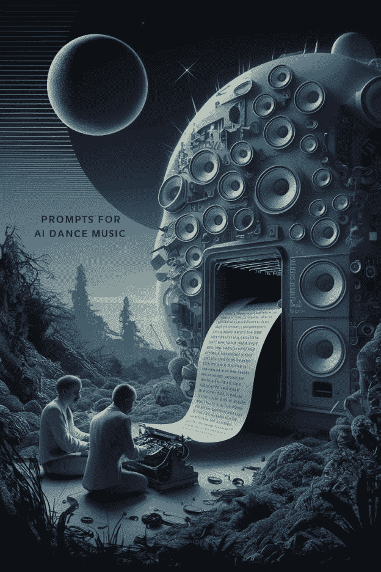

| **每个格子一个作品** |  |  |
| --- | --- | --- |
| 分享人JadeWu | 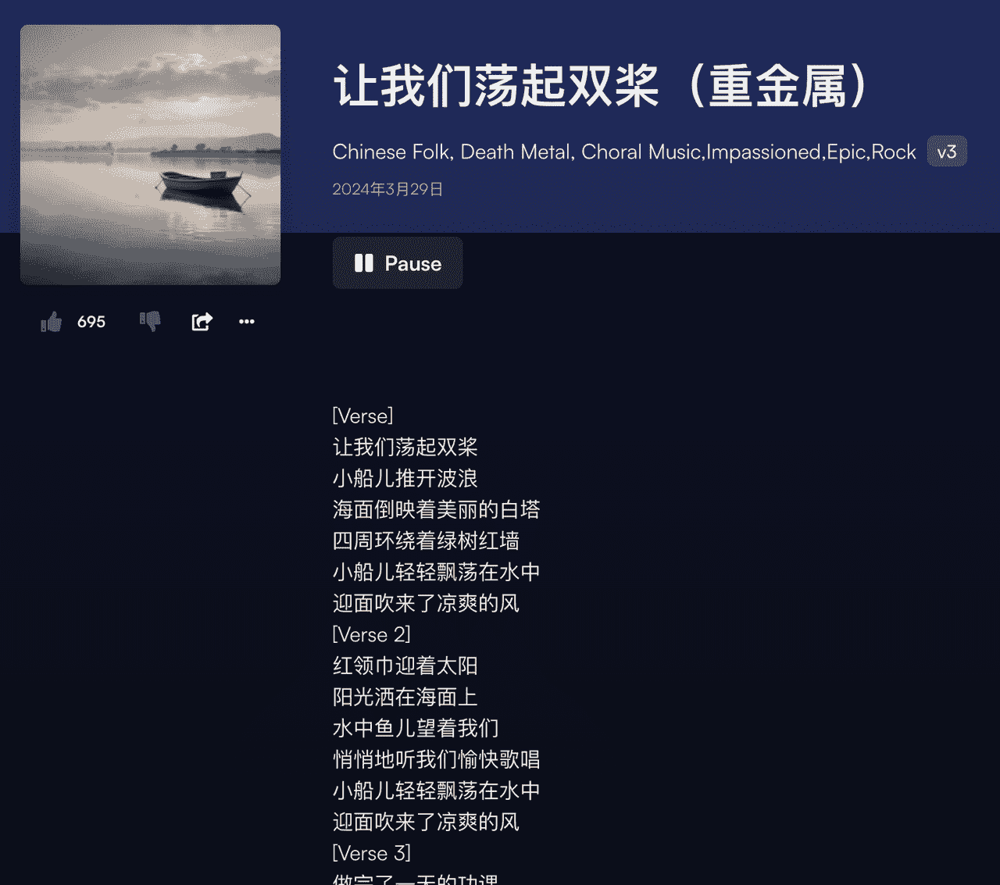 | 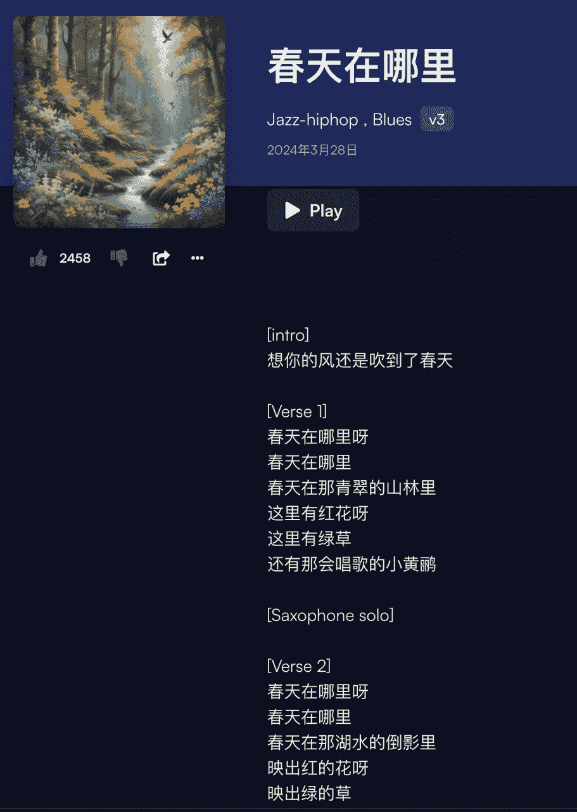 |
|  |  |  |
|  |  | 分享人：陈浚嘉/Kino |
|  |  |  |
| 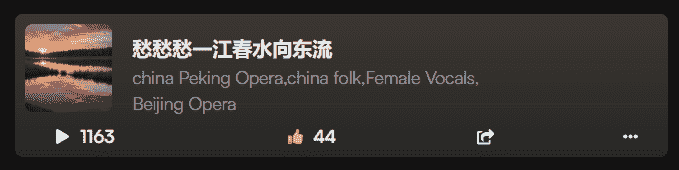 | 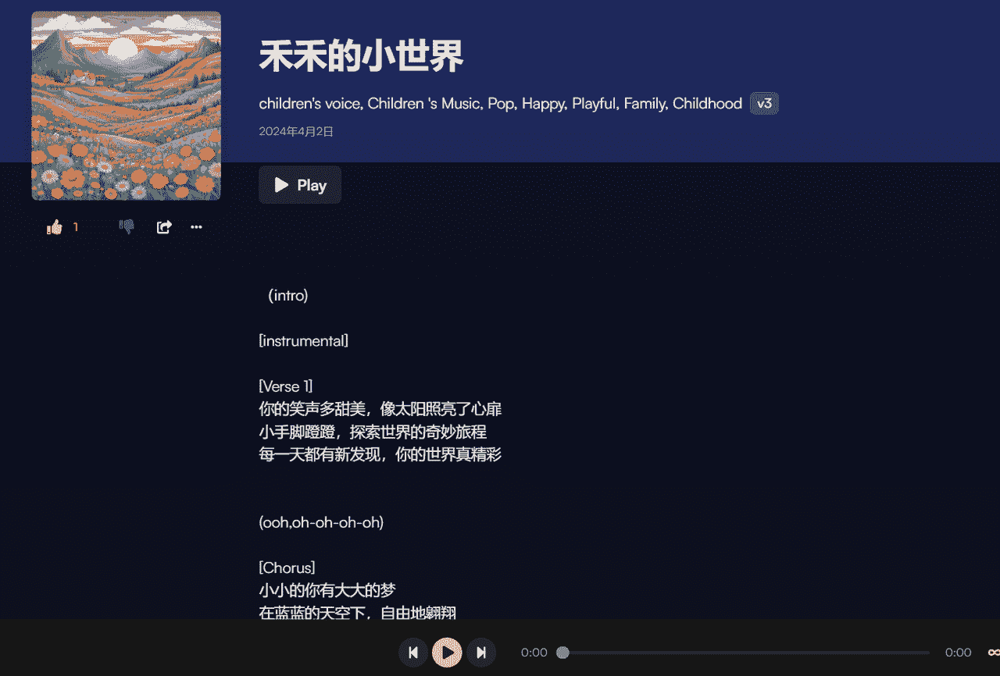 | 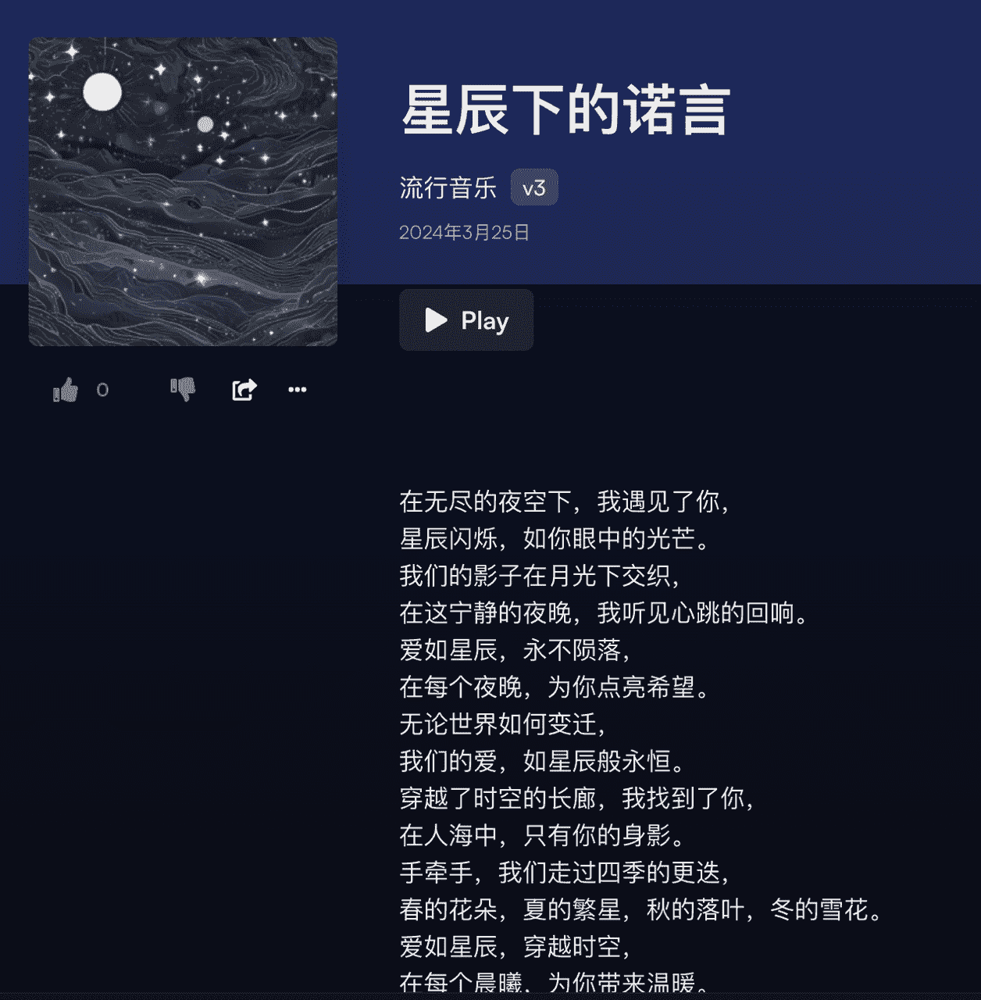 |
| https://suno.com/song/05d97cdb-3f5f-4e36-85d4-e308c99503fb |  |  |
|  |  |  |
| 单纯想给大家听听前面的四句封神 | 工具：suno |  |
|  |  |  |
|  |  |  |
|  |  |  |
|  |  |  |
|  |  |  |

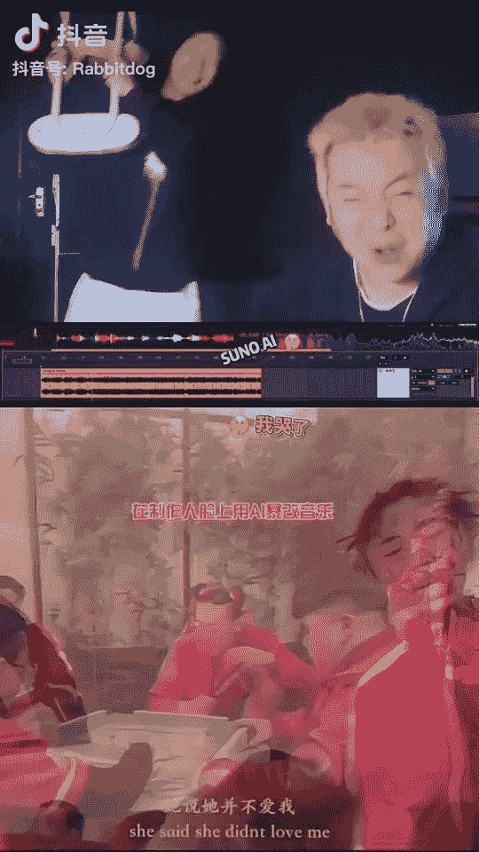

[5031_1711728270.mp4](https://internal-api-drive-stream.feishu.cn/space/api/box/stream/download/all/Ms6jbpcIvonAOIxbvXJcB4QAnYg)

[喵喵喵.mp3](https://internal-api-drive-stream.feishu.cn/space/api/box/stream/download/all/SY0BbLcJMoH5LexDbA2c9Uvfn7w)

[上学歌（house版）.mp3](https://internal-api-drive-stream.feishu.cn/space/api/box/stream/download/all/D509b4sy8o7oAPxgtD8cMQoGnKJ)

[上学歌（重金属版)  .mp3](https://internal-api-drive-stream.feishu.cn/space/api/box/stream/download/all/Hrcnb9DWpoNAVsxOGfucRT3ZnFd)

[上学歌（funk版）.mp3](https://internal-api-drive-stream.feishu.cn/space/api/box/stream/download/all/IYLeb90vZoJBSHxj65tcD0gYn0e)

[上学歌（jazz版）.mp3](https://internal-api-drive-stream.feishu.cn/space/api/box/stream/download/all/E6TlbECaioRJEsxJMS3cH2TnnL9)

[上学歌（朋克版） .mp3](https://internal-api-drive-stream.feishu.cn/space/api/box/stream/download/all/KrJabiScfoIsnoxxdBzcnQo4nYd)

[上学歌（bossa_nova版）.mp3](https://internal-api-drive-stream.feishu.cn/space/api/box/stream/download/all/DUI8bIJlqo0k1oxGn7kcsMe4ndh)

[上学歌（disco版）.mp3](https://internal-api-drive-stream.feishu.cn/space/api/box/stream/download/all/JUA9b5eVvoG0dCxm4kPcHFtKnHg)

[上学歌（雷鬼版）.mp3](https://internal-api-drive-stream.feishu.cn/space/api/box/stream/download/all/K2IebSfH4ohmRNx8CNMc4JTrnLd)

[上学歌（blues版）.mp3](https://internal-api-drive-stream.feishu.cn/space/api/box/stream/download/all/DDTFbFDAmovcQUx8kGmc3aVSnFd)

[上学歌（pop版）.mp3](https://internal-api-drive-stream.feishu.cn/space/api/box/stream/download/all/EMqWbfvewog2cbxcWudcUYDznff)

[大悲咒（迪斯科摇滚版）.mp3](https://internal-api-drive-stream.feishu.cn/space/api/box/stream/download/all/MqR1bsnLFoKdb4xBSBCcgDzpnVg)

[大悲咒（台湾摇滚版） .mp3](https://internal-api-drive-stream.feishu.cn/space/api/box/stream/download/all/PSVBbmR3Lodr8NxjQdVcuDvnnrd)

[正阳某火锅（案例demo）.mp3](https://internal-api-drive-stream.feishu.cn/space/api/box/stream/download/all/LhCzbXVkfoaMpvxUpqAcBAmknJe)

[老潘是少妇杀手.mp3](https://internal-api-drive-stream.feishu.cn/space/api/box/stream/download/all/Fs67bkUrAo71NCxgD3Kci5HwnNe)

[编程是我的主场.mp3](https://internal-api-drive-stream.feishu.cn/space/api/box/stream/download/all/CurZbEINwo1V7nxBg7ucQbIpn9f)

[win.mp3](https://internal-api-drive-stream.feishu.cn/space/api/box/stream/download/all/R8ZcbiuueoucCoxoONTcgNZenyc)

[星夜之爱 (Love Under the Stars).mp3](https://internal-api-drive-stream.feishu.cn/space/api/box/stream/download/all/IIOfb527gor9o1xxL1McQCmBnqb)

[雨忆清明.mp3](https://internal-api-drive-stream.feishu.cn/space/api/box/stream/download/all/Nh5IbIdEBoky8pxfVTCcfMc2nrh)

[梦回边关.mp3](https://internal-api-drive-stream.feishu.cn/space/api/box/stream/download/all/Pp7ybxI3po0UcPxCepscftBTnPd)

[waytoagi.mov](https://internal-api-drive-stream.feishu.cn/space/api/box/stream/download/all/LeNbbAOcfoI8O5x9P87cve8xnEd)

[净天地神咒epic kpop.mp3](https://internal-api-drive-stream.feishu.cn/space/api/box/stream/download/all/EL5mbFZIUoRS40xlAOEcuK1LnVc)

[净心净口净身神咒exptrap2.mp3](https://internal-api-drive-stream.feishu.cn/space/api/box/stream/download/all/YTTSbxXVdoL3Hqx4xr9c2XdznXf)

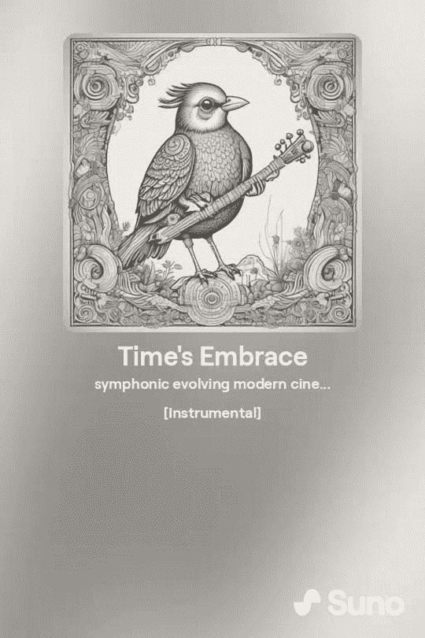

[Time's Embrace.mp4](https://internal-api-drive-stream.feishu.cn/space/api/box/stream/download/all/TVYqbdkJcoqiFZxfL7acH7Ohnve)

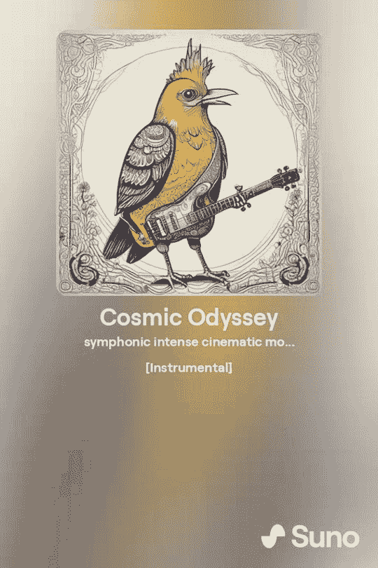

[Cosmic Odyssey.mp4](https://internal-api-drive-stream.feishu.cn/space/api/box/stream/download/all/Mg5cb44tMoFYK8xpXTDcunQEncn)

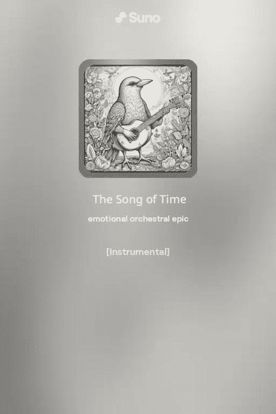

[The Song of Time.mp4](https://internal-api-drive-stream.feishu.cn/space/api/box/stream/download/all/LVIObdgzRoujo5xO03lcWsDbnUh)

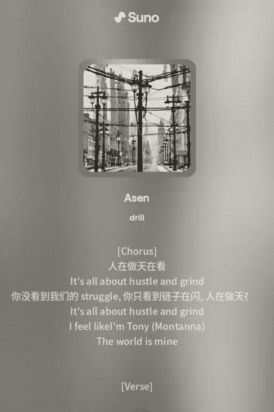

[Asen (3).mp4](https://internal-api-drive-stream.feishu.cn/space/api/box/stream/download/all/FTzlbI5qKo5HgexrTJ5cjTwSnqb)

**来都来了，点个赞再走吧～**

---

©️WaytoAGI

---