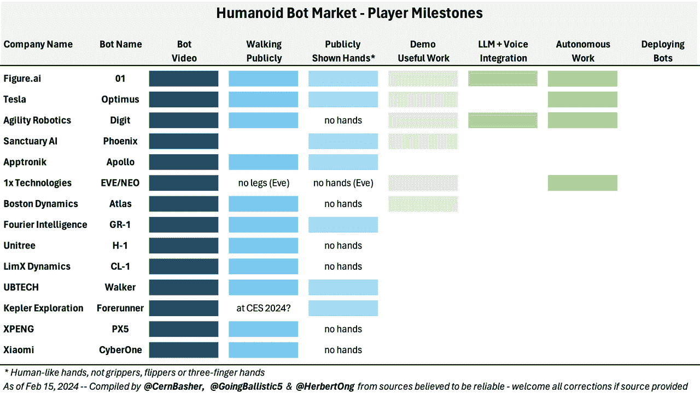
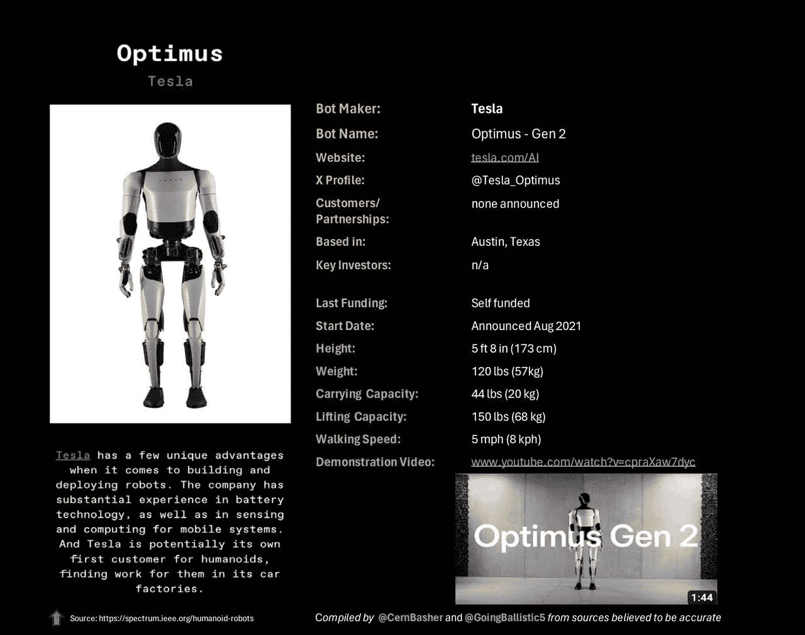
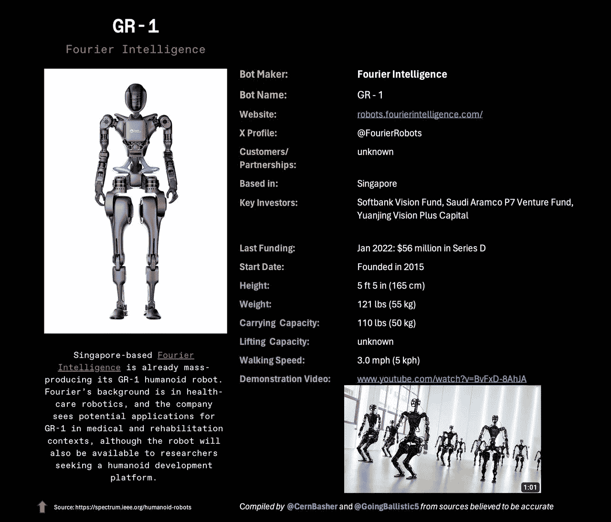
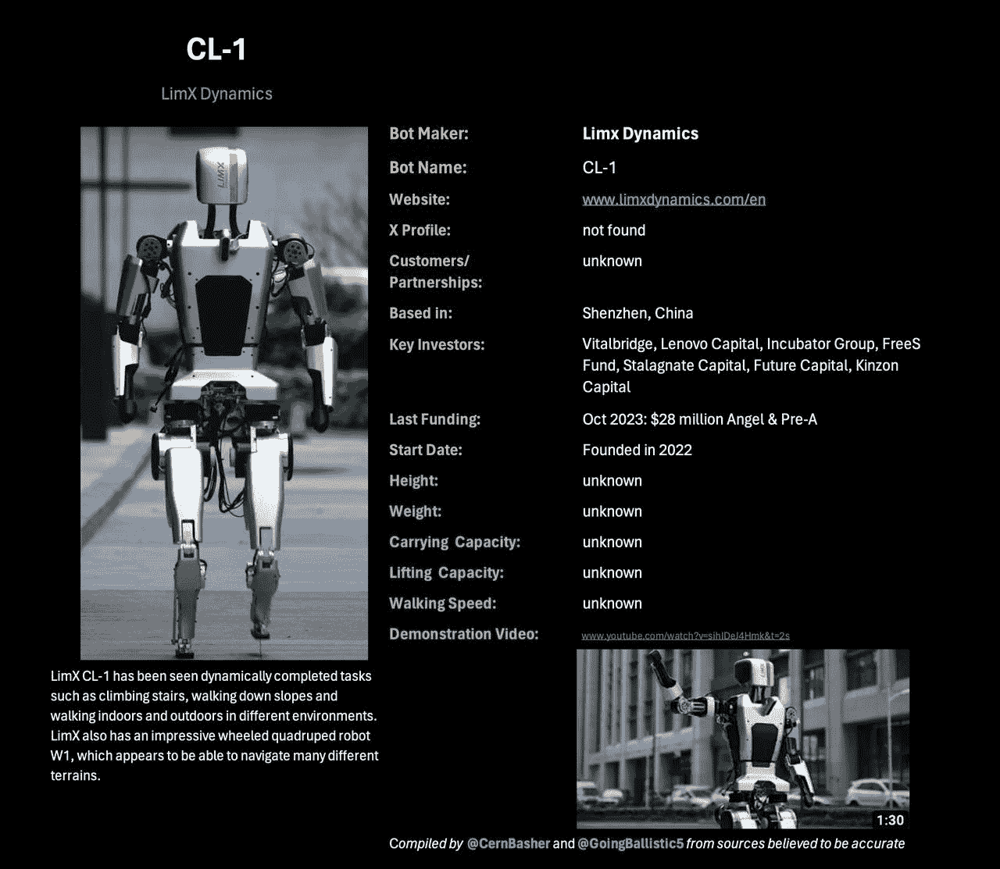
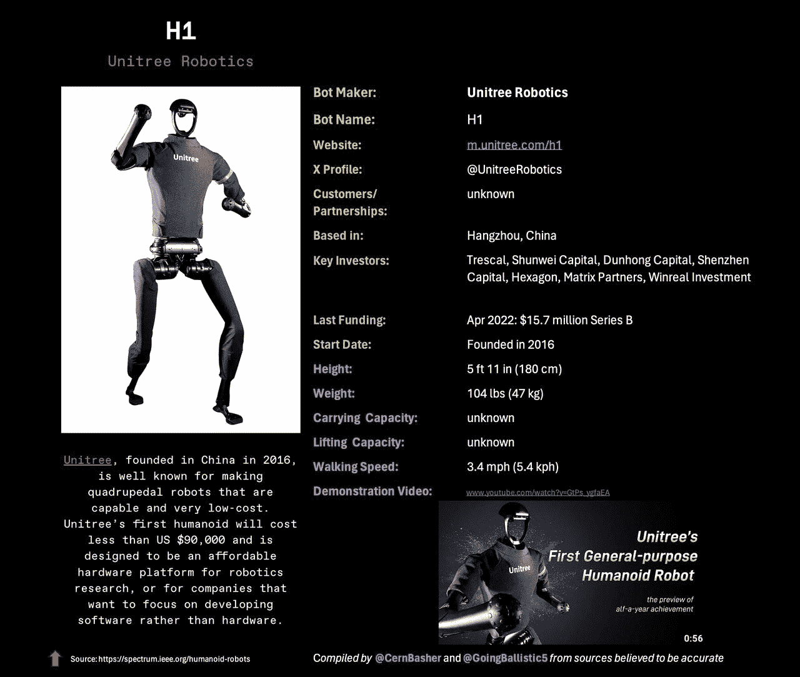
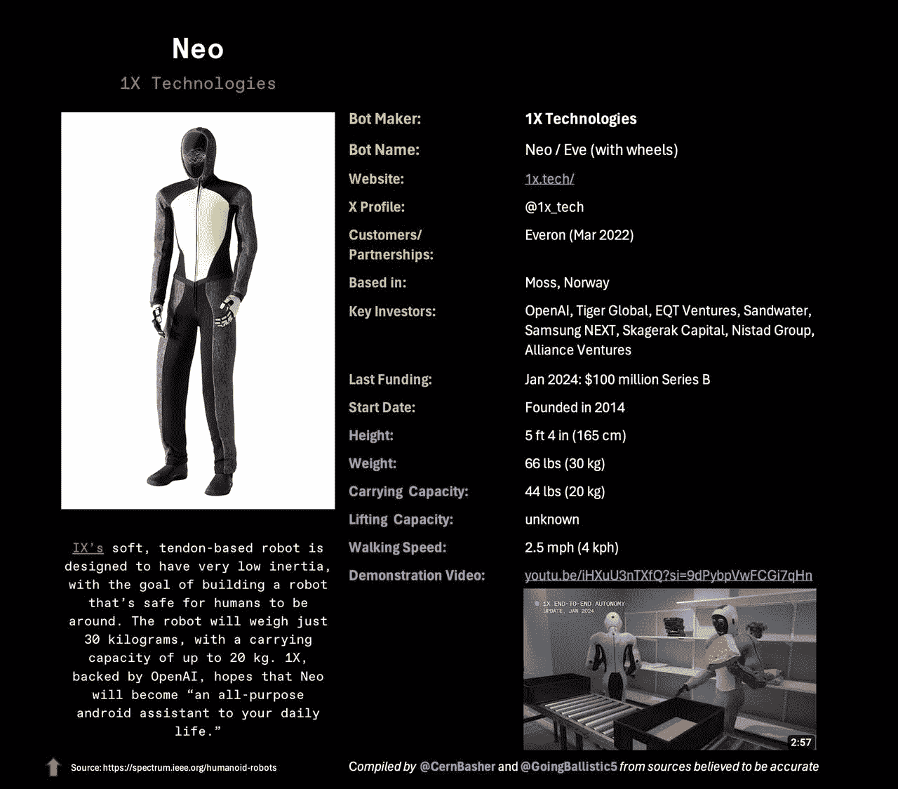
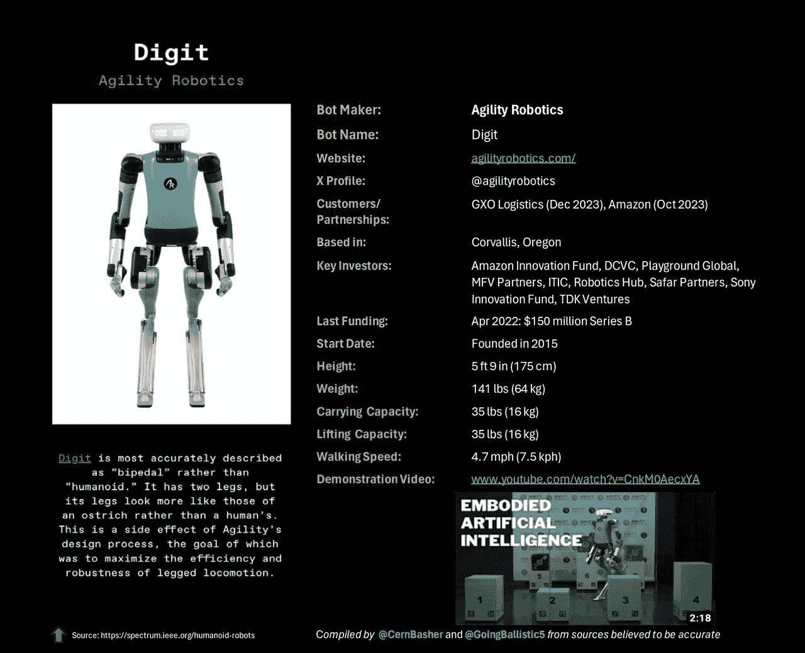
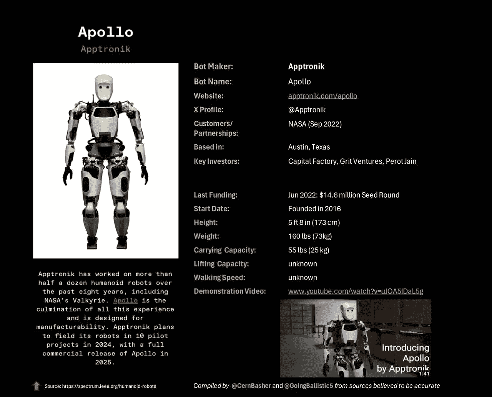
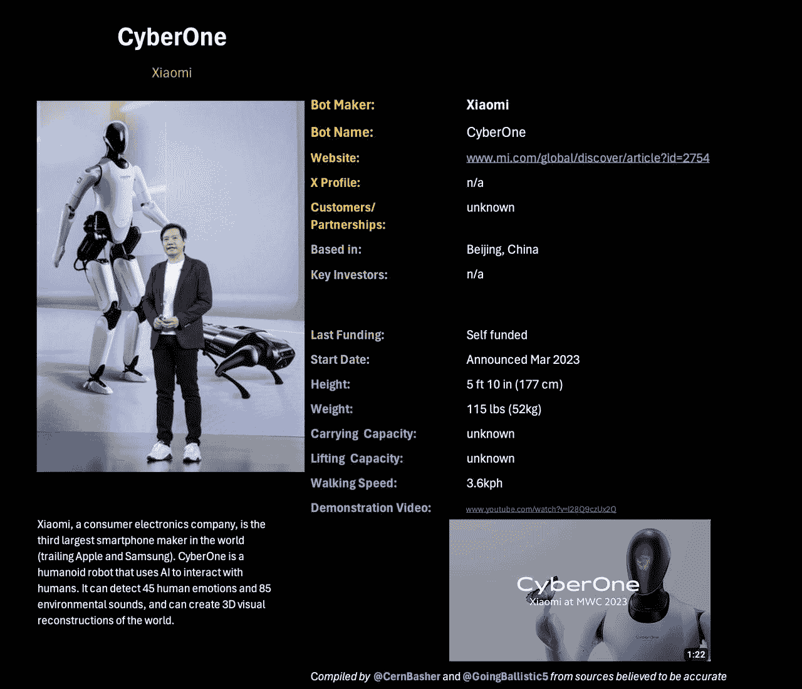

# 3.4 硬件：具身智能与AI硬件

> 来源：[https://waytoagi.feishu.cn/docx/KtWeddl5qoWFBVxji8ScIWhEnWC](https://waytoagi.feishu.cn/docx/KtWeddl5qoWFBVxji8ScIWhEnWC)

原博文：[h](https://x.com/CernBasher/status/1758275183985451059?s=20)ttps://x.com/CernBasher/status/1758275183985451059?s=20

1.  Figure

我们还没有对名单上的公司进行排名，所以如果你最喜欢的人形机器人没有排在第一位，请不要沮丧。

注意：还有许多其他里程碑和指标需要考虑-随着时间的推移，我们将在此列表中添加更多。

1.  Tesla

似乎在机器人商业化的努力中处于领先地位--宣布与宝马达成协议

1.  Sanctuary

由于其机器人和特斯拉的制造能力取得了快速进展，许多人认为特斯拉处于领先地位-但它仍然处于早期阶段。

4)名单上有7家公司是中国公司。

5)到目前为止，中国的机器人公司一直专注于走路（和踢他们的机器人！）

- 这有点奇怪，因为步行并不是机器人做有用工作的关键。也就是说，我们希望看到中国机器人的能力迅速进步

