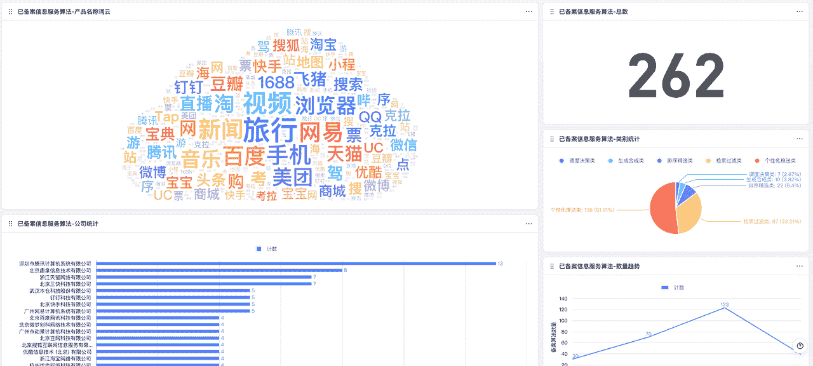
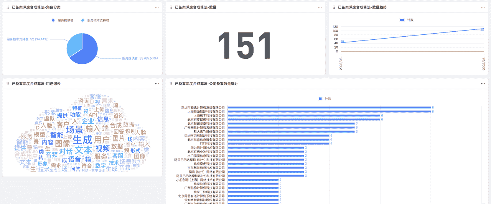

# 4.2 法规：全球AI法规手册

> 来源：[https://waytoagi.feishu.cn/docx/INL8dFgYNoQ7Q2xntPvcRJfFny6](https://waytoagi.feishu.cn/docx/INL8dFgYNoQ7Q2xntPvcRJfFny6)

# 🎯  定位

> 汇聚全球AI法规的知识库，帮助AI从业者理解、遵循各国的AI法律规定。

> 此板块来源：[Yuanx_全球AI法规手册](https://yuanx-ai.feishu.cn/wiki/Sb4twD8Utiqvdkk5hzscb6ODnNf)

# ⭐️  项目维护

JackChen

小红书：[@YuanxAI](https://www.xiaohongshu.com/user/profile/5a1bdc1e4eacab4aa39ea6d6?xhsshare=CopyLink&appuid=5a1bdc1e4eacab4aa39ea6d6&apptime=1699862705)

人工智能法律专家

杨志磊律师 微信：wudingmojie

# 🧭导航

> 内容如有遗漏，欢迎指正，请多多批评。如果你有想补充的内容或转载，请联系我，感谢。

> 本知识库内容不构成任何法律建议，仅供学习交流，请勿他用。

## 法律规定

### 中国大陆

+   **互联网信息服务算法**

[【法律规定】互联网信息服务算法推荐管理规定](https://waytoagi.feishu.cn/wiki/JmOmwJm1DiPT2ZkewiPcVs8pn3u)

[【官方解读】《互联网信息服务算法推荐管理规定》答记者问](https://waytoagi.feishu.cn/wiki/RzPEwWKoYiv3kmkcEImcaf58nKb)

[【前置通知】关于加强互联网信息服务算法综合治理的指导意见](https://waytoagi.feishu.cn/wiki/I2sQwKxETiuVr0kOvhvcSrb6n9b)

+   **深度合成算法**

[【法律规定】互联网信息服务深度合成管理规定](https://waytoagi.feishu.cn/wiki/Y1X2wWpsti2kjgkKjPWc84SEnnc)

+   **生成式人工智能服务**

[【法律规定】生成式人工智能服务管理暂行办法](https://waytoagi.feishu.cn/wiki/WDi5wfQ9JiWQkbkREkJcmu7Rnvh)

[【官方解读】《生成式人工智能服务管理暂行办法》答记者问](https://waytoagi.feishu.cn/wiki/GQyXw87taiERZpkDlgTcNTcInGc)

[【国家标准】《生成式人工智能服务安全基本要求 》（征求意见稿）发布日期：2023/10/11.pdf](https://waytoagi.feishu.cn/wiki/MBHAwQZTJitfcokGUcKclHFsnRg)

[【国家标准】生成式人工智能服务内容标识方法.pdf](https://waytoagi.feishu.cn/wiki/GcIKwg2VWi64rIkW1ujcTFFmnpd?from=from_copylink)

+   **科学伦理审查办法**

[【法律规定】科技伦理审查办法（试行）（征求意见稿）.docx](https://waytoagi.feishu.cn/wiki/Prg7wVabniD9sjkPhjlc2XEJnef)

+   国家人工智能产业综合化标准体系建设指南

[国家人工智能产业综合标准化体系建设指南.pdf](https://waytoagi.feishu.cn/wiki/FZkLwlBzeipZc5kZ0a4c3vy4nOc)

### 美国

[《生成人工智能网络安全法案》（GAINS Act）.pdf](https://yuanx-ai.feishu.cn/wiki/IRLfwH5AJi7VVNkbYZDcLiLnnMh?from=from_copylink)

[【法律法规】《2020年国家人工智能倡议法案》.pdf](https://yuanx-ai.feishu.cn/wiki/ZgxwwNagMiwzkskuxlocUD37ndf?from=from_copylink)

[《人工智能权利法案蓝图》](https://srvqdezmee.feishu.cn/wiki/QyLPwuHg0iOgwAkzI45cvB2XnMb)

[拜登签署的AI行政命令_2023.10.30](https://yuanx-ai.feishu.cn/wiki/FYAuwlKXtiEJ2ukIfOTcC4evndg?from=from_copylink)

[美国 AI 监管动态.pdf](https://srvqdezmee.feishu.cn/wiki/XOYywPplii87APkEi0JccFxonab)

### 欧盟

[AI ACT 中译本.pdf](https://waytoagi.feishu.cn/wiki/LiGuwvAoViz3NDk1pnPc1qsBnwd)

[【法律法规】《人工智能法案》2023.06.pdf](https://waytoagi.feishu.cn/wiki/VD51whdBnirpWSkpXPCceJ0Wnig)

[【官方解读】欧盟《人工智能法案》](https://waytoagi.feishu.cn/wiki/WCxJwAYljiwClDkQrOPcOb2onKh)

[【非官方解读】全球人工智能治理大变局之欧盟人工智能治理 监管框架评述及启示](https://waytoagi.feishu.cn/wiki/HycowiIMaiWrTfkay8ycHpZanqh)

[【立法提案】《欧盟人工智能责任指令》.pdf](https://waytoagi.feishu.cn/wiki/TJkMwif9Wib5QZkRh8lcYXSEnNe)

+   **数据法规**

[【法律法规】欧盟GDPR原文.pdf](https://waytoagi.feishu.cn/wiki/BQLiwcivGiw5zVka4xeccRNRnng)

[【合规指引】欧盟GDPR合规指引.pdf](https://waytoagi.feishu.cn/wiki/PY3ywjsuTiyKpAkYRT9cqggUn5d)

[【中文版】GDPR 通用数据保护条例-中文版全文-网络安全-中存储网](https://waytoagi.feishu.cn/wiki/MC2Rw5GyQivJ4WkoxObcvigln1M)

[【法律法规】欧盟数据治理法案-英文版.pdf](https://waytoagi.feishu.cn/wiki/Szlhw6OmXijn5Ukjp0yc3GVKn9M)

[【立法提案】欧盟数据法案-英文版.pdf](https://waytoagi.feishu.cn/wiki/F6MJw1aOPis7OZkZuyfcf07GnHd)

### 英国

[【法律法规】《促进创新的人工智能监管方法》.pdf](https://srvqdezmee.feishu.cn/wiki/PUQgwx4faiyQaUkg0EKcRGs9ntc)

[【译文】《促进创新的人工智能监管方法》白皮书](https://srvqdezmee.feishu.cn/wiki/S0LewdPsdiU7xrkmhZaczh1lnyd)

## 法规解读

### 中国大陆

[【官方解读】《互联网信息服务算法推荐管理规定》答记者问](https://srvqdezmee.feishu.cn/wiki/VO4ZwkDEvihV8WklXkNcIgpsn8m)

[【官方解读】《互联网信息服务深度合成管理规定》答记者问](https://srvqdezmee.feishu.cn/wiki/YZslwKHN2iynP2kYKtpc4qyPngf)

### 欧盟

[【官方解读】欧盟《人工智能法案》](https://srvqdezmee.feishu.cn/wiki/TdhvwwAmoiviNKkwViMc6wjRnub)

[【非官方解读】全球人工智能治理大变局之欧盟人工智能治理 监管框架评述及启示](https://srvqdezmee.feishu.cn/wiki/HyX9wktmhi31Mrk2So4chLibnXe)

[【中文版】GDPR 通用数据保护条例-中文版全文-网络安全-中存储网](https://yuanx-ai.feishu.cn/wiki/CZFVwhh70iGwLzkKXBBcqjiUnsh?from=from_copylink)

[【合规指引】欧盟GDPR合规指引.pdf](https://yuanx-ai.feishu.cn/wiki/NqsMwiUyiixGBokagpvcvyC0n0b?from=from_copylink)

## 备案指南

### 中国大陆

[【备案指南】互联网信息服务算法备案系统使用手册.pdf](https://srvqdezmee.feishu.cn/wiki/Gcd7wJnheib0WGkFHvIcBTRYnjc)

[【备案指南】《互联网信息服务深度合成管理规定》备案填报指南.pdf](https://srvqdezmee.feishu.cn/wiki/HHwRwc7VkiJytEk1BtBcUVYBnjh)

## 备案统计

### 中国大陆

[【备案统计】已备案信息服务算法统计](https://srvqdezmee.feishu.cn/wiki/FwjcwfDv2ivgANk9wMJcDVz2nee) 【已更新至2024.02最新数据】

[【备案统计】已备案深度合成算法统计](https://srvqdezmee.feishu.cn/wiki/XBxqwTg1kiADpOkP8BBcyJ9Vnxg) 【已更新至2024.02最新数据】

#