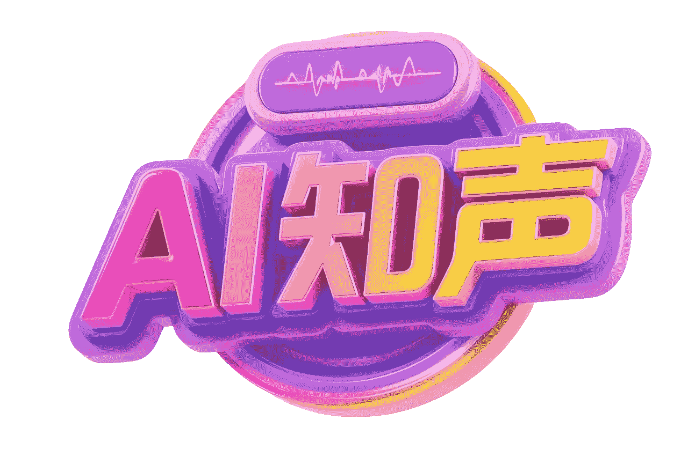

# 4.6 社区孵化栏目

> 来源：[https://waytoagi.feishu.cn/docx/C2LadA6Mpo5GWzxd3jGcBzWpnuf](https://waytoagi.feishu.cn/docx/C2LadA6Mpo5GWzxd3jGcBzWpnuf)

## 节目说明

欢迎来到**AI知声节目**！我们打算做一个专门聊AI的节目，每期都会邀请一些业内专家、从业者和爱好者，大家一起聊聊AI的热门话题、技术进展和实际应用。

不管你是技术大牛、产品经理、创业者，还是对AI感兴趣的普通人，这里都有你想要的干货。我们不仅聊技术，还聊经验、观点和灵感，帮助你更好地理解和应用AI。

在这里，你可以和我们一起探讨：

AI如何改变我们的生活和工作？

技术发展与社会责任怎么平衡？

AI项目的实战经验和案例分享。

大模型、生成式AI等前沿技术。。。。。

每期一个主题，每次不同的视角，让我们在轻松的氛围中碰撞出更多智慧的火花！

## 交流群和公众号

*加群备注“AI知声”，群满200人请加大狐微信进群

公众号

