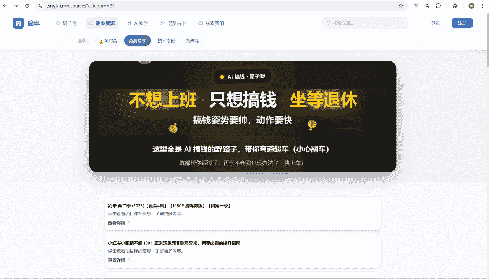
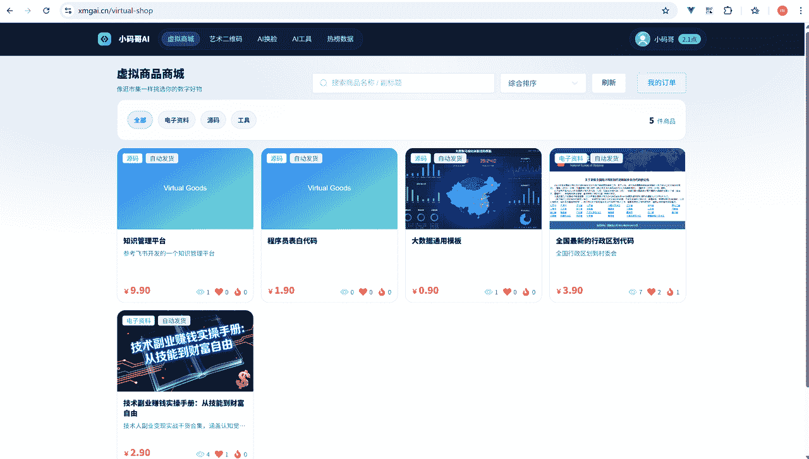
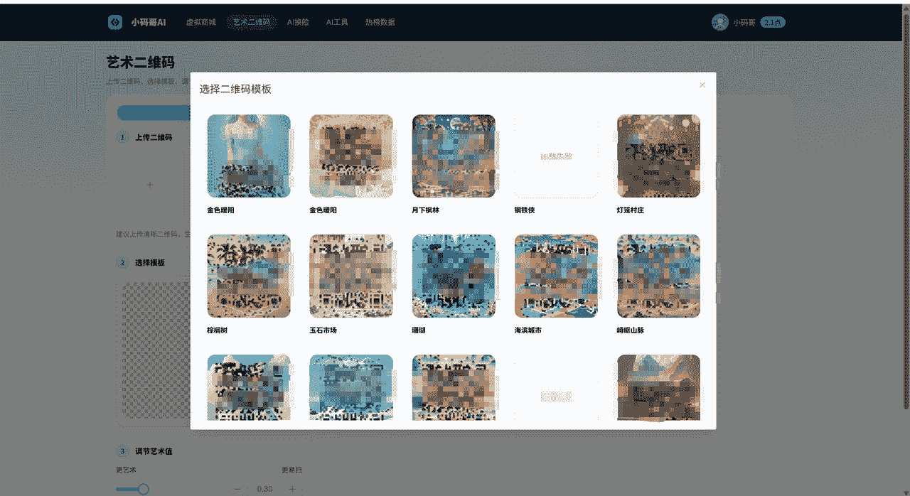
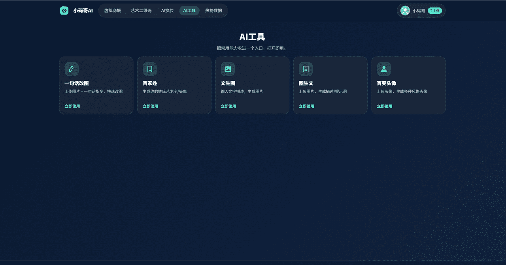
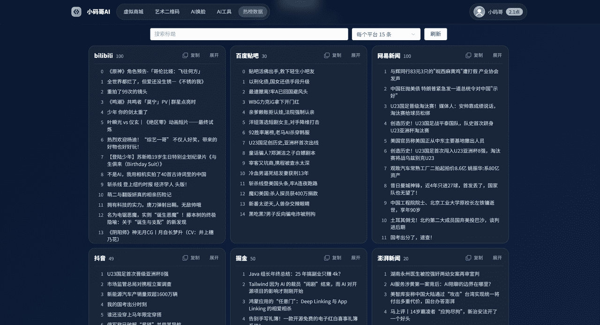
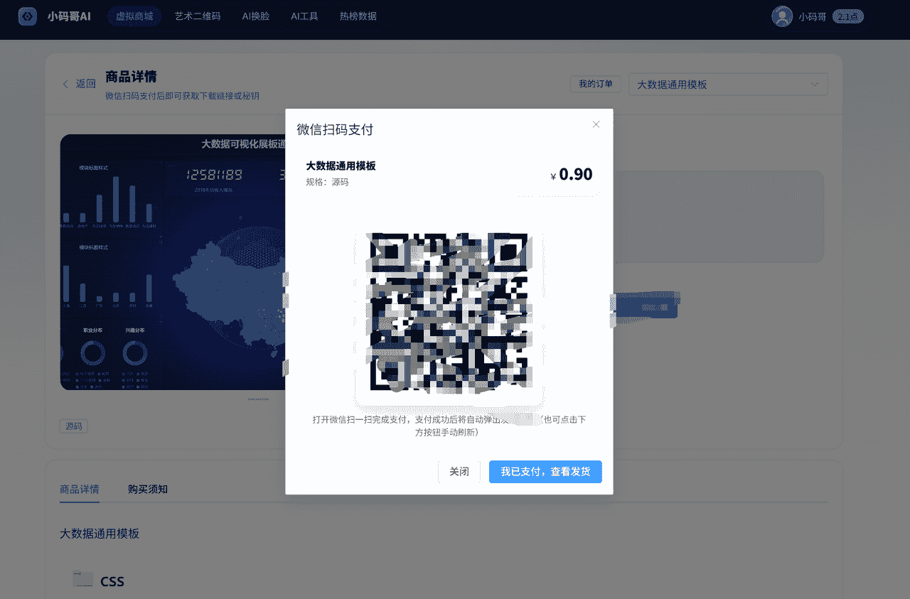
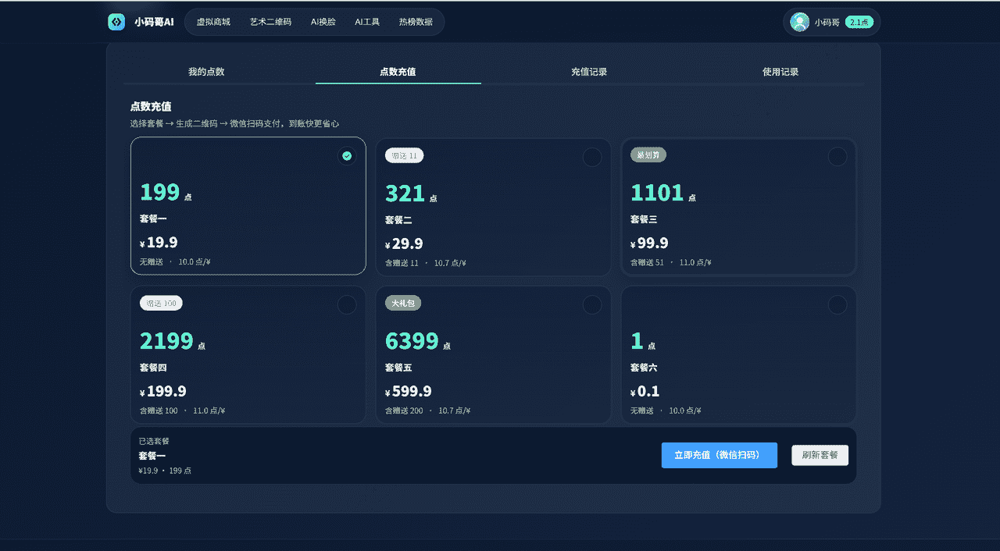
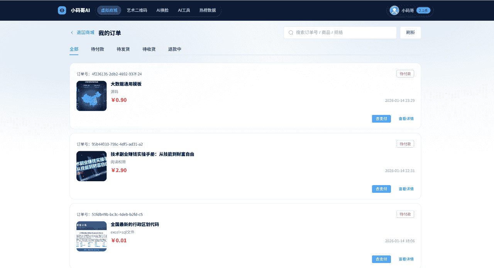
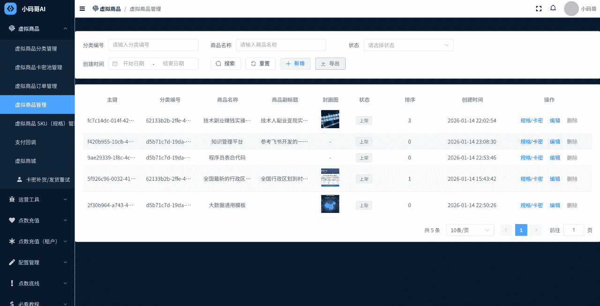
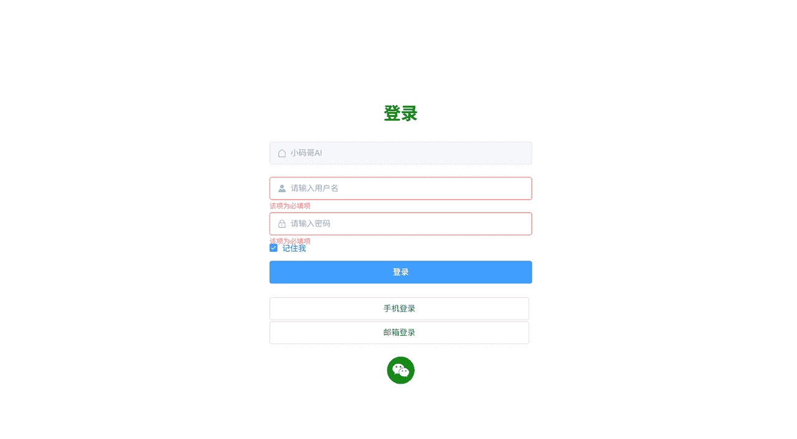

# 我用AI开发了一个虚拟商城交易平台

> 来源：[https://xmgtoagi.feishu.cn/docx/WRVxdaNIGoXRguxyvqmcHr2dnUu](https://xmgtoagi.feishu.cn/docx/WRVxdaNIGoXRguxyvqmcHr2dnUu)

上上个月，我参考飞书，用AI开发了一个知识管理平台，并且做了开源，体验地址：http://www.easyjx.cn。

项目核心功能介绍

本项目是一套集成了AI人工智能应用、虚拟商城运营及便捷支付系统的综合性平台。系统采用现代化技术栈，提供了从前端用户交互到后端精细化管理的一站式解决方案。

## 核心功能亮点

### 虚拟商城 (Virtual Mall)

提供完整的虚拟商品交易闭环，支持多种虚拟商品的上架与销售。

+   **商品管理**：支持虚拟商品的分类、规格（SKU）及详情管理。

+   **自动发货**：针对虚拟商品特性，支持自动发货或卡密发送功能。

+   **库存管理**：实时补货与库存监控，确保热门商品不缺货。

### 艺术二维码 (Artistic QR Code)

利用AI技术将普通二维码转化为极具视觉冲击力的艺术作品。

+   **一键生成**：用户只需上传普通二维码，选择心仪的艺术模板，即可一键生成。

+   **个性化定制**：提供多种风格模板，满足不同场景的营销与推广需求。

+   **创作记录**：自动保存用户的创作历史，方便随时查看与下载。

### AI换脸与头像生成 (AI Face Swap)

基于先进的AI图像处理技术，提供趣味性的换脸与形象定制服务。

+   **简单操作**：上传个人照片，选择目标风格或模板，AI自动完成融合处理。

+   **多样化风格**：支持多种热门风格与场景，生成独一无二的个性化图片。

### 个人🛰️支付到账 (Personal WeChat Payment)

**独家特色功能**，解决了个人开发者收款难的问题。

+   **无需营业执照**：支持非企业、非个体工商户的个人🛰️直接收款。

+   **资金直达**：用户支付后，资金直接进入个人🛰️账户，安全快捷。

+   **🛰️扫码支付**：完美集成🛰️扫码支付体验，流畅无感。

### 点数充值系统 (Point Recharge)

灵活的积分/点数消费体系，促进用户留存与转化。

+   **多梯度套餐**：支持设置不同金额的充值套餐（如19.9元、29.9元等）。

+   **充值赠送**：支持配置“买赠”策略（如充值送点数），提高用户付费意愿。

+   **实时到账**：支付成功后点数实时到账，立即用于AI功能或商品购买。

### 订单管理 (Order Management)

全方位的订单追踪与管理系统。

+   **订单全生命周期**：覆盖下单、支付、发货、完成等全流程状态监控。

+   **多种订单类型**：统一管理虚拟商品订单与点数充值订单。

+   **数据查询**：支持按时间、用户、状态等多维度查询订单详情。

### 后端管理 (Backend Management)

强大的后台管理系统，赋予管理员完全的掌控力。

+   **用户管理**：查看与管理用户信息、点数余额及消费记录。

+   **配置中心**：可视化配置支付参数、AI模型参数及商城运营规则。

+   **数据看板**：实时掌握平台运营数据，辅助决策。

## 登录方式

为满足不同用户群体的需求，系统提供便捷且安全的登录方式：

+   **🛰️扫码登录**：无需输入账号密码，🛰️扫一扫即可快速登录，通过关注👸号自动注册，不仅降低了注册门槛，还能有效沉淀私域流量。

+   **邮箱登录**：支持传统的邮箱账号注册与登录，满足习惯使用邮箱的用户需求。

# 功能很多

就不一一介绍了，欢迎一起交流学习AI编程，当然，如果你有需求，欢迎一起探索，免费提供技术支持！

