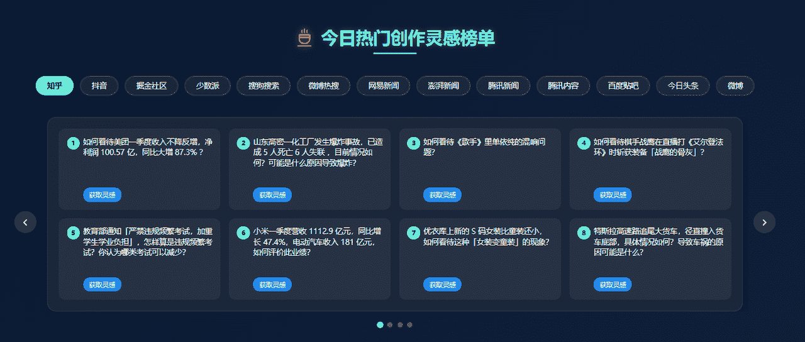
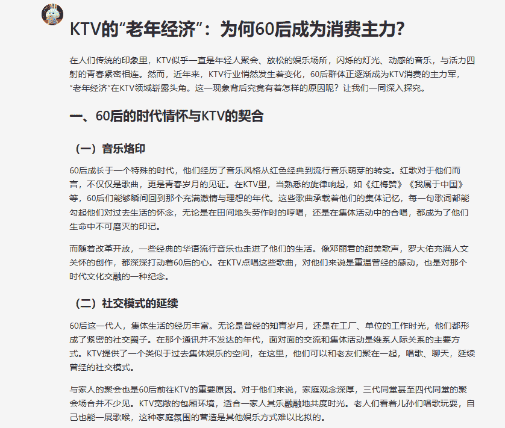
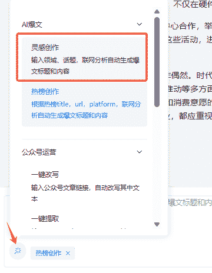
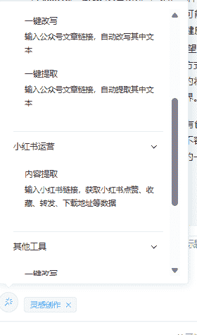
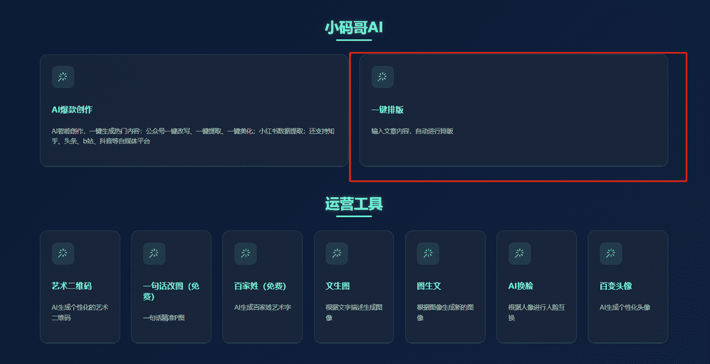
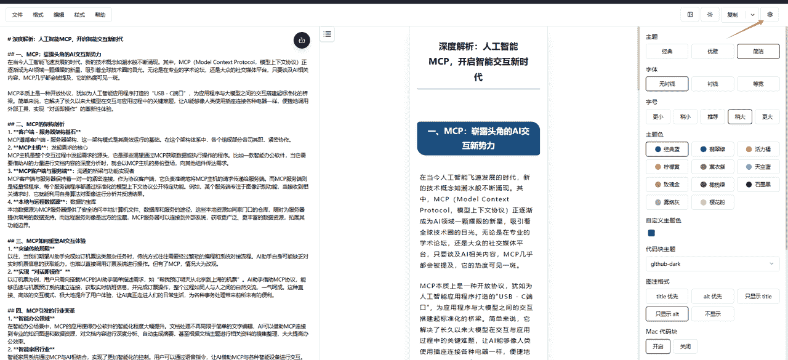
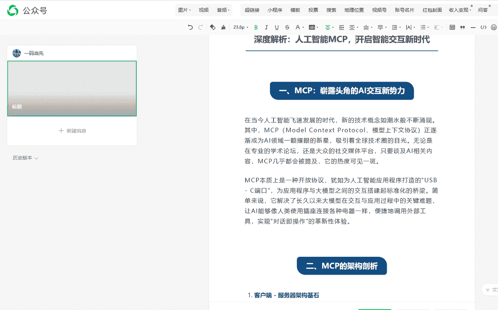
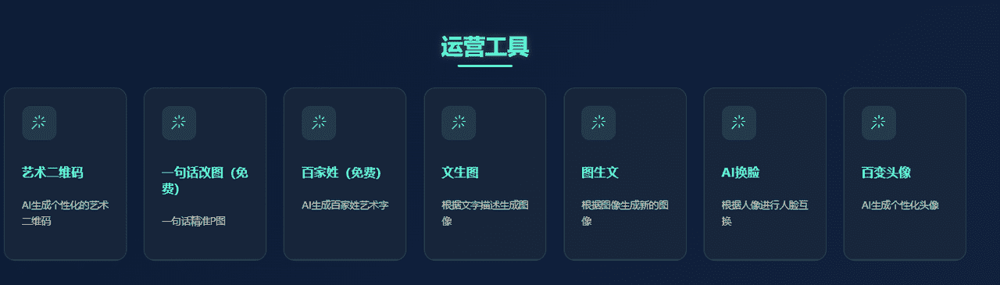

# 实时热榜，一键生成爆款内容

> 来源：[https://xmgtoagi.feishu.cn/docx/TByEdL5eZoG5OWxiGPocRl1Inee](https://xmgtoagi.feishu.cn/docx/TByEdL5eZoG5OWxiGPocRl1Inee)

很多做自媒人，越到后期，都会遇到瓶颈，连续发布作品几个月就坚持不下去了，遇到了瓶颈，很多用原因不是自己不想发作品，而是灵感枯竭，不知道发什么内容，再加上随便发内容，又没有流量，索性不发了。

小码哥断更很久了，不是坚持不下去，而是开发AI项目去了，我想解决很多自媒体人遇到的问题，灵感枯竭，通过AI技术，帮助自媒体人找到灵感，一键成文，根据自己的需求进行简单修改。即可发布作品。这个功能免费免费免费。

# 一键爆款

经过长时间的打磨，我升级了小码哥AI，先来看看这次主要升级的地方，根据实时热榜讯息，借助AI大模型推理能力，可以根据自己喜欢的热榜获取创作灵感，比之前更加直观了。

**使用地址：****www.xmgai.cn**

点击获取灵感，即可获取创作灵感，这个过程需要1-2分钟，因为要联网分析（后续优化），争取在10s内完成。

我们选中：创作灵感《KTV现在只能靠老年人"续命"》为标题，进行灵感获取，可以看到生成了四个热榜标题

点击一键创作，此时就开始自动创作了

这是原文：

# KTV的“老年经济”：为何60后成为消费主力？

>

> 在人们传统的印象里，KTV似乎一直是年轻人聚会、放松的娱乐场所，闪烁的灯光、动感的音乐，与活力四射的青春紧密相连。然而，近年来，KTV行业悄然发生着变化，60后群体正逐渐成为KTV消费的主力军，“老年经济”在KTV领域崭露头角。这一现象背后究竟有着怎样的原因呢？让我们一同深入探究。

>

## 一、60后的时代情怀与KTV的契合

### （一）音乐烙印

> 60后成长于一个特殊的时代，他们经历了音乐风格从红色经典到流行音乐萌芽的转变。红歌对于他们而言，不仅仅是歌曲，更是青春岁月的见证。在KTV里，当熟悉的旋律响起，如《红梅赞》《我属于中国》等，60后们能够瞬间回到那个充满激情与理想的年代。这些歌曲承载着他们的集体记忆，每一句歌词都能勾起他们对过去生活的怀念，无论是在田间地头劳作时的哼唱，还是在集体活动中的合唱，都成为了他们生命中不可磨灭的印记。

>

> 而随着改革开放，一些经典的华语流行音乐也走进了他们的生活。像邓丽君的甜美歌声，罗大佑充满人文关怀的创作，都深深打动着60后的心。在KTV点唱这些歌曲，对他们来说是重温曾经的感动，也是对那个时代文化交融的一种纪念。

>

### （二）社交模式的延续

> 60后这一代人，集体生活的经历丰富。无论是曾经的知青岁月，还是在工厂、单位的工作时光，他们都形成了紧密的社交圈子。在那个通讯并不发达的年代，面对面的交流和集体活动是维系人际关系的主要方式。KTV提供了一个类似于过去集体娱乐的空间，在这里，他们可以和老友们聚在一起，唱歌、聊天，延续曾经的社交模式。

>

> 与家人的聚会也是60后前往KTV的重要原因。对于他们来说，家庭观念深厚，三代同堂甚至四代同堂的聚会场合并不少见。KTV宽敞的包厢环境，适合一家人其乐融融地共度时光。老人们看着儿孙们唱歌玩耍，自己也能一展歌喉，这种家庭氛围的营造是其他娱乐方式难以比拟的。

>

## 二、60后的经济与时间优势

### （一）经济基础的支撑

> 经过几十年的奋斗，60后大多已经积累了一定的财富。他们中的许多人已经退休，有着稳定的退休金收入，而且子女也大多已经成年独立，经济负担相对减轻。这使得他们在消费上有了更多的可支配资金。

>

> 相比年轻人可能面临的房贷、车贷以及育儿压力，60后在经济上更为宽裕。他们无需为基本的生活保障过度担忧，从而有能力将一部分资金投入到娱乐消费中。对于他们来说，偶尔去KTV消费一次，并不会对生活造成经济压力，反而能够带来身心的愉悦，是一种性价比颇高的娱乐方式。

>

### （二）充裕的时间资源

> 退休后的60后拥有大量的闲暇时间。告别了忙碌的工作，他们有更多的时间去安排自己的生活。而KTV营业时间较为灵活，无论是白天还是晚上，都能满足他们的娱乐需求。

>

> 白天时段，KTV通常会推出较为优惠的套餐，这对于注重性价比的60后来说极具吸引力。他们可以在不影响家人休息和日常事务的情况下，约上三五好友，在白天前往KTV欢唱几个小时。这种灵活的时间安排，使得KTV成为了他们打发闲暇时光的理想选择。

>

## 三、KTV针对老年群体的策略调整

### （一）服务优化

> 为了吸引60后消费者，许多KTV在服务上进行了针对性的优化。考虑到老年人的身体状况，一些KTV在包厢内配备了更舒适的沙发，保证长时间久坐也不会感到不适。同时，在灯光设计上，不再一味追求强烈的闪烁效果，而是采用更为柔和、温馨的灯光，既营造出良好的氛围，又不会对老年人的眼睛造成刺激。

>

> 在服务人员培训方面，也更加注重与老年消费者的沟通技巧。服务人员会更加耐心地为老年人介绍点歌系统的使用方法，帮助他们解决在消费过程中遇到的问题。一些KTV还提供特殊的服务，如为老年人准备热水、提供简单的急救药品等，让60后消费者感受到贴心的关怀。

>

### （二）歌曲库更新

> KTV意识到60后对特定歌曲的需求，纷纷对歌曲库进行更新。除了保留经典的老歌外，还不断挖掘一些年代久远但具有代表性的小众歌曲。同时，为了满足60后对新潮流的追赶心理，也会适当添加一些当下流行的、旋律简单易唱的歌曲，让他们在KTV既能回味经典，又能体验新鲜。

>

> 此外，一些KTV还引入了戏曲类曲目。60后中有不少戏曲爱好者，京剧、越剧、黄梅戏等传统戏曲在KTV中也能点唱，进一步丰富了他们的娱乐选择，让他们在KTV中也能过一把“戏曲瘾”。

>

## 四、60后自身的消费观念转变

### （一）追求自我满足

> 随着社会的发展，60后的消费观念也在逐渐转变。他们不再像过去那样，将大部分的精力和金钱都投入到子女和家庭中，而是开始更加关注自身的需求和感受。去KTV唱歌，对他们来说是一种自我放松和满足的方式。

>

> 在KTV里，他们可以尽情地展示自己的歌喉，释放退休后的生活压力，享受属于自己的时光。这种对自我满足的追求，使得60后愿意走出家门，走进KTV，寻找属于自己的快乐。

>

### （二）注重健康与社交的双重需求

> 60后逐渐意识到健康生活的重要性，而KTV的娱乐方式在一定程度上能够满足他们对健康和社交的双重需求。唱歌本身就是一种有益于身心健康的活动，它可以锻炼心肺功能，增强呼吸肌的力量。同时，在KTV与朋友相聚，能够保持良好的社交互动，避免退休后可能出现的孤独感。

>

> 这种将健康与社交相结合的消费观念，促使60后将KTV作为日常娱乐的重要场所。他们通过在KTV的活动，既提升了自己的生活质量，又维护了良好的人际关系。

>

## 五、市场竞争与60后消费潜力的挖掘

### （一）娱乐市场的多元化竞争

> 如今的娱乐市场日益多元化，年轻人有更多的娱乐选择，如电竞、密室逃脱、剧本杀等新兴娱乐方式，这使得KTV在年轻群体中的市场份额受到一定冲击。相比之下，60后可选择的娱乐项目相对有限。传统的公园散步、下棋等活动虽然也能带来乐趣，但KTV提供了一种更具活力和互动性的娱乐体验。

>

> KTV商家敏锐地察觉到了这一市场变化，将目光投向60后群体，加大对老年市场的开发力度，通过各种营销策略和服务升级，吸引60后成为消费主力，以应对市场竞争的挑战。

>

### （二）60后消费潜力的深度挖掘

> 60后群体庞大，其消费潜力不容小觑。随着老龄化社会的到来，这一群体的规模还在不断扩大。KTV商家通过深入了解60后的消费需求和喜好，不仅在硬件设施和服务上进行改进，还在营销推广方面下功夫。

>

> 例如，一些KTV会与社区、老年活动中心合作，举办针对60后的歌唱比赛、主题派对等活动，提高品牌在老年群体中的知名度和影响力。通过这些活动，进一步挖掘60后的消费潜力，推动KTV“老年经济”的持续发展。

>

> 综上所述，60后成为KTV消费主力并非偶然。时代情怀的纽带、经济与时间的优势、KTV自身的策略调整、60后消费观念的转变以及市场竞争的推动等多方面因素共同作用，使得KTV的“老年经济”呈现出蓬勃发展的态势。未来，随着60后群体消费能力和消费意愿的进一步提升，KTV的“老年经济”有望迎来更广阔的发展空间。无论是KTV行业还是其他相关产业，都应重视这一市场变化，不断创新和优化，以满足60后日益多样化的消费需求。

当然，你可以要求进行对话，根据你自己的要求进行修改完善。

# 灵感创作

另外一个功能就是，输入自己感兴趣的领域、话题，会自动联网分析，生成爆款标题和内容。

比如我们选中灵感创作，输入：人工智能mcp为题，创作爆款文章。

以下是输出的内容：

# 深度解析：人工智能MCP，开启智能交互新时代

>

## 一、MCP：崭露头角的AI交互新势力

> 在当今人工智能飞速发展的时代，新的技术概念如潮水般不断涌现。其中，MCP（Model Context Protocol，模型上下文协议）正逐渐成为AI领域一颗耀眼的新星，吸引着全球技术圈的目光。无论是在专业的学术论坛，还是大众的社交媒体平台，只要谈及AI相关内容，MCP几乎都会被提及，它的热度可见一斑。

>

> MCP本质上是一种开放协议，犹如为人工智能应用程序打造的“USB - C端口”，为应用程序与大模型之间的交互搭建起标准化的桥梁。简单来说，它解决了长久以来大模型在交互与应用过程中的关键难题，让AI能够像人类使用插座连接各种电器一样，便捷地调用外部工具，实现“对话即操作”的革新性体验。

>

## 二、MCP的架构剖析

1.  **客户端 - 服务器架构基石**

> MCP遵循客户端 - 服务器架构，这一架构模式是其高效运行的基础。在这个架构体系中，各个组成部分各司其职，紧密协作。

1.  **MCP主机**：发起需求的核心

> MCP主机是整个交互过程中发起需求的源头，它是那些渴望通过MCP获取数据或执行操作的程序。比如一款智能办公软件，当它需要借助AI的力量进行文档内容的深度分析时，就会以MCP主机的身份登场，向其他组件传达需求。

1.  **MCP客户端与服务端**：沟通的桥梁与功能实现者

> MCP客户端与服务器保持着一对一的紧密连接，作为协议客户端，它负责准确地将MCP主机的请求传递给服务端。而MCP服务端则是轻量级程序，每个服务端程序都通过标准化的模型上下文协议公开特定功能。例如，某个服务端专注于图像识别功能，当接收到相关请求时，它就能利用自身算法对图像进行分析并反馈结果。

1.  **本地与远程数据源**：数据的宝库

> 本地数据源为MCP服务器提供了安全访问本地计算机文件、数据库和服务的途径，这些本地资源如同家门口的仓库，随时为服务器提供常用的数据支持。而远程服务则像是远方的宝藏，MCP服务器可以连接到外部系统，获取更广泛、更丰富的数据资源，拓展其功能边界。

>

## 三、MCP如何重塑AI交互体验

1.  **突破传统局限**

> 以往，当我们期望AI助手完成如订机票这类复杂任务时，传统方式往往需要经过繁琐的编程和系统对接流程。AI助手自身可能缺乏对实时机票信息的获取能力，也难以直接调用订票系统进行操作。但有了MCP，情况大为改观。

1.  **实现“对话即操作”**

> 以订机票为例，用户只需向搭载MCP的AI助手简单描述需求，如“帮我预订明天从北京到上海的机票”。AI助手借助MCP协议，能够迅速与机票预订系统建立连接，获取实时航班信息，并完成订票操作，整个过程如同人与人之间的自然交流，一气呵成。这种直接、高效的交互模式，极大地提升了用户体验，让AI真正走进人们的日常生活，为各种事务处理带来前所未有的便利。

>

## 四、MCP引发的行业变革

1.  **智能办公领域**

> 在智能办公场景中，MCP的应用使得办公软件的智能化程度大幅提升。文档处理不再局限于简单的文字编辑，AI可以借助MCP连接到专业的知识图谱和数据资源，对文档内容进行深度分析、自动生成摘要，甚至根据文档主题进行相关资料的搜集整理，大大提高办公效率。

1.  **智能家居行业**

> 智能家居系统通过MCP与AI相结合，实现了更加智能化的控制。用户可以通过语音指令，让AI借助MCP与各种智能设备进行交互。例如，说一句“让客厅灯光根据电影场景自动调节亮度”，AI就能通过MCP连接灯光控制系统，根据当前播放的电影情节，精准调整灯光亮度和色彩，营造出沉浸式的观影氛围。

1.  **医疗健康领域**

> 在医疗领域，MCP也有着巨大的应用潜力。医生可以利用搭载MCP的医疗AI系统，快速连接到患者的电子病历数据库、医学影像分析系统以及最新的医学研究成果库。当诊断病情时，AI能够综合多方面信息，为医生提供更准确的诊断建议和个性化的治疗方案，助力医疗水平的提升。

>

## 五、MCP面临的挑战与未来展望

1.  **安全与隐私困境**

> 随着MCP连接的数据源和服务越来越广泛，安全与隐私问题成为亟待解决的关键挑战。如何确保在数据交互过程中，用户的个人信息不被泄露，敏感数据得到妥善保护，是MCP发展过程中必须跨越的障碍。例如，在医疗场景中，患者的病历数据涉及个人隐私，MCP需要建立严格的加密机制和访问权限管理体系，防止数据被非法获取。

1.  **标准统一难题**

> 尽管MCP本身是一种标准化协议，但在实际应用中，不同的企业和开发者可能会基于MCP进行二次开发和拓展，这就可能导致一些兼容性问题。如何进一步统一标准，确保各个组件之间能够无缝对接，是维持MCP生态健康发展的重要课题。

1.  **未来无限可能**

> 展望未来，MCP有望成为人工智能领域的通用交互标准，如同互联网协议一样，深刻改变人们与智能设备、系统的交互方式。它将进一步推动AI与各行各业的深度融合，催生更多创新的应用场景和商业模式。或许在不久的将来，我们身边的每一个智能设备都将通过MCP实现互联互通，构建一个更加智能、便捷的未来世界。

>

> 综上所述，人工智能MCP作为一项具有创新性和前瞻性的技术，虽然在发展道路上面临诸多挑战，但它所展现出的潜力和对各行业的变革力量不容忽视。随着技术的不断完善和生态的逐步成熟，MCP必将在人工智能发展的历史长河中留下浓墨重彩的一笔。

当然，你可以可以根据要求进行修改。

# AI工具

当然还有一键改写，一键提取，📕内容提取，大家可以去探索。

# 一键排版

还可以一键排版，回到首页，我们复制小码哥AI生成的内容，点击一键排版

我们将刚才的内容复制过来。会自动美化排版，点击右上角的设置按钮，你可以改变字体大小、主题样式、主题颜色。

当然，最关键的是可以一键复制到🛰️👸号，发布后保证样式不变。

# 运营工具

还有很多运营工具，在这里就不在演示了，大家感兴趣可以去使用：艺术二维码，一句话P图、AI百家姓、头像制作等。

# 意见建议

欢迎广大朋友们前来使用，提宝贵的意见建议，也欢迎一起交流，一起学习。

使用地址：www.xmgai.cn

